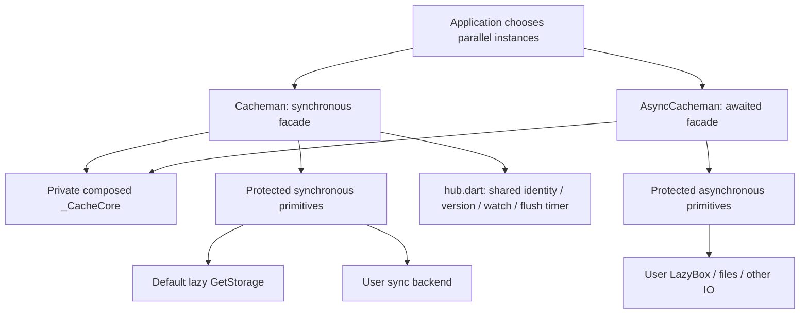

# cacheman

Flutter package, runtime dependencies only Flutter and `get_storage: ^2.1.1`.
The user owns any additional backend dependency. Read ARCHITECTURE.md and both READMEs
before public API changes; keep example/lib up to date. All new APIs/fields/methods
carry concise EN + 中文 documentation. Public contracts include usage examples.

## Architecture map



- `lib/src/cacheman.dart`: library owner and sync facade; constructor, initialization,
  primitive calls/orchestration, sync owned-key set. Defaults talk to GetStorage only
  inside primitives (container getter exposes the lazy instance for explicit interop).
- `lib/src/hub.dart`: private part; Expando keyed by hubIdentity, one listenRaw subscription,
  versioned owned-key healing, snapshot watch dispatch, earliest-deadline flush and lifecycle.
- `lib/src/core.dart`: private `_CacheCore` composed by both facades; namespace escaping,
  key mapping caches, full/logical key/owns, envelope validation, dump/load, expiry,
  renewal decision returning an optional new entity without IO, raw/batch validation,
  original-error reporting. No backend branches or IO.
- `lib/src/async_cacheman.dart`: abstract AsyncCacheman with options only, no container/path;
  awaited primitives and orchestration. No built-in backends, read-value cache or owned-key set.
- core.dart, hub.dart and async_cacheman.dart are parts of cacheman.dart, sharing a private Dart
  library scope. The package entry exports public types, never the core.
- interface.dart: Codec, CachemanOnError, immutable CacheContext and CacheOp.
- options.dart: shared CachemanOptions; deprecated CacheOptions is unused.
- entity.dart: CacheEntity value/expireAt/createdAt/ttl, default JSON serialization.
- fast.dart: FastAccessor/fast/lazy/batchFast only support synchronous Cacheman.
- debug.dart: synchronous decrypted snapshot, normal read side effects, never writes
  a snapshot back. Async variants of accessors/debug/key(index) are out of scope.
- jsonx.dart: optional extended JSON; strict two-key type tags, escapes same-shaped
  ordinary maps and supports toJson fallback. No unsolicited serializer changes.

## Invariants (do NOT break)

- **Primitives are the only backend contact points.** Both facades own semantics;
  users extend them and override primitives, not a new injected Store interface.
  Do not ship Hive/files/SharedPreferences backends or dependencies in lib.
- **Cacheman construction is synchronous; public CRUD stays synchronous.**
  ensureInitialized awaits initRaw before setting the initialization flag. Protected
  sync mutation primitives update memory before return; Future<void> only carries
  background flush failures. Never defer memory updates in a sync override.
- **GetStorage stays lazy (`late final`).** Constructor retains container/path, no
  GetStorage construction until container/default primitive access. Default initRaw
  initializes Flutter binding then awaits container.initStorage. Never call GetStorage.init:
  it constructs a pathless cached singleton. Default first access uses the supplied path;
  same-name containers still use the first actually constructed path. Because construction
  is lazy, access order determines that winner. A subclass overriding every primitive
  must construct via `super.custom(...)` and must never implicitly create the default backend.
  Explicit container access still does. Plain forwarding subclasses use the default constructor.
- **No read-value cache in either facade.** Every read calls getRaw. Only key mappings
  and the synchronous owned-key set may be cached.
- **AsyncCacheman never caches its owned-key set.** Every enumeration/length/purge/scoped
  erase calls keysRaw then filters owns. It may reuse the bounded core key mappings.
  Async initRaw defaults no-op, required hooks are getRaw/setRaw/removeRaw/keysRaw;
  clearRaw defaults to enumerating a snapshot and removing every backend key, no owns filter.
- **Sync owned-key indexes self-heal.** hubIdentity shares a Hub and one listenRaw listener.
  Synchronous notifications increment its version; _ownSet rebuilds stale snapshots.
  A fresh index tracks local writes/deletes in O(1), including retries; reentrant changes
  invalidate it. setNamespace invalidates it and migrates this instance's watchers.
  Null listenRaw or false syncNotificationsRaw means rescan on every _ownSet query.
  The default constructor (including plain forwarding subclasses) uses GetStorage identity;
  `Cacheman.custom` subclasses use this + no notifications unless explicitly opting in, so
  custom backends never implicitly open GetStorage. Never decide this by runtimeType.
- **Watch excludes own writes by default.** Mutation depth includes renewal/lazy deletion;
  clear notifies every watcher. Snapshot dispatch tolerates subscribe/cancel in callbacks.
  Read/type/callback errors use onError; onError itself still propagates. Unsupported watch
  throws UnsupportedError; asynchronous notifications may include own writes (document it).
- **Delayed flush is opt-in and sync-only.** flushDelay null preserves the default; writes
  with a delay update memory immediately and keep the earliest shared Timer deadline.
  Deletes still immediately queue a save. flush() is void; it cancels the Timer and saves.
  Register lifecycle observer only while pending, remove after flush; inactive/paused/hidden/
  detached flush. Errors go to latest delayed writer or explicit flush caller. Custom
  subclass deferred hooks fall back to setRaw/no-op. purgeOnInit false preserves behavior;
  true schedules Timer.run after init, skipping raw. AsyncCacheman ignores both options.
- **Namespace escaping is stable.** Escape `%` then `:`; namespace getter is the escaped
  prefix plus colon, not the original option. setNamespace clears both key maps together.
- **Key caches are bounded maps, not LRUs.** `_ekCache` and `_lkCache` each cap at 1024,
  clear wholesale on overflow. Successful logical decoding is memoized; null decoding
  retains the original fallback and is not memoized. enckey requires keyCodec ?? codec;
  codeable requires codec. Missing codecs warn and degrade to plaintext.
- **createdAt marks library envelopes.** Expiry/lazy deletion/purge require it so foreign
  expireAt-shaped data survives. Do not drop it during renewal. Owns filtering is based
  on namespace and successful enckey decoding, as before; it does not read every value.
- **Sliding threshold is inclusive**: `expireAt - now <= ttl * 0.9`, at least 10% elapsed.
  Above 90% remaining, no write-back. Core returns an entity copy, never mutates in place.
- **Raw only accepts String.** Other values warn and skip; no coercion. Raw bypasses
  envelope/value codec/ttl, including purge, but still applies namespace/key encoding.
- **Readonly checks presence before raw/entity branches.** A stored null value counts;
  probe does not renew/delete/report decode errors. Expired keys can be replaced.
- **Force boundaries differ intentionally.** Sync: catch synchronous serialization/codec/
  setRaw throws, purge expired, retry once; never retry background mutation Future failures.
  Async: catch serialization or awaited setRaw failure, await purge, retry once, then onError.
  Async renewal failures report and return the original read value (purge failure is caught
  too). get_storage 2.1.1 drops the actual flush Future, so onError for real disk failure is
  best-effort, never guaranteed. onError callbacks themselves are not swallowed.
- **Initialization assertions remain outside retry catches** in debug builds; release
  behavior is unchanged. A failed initRaw must not mark initialized.
- **Decode reporting preserves phase 0.** Read deletes then reports original error once;
  null value-codec decode produces FormatException. Purge/readonly load probes stay quiet;
  raw bypasses load. Other backend IO errors normally propagate.
- **Erase protects namespace OR enckey scopes.** Only with neither does erase call clearRaw
  on the whole backend, including foreign keys. Keep existing enckey-only protection in
  AsyncCacheman too; do not interpret “no namespace” as permission to drop that protection.
- **CacheContext identifies actual primitive calls.** Logical key before prefix/encoding;
  null for init/keys/clear. Namespace is the escaped prefix; CacheOp is actual read/write/
  remove/keys/clear/init, including internal renewal/deletion. Batched CRUD passes each key.
  Cross-box routing must enumerate/clear the union. Await pending async operations before
  namespace switches; no transaction/concurrent readonly/sliding guarantees are provided.
  key is resolved once on demand, including null, and retains the captured namespace;
  storageKey exposes the backend key. Preserve the const constructor. Subscription uses
  null-key init context and flush uses null-key write context (CacheOp remains unchanged).

## Verification

Execute at the package root; do not change directory:

```bash
flutter analyze
flutter test
flutter analyze example
flutter test --coverage
dart run tool/coverage.dart --min=100
dart run tool/check_acceptance.dart
```

Wait for final command results; no pnpm typecheck, no git commit. Original
`test/cacheman_test.dart` assertions stay unchanged. Real get_storage tests need a
FakePathProviderPlatform even with explicit path (IO backend queries documents first).
Windows file handles remain open; existing temp cleanup is best-effort. New tests:
`cacheman_primitives_test.dart` uses a fully overridden sync Map with a throwing container
getter; `async_cacheman_test.dart` uses a local Map, failure budgets and a persistence gate.
No test backend enters lib. The example has an independent pubspec and an interactive
parallel-cache page with its own simple AsyncCacheman Map subclass.

After verification inspect git status and git diff --stat; revert only unrelated pub-get
changes with `git checkout -- <file>`. Do not revert user changes. Both READMEs must remain
aligned, including Hive CE LazyBox, pure dart:io filename-safe storageKey mapping and
SharedPreferencesWithCache illustrations (app dependencies only). Before a separate
release task, use dart pub publish --dry-run; it is not required for this stage.
