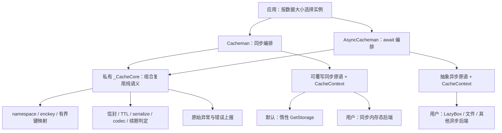

# Cacheman 架构文档

cacheman 是 Flutter 缓存语义层：默认同步 `Cacheman` 使用 get_storage；用户可继承
`Cacheman` 或抽象 `AsyncCacheman` 提供自己的底层。两者并行使用，包不自动路由、迁移数据，
不内置 Hive/文件等新后端，不新增依赖。类型由 `read<T>` / `write<T>` 指定。
入口 `lib/cacheman.dart` 导出公共 API；两个 README 包含完整用法和应用内适配示例。

## 模块与架构图



| 文件 | 职责 |
| --- | --- |
| `lib/src/cacheman.dart` | 所属 Dart library；同步 API 编排、同步自有键集合缓存、默认 get_storage 原语。 |
| `lib/src/core.dart` | 私有 `_CacheCore`，由两类分别组合持有；无 IO，统一键空间、信封、续期判定、错误处理。 |
| `lib/src/async_cacheman.dart` | 抽象异步 API 编排，必需/可选异步原语；不维护自有键集合缓存。 |
| `lib/src/interface.dart` | Codec、CachemanOnError、不可变 CacheContext 与 CacheOp。 |
| `lib/src/options.dart` | 共用 CachemanOptions；已弃用且无方法接受的 CacheOptions。 |
| `lib/src/entity.dart` | CacheEntity（value / createdAt / expireAt / ttl）及默认 JSON 序列化。 |
| `lib/src/fast.dart` | 仅同步 FastAccessor 和 fast / lazy / batchFast。 |
| `lib/src/debug.dart` | 仅同步解密快照；复用普通读取的懒删/续期副作用，不回写快照。 |
| `lib/src/jsonx.dart` | 日期、时长、集合等扩展 JSON；转义与标签形状相同的普通 Map。 |

`core.dart` 和 `async_cacheman.dart` 是 `cacheman.dart` 的 part，同一 Dart library 内
通过组合共享真正私有的 `_CacheCore`。入口导出的只有公共类；内核没有公共类型或导出入口。
同步/异步薄层仅执行原语调用和控制流，键/信封/配置校验/错误消息不重复实现。

## 初始化与原语边界

```dart
final cache = Cacheman(options: const CachemanOptions(namespace: 'small'));
await cache.ensureInitialized();
cache.write('summary', 1000, ttl: 60000);
// 用户自行实现的子类：final large = HiveCache('large');
// await large.ensureInitialized(); await large.write('report', rows);
```

`Cacheman` 构造函数仅保存 container/path/options；`late final _gs` 在访问 `container`
或默认原语时才创建 `GetStorage(container, path)`。默认初始化仍先初始化 Flutter binding，
再等待该实例的 `initStorage`，不调用 `GetStorage.init`。因此正常的构造→初始化路径仍带 path。
同名容器仍以 GetStorage 首次构造 path 为准；惰性化意味着先后由首次访问后端决定，
而非 Cacheman 对象的构造顺序。覆写所有原语的子类完全不触碰 get_storage；主动访问
`container` 仍会创建默认后端，这个 getter 只提供默认后端互操作。

**原语是唯一接触底层的地方。** 同步原语为 initRaw / getRaw / keysRaw / setRaw /
removeRaw / clearRaw；除初始化外，同步原语返回前须完成内存态更新。写删清空返回的 Future
只承载后台落盘错误，公开同步 CRUD 不等待它。`ensureInitialized` 是公开同步语义 API
唯一需等待的边界。不要给同步 mutation 原语添加延迟的内存态更新。

`AsyncCacheman({options})` 没有默认后端、container/path；必须实现异步 getRaw / setRaw /
removeRaw / keysRaw。initRaw 默认 no-op；clearRaw 默认枚举后快照逐键删除整个后端，
可覆写为原生 clear。异步读写/批量/枚举/清理/切换 namespace/storageKey 均返回 Future；
namespace getter 即时返回前缀。本阶段无异步 key(index)、快捷访问器或 debug。

CacheContext 传本次逻辑 key、转义 namespace 前缀和实际 CacheOp；初始化/枚举/整库清空
时 key 为 null。批量 CRUD 逐键传逻辑 key；续期传 write，懒删传 remove。跨 box 路由时，
用户须保证 keysRaw 枚举全部 box、clearRaw 覆盖全部路由。切换 namespace 前等待在途操作；
readonly、续期不是事务，包不提供并发隔离，也不负责用户后端的打开/关闭之外的生命周期。

## 写入与读取数据流

写入 `write(key, value, {ttl, expireAt})`：

1. 内核转义 namespace 中的 `%` / `:` 并拼接前缀，按需通过确定性的 keyCodec ?? codec 编码键。
2. readonly 静默检查存在性，不删除、不上报、不续期；信封中的 null 也算存在。
3. 普通模式生成 CacheEntity，serialize 后按 codeable 做值 codec 编码；raw 仅接受字符串，
   跳过信封、值 codec 和过期逻辑。
4. 薄层调用 setRaw。同步层只捕获同步异常；异步层 await 并捕获失败。force 清过期后重试一次，
   最终失败用 onError(storageKey, error) 或 print 上报。

读取 `read<T>(key, [defaultValue])`：

1. 每次通过 getRaw 读取后端；缺失或外部非字符串值返回默认值，无额外读值缓存。
2. raw 直接返回字符串；否则内核 load 负责值解码和信封反序列化。
3. 解码失败删除后上报原始异常（codec 返回 null 构造 FormatException），返回默认值。
   purge/readonly 探测不上报。后端读取/删除等 IO 失败和抛错的 onError 回调向上传播。
4. 带 createdAt 标记且过期的信封懒删除；内核返回可选的续期副本，由薄层写回。
   续期写入失败走 onError，正常返回原读取值。异步层等待续期，且捕获 force 清理失败。

## 不变量与边界

- 不调用 GetStorage.init；默认 path 规则见上文。
- 不增加进程内读值缓存。内核仅维护编码键和逻辑键两个映射，各最多 1024 项，溢出整体清空；
  setNamespace 同时清空，不做 LRU，null 键解码不缓存。
- 仅同步层维护自有键集合：首次扫描后随本实例写删更新（包括重试），setNamespace 使其失效。
  同后端/同 namespace 的其他实例和外部写删可能使该集合过时，保留已有边界。
- **AsyncCacheman 不维护自有键集合缓存**；keys()/length()/purge()/有作用域 erase 每次经 keysRaw
  枚举再过滤归属。后端自行负责性能及键元数据。过期项在读取/清理前仍计入枚举/数量。
- TTL 为整数毫秒，expireAt 接受 DateTime 或毫秒时间戳。createdAt 是本库信封标记，
  不可移除；purge 只删可识别且过期的自有信封，raw 跳过清理。
- 续期阈值保持 `expireAt - now <= ttl * 0.9`（已过去至少 10% TTL），返回副本而非原地修改。
- enckey 要求 keyCodec 或 codec；codeable 要求值 codec，缺少时警告并降级。
- 写入入口在调试模式断言已完成 ensureInitialized，位于重试/错误处理外；release 行为不变。
- 同步 force 不重试 mutation Future 的后台失败。get_storage 2.1.1 的 Future 带不出真实 flush
  错误，catchError 仅尽力而为。异步 force 捕获 serialize 和 await setRaw 的失败。
- 两类 erase 保持一致：namespace 或 enckey 存在时逐个删自有键；两者都没有时 clearRaw
  清空整个后端（含外部键）。任务书“无 namespace 整库清空”按保留现有 enckey 保护解释。
- 不内置后端路由/迁移/加密实现；container/storageKey 的 GetX 互操作边界见 README。

## 验证

在包根目录执行 `flutter analyze`、`flutter test`、`flutter analyze example`。
原有 cacheman_test.dart 使用真实 get_storage；cacheman_primitives_test.dart 覆写全部
同步原语，container getter 访问即失败；async_cacheman_test.dart 使用测试内 Map 和可注入
同步/Future 失败、写入闸门。example 新增分层演示页，内存异步子类仅存在于 example 内。
