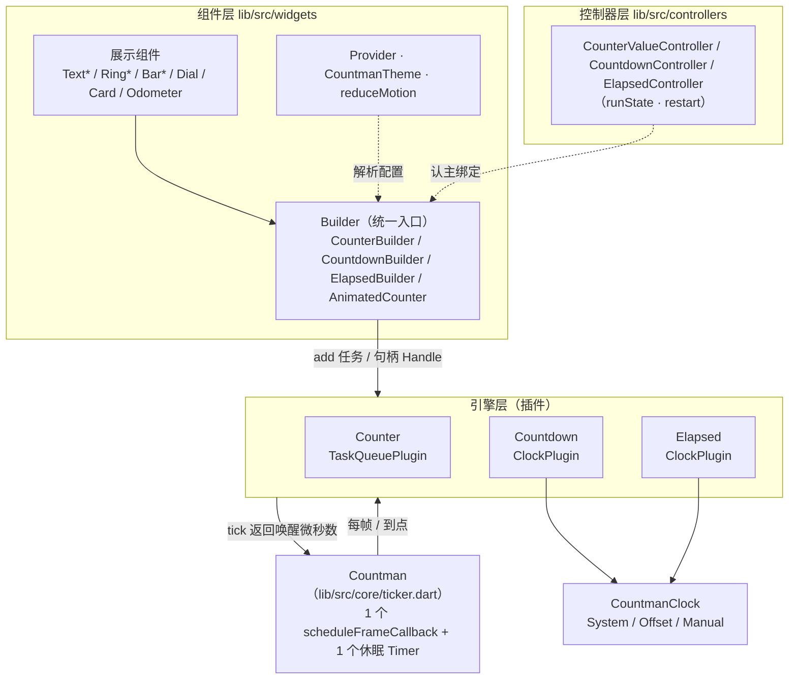
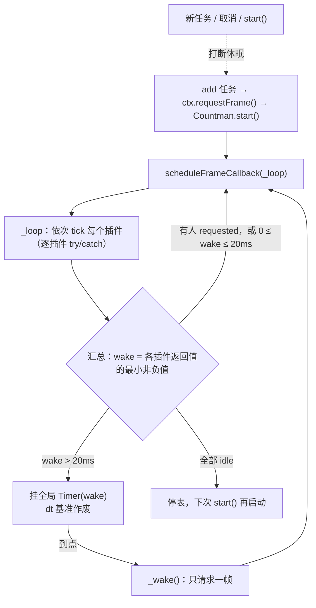
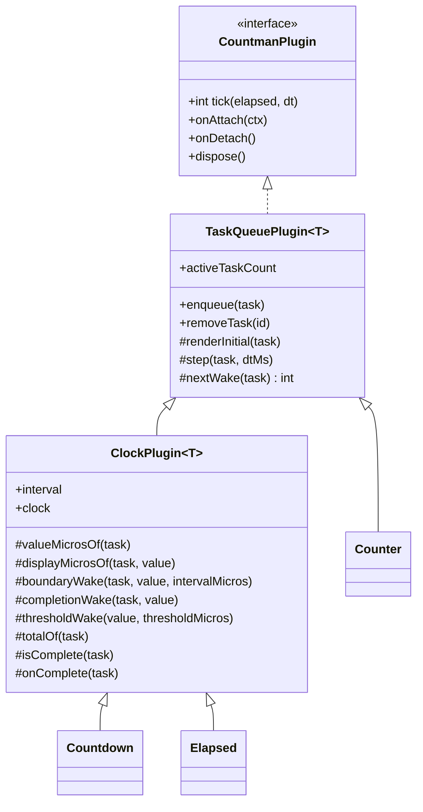
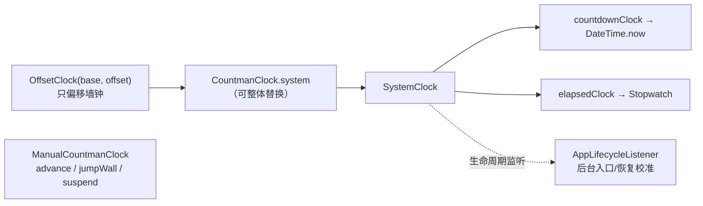
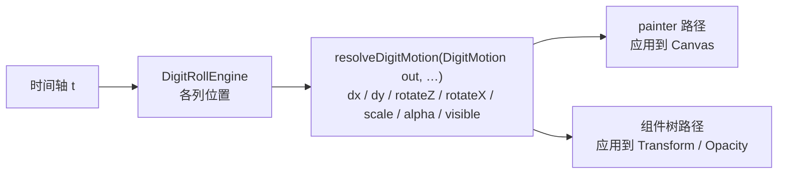

# Countman 架构文档（0.3.0）

countman 是一个高性能的 Flutter 计数 / 倒计时 / 正计时动画库。核心思路只有一条：**整个应用只有一个共享的帧驱动器，所有任务挂在它下面，没活干就睡，睡醒只做该做的事。** 本文描述 0.3.0 的实际结构；接口细节以 `lib/` 源码和 dartdoc 为准。

## 1. 总览



三条依赖方向是硬约束：

- 组件层依赖引擎层，**引擎层不认识任何 Widget**。
- `Countman` 只认 `CountmanPlugin` 接口，不认识具体引擎；插件通过注入的 `CountmanContext.requestFrame` 反向唤醒它，没有反向 import。
- 时钟只经 `CountmanClock` 抽象读取，引擎之间不互相依赖。

## 2. 共享帧驱动与休眠调度

`Countman`（静态单例，`core/ticker.dart`）是唯一的帧驱动器。0.3.0 之前它是“有任务就每个 vsync 都 tick”；现在是**按唤醒时间调度**。

### 2.1 插件契约

```dart
abstract interface class CountmanPlugin {
  static const int idle = -1;       // 没有活动任务，可以停表
  static const int nextFrame = 0;   // 下一帧继续
  String get name;
  void onAttach(CountmanContext ctx);
  int tick(Duration elapsed, Duration dt); // 返回距下次处理的微秒数
  void onDetach();                          // 注销时调用，之后可重新挂载
  void dispose();                           // 永久释放
}
```

`tick` 的返回值就是调度信息：`idle`（-1）、`nextFrame`（0）或一个正数（微秒）。`dt` 是活动帧间隔，**休眠后的首帧为 0**，所以会休眠的插件不能靠累加 `dt` 计时，必须读时钟。

### 2.2 调度循环



要点：

- 全局只有**一个**休眠 `Timer`（`_sleepTimer`）；`start()` 会取消它并重新排帧。休眠到点后仍由 vsync 帧来执行处理，Timer 本身不跑业务逻辑。
- `_frameWindowMicros = 20ms`：不超过这个窗口的等待直接走下一帧，避免短定时器抖动。
- 一秒间隔的倒计时因此在两次更新之间不出帧；只有动画类任务（`Counter`、`interval: 0` 的时钟任务）才逐帧。
- 注册表按**实例**（`LinkedHashSet.identity`）。同名的另一个实例在 debug 下 `assert`，release 照常注册。`Countman.unuse(plugin, {dispose = true})` 按实例注销。
- 运行代次（`_generation`）与 `_requested` 标记防止回调里 `stop()` / `destroy()` / 新增任务造成丢帧或旧帧继续驱动旧列表。
- 逐插件隔离：单个插件 `tick` 抛异常经 `FlutterError.reportError` 上报，不影响其他插件；`destroy()` 同样逐插件隔离。

### 2.3 显示限帧 fps

实例（Options / 组件）> 插件 > `Countman.fps`，null 逐级回退至跟随 vsync。
只过滤可见显示更新，完成与阈值仍取最早唤醒，终值强制发出；静音优先。
Counter 限帧按系统单调钟差值推进，避免休眠后 dt == 0 丢时间；默认仍累加 dt。
Counter / ClockPlugin 按固定网格推进限帧节拍，跳过错失时隙、不补发历史帧。
首个 view 的 `display.refreshRate` 决定 vsync 周期（无有效值回退 60Hz，添加任务时
刷新缓存），以半个 vsync 为容差：`now >= allowed - tol` 可显示，下一帧请求等待为
`allowed - tol - now`。限帧正数等待走全局 Timer，跳过 20ms 连续排帧窗口；提示
跟随逐任务、逐插件的最早等待，避免其它较晚唤醒使其重新轮询。
ClockPlugin 显示唤醒取桶边界与限帧请求时刻较晚者，再与完成/阈值取最早；桶和
事件不减容差，不提前。目标显示率不超过屏幕刷新率，
`period <= vsyncPeriod * 1.05` 视为不限帧。
CardCountdown 的进度任务使用同一套 Counter 限帧调度，真正降低出帧，端点始终精确通知。

### 2.4 不可见休眠

组件默认订阅 `TickerMode.getNotifier`（内部 `HiddenTaskState`），隐藏时令任务
`muted = true`：不投递 onUpdate/onTick，不改变 runState/isPaused、不重新锚定，也不
触发 onPause/onResume。首帧仍初始化 started/onStart；静音 ClockPlugin 仅取完成与
阈值的最早唤醒，无二者则 idle。Counter 记录单调钟，静音只睡到终点，恢复时补算
真实流逝并跳到当前位置（方案 A）；用户暂停期间不推进。取消静音作废显示桶并
requestFrame，回调仍在逐任务边界内，热路径只新增字段判断。终态可同步一次最终显示。
全部静音时通过内部 CountmanSleepHint 跳过 20ms 连续排帧窗口，正数等待均走 Timer。
新任务以静音状态入队，插件迁移保留静音。CardCountdown 隐藏/恢复取消共享 Counter
进度任务，直接落定模型并清零动画进度；不额外订阅 TickerMode。
`Countman.muteWhenHidden = false` 在挂载前关闭订阅；原生 Offstage 需配套 TickerMode。

## 3. 插件体系



### 3.1 TaskQueuePlugin：任务队列骨架

负责 id 分配、任务表、首次添加时惰性自注册（用户直接把自建插件传给组件即可）、分组事件（`onFirstEnqueued` / `onQueueDrained` / `addGroupListener`）、延迟结构变更（tick 循环中新增/移除先进缓冲，循环后统一排空，避免 `ConcurrentModificationError`）。

`tick` 的骨架：空队列返回 `idle` → `beginFrame` → 逐任务（首帧 `renderInitial` → `onStart` → `afterInitial`；之后 `step`）→ 收集各任务 `nextWake` 的最小值 → 排空缓冲 → 空了就派发 `onQueueDrained`。

**逐任务边界**：每个任务的回调都在独立的 `try/catch/finally` 里。回调抛异常只上报（`FlutterError.reportError`，带插件名与任务 id），该任务的 `done` 仍会被收尾，不会饿死同组其他任务，也不会让共享 ticker 停摆；出错的任务保守地要求下一帧再处理。`revision` 计数让回调里的暂停 / 重置 / 重定目标使旧版本帧的完成判定立即失效。

### 3.2 ClockPlugin：按桶边界休眠

`Countdown` 与 `Elapsed` 共用。每帧只读一次时钟（`frameWallMicros` / `frameMonotonicMicros`，惰性、整数微秒），任务内部全部整数运算，热路径不分配对象。

- **显示桶** = `显示值微秒 ~/ interval 微秒`。**每个任务按自己的值**跨过 interval 整数倍时更新，与任务何时加入、插件是否同相位无关。
- 完成与阈值**每帧检查**，不被显示间隔延迟；`onComplete` 恰在截止所在帧触发。
- `nextWake(task)` 取三者最小：`boundaryWake`（显示桶下次变化）、`completionWake`（完成时刻）、`thresholdWake`（阈值时刻）；桶已变化时返回 `nextFrame`。
- 子类只需提供领域钩子：`valueMicrosOf`、`displayMicrosOf`（倒计时的向上取整在此实现）、`totalOf`、`isComplete`、`boundaryWake`、`completionWake`、`thresholdWake`、`onComplete`。

### 3.3 内置引擎

| 引擎 | 基类 | 说明 |
|---|---|---|
| `Counter` | `TaskQueuePlugin` | 数值插值，默认 `dt` 累积、限帧读单调钟；`CounterTask` 不可暂停外的行为由 `paused` 控制 |
| `Countdown` | `ClockPlugin` | 相对时长走单调钟，绝对截止走墙钟；支持 `total`、`rounding` |
| `Elapsed` | `ClockPlugin` | `since`（墙钟）/ `initial`（单调钟）、`limit`、圈速 |

默认实例由 `LazyDefault` 惰性创建（`defaultCounter` / `defaultCountdown` / `defaultElapsed` 与 `*Ms` 的每帧版本），`Countman.destroy()` 统一重置。

## 4. 时钟抽象



- `CountmanClock` 有两条时间轴：`wallMicros()`（日历时钟，允许被改）与 `monotonicMicros()`（不跳变，含深睡补偿）。
- **语义分工**：相对时长（`duration`、组件 `to: Duration`）与正计时一律用单调钟，改系统时间不影响；绝对截止（`deadline`、`to` 为 `DateTime` / `int` / `String`）与 `ElapsedOptions.since` 用墙钟。暂停恢复、`reset()` 之后任务改按单调钟继续。
- `SystemClock` 首次读钟时懒注册 `AppLifecycleListener`：进入后台记下双钟快照，恢复时若墙钟比单调钟多走超过 1 秒，就把差值累加到单调钟偏移里（Dart VM 在 Android 上的单调钟在设备深睡期间会停走）。
- 引擎的时钟在读取时解析（`clock ?? CountmanClock.system`），所以测试可以整体替换全局时钟，也可以给单个引擎注入 `ManualCountmanClock`。

## 5. 任务 / 句柄 / 控制器三层

```mermaid
flowchart LR
  Ctl["Controller<br/>用户持有，可跨组件存活"] -->|attach / detach 认主| Handle
  Widget["展示组件 State"] -->|add(Options)| Plugin["Plugin"]
  Plugin -->|返回| Handle["Handle<br/>id + plugin 引用"]
  Handle -->|pause / resume / reset / cancel| Task["Task<br/>引擎内部状态（整数微秒）"]
  Plugin --- Task
```

- **Task**（`CountmanTask` 子类）：引擎内部状态，只有插件能改；热路径零分配。
- **Handle**（`CounterHandle` / `CountdownHandle` / `ElapsedHandle`）：`id + plugin` 的薄壳，是组件与控制器操作任务的唯一入口。
- **Controller**（`controllers/`）：用户侧命令式对象，混入 `CountmanRunStateNotifier`，暴露 `runState` / `runStateListenable`（idle / running / paused / completed）、`restart()`、`dispose()`。

**认主绑定**：组件调用 `controller.attach(handle, relaunch:, restart:)` 并在销毁时 `controller.detach(handle)`——`detach` 带上自己的句柄，只有“仍属于自己”才会解绑，所以组件被重新 key 或控制器在同一帧转交给另一个组件时，旧组件的 `dispose` 不会拆掉新绑定。`AnimatedCounterController` 用 `$owner` 做同样的归属检查。只换 `controller` 属于重新绑定，不会重启任务；`relaunch` 让 `update` / `reset` 在任务完成或被取消后重新创建任务。没有任务（animate-once 跳过入场）时绑定 `Counter.detachedHandle()`，不会“添加再取消”一个占位任务（那会触发 Provider 的分组回调）。

**runState 的构建期推迟**：`setRunState` 在 build / layout / paint 阶段写入时，最新值（`runState`）立即更新，但对监听者的通知推迟到帧末（`addPostFrameCallback`），同帧多次写入只通知一次，避免监听者在构建期 `setState` 触发断言。

## 6. 组件层

### 6.1 Builder 是统一入口

所有展示组件都是对 Builder 的薄封装，任务生命周期、插件解析、减弱动画、控制器绑定只在 Builder 里写一遍：

| Builder | 驱动 | 展示组件 |
|---|---|---|
| `CounterBuilder`（含 `.listenable`） | `Counter` | `TextCounter`、`RingCounter`、`BarCounter` |
| `CountdownBuilder`（含 `.listenable`） | `Countdown` | `TextCountdown`、`RingCountdown`、`BarCountdown`、`DialCountdown`、`CardCountdown` |
| `ElapsedBuilder` | `Elapsed` | `TextElapsed` |
| `AnimatedCounter` / `AnimatedCounterBuilder` | `Counter`（经自己的状态机） | `OdometerCounter` 也基于 painter 路径 |

`.listenable` 变体不逐 tick 重建：值经 `ValueListenable` 推送，Ring / Bar 的 painter 常驻，用 `repaint: Listenable` 原地重绘，语义标签只在整数百分比变化时更新。

**插件迁移**：解析出的插件变化时（显式 `plugin`、Provider 出现/消失、`precise` 切换），Builder 把存活任务迁移到新插件并保留剩余/已经过时间、进度分母、绝对截止语义、圈速、暂停态与当前显示值；旧任务静默取消（不触发用户的 `onCancel` / `onPause`），不再重启。

### 6.2 配置解析顺序

插件（`widgets/scope_resolution.dart`）：

```
组件显式 plugin > 最近的 CountmanScope<P>（Provider）的 plugin > precise 默认组 > 默认组（defaultX）
```

`resolvePlugin`（不注册依赖，可在 `initState` 用）与 `resolvePluginDependent`（注册依赖，用于 `didChangeDependencies` / `build`）。倒计时家族（含 `CardCountdown`）读取 `CountdownProvider.plugin`，所以 `onAllComplete` 对卡片也生效；`AnimatedCounter` 读取 `CounterProvider.plugin`。

样式（逐字段合并，空字段逐层回退）：

```
组件 style  >  Provider 上的 *Style（已废弃）  >  CountmanTheme  >  内置默认
```

标量默认（`textStyle` / `color` / `duration` 等）仍走 Provider，回退链是“自身属性 > Provider > 内置默认”。

**CountmanTheme**（`ThemeExtension<CountmanTheme>`）承载所有展示组件的默认样式；每个 `*Style` 带 `copyWith` / `merge` / 静态 `lerp`，`CountmanTheme.lerp` 逐样式插值（不可插值字段 `t < 0.5` 取前者）；`maybeOf` / `of` 供第三方组件读取。

**减弱动画**：`reduceMotionOf(context)` 优先读 `MediaQuery.maybeDisableAnimationsOf`（会随系统设置重建），没有 MediaQuery 才回退平台标志；装饰性动画直接跳终值，功能性计时不受影响。

**animate-once**：登记表（`AnimateOnceRegistry`）挂在最近的 Provider 的 State 里，按稳定 id 记录“入场已播放”。没有稳定 id 或没有 Provider 时不断言：debug 下警告一次，退化为每次都动画。

### 6.3 其他组件细节

- `CardCountdown`：内部 `CardProgress`（`Animation<double>`）由私有共享 `Counter` 任务组驱动常驻 `FlipCardPainter`，不再创建每卡 Ticker。fps 对卡片同样真正降低出帧，沿用实例 > 所用 Countdown 插件 > 全局；曲线仍在 painter 应用，calendar 往返两段各用 duration，slide/flip 单程。HiddenTaskState 唯一订阅 TickerMode，隐藏/恢复取消动画任务并清零、落定当前值。原保留 AnimationController 的结论已被真窗口数据推翻，见 DECISIONS.md。
- `DialCountdown`：自带 painter，`builder` 填充中心。
- `StartScheduler`：把密集网格的首次启动分摊到多帧（`defaultBatchSize` / `groupBatchSize`），组件销毁时必须 `cancel(this)`。

## 7. AnimatedCounter 渲染内核

`widgets/animated_counter/` 是 `animated_counter.dart` 为库根的一个 Dart library，用 `part` 按职责拆分：

| 文件 | 职责 |
|---|---|
| `animated_counter.dart` | `AnimatedCounter` 与 painter 路径状态 |
| `custom_digit_counter.dart` | `AnimatedCounterBuilder` 与组件树路径状态 |
| `_base_counter.dart` | 两条路径共用的组件参数 |
| `_counter_config.dart` | 平铺参数 / `format` / `timeline` 的合并（对象字段优先，空字段回退） |
| `_counter_timeline.dart` | 有效 duration / curve / 速度解析 |
| `_counter_scope.dart` | CounterProvider 的 plugin、animate-once、减弱动画 |
| `_counter_measure.dart` | 数字格式化、字形测量、语义文本 |
| `_counter_tint.dart` | 方向变色（量化调色板 + 样式缓存） |
| `_counter_controller_binding.dart` | `AnimatedCounterController` 命令接线 |
| `_counter_state.dart` | 可中断播放状态机 |
| `digit_roll_engine.dart` | 纯 Dart 数位滚动引擎（非 part，包内使用） |
| `digit_motion.dart` | `resolveDigitMotion`：单一来源的运动解算 |

### 7.1 DigitRollEngine

纯 Dart、不依赖 Widget。持有一次过渡里每个数位列的起止端点与当前位置：

- 普通（累计）模式：个位列携带整个数值，更高位是 `值 / 10^位`，低位比高位滚得快；`currentDigits` 是连续的里程表位置。
- `fast` 单步模式：每列只从旧位走到新位一个身位，`currentDigits` 存 0–1 进度，起止位在 `fastFromDigits` / `fastToDigits`。

状态机只管时间轴与生命周期，进度 t 到各列位置的换算（含错峰、`autoEaseThreshold`、回弹）全在引擎里，因此可以不起 Flutter 环境直接单测。

### 7.2 resolveDigitMotion 与两条渲染路径



`resolveDigitMotion` 把“某一帧某个数位的运动数值”写进复用的 `DigitMotion` 持有者，热路径零分配；两条路径只负责**应用**，不再各写一份 `switch (motion)`，从而保证 slide / rotate / flip / scale / fade / blur 在两条路径上外观一致。

- **painter 路径**（`AnimatedCounter`）：常驻 `CounterPainter`，每帧 `update()` + `repaint: Listenable` 重绘，零 widget 构建；方向变色由共享 ticker 驱动，渐变期间不重建。
- **组件树路径**（`AnimatedCounterBuilder`，以及 `blur` / `flip` 等需要图层效果的过渡）：`DigitColumn` 每帧 build，支持 `digitBuilder` / `digitTransitionBuilder`，单位数位成本约 0.85 ms/帧，仅用于少量计数器。

## 8. 性能不变量

不要破坏下面这些（回归时优先查这里）：

1. **零分配热路径**：`Counter.step`、时钟引擎的 `tick`、`resolveDigitMotion` 不创建对象；复用任务状态、每任务 `TimeParts`、`DigitMotion` / `DigitPhase` 持有者。
2. **常驻 painter**：`CounterPainter` / `RingPainter` / `BarPainter` / `FlipCardPainter` 在组件生命周期（或配置变化）内只创建一次，经 `update()` + `repaint: Listenable` 原地更新，绝不逐帧新建。
3. **休眠调度**：时钟任务不得靠逐帧轮询判断到期；必须给出准确的 `nextWake`。未限帧的 `interval: 0`（`precise`）会让该组无法休眠，只在真的显示亚秒位时使用。
4. **每帧只读一次时钟**：`beginFrame` 作废快照，`frameWallMicros` / `frameMonotonicMicros` 惰性读取；完成与阈值每帧检查，只有显示更新被 `interval` 节流。
5. **逐任务边界**：任务回调的异常不得越过 `TaskQueuePlugin.tick` 的 `try/catch/finally`；终态任务一定被清理。
6. **每次 `add` 都 `requestFrame()`**：`Countman.start()` 幂等；休眠中新增任务会打断休眠。
7. **认主绑定**：控制器的 `attach` / `detach` 必须带句柄；只换控制器不重启任务。
8. **构建期写入的 runState 推迟到帧末通知**：监听者不得在构建期被同步通知。
9. **不用 `Opacity` 做淡入淡出**：用 `color.withValues(alpha:)`，否则每个分数透明度帧都触发 `saveLayer`。
10. **Web 兼容**：整数字面量不得超过 2^53（如 `0x7fffffffffffffff` 的 `clamp` 上界），否则 dart2js 编译失败而 VM 测试仍绿。

## 9. 目录结构

```
lib/
  countman.dart                 公共导出入口
  src/
    core/
      ticker.dart               Countman：共享帧驱动 + 休眠调度
      types.dart                CountmanPlugin / CountmanContext
      plugin_base.dart          CountmanTask / TaskQueuePlugin / ClockTask / ClockPlugin / LazyDefault
      clock.dart                CountmanClock / SystemClock / OffsetClock / ManualCountmanClock
      run_state.dart            CountmanRunState / CountmanRunStateNotifier
      start_scheduler.dart      StartScheduler 启动分批
      time_parts.dart           TimeParts（每任务复用，原地修改）
    counter/                    Counter 引擎（plugin / types）
    count_down/                 Countdown 引擎、CountdownFormat、CountdownRounding
    elapsed/                    Elapsed 引擎、圈速
    controllers/                三个 Controller（counter_value / countdown / elapsed）
    widgets/
      counter_builder.dart  countdown_builder.dart  elapsed_builder.dart   统一入口
      text_* / ring_* / bar_* / dial_countdown / card_countdown* / odometer_counter   展示组件
      *_style.dart  style_support.dart  countman_theme.dart   样式与主题
      providers.dart  scope_resolution.dart  reduce_motion.dart  animate_once.dart
      progress_display.dart     Ring / Bar 共用的颜色回退
      painter/                  CounterPainter / RingPainter / BarPainter / FlipCardPainter
      animated_counter/         AnimatedCounter 渲染内核（见第 7 节）
test/                           单测与组件测试
example/                        演示应用（也是在线 Demo 的来源）
```

## 10. 相关文档

- [README.md](README.md) / [README.zh-CN.md](README.zh-CN.md)：使用说明与 API 示例。
- [MIGRATION.md](MIGRATION.md)：0.2.x → 0.3.0 迁移指南。
- [CHANGELOG.md](CHANGELOG.md)：变更记录。
- `.claude/skills/countman/DECISIONS.md`：设计决策记录（含 0.3.0 推翻的旧决策）。
