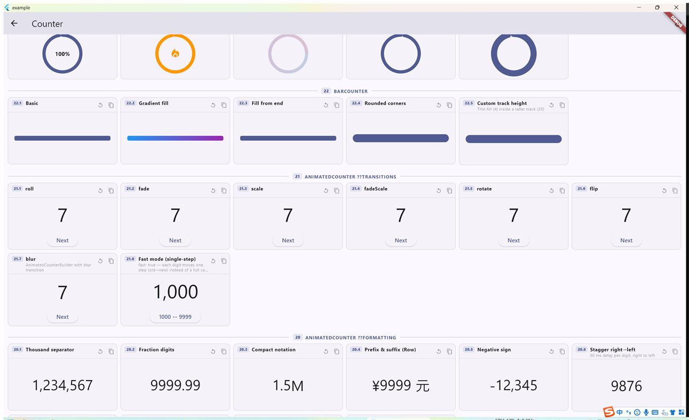
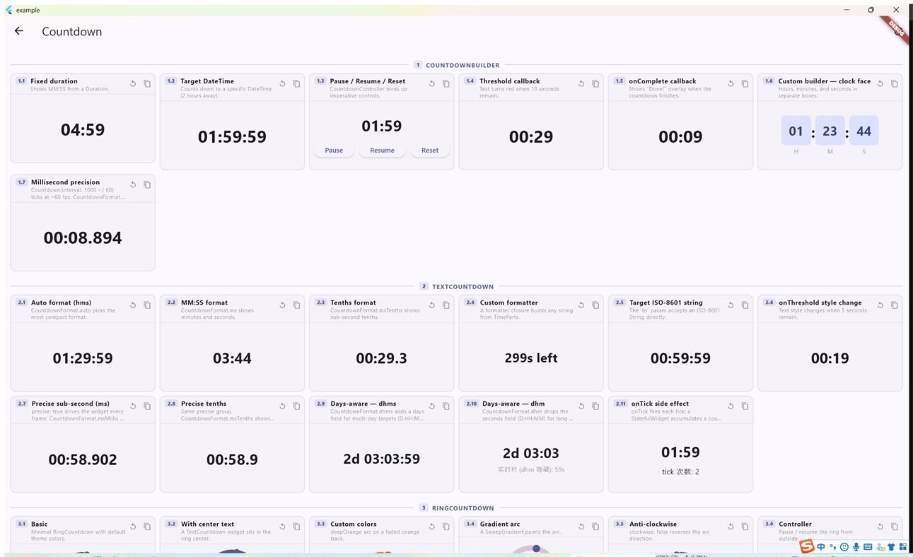
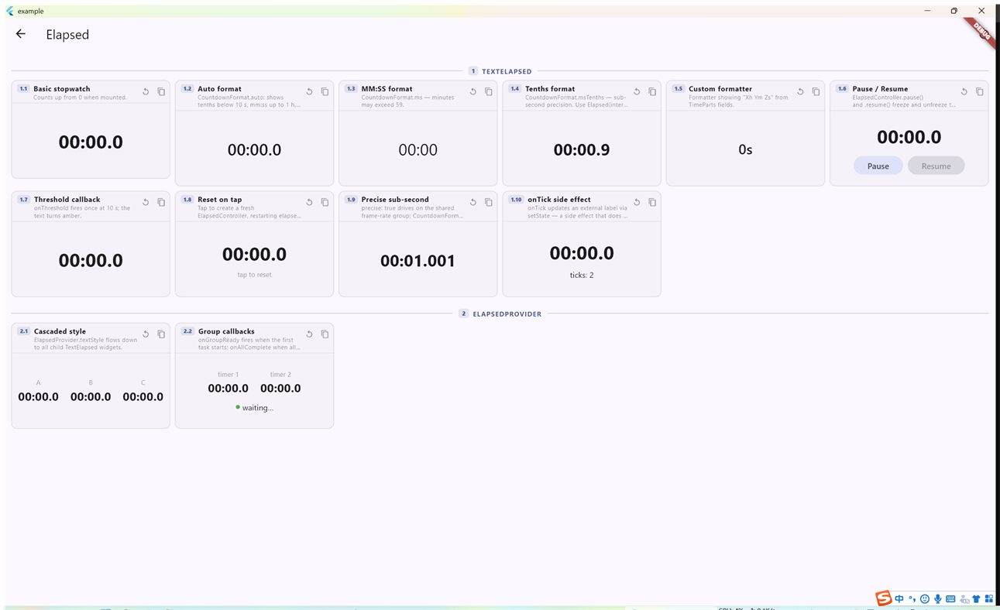

# countman

**Counter, countdown and stopwatch widgets for Flutter. They all run on one shared vsync ticker instead of a timer or `AnimationController` per widget, so the cost stays low when many are on screen.**

**English** | [简体中文](README.zh-CN.md)

[](https://pub.dev/packages/countman)
[](https://github.com/icodejoo/dart-labs/blob/main/countman/LICENSE)
[](https://icodejoo.github.io/dart-labs/countman/)

**[▶ Live Demo](https://icodejoo.github.io/dart-labs/countman/)**: counter, countdown, elapsed and 0.3.x scheduler examples, with English/Chinese switching and light/dark themes.

> **Upgrading from 0.2.x?** Read the
> [migration guide](https://github.com/icodejoo/dart-labs/blob/main/countman/MIGRATION.md).
> Custom plugins, `CountdownOptions` and the relative/absolute clock behavior changed.

- **No `Timer.periodic` and no per-widget `AnimationController`.** A single `SchedulerBinding.scheduleFrameCallback` drives everything.
- **Sleeps between updates.** A once-per-second countdown does not render a frame on every vsync; the scheduler wakes up only when a task is due.
- **Cost does not grow with the count.** The 100th live counter or timer costs the same as the 1st, and the ticker goes idle when nothing is animating.
- Counter, Countdown and Elapsed widgets with text / ring / bar / odometer / dial / flip-card renderers, per-widget styles, a `ThemeExtension`, controllers and providers.

---

## Hidden widgets

Widgets sleep under `TickerMode(enabled: false)` (including routes muted by
Flutter). Hidden widgets do not deliver `onUpdate` / `onTick`; completion and
threshold callbacks still fire when due. Visibility resumes at the current
value; Counter animations jump to their real-time position. Muting does not
pause the task or change `runState`, and never calls `onPause` / `onResume`.
CardCountdown settles its flip immediately when hidden or shown.

For a bare `Offstage`, also wrap the child in `TickerMode(enabled: !offstage)`;
Offstage itself does not mute tickers. To keep updating while hidden, set this
before mounting widgets (they then do not subscribe to `TickerMode`):

```dart
Countman.muteWhenHidden = false; // default: true
```

## Frame cap fps

Display updates use the first non-null `fps` from instance, then plugin, then `Countman.fps`.
If all are null, updates follow vsync (the default).
Completion and thresholds stay on real time; the terminal value always renders.
Invalid values (not finite and positive) assert in debug and act as null in release.

```dart
Countman.fps = 30; // global; runtime changes apply on the next frame
final group = Counter(name: 'prices', fps: 20);
TextCounter(to: 999, plugin: group, fps: 10); // instance override
CardCountdown(to: Duration(minutes: 5), fps: 30);
// Direct engine: group.add(CounterOptions(to: 999, fps: 15));
Countman.fps = null; // global follows vsync again
```

Counter and clock engines advance a fixed display grid aligned using the first
view's `display.refreshRate` (60Hz fallback, cached until a task is added).
A half-vsync tolerance accepts slightly early frames; the shared Timer requests
the next frame at `allowed - tolerance`, avoiding empty polling frames. Missed
slots are skipped. The target rate never exceeds the display refresh rate;
`period <= vsyncPeriod * 1.05` is treated as uncapped. Display bucket boundaries,
completion and thresholds keep their exact timing without this tolerance.
Muting takes priority and ignores fps; showing a widget immediately displays
its current value. CardCountdown uses a shared Counter motion group, so fps
also reduces its actual frame rate while preserving transition duration and curve.

## Screenshots

| Counter | Countdown | Elapsed |
| :---: | :---: | :---: |
|  |  |  |
| Text / ring / bar / odometer / animated | Text / ring / bar / dial / card | Stopwatch, precise, provider |

> Captured from the [example app](https://github.com/icodejoo/dart-labs/tree/main/countman/example) — try it live at the [demo site](https://icodejoo.github.io/dart-labs/countman/).

---

## Why countman?

Most counter packages give every widget its own `AnimationController` (or a
`Timer.periodic`). With N counters on screen, that is N frame-callback
registrations, N timers and N animation lifecycles that know nothing about
each other.

**countman** does the opposite: one `SchedulerBinding.scheduleFrameCallback` drives
every instance. Each plugin reports **when it next needs to run**; the ticker
renders frames while something animates, **sleeps on a single global timer**
between updates (a one-second countdown does not wake the engine 60 times a
second), and stops when everything is idle. Adding a hundredth counter costs the
same as adding the first.

```
Countman (1 scheduleFrameCallback + 1 sleep timer)
  ├── Counter    — interpolates numbers from → to (every frame while animating)
  ├── Countdown  — relative (monotonic) or absolute (wall-clock) timers, wake per update
  └── Elapsed    — stopwatch timers, wake per update
```

Each engine is a `CountmanPlugin`. You can register more than one instance of
each to keep independent "groups" apart, or write your own
([Writing a custom plugin](#writing-a-custom-plugin)).

---

## Installation

```yaml
dependencies:
  countman: ^0.3.1
```

Requires Flutter 3.35+ (Dart 3.9+).

```dart
import 'package:countman/countman.dart';
```

---

## Performance

| Approach | Frame callbacks | Timer allocations |
|---|---|---|
| N `AnimationController`s | N | N vsync listeners |
| N `Timer.periodic` | — | N timers |
| **countman** | **1** | **1 shared sleep timer** |

Measured at 94 concurrent `AnimatedCounter` instances (0 → 999,999,999):

- **Raster: 8–11 ms** — RepaintBoundary keeps each counter in its own layer.
- **Build: ~2 ms** — CustomPainter path skips widget instantiation entirely.
- **Startup spike** is spread across frames with `StartScheduler` batching.

**Sleeping scheduler (0.3.0).** A task is processed only when its value
crosses the next `interval` boundary, completes, or crosses a threshold. In
between, the scheduler arms one global timer instead of asking for a frame on
every vsync, so a text countdown at the default 1 s interval produces frames
only around each update. Animations (`Counter`, the flip of `CardCountdown`)
still run every frame while they move, unless capped with fps. For
`CardCountdown`, the cost depends mostly on the transition type and duration:
`calendar` animates about 90 % of every second, `slide` / `flip` about 45 %,
and a shorter `duration` lowers the cost proportionally.

### Head-to-head vs other packages

> **Note:** the numbers below were measured with the **0.2.x scheduler**, which
> rendered a frame on every vsync while a countdown was alive. 0.3.0 sleeps
> between updates; the tables are kept for reference and have not been re-run.

**50 concurrent countdowns**, Windows desktop **profile** mode, 15 s measurement
window per library, run back-to-back in one session (display at 120 Hz). FPS =
frames actually rendered ÷ elapsed; UI/raster = per-frame thread time;
CPU = share of **one** core, sampled externally from the OS process; RSS =
resident set size. Lower is better except FPS/jank.

**Card / slide mode** — countman `CardCountdown(slide)` vs [`slide_countdown`](https://pub.dev/packages/slide_countdown) `^2.0.2`:

| metric | countman `CardCountdown` slide | `slide_countdown` |
|---|---|---|
| FPS (frames / 15 s) | **121.7** (1826) | 32.5 (488) |
| UI ms  avg / p99 | **0.80 / 2.12** | 1.32 / 4.39 |
| raster ms  avg / p99 | **0.83 / 1.47** | 1.05 / 1.76 |
| jank frames | 0 | 0 |
| RSS  avg / peak (MB) | 130.2 / 137.3 | 130.3 / 135.4 |
| CPU (1 core) | 26.1 % | **10.0 %** |

countman drives the slide+scale+opacity transition on **every vsync** (smoother,
cheaper per frame), so it renders far more frames and uses more CPU in total.
`slide_countdown` repaints only during its once-per-second slide bursts: lower
CPU, but a burstier cadence and costlier frames. Neither shows jank, and memory
use is the same.

**Text mode** — countman `TextCountdown` vs [`stop_watch_timer`](https://pub.dev/packages/stop_watch_timer) `^3.2.2` (driving a `Text` via `StreamBuilder`):

| metric | countman `TextCountdown` | `stop_watch_timer` |
|---|---|---|
| FPS (frames / 15 s) | 120.9 (1813) | 120.1 (1801) |
| UI ms  avg / p99 | **0.10 / 0.16** | 0.16 / 0.66 |
| raster ms  avg / p99 | 0.37 / 0.59 | **0.31 / 0.58** |
| jank frames | 0 | 0 |
| RSS  avg / peak (MB) | 113.8 / 116.0 | 113.9 / 116.4 |
| CPU (1 core) | **12.1 %** | 18.8 % |

For plain-text countdowns, the shared ticker with `markNeedsPaint` uses
**about 35 % less CPU** than 50 independent `stop_watch_timer` streams
(12.1 % vs 18.8 % of a core), with steadier per-frame UI time. Memory is the
same. (0.2.x scheduler numbers, see the note above.)

> Reproduce with `example/lib/benchmark_page.dart`:
> `flutter run --profile -d windows --dart-define=BENCH_LIB=countmanCard`
> (also `slide` / `countmanText` / `stopWatch`).

---

## Counter

Widgets that animate a number `from → to` on the shared ticker.
All of them accept `from` / `to` / `duration` (default 1000 ms) / `curve`
(default `Curves.easeOut`) / `allowNegative` (default `false`, clamps to ≥ 0) /
`plugin` / `controller` ([`CounterValueController`](#counters-controller)) plus
lifecycle callbacks `onUpdate` / `onComplete` / `onReady` / `onStart` /
`onCancel`, and `animateOnce` (see [Advanced](#animate-once-list-friendly)).

### `TextCounter`

Text counter with optional prefix and suffix.

```dart
TextCounter(to: 9999)                                        // "9999"
TextCounter(to: 9999, prefix: '¥', style: const TextCounterStyle(
  textStyle: TextStyle(fontSize: 32, fontWeight: FontWeight.bold)))
TextCounter(to: 9999, prefixWidget: const Icon(Icons.star), suffix: ' pts')
TextCounter(to: 1234.56, fractionDigits: 2)                  // "1234.56"
TextCounter(to: 1234.56, formatter: (v) => v.toStringAsFixed(2))
```

| Parameter | Default | Description |
|---|---|---|
| `to` | required | Target value |
| `from` | `0` | Start value |
| `formatter` | integer | `String Function(double)` — wins over `fractionDigits` |
| `fractionDigits` | — | Decimal places when no `formatter` |
| `style` | — | `TextCounterStyle` (alias of `CountmanTextStyle`) |
| `prefix`/`suffix` | — | Plain text; `prefixWidget`/`suffixWidget` win |
| `semanticsLabel` | — | Fixed screen-reader label |
| `repaintBoundary` | `false` | Isolate repaint layer |

### `RingCounter`

Circular arc that fills toward a goal: progress = `(value − from) / (to − from)`.

```dart
RingCounter(
  to: 100,
  style: const RingCounterStyle(size: 80, strokeWidth: 10),
  center: const TextCounter(to: 100, suffix: '%'),
)
```

Visuals live in [`RingCounterStyle`](#ring-style) (alias of `RingStyle`). Also
supports `painterBuilder: (context, progress) => CustomPainter` for a fully
custom arc. The painter is created once and repainted in place.

### `BarCounter`

Linear progress bar filling toward a goal.

```dart
BarCounter(to: 100, style: const BarCounterStyle(
  width: 240, height: 12, gradient: LinearGradient(colors: [Colors.blue, Colors.green])))
```

Visuals live in [`BarCounterStyle`](#bar-style) (alias of `BarStyle`); also
`painterBuilder`.

### `OdometerCounter`

Mechanical-odometer sliding digits, drawn by a self-contained `CustomPainter`
(no third-party package). The ones digit scrolls continuously while higher
digits tick on integer carry.

```dart
OdometerCounter(
  to: 9999,
  style: const OdometerCounterStyle(
    numberTextStyle: TextStyle(fontSize: 40),
    letterWidth: 24,
  ),
  groupSeparator: ',',       // text drawn every 3 digits
)

OdometerCounter(from: 9999, to: 100)               // decreasing, no leading zeros
OdometerCounter(to: 500, bounceOvershoot: 0.35)    // spring overshoot per digit
```

| Parameter | Default | Description |
|---|---|---|
| `style` | — | `OdometerCounterStyle` (`numberTextStyle`, `letterWidth` 20, `verticalOffset` 20, `fadeEnabled`, `digitAlignment`, `crossAxisAlignment`, `prefixStyle`, `suffixStyle`, `padding`, `decoration`) |
| `groupSeparator` | — | `String` drawn every 3 digits |
| `slideCurve` | — | Easing on the per-digit slide |
| `bounceOvershoot` | `0.0` | Overshoot magnitude per ones-digit transition |
| `prefix`/`suffix`/`prefixWidget`/`suffixWidget` | — | Affixes |

### `AnimatedCounter`

Rolling-digit counter with composable transitions, stagger, compact notation,
decimals, digit grouping, color tinting and control from code. It draws with a
persistent `CustomPainter`, so no widgets are built per frame
(`AnimatedCounterBuilder` uses the widget-tree path instead).

Configuration is grouped into three objects, each field optional:

- **`format: CounterFormat`** — how the number is written (decimals, separators, compact notation, numerals).
- **`timeline: CounterTimeline`** — how it moves (duration, curve, stagger, delay, `fast`).
- **`style: AnimatedCounterStyle`** — how it looks (text styles, colors, padding, decoration).

```dart
AnimatedCounter(value: 9999)

AnimatedCounter(
  value: 1000000,
  transition: CounterTransition.slide,   // .slide·.slideScale·.slideBlur·.rotate·.flip·.flipFade
  format: const CounterFormat(thousandSeparator: ','),
  timeline: const CounterTimeline(
    duration: Duration(seconds: 2),
    staggerDelay: Duration(milliseconds: 30),
    staggerDirection: StaggerDirection.rightToLeft,
  ),
  style: const AnimatedCounterStyle(
    textStyle: TextStyle(fontSize: 40, fontWeight: FontWeight.bold),
    increasingColor: Colors.green, decreasingColor: Colors.red,
  ),
)

// Currency: prefix + grouping pattern (grouping [3]=USD, [4]=CNY, [3,2]=INR)
AnimatedCounter(value: 1234.56, prefix: r'$',
    format: const CounterFormat(
        fractionDigits: 2, thousandSeparator: ',', groupingPattern: [3]))   // $1,234.56

// Compact notation
AnimatedCounter(value: 1200000,
    format: const CounterFormat(compactNotation: true))     // "1.2M"

// International numerals
AnimatedCounter(value: 2025,
    format: const CounterFormat(numeralSystem: NumeralSystem.devanagari))

// The exact string the counter shows at rest (for labels, tests, semantics)
const CounterFormat(thousandSeparator: ',', fractionDigits: 2).format(1234.5); // "1,234.50"
```

> The flat parameters that duplicate these objects (`fractionDigits`,
> `duration`, `textStyle`, …) are **deprecated** since 0.3.0 and still work with
> the same precedence. See the [migration guide](https://github.com/icodejoo/dart-labs/blob/main/countman/MIGRATION.md#7-animatedcounter-format-timeline-style).

Direct parameters:

| Parameter | Default | Description |
|---|---|---|
| `value` | — | Target value (or drive via `controller`) |
| `controller` | — | [`AnimatedCounterController`](#animatedcounter-controller) |
| `plugin` | — | A `Counter` group. Resolution: this > nearest `CounterProvider` > `defaultCounter`; the provider's `onGroupReady` / `onAllComplete` apply |
| `animateOnce` | — | Entrance plays once per stable key — see [Animate-once](#animate-once-list-friendly) |
| `transition` | `CounterTransition.slide` | Composable look: presets `.slide`·`.slideScale`·`.slideBlur`·`.rotate`·`.flip`·`.flipFade`, or build one from a `CounterMotion` (`none`/`slide`/`rotate`/`flip`) plus `scale`/`fade`/`blur` modifiers, e.g. `CounterTransition(motion: CounterMotion.none, scale: true)` |
| `prefix` / `infix` / `suffix` | — | Affix text (their `*Widget` variants win) |
| `flipDirection` | `AxisDirection.up` | Digit scroll direction |
| `minValue` / `maxValue` | — | Clamp range |
| `initialValue` | — | Value shown before the first animation |
| `triggerHaptics` | `false` | Selection click on digit change |
| `repaintBoundary` | `true` | Isolate repaint layer |
| `semanticsLabel` | — | Fixed screen-reader label |
| `painterBuilder` | — | Custom `CounterPainter` subclass factory |

`CounterFormat` (`format:`):

| Field | Default | Description |
|---|---|---|
| `fractionDigits` | `0` | Decimal places |
| `wholeDigits` | `1` | Minimum integer digit slots |
| `hideLeadingZeroes` | `true` | Hide leading zeros |
| `thousandSeparator` | — | e.g. `','` |
| `groupingPattern` | `[3]` | Digit grouping (`[3, 2]` for INR, `[4]` for CNY) |
| `decimalSeparator` | `'.'` | Decimal point character |
| `compactNotation` | `false` | Show `1200000` as `1.2M` |
| `compactFractionDigits` / `compactAbbreviations` | — / K·M·B·T | Compact precision and custom labels (`Map<num,String>`) |
| `showPositiveSign` | `false` | Animated `+` for positive values |
| `numeralSystem` / `numeralMapper` | `latin` | `easternArabic`·`persian`·`devanagari`·`bengali`, or a custom digit mapper |

`CounterTimeline` (`timeline:`):

| Field | Default | Description |
|---|---|---|
| `duration` | `300 ms` | Animation duration |
| `curve` | `Curves.linear` | Easing curve |
| `reverseDuration` / `reverseCurve` | — | Timing when animating backwards |
| `startDelay` | — | Delay before starting |
| `speedMultiplier` | `1.0` | Scale all durations |
| `staggerDelay` / `staggerDirection` | — / `rightToLeft` | Per-digit stagger offset and direction |
| `autoEaseThreshold` | `100000` | Auto `easeInOut` for large linear ranges |
| `fast` | `false` | Single-step per digit: each column moves ONE slot old→new (e.g. 1000→9999 slides 1→9 once) instead of the full cascading roll. Works with every `transition`; painter and widget paths both supported. |
| `curveForDigit` / `interpolation` / `bounceOvershoot` | — | Per-digit curve, custom interpolation, overshoot |

`AnimatedCounterStyle` (`style:`): `textStyle`, `prefixStyle` / `infixStyle` /
`suffixStyle` / `separatorStyle`, `numberAlignment`, `mainAxisAlignment` /
`crossAxisAlignment`, `padding`, `useTabularFigures`, `increasingColor` /
`decreasingColor` / `colorFadeDuration` (direction tint, driven by the shared
ticker), `decoration`.

`AnimatedCounter` follows the platform's reduce-motion setting
(`MediaQuery.disableAnimations`): decorative animation jumps straight to the
final value.

### `AnimatedCounterBuilder`

Same engine as `AnimatedCounter`, plus `digitBuilder` /
`digitTransitionBuilder` so you can render each digit with your own widget.
It always uses the widget-tree path, so keep it for a handful of counters.

```dart
AnimatedCounterBuilder(
  value: 1234,
  digitBuilder: (context, digit, style) => Text('$digit', style: style),
)
```

### `CounterBuilder`

Low-level driver. `builder` receives the raw animated `double`; build whatever
you like from it. The cached `child` is passed through unchanged every frame.

```dart
CounterBuilder(
  to: 9999,
  duration: const Duration(seconds: 2),
  curve: Curves.easeOut,
  builder: (context, value, child) => Text(value.toInt().toString(),
      style: const TextStyle(fontSize: 48)),
)
```

`valueTransform` maps the value before it reaches `builder`; `onUpdate` still
sees the raw value. `CounterBuilder.listenable` gives you a
`ValueListenable<double>` instead and does **not** rebuild per frame. Wire it
to a `CustomPainter(repaint: …)` (`CountdownBuilder.listenable` does the same
for `TimeParts`).

### <a name="counters-controller"></a>`CounterValueController`

Imperative control for the counter family (`TextCounter`, `RingCounter`,
`BarCounter`, `OdometerCounter`, `CounterBuilder`).

```dart
final ctrl = CounterValueController();
TextCounter(to: 0, controller: ctrl);

ctrl.update(to: 9999, duration: const Duration(seconds: 1)); // retarget from current
ctrl.pause();
ctrl.resume();
ctrl.cancel();
ctrl.restart();    // replay from the widget's current configuration
ctrl.value;        // current animated value
ctrl.isAnimating;  // running (not paused, not done)
ctrl.isPaused;
ctrl.isDone;
ctrl.runState;     // CountmanRunState: idle / running / paused / completed
ctrl.dispose();    // optional: release the runState notifier
```

`update` also works after the animation finished: the widget relaunches from
the value on screen. A controller keeps working when its widget is re-keyed or
handed to another widget, and swapping the `controller` alone never restarts
the animation. The same holds for `CountdownController`, `ElapsedController`
and `AnimatedCounterController`.

### <a name="run-state"></a>Observing `runState`

Every controller exposes its lifecycle as a `ValueListenable`, so a play/pause
button can follow the real state without bookkeeping:

```dart
ValueListenableBuilder<CountmanRunState>(
  valueListenable: ctrl.runStateListenable,
  builder: (context, state, _) => IconButton(
    icon: Icon(state == CountmanRunState.running ? Icons.pause : Icons.play_arrow),
    onPressed: state == CountmanRunState.running ? ctrl.pause : ctrl.resume,
  ),
)
```

States: `idle` (not started or cancelled), `running`, `paused`, `completed`
(finished naturally). The notifier only fires on real changes; a change made
while a widget is building is published at the end of that frame, so listeners
may call `setState` safely. Read `ctrl.runState` for the latest value at any time.

### <a name="animatedcounter-controller"></a>`AnimatedCounterController`

Richer controller for `AnimatedCounter` / `AnimatedCounterBuilder`.

```dart
final ctrl = AnimatedCounterController(initialValue: 0);
AnimatedCounter(controller: ctrl, value: 0);

ctrl.animateTo(9999);   // animate to a value
ctrl.jumpTo(9999);      // instant, no animation
ctrl.pause();
ctrl.resume();
ctrl.stop();
ctrl.restart();
ctrl.repeat(reverse: true);
ctrl.reverse();
ctrl.status;            // AnimationStatus: forward / reverse / completed / dismissed
ctrl.runState;          // CountmanRunState (also runStateListenable)
ctrl.addStatusListener(listener);
```

`resume()` only resumes a paused animation, and `jumpTo` lands immediately
(skipping `startDelay`, stagger and bounce).

---

## Countdown

Every countdown widget accepts `to`: a `Duration`, `DateTime`, `int` (ms since
epoch) **or** ISO-8601 `String`. Shared knobs: `plugin`, `precise`,
`controller` ([`CountdownController`](#countdown-controller)), `total`,
`rounding`, `onComplete`, `onTick`, `threshold` + `onThreshold`, and lifecycle
`onReady`/`onStart`/`onCancel`/`onPause`/`onResume`.

### Relative vs absolute: which clock?

| `to` | Anchored on | System-time change |
|---|---|---|
| `Duration` (or `CountdownOptions.duration`) | monotonic clock | no effect: "5 more minutes" stays 5 minutes |
| `DateTime` / `int` / `String` (or `CountdownOptions.deadline`) | wall clock | the countdown shifts: "ends at 20:00" stays 20:00 |

Use a `Duration` for "N minutes from now" and a deadline for something tied to a
real moment (a sale start, an auction end). Background pauses and frame drops
never cause drift, and the default `SystemClock` adds back the time the device
spent in deep sleep once the app returns to the foreground. After pause/resume
or `reset()`, a task continues on the monotonic clock.

### `TextCountdown`

Countdown text. `const`-constructible when `to` is a `Duration`.

```dart
TextCountdown(
  to: const Duration(minutes: 5),
  formatter: CountdownFormat.ms,
  style: const TextCountdownStyle(
    textStyle: TextStyle(fontSize: 28, fontWeight: FontWeight.bold)),
)

TextCountdown(to: DateTime(2026, 1, 1), formatter: CountdownFormat.dhms)

// Show 10 → 1 instead of 9 → 0 (ceil rounding), template-based layout
TextCountdown(
  to: const Duration(seconds: 10),
  rounding: CountdownRounding.ceil,
  formatter: CountdownFormat.template('{s}s'),
)
```

### `total` and `rounding`

```dart
// Progress reflects the whole auction window, not the moment of mounting
RingCountdown(
  to: auctionEnd,                              // DateTime deadline
  total: auctionEnd.difference(auctionStart),  // progress denominator
)
```

- **`total`** sets the denominator of `TimeParts.progress` / `TimeParts.total`
  (default: the remaining time when the task started). `reset()` still restores
  the remaining time the task was created with.
- **`rounding`** is `CountdownRounding.floor` (default; 9.3 s shows 9) or
  `CountdownRounding.ceil` (9.3 s shows 10, the last whole second shows 1 and the
  countdown completes at 0). The granularity is `interval` (1 s when
  `interval` is 0). Completion and thresholds always use the real remaining time.

Both are available on `CountdownBuilder`, `TextCountdown`, `RingCountdown`,
`BarCountdown`, `DialCountdown` and `CardCountdown`.

### `RingCountdown`

Arc ring that drains from full to empty (progress = remaining / total). A
leading thumb dot is on by default so slow countdowns visibly move each tick.

```dart
RingCountdown(
  to: const Duration(minutes: 2),
  style: const RingCountdownStyle(size: 100, strokeWidth: 10),
  center: const TextCountdown(to: Duration(minutes: 2), formatter: CountdownFormat.ms),
)
```

### `BarCountdown`

Linear progress bar that shrinks as time elapses.

```dart
BarCountdown(
  to: const Duration(minutes: 1),
  style: const BarCountdownStyle(
    width: 250, height: 10,
    gradient: LinearGradient(colors: [Colors.green, Colors.yellow, Colors.red]),
    borderRadius: Radius.circular(5),
  ),
)
```

### `DialCountdown`

Analog dial with four concentric rings (ticks, two decorative arcs, inner
progress ring). In the final minute the lit elements shift green → yellow → red.

```dart
DialCountdown(
  to: const Duration(minutes: 5),
  style: const DialCountdownStyle(size: 200, glow: true),
  builder: (context, parts) => Text(
    '${parts.minutes.toString().padLeft(2, '0')}:'
    '${parts.seconds.toString().padLeft(2, '0')}',
    style: const TextStyle(color: Colors.white, fontSize: 28),
  ),
)
```

`DialCountdownStyle` fields: `size` (200), `clockwise`, `redAt` (3), `yellowAt`
(10), `colors` (`DialColors`), `ticks` (`DialTicksConfig`), `arcA`/`arcB`
(`DialArcConfig`), `inner` (`DialInnerConfig`), `glow`, and explicit
`showTicks`/`showArcA`/`showArcB`/`showInner` flags, plus `centerAlignment` /
`padding` / `decoration`. `builder` fills the center; `painterBuilder:
(context, parts) => CustomPainter` replaces the whole dial.

### `CardCountdown`

Flip-card display; each time unit (H/M/S) is a card that animates on digit
change. Shared Counter progress drives a single persistent `CustomPainter`, so
digit changes never rebuild the widget tree.

```dart
CardCountdown(to: const Duration(hours: 1, minutes: 30))

CardCountdown(
  to: DateTime(2026, 12, 31),
  labels: const ['H', 'M', 'S'],       // pass null to hide labels
  separator: ':',
  showHours: true,                     // null = auto (shown when ≥ 1 h)
  showDays: true,                      // leading days unit (default false)
  dayLabel: 'D',
  semanticsLabel: 'Sale ends in',      // screen-reader label, default 'Countdown'
  style: const CardCountdownStyle(
    splitDigits: true,
    transitionType: CountdownType.slide,   // calendar · slide · flip
    scaleEffect: SlideEffect.both,
    opacityEffect: SlideEffect.enter,
    cardColor: Color(0xFF212121),
  ),
)
```

`CardCountdownStyle` fields: `splitDigits`, `cardWidth` (56) / `cardHeight`
(76), `digitGap` / `unitGap`, `cardColor`, `transitionType`
(`CountdownType.calendar`/`slide`/`flip`), `scaleEffect` / `opacityEffect`
(`SlideEffect.none`/`enter`/`exit`/`both`), `scaleFactor` (1.5), `perspective`
(0.006, flip only), `textStyle` / `labelStyle` / `separatorStyle`, `padding` /
`decoration`. Widget-level: `duration` (450 ms), `curve` (linear),
`repaintBoundary`, `showDays` / `dayLabel`. Hour (and day) cells grow as
needed, so 100 h and more render correctly. See also
[`CardCountdownProvider`](#providers).

### `CountdownBuilder`

Low-level driver exposing the remaining time as [`TimeParts`](#timeparts).

```dart
CountdownBuilder(
  duration: const Duration(minutes: 5),   // or use `to:` for a deadline
  builder: (context, parts, child) => Text(CountdownFormat.ms(parts)),
)
```

`CountdownBuilder.listenable` pushes `TimeParts` through a `ValueListenable`
without rebuilding (see `CounterBuilder.listenable`).

### <a name="countdown-controller"></a>`CountdownController`

```dart
final ctrl = CountdownController();
CountdownBuilder(duration: const Duration(minutes: 2), controller: ctrl,
  builder: (_, parts, __) => Text(CountdownFormat.ms(parts)));

ctrl.pause();
ctrl.resume();
ctrl.reset();                                     // back to original duration (also after it finished)
ctrl.reset(duration: const Duration(seconds: 30)); // override duration
ctrl.restart();                                   // start over from the widget's current `to` / `total` / `rounding`
ctrl.cancel();
ctrl.remaining;  // Duration
ctrl.isPaused;
ctrl.isDone;
ctrl.runState;   // idle / running / paused / completed — see "Observing runState"
```

`reset` keeps the running task's length; `restart` re-reads the widget's
configuration (for example after you changed `to` and want a fresh start).

---

## Elapsed

Stopwatch timers. They count up until cancelled or until an optional `limit`. Same
`plugin` / `precise` / `controller` ([`ElapsedController`](#elapsed-controller)) /
`onTick` / `threshold` + `onThreshold` / lifecycle callbacks as Countdown, plus
`since`, `initial`, `limit` and `onComplete`.

### `TextElapsed`

```dart
TextElapsed()                                  // 00:00, 00:01, 00:02, …
TextElapsed(formatter: CountdownFormat.hms)
TextElapsed(prefix: '⏱ ', style: const TextElapsedStyle(
  textStyle: TextStyle(fontSize: 28, fontWeight: FontWeight.bold)))

TextElapsed(since: orderTime)                  // "placed 3 minutes ago" (wall clock)
TextElapsed(initial: savedElapsed)             // resume a stopwatch (monotonic clock)
TextElapsed(                                   // stop at 30 minutes
  limit: const Duration(minutes: 30),
  onComplete: () => print('time is up'),
)
```

- **`since`** — wall-clock start (`elapsed = now − since`); follows system-time
  changes until the task is paused/reset. A start in the future shows 0.
- **`initial`** — monotonic offset to start from; unaffected by system-time
  changes. `since` and `initial` are mutually exclusive.
- **`limit`** — at the limit the last update equals `limit`, then `onComplete`
  fires and the task ends (`runState` becomes `completed`).
  `ElapsedHandle.updateLimit` changes it on the fly.

### `ElapsedBuilder`

```dart
ElapsedBuilder(
  builder: (context, parts, child) => Text(CountdownFormat.hms(parts)),
)
```

### <a name="elapsed-controller"></a>`ElapsedController`

```dart
final ctrl = ElapsedController();
TextElapsed(controller: ctrl);

ctrl.pause();
ctrl.resume();
ctrl.reset();     // back to zero, then resume (also after cancel)
ctrl.restart();   // start over from the widget's `since` / `initial` / `limit`
ctrl.cancel();
final split = ctrl.lap();   // record a lap, returns this lap's duration
ctrl.laps;        // List<Duration>, paused time is not counted
ctrl.elapsed;     // Duration
ctrl.isPaused;
ctrl.runState;
```

Laps are cleared by `reset()` / `restart()` and survive a plugin change.

---

## Formatters

`CountdownFormat` holds ready-made `String Function(TimeParts)` formatters for
the countdown and elapsed text widgets (pass them via `formatter:`).

| Formatter | Example | Notes |
|---|---|---|
| `CountdownFormat.hms` | `01:23:45` | Always shows hours |
| `CountdownFormat.ms` | `03:07` | Minutes may exceed 59 |
| `CountdownFormat.msTenths` | `00:09.7` | Tenths of a second — pair with `precise: true` |
| `CountdownFormat.msMillis` | `00:09.327` | Full ms precision — pair with `precise: true` |
| `CountdownFormat.dhms` | `2d 03:04:05` | Whole days when ≥ 1 day, else `hms` |
| `CountdownFormat.dhm` | `2d 03:04` | Days + hours + minutes (no seconds) |
| `CountdownFormat.auto` | adaptive | ≥1d → `dhms` · ≥1h → `hms` · <10s → `msTenths` · else `ms` |
| `CountdownFormat.template(pattern)` | `1天 02:03:04` | Your own layout, parsed once |

### `CountdownFormat.template`

For localization and custom layouts, describe the output with tokens in braces
(case-sensitive). The pattern is parsed once when you call `template`; each tick
only concatenates.

| Token | Meaning |
|---|---|
| `{d}` | days |
| `{H}` / `{HH}` | hours 0–23 (plain / zero-padded) |
| `{TH}` | total hours |
| `{m}` / `{mm}` | minutes 0–59 (plain / zero-padded) |
| `{TM}` | total minutes |
| `{s}` / `{ss}` | seconds 0–59 (plain / zero-padded) |
| `{S}` | tenths of a second 0–9 |
| `{SSS}` | milliseconds, zero-padded to three digits |

Other text is output as is; unknown tokens (`{x}`), an unclosed `{` and a lone
`}` are kept literally.

```dart
TextCountdown(
  to: deadline,
  formatter: CountdownFormat.template('{d}天 {HH}:{mm}:{ss}'),   // 1天 02:03:04
)
TextCountdown(to: const Duration(minutes: 90),
    formatter: CountdownFormat.template('剩余 {TM} 分 {ss} 秒'))   // 剩余 90 分 00 秒
TextCountdown(to: const Duration(seconds: 10), precise: true,
    formatter: CountdownFormat.template('{ss}.{SSS}'))
```

You can also write your own: `formatter: (t) => '${t.totalMinutes}m ${t.seconds}s'`.

---

## Styling

Every visual widget takes a `style:` object; the old loose visual params
(`size`, `strokeWidth`, `color`, `width`, `height`, `gradient`, `borderRadius`,
`textStyle`, …) have been folded into these. **Every** style also carries
`decoration` + `padding` for a container background / border / rounded corners.

- **`CountmanTextStyle`** — for text widgets. Aliases: `TextCounterStyle`,
  `TextCountdownStyle`, `TextElapsedStyle`. (`textStyle`, affix styles, `decoration`, `padding`.)

### <a name="ring-style"></a>`RingStyle` (aliases `RingCounterStyle` / `RingCountdownStyle`)

`size`, `strokeWidth`, `trackStrokeWidth`, `color`, `trackColor`, `gradient`,
`trackGradient`, `startAngle`, `strokeCap`, `clockwise`, **`sweepAngle`** (< 2π
makes a partial-arc gauge), **`showTrack`**, `backgroundColor`,
`centerAlignment`, and a thumb dot: **`showThumb`** (default on for
`RingCountdown`, off for `RingCounter`), **`thumbColor`**, **`thumbRadius`**,
plus `padding` / `decoration`.

```dart
const RingCounterStyle(
  size: 120, strokeWidth: 12,
  sweepAngle: 4.71,                     // ~270° gauge
  startAngle: 2.36,
  gradient: SweepGradient(colors: [Colors.blue, Colors.cyan]),
  showThumb: true,
)
```

### <a name="bar-style"></a>`BarStyle` (aliases `BarCounterStyle` / `BarCountdownStyle`)

`width`, `height`, `trackHeight`, `color`, `trackColor`, `gradient`,
`trackGradient`, `borderRadius`, `borderRadiusGeometry`, **`fillFromStart`**,
**`showTrack`**, **`vertical`** (fill along the vertical axis), plus `padding` /
`decoration`. `width` / `height` are the literal layout size; a vertical bar
without explicit sizes defaults to 8×200. Gradients may use
`AlignmentDirectional` (resolved with the ambient `Directionality`).

Other style objects: `OdometerCounterStyle`, `DialCountdownStyle`,
`CardCountdownStyle`, `AnimatedCounterStyle` (documented with their widgets
above). All styles are immutable with `copyWith`, `merge` and a static `lerp`.

### <a name="countman-theme"></a>`CountmanTheme` — app-wide default styles

`CountmanTheme` is a `ThemeExtension`: register it once in `ThemeData.extensions`
and every countman widget below it picks up its defaults. Fields are the style
objects above, all optional: `textCounterStyle`, `textCountdownStyle`,
`textElapsedStyle`, `ringCounterStyle`, `ringCountdownStyle`, `barCounterStyle`,
`barCountdownStyle`, `dialCountdownStyle`, `cardCountdownStyle`,
`odometerCounterStyle`, `animatedCounterStyle`.

```dart
MaterialApp(
  theme: ThemeData(extensions: const [
    CountmanTheme(
      ringCounterStyle: RingCounterStyle(size: 96, strokeWidth: 10),
      textCountdownStyle: CountmanTextStyle(
        textStyle: TextStyle(fontSize: 28, fontWeight: FontWeight.w600),
      ),
      cardCountdownStyle: CardCountdownStyle(cardColor: Color(0xFF212121)),
    ),
  ]),
  home: const MyPage(),
)

// In your own widgets:
final ring = CountmanTheme.of(context).ringCounterStyle;      // never null object
final maybe = CountmanTheme.maybeOf(context);                 // null if not registered
```

Style resolution, field by field (an unset field falls through to the next
level):

1. the widget's own `style:`
2. the enclosing provider's `*Style` parameter (**deprecated** — prefer the theme)
3. `CountmanTheme`
4. the built-in default

Because it is a `ThemeExtension`, `Theme(data: …)` overrides and
`ThemeData.lerp` animations work as usual (every style has a `lerp`).

---

## Providers

Providers push default configuration (and an optional shared group) down to
descendant widgets. A widget resolves each value as **its own property >
provider > built-in default**.

| Provider | Configures |
|---|---|
| `CounterProvider` | counter family — `duration`, `curve`, `allowNegative`, `textStyle`, `color`, `trackColor`, `repaintBoundary`, `animateOnce`, `plugin`, `onGroupReady`/`onAllComplete` |
| `CountdownProvider` | countdown family — `formatter`, `textStyle`, `color`, `trackColor`, `repaintBoundary`, `plugin`, group callbacks |
| `ElapsedProvider` | elapsed family — `formatter`, `textStyle`, `plugin`, group callbacks |
| `CountmanProvider` | all three families at once (nests the above) |
| `CardCountdownProvider` | `CardCountdown` defaults + a shared glyph (`TextPainter`) cache across a subtree of cards |

> The per-component `*Style` parameters of the providers (`ringCounterStyle`,
> `textCountdownStyle`, …) are **deprecated** — use
> [`CountmanTheme`](#countman-theme). `CountdownProvider.animateOnce` is
> deprecated as well: countdowns have no entrance animation.

```dart
CountmanProvider(
  textStyle: const TextStyle(fontSize: 24),
  color: Colors.teal,
  formatter: CountdownFormat.hms,
  child: MyPage(),   // TextCounter / RingCountdown / TextElapsed inside inherit these
)
```

`onGroupReady` fires when a group goes idle → active (first task enqueued);
`onAllComplete` fires when it goes active → idle (last task leaves). The
countdown family — `CountdownBuilder`, the text/ring/bar/dial widgets and
`CardCountdown` — reads `CountdownProvider.plugin`, so group callbacks also fire
for cards; `AnimatedCounter` reads `CounterProvider.plugin` the same way.

---

## Advanced

### The `Counter` / `Countdown` / `Elapsed` engines

Widgets are convenience wrappers; you can drive the engines directly. Each is a
`CountmanPlugin` with a `name` and (for Countdown/Elapsed) an `interval` in ms
(`1000` = once per second, `0` = every frame).

```dart
// Top-level helpers on the auto-registered default instances:
final h  = counter(CounterOptions(to: 100, onUpdate: (v) => print(v)));
final cd = countdown(CountdownOptions(duration: const Duration(minutes: 1),
    onUpdate: (parts) => print(CountdownFormat.ms(parts))));
final dl = countdown(CountdownOptions(deadline: DateTime(2026, 12, 31),
    total: const Duration(days: 30)));
final el = elapsed(ElapsedOptions(limit: const Duration(minutes: 5),
    onUpdate: (parts) => print(parts.inSeconds),
    onComplete: () => print('done')));

el.lap();  // ElapsedHandle: lap() / laps / updateLimit / pause / resume / reset / cancel

// Default instances (auto-registered on first access):
defaultCounter; defaultCountdown; defaultElapsed;
defaultCountdownMs; defaultElapsedMs;   // interval: 0, used by precise widgets

// A custom group for isolation:
final auction = Countdown(name: 'auction', interval: 1000);
Countman.use(auction);                  // register by instance
CountdownBuilder(duration: ..., plugin: auction, builder: ...);

Countman.start();   // usually implicit — plugins request frames when they add tasks
Countman.stop();    // pause the frame loop (tasks preserved)
Countman.unuse(auction);                 // detach + dispose one group
Countman.destroy(); // stop + dispose every plugin
```

> Register groups at module or long-lived-state level and reuse the **instance**.
> `Countman.use` ignores the same instance twice, but registering a *different*
> instance with an existing `name` fails an `assert` in debug builds. A group a
> page creates for itself should be removed in `dispose` with
> `Countman.unuse(group)`.

When the plugin a widget resolves changes (a new `plugin:` argument, a provider
appearing, `precise` toggled), the running task **migrates** to the new plugin
and keeps its remaining/elapsed time, laps, pause state and displayed value — it
no longer restarts.

### Millisecond precision (`precise: true`)

For sub-second formatters (`msTenths` / `msMillis`), set `precise: true` — the
widget drives itself on the shared every-frame group (`defaultCountdownMs` /
`defaultElapsedMs`, `interval: 0`) without you hand-wiring a plugin.

```dart
TextCountdown(
  to: const Duration(seconds: 10),
  precise: true,
  formatter: CountdownFormat.msMillis,   // 00:09.327
)

ElapsedBuilder(
  precise: true,
  builder: (_, parts, __) => Text(CountdownFormat.msTenths(parts)),
)
```

`precise` is ignored when you pass an explicit `plugin`.

### <a name="animate-once-list-friendly"></a>Animate-once (list-friendly)

In a lazy list, a counter re-runs its entrance animation every time it scrolls
back into view. Set `animateOnce: true` **and** a stable `ValueKey`: the
entrance plays only the first time that key is seen under a provider; later
rebuilds jump straight to the value. It works for the counter family and for
`AnimatedCounter` / `AnimatedCounterBuilder`.

```dart
CounterProvider(
  animateOnce: true,
  child: ListView(children: [
    for (final row in rows)
      TextCounter(key: ValueKey(row.id), to: row.amount),
  ]),
)

AnimatedCounter(key: ValueKey(row.id), value: row.amount, animateOnce: true)
```

The registry lives on the provider, so it survives scroll-out/in. A widget's
own `animateOnce` overrides the provider default. Without a stable id or without
a provider the widget falls back to animating every time (one debug warning, no
assertion).

### Batch startup (`StartScheduler`)

When a dense grid of `AnimatedCounter`s starts in one frame, the cold-start cost
can exceed the frame budget. `StartScheduler` spreads starts across frames.

```dart
StartScheduler.instance.defaultBatchSize = 5;   // ≤ 5 starts per frame
setState(() => _target = 999);

// Per-group override:
StartScheduler.instance.groupBatchSize[myCounter] = 10;
```

Always call `StartScheduler.instance.cancel(this)` in `dispose()` for widgets
that enqueue, to release the closure.

### Clocks (`CountmanClock`)

Countdown and Elapsed read time through a `CountmanClock` with two timelines:
`wallMicros()` (the calendar clock, changes when the user edits the time) and
`monotonicMicros()` (never jumps). Relative durations use the monotonic one,
deadlines use the wall one.

| Clock | Use |
|---|---|
| `SystemClock` | The default (`CountmanClock.system`). Compensates for deep sleep: when the app returns to the foreground, the time the monotonic clock stood still is added back. |
| `OffsetClock(base, offset)` | Server-time correction: shifts the wall clock by `offset`, passes the monotonic clock through. |
| `ManualCountmanClock` | Deterministic tests: `advance(d)` moves both clocks, `jumpWall(d)` only the wall clock, `suspend(d)` simulates a deep sleep. |

```dart
// Correct deadlines with the server's time (offset = serverNow - deviceNow)
final server = OffsetClock(CountmanClock.system, serverOffset);
final auction = Countdown(name: 'auction', clock: server);
TextCountdown(to: auctionEnd, plugin: auction);

// Tests: no real waiting
final clock = ManualCountmanClock(wallTime: DateTime(2026));
final cd = Countdown(name: 'test', clock: clock);
clock.advance(const Duration(seconds: 3));   // "3 seconds pass"

// Replace the global default (restore it afterwards)
CountmanClock.system = clock;
```

The lower-level `countdownClock` / `elapsedClock` functions still feed
`SystemClock`.

### <a name="writing-a-custom-plugin"></a>Writing a custom plugin

A plugin owns a queue of tasks and tells the shared ticker **when it next needs
to run**. Extend `TaskQueuePlugin<T>` (generic queue, per-task error isolation,
group callbacks) or `ClockPlugin<T>` (clock-driven tasks like Countdown/Elapsed),
or implement `CountmanPlugin` yourself.

`CountmanPlugin.tick(elapsed, dt)` returns **microseconds until the next call**:

- `CountmanPlugin.idle` (`-1`) — nothing to do; the ticker may stop.
- `CountmanPlugin.nextFrame` (`0`) — run again on the next frame (animations).
- a positive number — sleep that long first (`1000000` = one second). Waits of
  about 20 ms or less are served by the next frame.

`dt` is the interval since the previous frame and is **zero on the first frame
after a sleep**, so sleeping plugins must read a clock instead of summing `dt`.
`onDetach()` is called when the plugin is unregistered (`Countman.unuse` /
`destroy`); a detached plugin may be attached again, so use `dispose()` for final
cleanup.

```dart
class BeatTask extends CountmanTask {
  BeatTask(super.id, {required this.periodMicros, required this.onBeat});
  final int periodMicros;
  final void Function(int beat) onBeat;
  final Stopwatch watch = Stopwatch()..start();
  int beats = 0;
}

/// Fires onBeat every period, ten times, sleeping in between.
class Beat extends TaskQueuePlugin<BeatTask> {
  Beat() : super('beat');

  @override
  void renderInitial(BeatTask t) => t.onBeat(0);        // first frame

  @override
  void step(BeatTask t, double dtMs) {                  // return type is void
    final due = t.watch.elapsedMicroseconds ~/ t.periodMicros;
    if (due > t.beats) {
      t.beats = due;
      t.onBeat(due);
    }
    if (t.beats >= 10) t.done = true;                   // evicted after this frame
  }

  /// Tell the scheduler when this task needs the next step (default: nextFrame).
  @override
  int nextWake(BeatTask t) {
    final remaining = (t.beats + 1) * t.periodMicros - t.watch.elapsedMicroseconds;
    return remaining <= 0 ? CountmanPlugin.nextFrame : remaining;
  }

  void start(Duration period, void Function(int beat) onBeat) => enqueue(
      BeatTask(nextId(), periodMicros: period.inMicroseconds, onBeat: onBeat));
}
```

`TaskQueuePlugin.tick` returns the earliest `nextWake` of all active tasks (or
`idle` when the queue is empty), isolates exceptions per task, and registers the
plugin on its first `enqueue`, so `Beat().start(...)` works without a manual
`Countman.use`.

For clock-driven tasks extend `ClockPlugin<T>` instead; it reads the clock once
per frame and asks you for integer-microsecond hooks: `valueMicrosOf`,
`totalOf`, `isComplete`, `boundaryWake` (time to the next display change),
`completionWake`, `thresholdWake`, `onComplete`, optionally `displayMicrosOf`.
The constructor takes `interval` and `clock`. See the table in the
[migration guide](https://github.com/icodejoo/dart-labs/blob/main/countman/MIGRATION.md#2-clockplugin-subclasses-integer-microsecond-hooks)
and the source of `Countdown` / `Elapsed` for complete examples.

### <a name="timeparts"></a>`TimeParts`

The value object every countdown/elapsed builder receives. It is
**mutated in place** each tick (one per task, zero per-frame allocation) — read
the ints you need synchronously; don't retain it across frames.

- Components: `days`, `hours` (0–23), `minutes` (0–59), `seconds` (0–59), `millis` (0–999)
- Totals: `totalHours`, `totalMinutes`, `totalSeconds`, and `Duration`-style `inDays`/`inHours`/…/`inMicroseconds`
- `value` (raw `Duration`), `total` (countdown denominator, null for elapsed), `progress` (0–1)
- `parts` — live read-only `[d, h, m, s, ms]` view

### Custom painters (`painterBuilder`)

`RingCounter`/`RingCountdown`/`BarCounter`/`BarCountdown` take
`painterBuilder: (context, progress) => CustomPainter`; `DialCountdown` takes
`(context, parts) => CustomPainter`; `AnimatedCounter` takes a
`CounterPainterBuilder`. Every built-in painter (exported from
`painter/painter.dart`) has public, individually-overridable drawing methods so
you can subclass one instead of starting from scratch. `RingPainter` /
`BarPainter` accept an optional `progressListenable` to repaint in place.

---

## Performance tips

- **`repaintBoundary`** — on (default for most) gives each widget its own
  repaint layer, so one ticking widget never repaints its neighbours. Turning it
  off for a dense grid (>~10) and sharing **one boundary that wraps only the
  timers** saves a little UI-thread time (measured ≈0.4 ms/frame for 50 cards)
  but nothing on Raster, CPU or memory. Getting the boundary wrong is far more
  expensive: if the shared boundary also wraps other page content, or there is
  no boundary at all, every tick repaints that content too (measured +0.6–1.1
  ms/frame UI time on a mixed page, p99 up to 2.3×). Keep the default unless the
  timers sit alone in their own group.
- **Batch grid startup** with `StartScheduler` (above).
- **Avoid `digitBuilder` / `digitTransitionBuilder`** at scale — they force the
  widget path (~0.85 ms/digit/frame) instead of the CustomPainter path.
- **`blur` and `flip`** transition types always use the widget path — avoid in
  large grids.
- **Use `interval: 1000`** (the default) for HH:mm:ss displays; reach for
  `precise:`/`interval: 0` only when you actually show sub-second digits —
  an every-frame group cannot sleep.
- **`CardCountdown`**: fps also lowers actual frames via the shared ticker. Its transition costs: `calendar` is in motion
  about 90 % of every second, `slide` / `flip` about 45 %. Prefer `slide` for
  big grids and shorten `duration` to scale the cost down. Calendar has two
  segments and produces about twice as many frames as slide. For an equivalent
  comparison with `slide_countdown`, use the slide transition with
  `duration: Duration(milliseconds: 250)`.
- **Memory pressure**: `DialCountdown` tick rings and `CardCountdown` card faces
  are cached as bitmaps shared by all instances (LRU, about 32 MiB / 8 MiB).
  Call `DialCountdown.clearTickImageCache()` and
  `FlipCardPainter.clearFaceImageCache()` (for example from
  `didHaveMemoryPressure` or test teardown) to release them; they are rebuilt
  on demand at the next paint. Neither call repaints or clears glyph caches.

---

## Credits / Attributions

### flip_counter_plus

- Repository: [github.com/Itsxhadi/flip_counter_plus](https://github.com/Itsxhadi/flip_counter_plus)
- License: MIT
- Role: `AnimatedCounter`'s `DigitColumn` (and the overall structure) is adapted
  from `AnimatedFlipCounter`. Major changes:
  - `AnimationController` (per-instance vsync) replaced by the `Counter` engine
    on the shared `Countman` ticker.
  - Per-frame `setState` replaced by a persistent `CounterPainter` driven by a
    `ValueNotifier` repaint trigger — no widget build cost per frame.
  - Roll transition changed from `Positioned` (layout pass) to
    `Transform.translate + ClipRect` (compositor only).
  - All-nines target adjustment added to avoid degenerate digit patterns.

> `OdometerCounter` no longer depends on the external `odometer` package — it
> is drawn by a self-contained `CustomPainter` bundled with countman.

---

## Contributing

Issues and PRs are welcome: bug reports, feature ideas, performance findings,
docs, and new demos for the [example app](https://github.com/icodejoo/dart-labs/tree/main/countman/example)
(it powers the [live demo](https://icodejoo.github.io/dart-labs/)) all help.

- [Open an issue](https://github.com/icodejoo/dart-labs/issues)
- [Send a PR](https://github.com/icodejoo/dart-labs/pulls) — please run
  `dart analyze` and `flutter test` (from `countman/`) before submitting.
- Adding a demo? Drop a page under `example/lib/` and wire it into the home
  hub in `example/lib/main.dart`.

## License

MIT — see [LICENSE](https://github.com/icodejoo/dart-labs/blob/main/countman/LICENSE).
