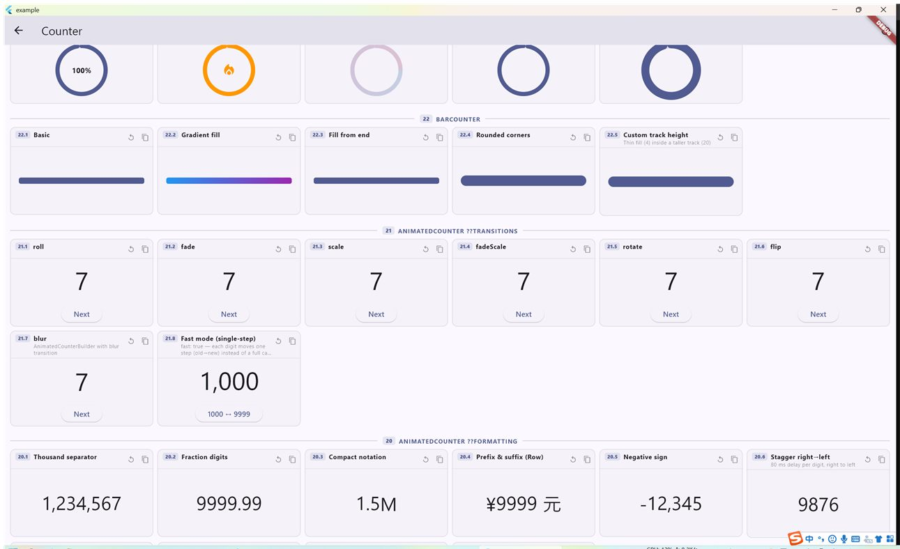
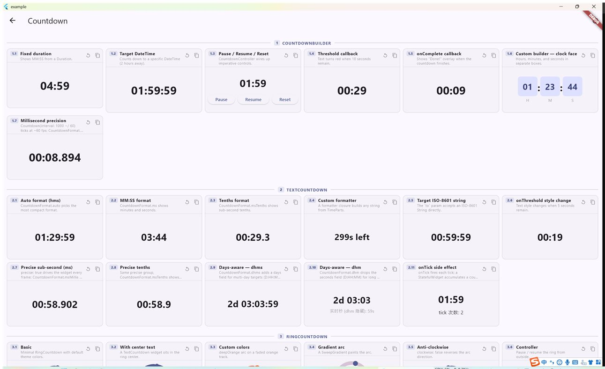
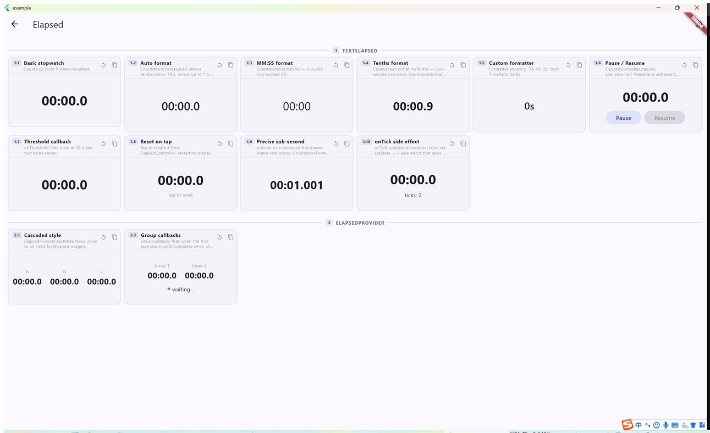

# countman

**面向 Flutter 的高性能计数器、倒计时与计时动画 —— 由一个共享的 vsync ticker 驱动，而非逐组件的定时器。专为高并发计时场景设计。**

[English](https://github.com/icodejoo/dart-labs/blob/main/countman/README.md) · **简体中文**

[](https://pub.dev/packages/countman)
[](https://github.com/icodejoo/dart-labs/blob/main/countman/LICENSE)
[](https://icodejoo.github.io/dart-labs/countman/)

**[▶ 在线演示](https://icodejoo.github.io/dart-labs/countman/)** —— 计数器 · 倒计时 · 计时，涵盖全部组件、全部 API。

> **从 0.2.x 升级？** 请先看
> [迁移指南](https://github.com/icodejoo/dart-labs/blob/main/countman/MIGRATION.md)（英文）——
> 自定义插件、`CountdownOptions` 以及相对/绝对时钟语义都有变化。

- ⚡ **无 `Timer.periodic`，无逐组件 `AnimationController`** —— 一切都由单个 `SchedulerBinding.scheduleFrameCallback` 驱动。
- 😴 **两次更新之间休眠** —— 秒级倒计时不会每个 vsync 都出一帧；调度器只在有任务到期时才醒来。
- 🚀 **专为高并发设计** —— 第 100 个活动计数器/计时器与第 1 个开销相同；当没有任何动画时，ticker 会自动进入空闲。
- 🎨 计数器 · 倒计时 · 计时，每类都提供 文本 / 环形 / 进度条 / 里程表 / 表盘 / 翻牌 渲染器，支持逐组件样式、`ThemeExtension`、控制器与 provider。

---

## 不可见时休眠

组件默认随 `TickerMode(enabled: false)`（包括 Flutter 静音的被覆盖路由）休眠。
隐藏期间 **onUpdate/onTick 不投递**，完成与阈值仍按真实时刻触发；恢复直接显示
当前值，Counter 跳到按真实时间推进后的位置（方案 A）。静音不等于暂停：不改变
runState/isPaused、不触发 onPause/onResume，用户已暂停的任务仍保持暂停。
CardCountdown 隐藏与恢复时直接落定翻牌，不停在动画半程。

单独使用原生 `Offstage` 时请配套 `TickerMode(enabled: !offstage)`，Offstage 本身不
会静音 ticker。如需保留原行为，在挂载组件前关闭开关（完全不订阅 TickerMode）：

```dart
Countman.muteWhenHidden = false; // 默认 true
```

## 限帧 fps

`fps` 只限制可见显示更新，以减少 CPU / Raster 开销；完成与阈值按真实时刻
触发，最后一帧强制落到终值。优先级为实例 > 插件 > 全局，null 逐级回退，最终
null 跟随 vsync（默认行为不变）。非法值（非有限正数）debug 断言、release 当 null。

```dart
Countman.fps = 30; // 全局，运行时修改从下一帧生效
final group = Counter(name: 'prices', fps: 20); // 插件覆盖
TextCounter(to: 999, plugin: group, fps: 10); // 单实例覆盖
CardCountdown(to: Duration(minutes: 5), fps: 30);
// 直接引擎：group.add(CounterOptions(to: 999, fps: 15));
Countman.fps = null; // 恢复全局跟随 vsync
```

Counter 与时钟引擎按固定网格推进显示节拍，依据首个 view 的 `display.refreshRate`
对齐 vsync（无有效值回退 60Hz，添加任务时刷新缓存），跳过错失时隙、不补历史帧。
以半个 vsync 为容差接受稍早的帧，全局 Timer 在 `allowed - tol` 请求下一帧，
限帧等待跳过 20ms 连续排帧窗口，避免空轮询帧。目标显示率不超过屏幕刷新率，
`period <= vsyncPeriod * 1.05` 视为不限帧。显示桶边界、完成与阈值仍取精确时刻，
不减容差、不提前。静音优先，隐藏任务无视 fps，恢复立即显示当前值。
CardCountdown 的翻牌进度由共享 Counter 驱动，fps 同样真正降低出帧，时长和曲线保持原语义。

## 截图

| 计数器 | 倒计时 | 计时 |
| :---: | :---: | :---: |
|  |  |  |
| 文本 / 环形 / 条形 / 里程表 / 动画 | 文本 / 环形 / 条形 / 表盘 / 卡片 | 秒表、高精度、Provider |

> 截取自[示例应用](https://github.com/icodejoo/dart-labs/tree/main/countman/example) —— 可在[在线演示](https://icodejoo.github.io/dart-labs/countman/)中实际体验。

---

## 为什么选择 countman？

大多数计数器包会给每个组件配一个自己的 `AnimationController`（或一个
`Timer.periodic`）。屏幕上有 N 个计数器，你就要付出 N 次帧回调
注册、N 个定时器和 N 套彼此独立、互不感知的动画生命周期。

**countman** 反其道而行：由一个 `SchedulerBinding.scheduleFrameCallback` 驱动
每一个实例。每个插件会上报**自己下一次需要运行的时间**：有动画时 ticker 逐帧渲染，
两次更新之间则**靠一个全局定时器休眠**（一秒一次的倒计时不会让引擎每秒醒 60 次），
全部空闲时停表。新增第一百个计数器与新增第一个开销相同。

```
Countman (1 scheduleFrameCallback + 1 个休眠定时器)
  ├── Counter    — 数值从 from → to 插值（动画期间每帧）
  ├── Countdown  — 相对（单调钟）或绝对（墙钟）倒计时，按更新时刻唤醒
  └── Elapsed    — 正计时/秒表，按更新时刻唤醒
```

每个引擎都是一个 `CountmanPlugin`；你可以为每类注册多个实例，
以隔离互相独立的「分组」，也可以自己写插件
（见[编写自定义插件](#writing-a-custom-plugin)）。

---

## 安装

```yaml
dependencies:
  countman: ^0.3.1
```

需要 Flutter 3.35+（Dart 3.9+）。

```dart
import 'package:countman/countman.dart';
```

---

## 性能

| 方案 | 帧回调 | 定时器分配 |
|---|---|---|
| N 个 `AnimationController` | N | N 个 vsync 监听器 |
| N 个 `Timer.periodic` | — | N 个定时器 |
| **countman** | **1** | **1 个共享休眠定时器** |

在 94 个并发 `AnimatedCounter` 实例（0 → 999,999,999）下测量：

- **Raster：8–11 ms** —— RepaintBoundary 让每个计数器处于自己的图层。
- **Build：~2 ms** —— CustomPainter 路径完全跳过组件实例化。
- **启动尖峰** 通过 `StartScheduler` 批处理分摊到多帧。

**休眠调度器（0.3.0）。** 每个任务只在自己的值跨过下一个 `interval` 边界（或完成、
或越过阈值）时才被处理。其间调度器只挂一个全局定时器，而不是每个 vsync 都请求一帧；
因此默认 1 秒间隔的文本倒计时只在每次更新前后出帧。动画（`Counter`、`CardCountdown`
的翻牌）不限帧时在运动期间仍逐帧运行。所以 `CardCountdown` 的开销主要由过渡类型和时长决定：
`calendar` 每秒约 90% 的时间在动画，`slide` / `flip` 约 45%，缩短 `duration` 会成比例降低开销。

### 与其他包的正面对比

> **注意：** 以下数据基于 **0.2.x 调度器**测得，那时倒计时存活期间每个 vsync 都会出一帧。
> 0.3.0 起两次更新之间休眠；表格保留作参考，尚未用新版本重测。

**50 个并发倒计时**，Windows 桌面 **profile** 模式，每库测量 15 s，
同一会话中依次连续运行（显示器 120 Hz）。FPS =
实际渲染帧数 ÷ 耗时；UI/raster = 每帧线程时间；
CPU = 占**一个**核心的比例，从操作系统进程外部采样；RSS =
常驻内存集大小。除 FPS/jank 外均越低越好。

**卡片 / 滑动模式** —— countman `CardCountdown(slide)` 对比 [`slide_countdown`](https://pub.dev/packages/slide_countdown) `^2.0.2`：

| 指标 | countman `CardCountdown` slide | `slide_countdown` |
|---|---|---|
| FPS（帧数 / 15 s） | **121.7** (1826) | 32.5 (488) |
| UI ms  avg / p99 | **0.80 / 2.12** | 1.32 / 4.39 |
| raster ms  avg / p99 | **0.83 / 1.47** | 1.05 / 1.76 |
| jank 帧 | 0 | 0 |
| RSS  avg / peak (MB) | 130.2 / 137.3 | 130.3 / 135.4 |
| CPU（1 核） | 26.1 % | **10.0 %** |

countman **每一帧 vsync** 都驱动滑动+缩放+透明度过渡（完全
顺滑、单帧更便宜），因此渲染的帧数多得多、总
CPU 更高；`slide_countdown` 仅在其每秒一次的滑动突发期间重绘 ——
CPU 更低，但节奏更突发、单帧更贵。两者均无卡顿，且使用
相同的内存。

**文本模式** —— countman `TextCountdown` 对比 [`stop_watch_timer`](https://pub.dev/packages/stop_watch_timer) `^3.2.2`（通过 `StreamBuilder` 驱动一个 `Text`）：

| 指标 | countman `TextCountdown` | `stop_watch_timer` |
|---|---|---|
| FPS（帧数 / 15 s） | 120.9 (1813) | 120.1 (1801) |
| UI ms  avg / p99 | **0.10 / 0.16** | 0.16 / 0.66 |
| raster ms  avg / p99 | 0.37 / 0.59 | **0.31 / 0.58** |
| jank 帧 | 0 | 0 |
| RSS  avg / peak (MB) | 113.8 / 116.0 | 113.9 / 116.4 |
| CPU（1 核） | **12.1 %** | 18.8 % |

对于纯文本倒计时，单一共享 ticker + `markNeedsPaint` 比
50 个独立的 `stop_watch_timer` 流**少用约 35% 的 CPU**
（单核 12.1 % vs 18.8 %），且单帧 UI 耗时更稳定；内存
完全相同。（同样是 0.2.x 调度器下的数据，见上方说明。）

> 使用 `example/lib/benchmark_page.dart` 复现：
> `flutter run --profile -d windows --dart-define=BENCH_LIB=countmanCard`
>（也可用 `slide` / `countmanText` / `stopWatch`）。

---

## Counter（计数器）

数值插值组件。它们在共享 ticker 上执行 `from → to` 的动画。
所有组件都接受 `from` / `to` / `duration`（默认 1000 ms）/ `curve`
（默认 `Curves.easeOut`）/ `allowNegative`（默认 `false`，钳制到 ≥ 0）/
`plugin` / `controller`（[`CounterValueController`](#counters-controller)），外加
生命周期回调 `onUpdate` / `onComplete` / `onReady` / `onStart` /
`onCancel`，以及 `animateOnce`（参见 [进阶](#animate-once-list-friendly)）。

### `TextCounter`

即插即用的文本计数器，可选前缀/后缀。

```dart
TextCounter(to: 9999)                                        // "9999"
TextCounter(to: 9999, prefix: '¥', style: const TextCounterStyle(
  textStyle: TextStyle(fontSize: 32, fontWeight: FontWeight.bold)))
TextCounter(to: 9999, prefixWidget: const Icon(Icons.star), suffix: ' pts')
TextCounter(to: 1234.56, fractionDigits: 2)                  // "1234.56"
TextCounter(to: 1234.56, formatter: (v) => v.toStringAsFixed(2))
```

| 参数 | 默认值 | 说明 |
|---|---|---|
| `to` | 必填 | 目标值 |
| `from` | `0` | 起始值 |
| `formatter` | 整数 | `String Function(double)` —— 优先于 `fractionDigits` |
| `fractionDigits` | — | 无 `formatter` 时的小数位数 |
| `style` | — | `TextCounterStyle`（`CountmanTextStyle` 的别名） |
| `prefix`/`suffix` | — | 纯文本；`prefixWidget`/`suffixWidget` 优先 |
| `semanticsLabel` | — | 固定的屏幕阅读器标签 |
| `repaintBoundary` | `false` | 隔离重绘图层 |

### `RingCounter`

朝目标填充的圆弧：progress = `(value − from) / (to − from)`。

```dart
RingCounter(
  to: 100,
  style: const RingCounterStyle(size: 80, strokeWidth: 10),
  center: const TextCounter(to: 100, suffix: '%'),
)
```

视觉样式在 [`RingCounterStyle`](#ring-style)（`RingStyle` 的别名）中。也支持
`painterBuilder: (context, progress) => CustomPainter` 来完全自定义圆弧。
画笔只创建一次，之后原地重绘。

### `BarCounter`

朝目标填充的线性进度条。

```dart
BarCounter(to: 100, style: const BarCounterStyle(
  width: 240, height: 12, gradient: LinearGradient(colors: [Colors.blue, Colors.green])))
```

视觉样式在 [`BarCounterStyle`](#bar-style)（`BarStyle` 的别名）中；同样支持
`painterBuilder`。

### `OdometerCounter`

机械里程表式的滑动数字，由自包含的 `CustomPainter` 绘制
（无第三方包）。个位数字连续滚动，更高位在整数进位时跳动。

```dart
OdometerCounter(
  to: 9999,
  style: const OdometerCounterStyle(
    numberTextStyle: TextStyle(fontSize: 40),
    letterWidth: 24,
  ),
  groupSeparator: ',',       // text drawn every 3 digits
)

OdometerCounter(from: 9999, to: 100)               // decreasing, no leading zeros
OdometerCounter(to: 500, bounceOvershoot: 0.35)    // spring overshoot per digit
```

| 参数 | 默认值 | 说明 |
|---|---|---|
| `style` | — | `OdometerCounterStyle`（`numberTextStyle`、`letterWidth` 20、`verticalOffset` 20、`fadeEnabled`、`digitAlignment`、`crossAxisAlignment`、`prefixStyle`、`suffixStyle`、`padding`、`decoration`） |
| `groupSeparator` | — | 每 3 位绘制一次的 `String` |
| `slideCurve` | — | 每位滑动的缓动 |
| `bounceOvershoot` | `0.0` | 个位每次转换的回弹过冲幅度 |
| `prefix`/`suffix`/`prefixWidget`/`suffixWidget` | — | 前后缀 |

### `AnimatedCounter`

功能完整的滚动数字计数器：可组合的过渡、错峰、紧凑记数法、小数、数位分组、
颜色着色和程序化控制。底层是常驻的 `CustomPainter` —— 每帧零次 widget 构建
（`AnimatedCounterBuilder` 变体则走 widget 树路径）。

配置分成三个对象，每个字段都可选：

- **`format: CounterFormat`** —— 数字怎么写（小数、分隔符、紧凑记数法、数字字形）。
- **`timeline: CounterTimeline`** —— 怎么动（时长、曲线、错峰、延迟、`fast`）。
- **`style: AnimatedCounterStyle`** —— 长什么样（文字样式、颜色、内边距、装饰）。

```dart
AnimatedCounter(value: 9999)

AnimatedCounter(
  value: 1000000,
  transition: CounterTransition.slide,   // .slide·.slideScale·.slideBlur·.rotate·.flip·.flipFade
  format: const CounterFormat(thousandSeparator: ','),
  timeline: const CounterTimeline(
    duration: Duration(seconds: 2),
    staggerDelay: Duration(milliseconds: 30),
    staggerDirection: StaggerDirection.rightToLeft,
  ),
  style: const AnimatedCounterStyle(
    textStyle: TextStyle(fontSize: 40, fontWeight: FontWeight.bold),
    increasingColor: Colors.green, decreasingColor: Colors.red,
  ),
)

// Currency: prefix + grouping pattern (grouping [3]=USD, [4]=CNY, [3,2]=INR)
AnimatedCounter(value: 1234.56, prefix: r'$',
    format: const CounterFormat(
        fractionDigits: 2, thousandSeparator: ',', groupingPattern: [3]))   // $1,234.56

// Compact notation
AnimatedCounter(value: 1200000,
    format: const CounterFormat(compactNotation: true))     // "1.2M"

// International numerals
AnimatedCounter(value: 2025,
    format: const CounterFormat(numeralSystem: NumeralSystem.devanagari))

// 静止时计数器显示的完整字符串（可用于标签、测试、语义）
const CounterFormat(thousandSeparator: ',', fractionDigits: 2).format(1234.5); // "1,234.50"
```

> 与这些对象重复的平铺参数（`fractionDigits`、`duration`、`textStyle` 等）自 0.3.0 起
> **已废弃**，行为与优先级不变，仍可继续使用。迁移方法见
> [迁移指南](https://github.com/icodejoo/dart-labs/blob/main/countman/MIGRATION.md#7-animatedcounter-format-timeline-style)。

直接参数：

| 参数 | 默认值 | 说明 |
|---|---|---|
| `value` | — | 目标值（或经由 `controller` 驱动） |
| `controller` | — | [`AnimatedCounterController`](#animatedcounter-controller) |
| `plugin` | — | 指定 `Counter` 分组。解析顺序：本参数 > 最近的 `CounterProvider` > `defaultCounter`；provider 的 `onGroupReady` / `onAllComplete` 对它生效 |
| `animateOnce` | — | 同一个稳定 key 只播放一次入场，见[只播放一次](#animate-once-list-friendly) |
| `transition` | `CounterTransition.slide` | 可组合的外观：预设 `.slide`·`.slideScale`·`.slideBlur`·`.rotate`·`.flip`·`.flipFade`，或由 `CounterMotion`（`none`/`slide`/`rotate`/`flip`）加 `scale`/`fade`/`blur` 修饰组合，如 `CounterTransition(motion: CounterMotion.none, scale: true)` |
| `prefix` / `infix` / `suffix` | — | 前缀/中缀/后缀文本（对应的 `*Widget` 优先） |
| `flipDirection` | `AxisDirection.up` | 数字滚动方向 |
| `minValue` / `maxValue` | — | 钳制范围 |
| `initialValue` | — | 首次动画之前显示的值 |
| `triggerHaptics` | `false` | 数字变化时的选择点击反馈 |
| `repaintBoundary` | `true` | 隔离重绘图层 |
| `semanticsLabel` | — | 固定的屏幕阅读器标签 |
| `painterBuilder` | — | 自定义 `CounterPainter` 子类工厂 |

`CounterFormat`（`format:`）：

| 字段 | 默认值 | 说明 |
|---|---|---|
| `fractionDigits` | `0` | 小数位数 |
| `wholeDigits` | `1` | 最少整数位槽数 |
| `hideLeadingZeroes` | `true` | 隐藏前导零 |
| `thousandSeparator` | — | 如 `','` |
| `groupingPattern` | `[3]` | 数位分组（印度用 `[3, 2]`，中文万进制用 `[4]`） |
| `decimalSeparator` | `'.'` | 小数点字符 |
| `compactNotation` | `false` | 把 `1200000` 显示为 `1.2M` |
| `compactFractionDigits` / `compactAbbreviations` | — / K·M·B·T | 紧凑记数法的精度与自定义缩写（`Map<num,String>`） |
| `showPositiveSign` | `false` | 为正值显示带动画的 `+` |
| `numeralSystem` / `numeralMapper` | `latin` | `easternArabic`·`persian`·`devanagari`·`bengali`，或自定义数字映射 |

`CounterTimeline`（`timeline:`）：

| 字段 | 默认值 | 说明 |
|---|---|---|
| `duration` | `300 ms` | 动画时长 |
| `curve` | `Curves.linear` | 缓动曲线 |
| `reverseDuration` / `reverseCurve` | — | 反向动画时的时长/曲线 |
| `startDelay` | — | 开始前延迟 |
| `speedMultiplier` | `1.0` | 缩放所有时长 |
| `staggerDelay` / `staggerDirection` | — / `rightToLeft` | 逐位错峰偏移与方向 |
| `autoEaseThreshold` | `100000` | 大范围线性动画自动切到 `easeInOut` 的阈值 |
| `fast` | `false` | 逐位单步：每列只从旧数字滑到新数字一个身位（如 1000→9999 只滑一次 1→9），而不是完整的级联滚动。适用于所有 `transition`；painter 路径与 widget 路径都支持。 |
| `curveForDigit` / `interpolation` / `bounceOvershoot` | — | 逐位曲线、自定义插值、过冲 |

`AnimatedCounterStyle`（`style:`）：`textStyle`、`prefixStyle` / `infixStyle` /
`suffixStyle` / `separatorStyle`、`numberAlignment`、`mainAxisAlignment` /
`crossAxisAlignment`、`padding`、`useTabularFigures`、`increasingColor` /
`decreasingColor` / `colorFadeDuration`（方向变色，由共享 ticker 驱动）、`decoration`。

`AnimatedCounter` 会遵循系统的"减弱动画"设置（`MediaQuery.disableAnimations`）：
装饰性动画直接跳到终值。

### `AnimatedCounterBuilder`

与 `AnimatedCounter` 同一引擎，但暴露 `digitBuilder` /
`digitTransitionBuilder`，让你用自己的 widget 渲染每一位数字
（始终走 widget 树路径 —— 仅留给少量计数器使用）。

```dart
AnimatedCounterBuilder(
  value: 1234,
  digitBuilder: (context, digit, style) => Text('$digit', style: style),
)
```

### `CounterBuilder`

底层驱动。通过 `builder` 暴露原始的动画 `double` —— 用它构建任何东西。
缓存的 `child` 每帧原样透传。

```dart
CounterBuilder(
  to: 9999,
  duration: const Duration(seconds: 2),
  curve: Curves.easeOut,
  builder: (context, value, child) => Text(value.toInt().toString(),
      style: const TextStyle(fontSize: 48)),
)
```

`valueTransform` 在值到达 `builder` 之前对其做映射；`onUpdate` 仍然拿到原始值。
`CounterBuilder.listenable` 则把 `ValueListenable<double>` 交给你，**不会**逐帧重建 ——
把它接到 `CustomPainter(repaint: …)` 上即可（`CountdownBuilder.listenable` 对 `TimeParts`
同理）。

### <a name="counters-controller"></a>`CounterValueController`

计数器家族（`TextCounter`、`RingCounter`、
`BarCounter`、`OdometerCounter`、`CounterBuilder`）的命令式控制。

```dart
final ctrl = CounterValueController();
TextCounter(to: 0, controller: ctrl);

ctrl.update(to: 9999, duration: const Duration(seconds: 1)); // retarget from current
ctrl.pause();
ctrl.resume();
ctrl.cancel();
ctrl.restart();    // 按组件当前配置重新播放
ctrl.value;        // current animated value
ctrl.isAnimating;  // running (not paused, not done)
ctrl.isPaused;
ctrl.isDone;
ctrl.runState;     // CountmanRunState: idle / running / paused / completed
ctrl.dispose();    // 可选：释放 runState 通知器
```

动画结束后 `update` 同样有效：组件会从屏幕上当前的值重新启动。控制器在其组件被换 key 或
转交给另一个组件时依然可用，仅替换 `controller` 也不会重启动画。
`CountdownController`、`ElapsedController` 与 `AnimatedCounterController` 同理。

### <a name="run-state"></a>监听 `runState`

每个控制器都把自己的生命周期暴露为 `ValueListenable`，播放/暂停按钮可以直接跟随真实状态，
不必自己记状态：

```dart
ValueListenableBuilder<CountmanRunState>(
  valueListenable: ctrl.runStateListenable,
  builder: (context, state, _) => IconButton(
    icon: Icon(state == CountmanRunState.running ? Icons.pause : Icons.play_arrow),
    onPressed: state == CountmanRunState.running ? ctrl.pause : ctrl.resume,
  ),
)
```

状态：`idle`（未启动或已取消）、`running`、`paused`、`completed`（自然完成）。通知器只在
状态真正变化时触发；组件构建期间产生的变化会推迟到当帧结束后再通知，因此监听者可以放心
调用 `setState`。任何时候都可以读 `ctrl.runState` 取最新值。

### <a name="animatedcounter-controller"></a>`AnimatedCounterController`

`AnimatedCounter` / `AnimatedCounterBuilder` 的更丰富控制器。

```dart
final ctrl = AnimatedCounterController(initialValue: 0);
AnimatedCounter(controller: ctrl, value: 0);

ctrl.animateTo(9999);   // animate to a value
ctrl.jumpTo(9999);      // instant, no animation
ctrl.pause();
ctrl.resume();
ctrl.stop();
ctrl.restart();
ctrl.repeat(reverse: true);
ctrl.reverse();
ctrl.status;            // AnimationStatus: forward / reverse / completed / dismissed
ctrl.runState;          // CountmanRunState（另有 runStateListenable）
ctrl.addStatusListener(listener);
```

`resume()` 只会恢复已暂停的动画，`jumpTo` 立即落位
（跳过 `startDelay`、错峰与回弹）。

---

## Countdown（倒计时）

所有倒计时组件都接受 `to` —— `Duration`、`DateTime`、`int`（自 epoch 起的毫秒）
**或** ISO-8601 `String`。共有的参数：`plugin`、`precise`、
`controller`（[`CountdownController`](#countdown-controller)）、`total`、
`rounding`、`onComplete`、`onTick`、`threshold` + `onThreshold`，以及生命周期
`onReady`/`onStart`/`onCancel`/`onPause`/`onResume`。

### 相对 vs 绝对：用哪个时钟？

| `to` | 锚定的时钟 | 系统时间被修改时 |
|---|---|---|
| `Duration`（或 `CountdownOptions.duration`） | 单调钟 | 不受影响 —— "再来 5 分钟"始终是 5 分钟 |
| `DateTime` / `int` / `String`（或 `CountdownOptions.deadline`） | 墙钟 | 倒计时随之移动 —— "20:00 结束"始终是 20:00 |

"从现在起 N 分钟"用 `Duration`；与真实时刻绑定的（开售时间、拍卖结束）用截止时刻。
切后台、掉帧都不会造成漂移；默认的 `SystemClock` 还会在应用回到前台时，把设备深睡期间
单调钟停走的时长补回来。暂停/恢复或 `reset()` 之后，任务改为按单调钟继续计时。

### `TextCountdown`

即插即用的倒计时文本。`to` 为 `Duration` 时可 `const` 构造。

```dart
TextCountdown(
  to: const Duration(minutes: 5),
  formatter: CountdownFormat.ms,
  style: const TextCountdownStyle(
    textStyle: TextStyle(fontSize: 28, fontWeight: FontWeight.bold)),
)

TextCountdown(to: DateTime(2026, 1, 1), formatter: CountdownFormat.dhms)

// 显示 10 → 1 而不是 9 → 0（向上取整），并用模板排版
TextCountdown(
  to: const Duration(seconds: 10),
  rounding: CountdownRounding.ceil,
  formatter: CountdownFormat.template('{s}s'),
)
```

### `total` 与 `rounding`

```dart
// 进度反映整个拍卖时段，而不是挂载那一刻起的剩余
RingCountdown(
  to: auctionEnd,                              // DateTime 截止时刻
  total: auctionEnd.difference(auctionStart),  // 进度分母
)
```

- **`total`** 指定 `TimeParts.progress` / `TimeParts.total` 的分母（默认是任务启动那一刻的
  剩余时间）。`reset()` 仍恢复任务创建时的剩余时间。
- **`rounding`** 为 `CountdownRounding.floor`（默认；剩余 9.3 秒显示 9）或
  `CountdownRounding.ceil`（9.3 秒显示 10，最后一整秒显示 1，到 0 才完成）。取整粒度为
  `interval`（`interval` 为 0 时按 1 秒）。完成与阈值始终按真实剩余时间判定。

`CountdownBuilder`、`TextCountdown`、`RingCountdown`、`BarCountdown`、`DialCountdown`
与 `CardCountdown` 都支持这两个参数。

### `RingCountdown`

从满到空消耗的圆环（progress = remaining / total）。默认开启前端圆点，
使慢速倒计时每个 tick 都肉眼可见地移动。

```dart
RingCountdown(
  to: const Duration(minutes: 2),
  style: const RingCountdownStyle(size: 100, strokeWidth: 10),
  center: const TextCountdown(to: Duration(minutes: 2), formatter: CountdownFormat.ms),
)
```

### `BarCountdown`

随时间流逝而缩短的线性进度条。

```dart
BarCountdown(
  to: const Duration(minutes: 1),
  style: const BarCountdownStyle(
    width: 250, height: 10,
    gradient: LinearGradient(colors: [Colors.green, Colors.yellow, Colors.red]),
    borderRadius: Radius.circular(5),
  ),
)
```

### `DialCountdown`

带四层同心环的模拟表盘（刻度、两条装饰弧、内部进度环）。
最后一分钟内，点亮的元素会按 绿 → 黄 → 红 渐变。

```dart
DialCountdown(
  to: const Duration(minutes: 5),
  style: const DialCountdownStyle(size: 200, glow: true),
  builder: (context, parts) => Text(
    '${parts.minutes.toString().padLeft(2, '0')}:'
    '${parts.seconds.toString().padLeft(2, '0')}',
    style: const TextStyle(color: Colors.white, fontSize: 28),
  ),
)
```

`DialCountdownStyle` 字段：`size`（200）、`clockwise`、`redAt`（3）、`yellowAt`
（10）、`colors`（`DialColors`）、`ticks`（`DialTicksConfig`）、`arcA`/`arcB`
（`DialArcConfig`）、`inner`（`DialInnerConfig`）、`glow`，以及显式的
`showTicks`/`showArcA`/`showArcB`/`showInner` 开关，外加 `centerAlignment` /
`padding` / `decoration`。`builder` 填充中心；`painterBuilder:
(context, parts) => CustomPainter` 替换整个表盘。

### `CardCountdown`

翻牌显示；每个时间单位（H/M/S）是一张卡片，数字变化时播放动画。
共享 Counter 进度任务驱动常驻 `CustomPainter` ——
数字变化绝不重建 widget 树。

```dart
CardCountdown(to: const Duration(hours: 1, minutes: 30))

CardCountdown(
  to: DateTime(2026, 12, 31),
  labels: const ['H', 'M', 'S'],       // pass null to hide labels
  separator: ':',
  showHours: true,                     // null = auto (shown when ≥ 1 h)
  showDays: true,                      // leading days unit (default false)
  dayLabel: 'D',
  semanticsLabel: 'Sale ends in',      // 屏幕阅读器标签，默认 'Countdown'
  style: const CardCountdownStyle(
    splitDigits: true,
    transitionType: CountdownType.slide,   // calendar · slide · flip
    scaleEffect: SlideEffect.both,
    opacityEffect: SlideEffect.enter,
    cardColor: Color(0xFF212121),
  ),
)
```

`CardCountdownStyle` 字段：`splitDigits`、`cardWidth`（56）/ `cardHeight`
（76）、`digitGap` / `unitGap`、`cardColor`、`transitionType`
（`CountdownType.calendar`/`slide`/`flip`）、`scaleEffect` / `opacityEffect`
（`SlideEffect.none`/`enter`/`exit`/`both`）、`scaleFactor`（1.5）、`perspective`
（0.006，仅 flip）、`textStyle` / `labelStyle` / `separatorStyle`、`padding` /
`decoration`。组件级参数：`duration`（450 ms）、`curve`（linear）、
`repaintBoundary`、`showDays` / `dayLabel`。小时（以及天）单元会按需
变宽，因此 100 小时及以上也能正确渲染。另见
[`CardCountdownProvider`](#providers)。

### `CountdownBuilder`

底层驱动，把剩余时间以 [`TimeParts`](#timeparts) 形式暴露出来。

```dart
CountdownBuilder(
  duration: const Duration(minutes: 5),   // or use `to:` for a deadline
  builder: (context, parts, child) => Text(CountdownFormat.ms(parts)),
)
```

`CountdownBuilder.listenable` 通过 `ValueListenable` 推送 `TimeParts`，不重建
（参见 `CounterBuilder.listenable`）。

### <a name="countdown-controller"></a>`CountdownController`

```dart
final ctrl = CountdownController();
CountdownBuilder(duration: const Duration(minutes: 2), controller: ctrl,
  builder: (_, parts, __) => Text(CountdownFormat.ms(parts)));

ctrl.pause();
ctrl.resume();
ctrl.reset();                                     // back to original duration (also after it finished)
ctrl.reset(duration: const Duration(seconds: 30)); // override duration
ctrl.restart();                                   // 按组件当前的 `to` / `total` / `rounding` 从头开始
ctrl.cancel();
ctrl.remaining;  // Duration
ctrl.isPaused;
ctrl.isDone;
ctrl.runState;   // idle / running / paused / completed —— 见"监听 runState"
```

`reset` 沿用运行中任务的时长；`restart` 重新读取组件当前的配置（例如你改了 `to`，想要
一次全新的开始）。

---

## Elapsed（计时）

秒表式计时 —— 一直向上计数，直到被取消，或到达可选的 `limit`。与 Countdown 相同的
`plugin` / `precise` / `controller`（[`ElapsedController`](#elapsed-controller)）/
`onTick` / `threshold` + `onThreshold` / 生命周期回调，外加
`since`、`initial`、`limit` 与 `onComplete`。

### `TextElapsed`

```dart
TextElapsed()                                  // 00:00, 00:01, 00:02, …
TextElapsed(formatter: CountdownFormat.hms)
TextElapsed(prefix: '⏱ ', style: const TextElapsedStyle(
  textStyle: TextStyle(fontSize: 28, fontWeight: FontWeight.bold)))

TextElapsed(since: orderTime)                  // "下单已 3 分钟"（墙钟）
TextElapsed(initial: savedElapsed)             // 恢复上次的秒表（单调钟）
TextElapsed(                                   // 到 30 分钟停止
  limit: const Duration(minutes: 30),
  onComplete: () => print('time is up'),
)
```

- **`since`** —— 墙钟起点（`已经过 = 现在 − since`）；在任务暂停/重置之前随系统时间变化。
  起点在未来时显示 0。
- **`initial`** —— 单调钟起始偏移；不受系统改时间影响。`since` 与 `initial` 互斥。
- **`limit`** —— 到达上限时发出值恰为 `limit` 的最后一次更新，随后触发 `onComplete` 并结束
  任务（`runState` 变为 `completed`）。`ElapsedHandle.updateLimit` 可动态调整。

### `ElapsedBuilder`

```dart
ElapsedBuilder(
  builder: (context, parts, child) => Text(CountdownFormat.hms(parts)),
)
```

### <a name="elapsed-controller"></a>`ElapsedController`

```dart
final ctrl = ElapsedController();
TextElapsed(controller: ctrl);

ctrl.pause();
ctrl.resume();
ctrl.reset();     // back to zero, then resume (also after cancel)
ctrl.restart();   // 按组件的 `since` / `initial` / `limit` 从头开始
ctrl.cancel();
final split = ctrl.lap();   // 记一圈，返回本圈时长
ctrl.laps;        // List<Duration>，暂停期间不计
ctrl.elapsed;     // Duration
ctrl.isPaused;
ctrl.runState;
```

`reset()` / `restart()` 会清空圈速；更换插件时圈速会保留。

---

## 格式化器（Formatters）

`CountdownFormat` 提供 `String Function(TimeParts)` 格式化器，供所有
倒计时/计时文本组件使用（通过 `formatter:`）。

| 格式化器 | 示例 | 说明 |
|---|---|---|
| `CountdownFormat.hms` | `01:23:45` | 始终显示小时 |
| `CountdownFormat.ms` | `03:07` | 分钟可超过 59 |
| `CountdownFormat.msTenths` | `00:09.7` | 十分之一秒 —— 搭配 `precise: true` |
| `CountdownFormat.msMillis` | `00:09.327` | 完整毫秒精度 —— 搭配 `precise: true` |
| `CountdownFormat.dhms` | `2d 03:04:05` | ≥ 1 天时显示整数天，否则同 `hms` |
| `CountdownFormat.dhm` | `2d 03:04` | 天 + 时 + 分（无秒） |
| `CountdownFormat.auto` | 自适应 | ≥1d → `dhms` · ≥1h → `hms` · <10s → `msTenths` · 否则 `ms` |
| `CountdownFormat.template(pattern)` | `1天 02:03:04` | 自定义排版，只解析一次 |

### `CountdownFormat.template`

做本地化或自定义排版时，用花括号包裹的记号描述输出（区分大小写）。模板在调用 `template`
时只解析一次，之后每个 tick 只做拼接。

| 记号 | 含义 |
|---|---|
| `{d}` | 天 |
| `{H}` / `{HH}` | 小时 0–23（不补零 / 补零） |
| `{TH}` | 总小时 |
| `{m}` / `{mm}` | 分钟 0–59（不补零 / 补零） |
| `{TM}` | 总分钟 |
| `{s}` / `{ss}` | 秒 0–59（不补零 / 补零） |
| `{S}` | 十分之一秒 0–9 |
| `{SSS}` | 毫秒，补零到三位 |

其他文字原样输出；未知记号（如 `{x}`）、未闭合的 `{` 与孤立的 `}` 原样保留。

```dart
TextCountdown(
  to: deadline,
  formatter: CountdownFormat.template('{d}天 {HH}:{mm}:{ss}'),   // 1天 02:03:04
)
TextCountdown(to: const Duration(minutes: 90),
    formatter: CountdownFormat.template('剩余 {TM} 分 {ss} 秒'))   // 剩余 90 分 00 秒
TextCountdown(to: const Duration(seconds: 10), precise: true,
    formatter: CountdownFormat.template('{ss}.{SSS}'))
```

也可以自己写：`formatter: (t) => '${t.totalMinutes}m ${t.seconds}s'`。

---

## 样式（Styling）

每个可视组件都接受一个 `style:` 对象；原先零散的视觉参数
（`size`、`strokeWidth`、`color`、`width`、`height`、`gradient`、`borderRadius`、
`textStyle` 等）都已并入其中。**每个** style 还带有
`decoration` + `padding`，用于容器背景 / 边框 / 圆角。

- **`CountmanTextStyle`** —— 用于文本组件。别名：`TextCounterStyle`、
  `TextCountdownStyle`、`TextElapsedStyle`。（`textStyle`、前后缀样式、`decoration`、`padding`。）

### <a name="ring-style"></a>`RingStyle`（别名 `RingCounterStyle` / `RingCountdownStyle`）

`size`、`strokeWidth`、`trackStrokeWidth`、`color`、`trackColor`、`gradient`、
`trackGradient`、`startAngle`、`strokeCap`、`clockwise`、**`sweepAngle`**（< 2π
即为部分圆弧仪表）、**`showTrack`**、`backgroundColor`、
`centerAlignment`，以及圆点：**`showThumb`**（`RingCountdown` 默认开，
`RingCounter` 默认关）、**`thumbColor`**、**`thumbRadius`**，
外加 `padding` / `decoration`。

```dart
const RingCounterStyle(
  size: 120, strokeWidth: 12,
  sweepAngle: 4.71,                     // ~270° gauge
  startAngle: 2.36,
  gradient: SweepGradient(colors: [Colors.blue, Colors.cyan]),
  showThumb: true,
)
```

### <a name="bar-style"></a>`BarStyle`（别名 `BarCounterStyle` / `BarCountdownStyle`）

`width`、`height`、`trackHeight`、`color`、`trackColor`、`gradient`、
`trackGradient`、`borderRadius`、`borderRadiusGeometry`、**`fillFromStart`**、
**`showTrack`**、**`vertical`**（沿垂直轴填充），外加 `padding` /
`decoration`。`width` / `height` 即实际布局尺寸；未显式给尺寸的垂直条
默认 8×200。渐变可使用
`AlignmentDirectional`（按所处 `Directionality` 解析）。

其他样式对象：`OdometerCounterStyle`、`DialCountdownStyle`、
`CardCountdownStyle`、`AnimatedCounterStyle`（随各自组件在上文说明）。
所有样式都是不可变的，带 `copyWith`、`merge` 与静态 `lerp`。

### <a name="countman-theme"></a>`CountmanTheme` —— 全局默认样式

`CountmanTheme` 是一个 `ThemeExtension`：在 `ThemeData.extensions` 里注册一次，
其下所有 countman 组件都会采用它的默认值。字段就是上面那些样式对象，全部可选：
`textCounterStyle`、`textCountdownStyle`、`textElapsedStyle`、`ringCounterStyle`、
`ringCountdownStyle`、`barCounterStyle`、`barCountdownStyle`、`dialCountdownStyle`、
`cardCountdownStyle`、`odometerCounterStyle`、`animatedCounterStyle`。

```dart
MaterialApp(
  theme: ThemeData(extensions: const [
    CountmanTheme(
      ringCounterStyle: RingCounterStyle(size: 96, strokeWidth: 10),
      textCountdownStyle: CountmanTextStyle(
        textStyle: TextStyle(fontSize: 28, fontWeight: FontWeight.w600),
      ),
      cardCountdownStyle: CardCountdownStyle(cardColor: Color(0xFF212121)),
    ),
  ]),
  home: const MyPage(),
)

// 在你自己的组件里：
final ring = CountmanTheme.of(context).ringCounterStyle;      // 始终返回对象
final maybe = CountmanTheme.maybeOf(context);                 // 未注册时为 null
```

样式解析顺序，逐字段回退（某字段没设置就落到下一级）：

1. 组件自己的 `style:`
2. 所在 provider 的 `*Style` 参数（**已废弃** —— 请改用主题）
3. `CountmanTheme`
4. 内置默认

因为是 `ThemeExtension`，`Theme(data: …)` 局部覆盖与 `ThemeData.lerp` 动画都照常工作
（每个样式都有 `lerp`）。

---

## Providers

Provider 把默认配置（以及可选的共享分组）下发给后代组件。组件解析每个值的顺序是
**自身属性 > provider > 内置默认**。

| Provider | 配置内容 |
|---|---|
| `CounterProvider` | 计数器家族 —— `duration`、`curve`、`allowNegative`、`textStyle`、`color`、`trackColor`、`repaintBoundary`、`animateOnce`、`plugin`、`onGroupReady`/`onAllComplete` |
| `CountdownProvider` | 倒计时家族 —— `formatter`、`textStyle`、`color`、`trackColor`、`repaintBoundary`、`plugin`、分组回调 |
| `ElapsedProvider` | 计时家族 —— `formatter`、`textStyle`、`plugin`、分组回调 |
| `CountmanProvider` | 一次覆盖三个家族（嵌套上面几个） |
| `CardCountdownProvider` | `CardCountdown` 默认值 + 一棵卡片子树共享的字形（`TextPainter`）缓存 |

> provider 上逐组件的 `*Style` 参数（`ringCounterStyle`、`textCountdownStyle` 等）已
> **废弃** —— 请改用 [`CountmanTheme`](#countman-theme)。`CountdownProvider.animateOnce`
> 也已废弃：倒计时没有入场动画。

```dart
CountmanProvider(
  textStyle: const TextStyle(fontSize: 24),
  color: Colors.teal,
  formatter: CountdownFormat.hms,
  child: MyPage(),   // TextCounter / RingCountdown / TextElapsed inside inherit these
)
```

`onGroupReady` 在分组由空闲变为活动（首个任务入队）时触发；
`onAllComplete` 在分组由活动变为空闲（最后一个任务离开）时触发。倒计时家族
—— `CountdownBuilder`、文本/环形/条形/表盘组件以及 `CardCountdown` —— 都会读取
`CountdownProvider.plugin`，所以分组回调对卡片同样生效；`AnimatedCounter` 同样会读取
`CounterProvider.plugin`。

---

## 进阶（Advanced）

### `Counter` / `Countdown` / `Elapsed` 引擎

组件只是便捷封装；你也可以直接驱动引擎。每个引擎都是一个
`CountmanPlugin`，带有一个 `name`，并（对 Countdown/Elapsed 而言）带有一个以毫秒计的 `interval`
（`1000` = 每秒一次，`0` = 每帧）。

```dart
// Top-level helpers on the auto-registered default instances:
final h  = counter(CounterOptions(to: 100, onUpdate: (v) => print(v)));
final cd = countdown(CountdownOptions(duration: const Duration(minutes: 1),
    onUpdate: (parts) => print(CountdownFormat.ms(parts))));
final dl = countdown(CountdownOptions(deadline: DateTime(2026, 12, 31),
    total: const Duration(days: 30)));
final el = elapsed(ElapsedOptions(limit: const Duration(minutes: 5),
    onUpdate: (parts) => print(parts.inSeconds),
    onComplete: () => print('done')));

el.lap();  // ElapsedHandle: lap() / laps / updateLimit / pause / resume / reset / cancel

// Default instances (auto-registered on first access):
defaultCounter; defaultCountdown; defaultElapsed;
defaultCountdownMs; defaultElapsedMs;   // interval: 0, used by precise widgets

// A custom group for isolation:
final auction = Countdown(name: 'auction', interval: 1000);
Countman.use(auction);                  // register by instance
CountdownBuilder(duration: ..., plugin: auction, builder: ...);

Countman.start();   // usually implicit — plugins request frames when they add tasks
Countman.stop();    // pause the frame loop (tasks preserved)
Countman.unuse(auction);                 // detach + dispose one group
Countman.destroy(); // stop + dispose every plugin
```

> 请在模块级或长生命周期状态级别注册分组，并复用同一个**实例**。`Countman.use` 对同一实例
> 重复注册是空操作，但用**另一个实例**注册已存在的 `name` 时，debug 下会触发 `assert`。
> 页面自建的分组，请在 `dispose` 里用 `Countman.unuse(group)` 注销。

组件解析出的插件变化时（传了新的 `plugin:`、provider 出现、`precise` 切换），运行中的任务会
**迁移**到新插件，并保留剩余/已经过时间、圈速、暂停态与当前显示值 —— 不再重启。

### 毫秒精度（`precise: true`）

对于亚秒级格式化器（`msTenths` / `msMillis`），设置 `precise: true` ——
组件会在共享的每帧分组（`defaultCountdownMs` /
`defaultElapsedMs`，`interval: 0`）上自我驱动，无需你手工接线 plugin。

```dart
TextCountdown(
  to: const Duration(seconds: 10),
  precise: true,
  formatter: CountdownFormat.msMillis,   // 00:09.327
)

ElapsedBuilder(
  precise: true,
  builder: (_, parts, __) => Text(CountdownFormat.msTenths(parts)),
)
```

当你传入了显式的 `plugin` 时，`precise` 会被忽略。

### <a name="animate-once-list-friendly"></a>只播放一次（适合列表）

在惰性列表中，计数器每次滚回视图都会重新播放其入场
动画。设置 `animateOnce: true` **并** 提供一个稳定的 `ValueKey`：入场动画
只会在该 key 于某个 provider 下首次出现时播放；之后的
重建会直接跳到目标值。计数器家族以及 `AnimatedCounter` / `AnimatedCounterBuilder` 都支持。

```dart
CounterProvider(
  animateOnce: true,
  child: ListView(children: [
    for (final row in rows)
      TextCounter(key: ValueKey(row.id), to: row.amount),
  ]),
)

AnimatedCounter(key: ValueKey(row.id), value: row.amount, animateOnce: true)
```

登记表挂在 provider 上，因此滚出/滚入后依然保留。组件自己的
`animateOnce` 会覆盖 provider 的默认值。没有稳定 id 或没有 provider 时，组件会退化为每次都
播放动画（debug 下警告一次，不再断言）。

### 批量启动（`StartScheduler`）

当一大片 `AnimatedCounter` 网格在同一帧启动时，冷启动开销
可能撑爆帧预算。`StartScheduler` 把启动分摊到多帧。

```dart
StartScheduler.instance.defaultBatchSize = 5;   // ≤ 5 starts per frame
setState(() => _target = 999);

// Per-group override:
StartScheduler.instance.groupBatchSize[myCounter] = 10;
```

对会入队的组件，请务必在 `dispose()` 里调用 `StartScheduler.instance.cancel(this)`，
以释放闭包。

### 时钟（`CountmanClock`）

倒计时与计时通过 `CountmanClock` 读时间，它有两条时间轴：`wallMicros()`（日历时钟，
用户改时间时会变）和 `monotonicMicros()`（永不跳变）。相对时长用单调钟，截止时刻用墙钟。

| 时钟 | 用途 |
|---|---|
| `SystemClock` | 默认（`CountmanClock.system`）。补偿设备深睡：应用回到前台时，把单调钟停走的时长补回来。 |
| `OffsetClock(base, offset)` | 服务器校时：把墙钟偏移 `offset`，单调钟原样透传。 |
| `ManualCountmanClock` | 确定性测试：`advance(d)` 同时推进两个钟，`jumpWall(d)` 只跳墙钟，`suspend(d)` 模拟深睡。 |

```dart
// 用服务器时间校正截止时刻（offset = serverNow - deviceNow）
final server = OffsetClock(CountmanClock.system, serverOffset);
final auction = Countdown(name: 'auction', clock: server);
TextCountdown(to: auctionEnd, plugin: auction);

// 测试：无需真实等待
final clock = ManualCountmanClock(wallTime: DateTime(2026));
final cd = Countdown(name: 'test', clock: clock);
clock.advance(const Duration(seconds: 3));   // "3 seconds pass"

// 替换全局默认时钟（用完记得恢复）
CountmanClock.system = clock;
```

更底层的 `countdownClock` / `elapsedClock` 函数仍然是 `SystemClock` 的时间源。

### <a name="writing-a-custom-plugin"></a>编写自定义插件

插件持有一队任务，并告诉共享 ticker **自己下一次需要运行的时间**。继承
`TaskQueuePlugin<T>`（通用队列、逐任务异常隔离、分组回调）或 `ClockPlugin<T>`（
Countdown/Elapsed 这类由时钟驱动的任务），也可以直接实现 `CountmanPlugin`。

`CountmanPlugin.tick(elapsed, dt)` 返回**距下次调用的微秒数**：

- `CountmanPlugin.idle`（`-1`）—— 没有要做的事；ticker 可以停止。
- `CountmanPlugin.nextFrame`（`0`）—— 下一帧再运行（动画用）。
- 正数 —— 先休眠这么久（`1000000` = 一秒）。约 20 ms 及以内的等待由下一帧处理。

`dt` 是距上一帧的间隔，**休眠后的首帧为 0**，所以会休眠的插件必须读时钟，而不是累加 `dt`。
`onDetach()` 在插件被注销（`Countman.unuse` / `destroy`）时调用；注销后的插件可以再次挂载，
所以最终清理请放在 `dispose()`。

```dart
class BeatTask extends CountmanTask {
  BeatTask(super.id, {required this.periodMicros, required this.onBeat});
  final int periodMicros;
  final void Function(int beat) onBeat;
  final Stopwatch watch = Stopwatch()..start();
  int beats = 0;
}

/// 每隔一个周期触发一次 onBeat，共十次，其间休眠。
class Beat extends TaskQueuePlugin<BeatTask> {
  Beat() : super('beat');

  @override
  void renderInitial(BeatTask t) => t.onBeat(0);        // 首帧

  @override
  void step(BeatTask t, double dtMs) {                  // 返回类型是 void
    final due = t.watch.elapsedMicroseconds ~/ t.periodMicros;
    if (due > t.beats) {
      t.beats = due;
      t.onBeat(due);
    }
    if (t.beats >= 10) t.done = true;                   // 本帧结束后被移除
  }

  /// 告诉调度器这个任务何时需要下一次 step（默认 nextFrame）。
  @override
  int nextWake(BeatTask t) {
    final remaining = (t.beats + 1) * t.periodMicros - t.watch.elapsedMicroseconds;
    return remaining <= 0 ? CountmanPlugin.nextFrame : remaining;
  }

  void start(Duration period, void Function(int beat) onBeat) => enqueue(
      BeatTask(nextId(), periodMicros: period.inMicroseconds, onBeat: onBeat));
}
```

`TaskQueuePlugin.tick` 返回所有活动任务中最早的 `nextWake`（队列为空时返回 `idle`），
逐任务隔离异常，并在首次 `enqueue` 时自动注册插件，所以 `Beat().start(...)` 无需手动
`Countman.use`。

由时钟驱动的任务请继承 `ClockPlugin<T>`；它每帧只读一次时钟，并要求你实现整数微秒的钩子：
`valueMicrosOf`、`totalOf`、`isComplete`、`boundaryWake`（距下次显示变化的时间）、
`completionWake`、`thresholdWake`、`onComplete`，可选 `displayMicrosOf`。构造器接受
`interval` 与 `clock`。对照表见
[迁移指南](https://github.com/icodejoo/dart-labs/blob/main/countman/MIGRATION.md#2-clockplugin-subclasses-integer-microsecond-hooks)，
完整示例可参考 `Countdown` / `Elapsed` 的源码。

### <a name="timeparts"></a>`TimeParts`

每个倒计时/计时 builder 收到的值对象。它在每个 tick 都会被
**原地修改**（每个任务一个，每帧零分配）—— 请同步读取
你需要的整数；不要跨帧持有。

- 分量：`days`、`hours`（0–23）、`minutes`（0–59）、`seconds`（0–59）、`millis`（0–999）
- 总量：`totalHours`、`totalMinutes`、`totalSeconds`，以及 `Duration` 风格的 `inDays`/`inHours`/…/`inMicroseconds`
- `value`（原始 `Duration`）、`total`（倒计时分母，计时为 null）、`progress`（0–1）
- `parts` —— 实时只读的 `[d, h, m, s, ms]` 视图

### 自定义画笔（`painterBuilder`）

`RingCounter`/`RingCountdown`/`BarCounter`/`BarCountdown` 接受
`painterBuilder: (context, progress) => CustomPainter`；`DialCountdown` 接受
`(context, parts) => CustomPainter`；`AnimatedCounter` 接受一个
`CounterPainterBuilder`。每个内置画笔（从
`painter/painter.dart` 导出）都有公开的、可单独覆写的绘制方法，
因此你可以继承其中一个，而不必从零开始。`RingPainter` /
`BarPainter` 接受可选的 `progressListenable`，用于原地重绘。

---

## 性能建议

- **`repaintBoundary`** —— 开启（多数组件的默认值）会让每个组件拥有自己的
  重绘层，某个组件刷新时不会连累旁边的内容。密集网格（>~10 个）关掉它、改用
  **只包住这些计时器的一个共享边界**，只能省一点 UI 线程时间（50 张卡实测约
  0.4 ms/帧），对 Raster、CPU、内存没有收益；而边界放错代价更大：共享边界如果
  同时包着页面其他内容，或者根本没有边界，每次刷新都会把这些内容一起重绘（混合
  页面实测 UI 耗时多 0.6–1.1 ms/帧，p99 最高到 2.3 倍）。除非计时器单独成组，
  否则保持默认值。
- 用 `StartScheduler` **批量启动网格**（见上文）。
- 大规模下**避免使用 `digitBuilder` / `digitTransitionBuilder`** —— 它们会强制走
  widget 路径（~0.85 ms/位/帧），而不是 CustomPainter 路径。
- **`blur` 和 `flip`** 过渡类型始终走 widget 路径 —— 在大网格中请避免。
- HH:mm:ss 显示请**使用 `interval: 1000`**（默认值）；只有真正显示亚秒数字时，
  才使用 `precise:`/`interval: 0` —— 每帧分组无法休眠。
- **`CardCountdown`** 的 fps 同样真正降低出帧；开销也取决于过渡本身：`calendar` 每秒约 90% 的时间在运动，
  `slide` / `flip` 约 45%。大网格优先选 `slide`，并缩短 `duration` 来按比例降低开销。
  `calendar` 往返两段，帧数约为 `slide` 的 2 倍。与 `slide_countdown` 对等对比时，
  使用 `slide` 过渡并设置 `duration: Duration(milliseconds: 250)`。
- **内存紧张时**：`DialCountdown` 的刻度环与 `CardCountdown` 的翻牌卡面以位图形式缓存，
  所有实例共享（LRU，分别约 32 MiB / 8 MiB）。可调用
  `DialCountdown.clearTickImageCache()` 与 `FlipCardPainter.clearFaceImageCache()`
  （例如在 `didHaveMemoryPressure` 或测试清理时）释放，下次绘制按需重建；
  两者都不会触发重绘，也不清理字形缓存。

---

## 致谢 / 归属（Credits / Attributions）

### flip_counter_plus

- 仓库：[github.com/Itsxhadi/flip_counter_plus](https://github.com/Itsxhadi/flip_counter_plus)
- 许可证：MIT
- 作用：`AnimatedCounter` 的 `DigitColumn`（以及整体结构）改编自
  `AnimatedFlipCounter`。主要改动：
  - 把 `AnimationController`（每实例 vsync）替换为共享 `Countman` ticker 上的 `Counter` 引擎。
  - 把每帧 `setState` 替换为由 `ValueNotifier` 重绘触发器驱动的常驻 `CounterPainter` ——
    每帧没有 widget 构建开销。
  - 滚动过渡由 `Positioned`（布局阶段）改为
    `Transform.translate + ClipRect`（仅合成器）。
  - 新增"全 9 目标"调整，避免退化的数字模式。

> `OdometerCounter` 不再依赖外部的 `odometer` 包 —— 它由随 countman 打包的
> 自包含 `CustomPainter` 绘制。

---

## 贡献（Contributing）

非常欢迎 Issue 和 PR —— bug 报告、功能想法、性能发现、文档，以及为
[示例应用](https://github.com/icodejoo/dart-labs/tree/main/countman/example)（它驱动着
[在线演示](https://icodejoo.github.io/dart-labs/)）新增的**演示**，都很有帮助。

- 🐛 [提交 issue](https://github.com/icodejoo/dart-labs/issues)
- 🔧 [发送 PR](https://github.com/icodejoo/dart-labs/pulls) —— 提交前请在 `countman/` 下运行
  `dart analyze` 和 `flutter test`。
- 🎨 想添加演示？在 `example/lib/` 下放一个页面，并在
  `example/lib/main.dart` 的首页入口中接入它。

## 许可证（License）

MIT —— 见 [LICENSE](https://github.com/icodejoo/dart-labs/blob/main/countman/LICENSE)。
