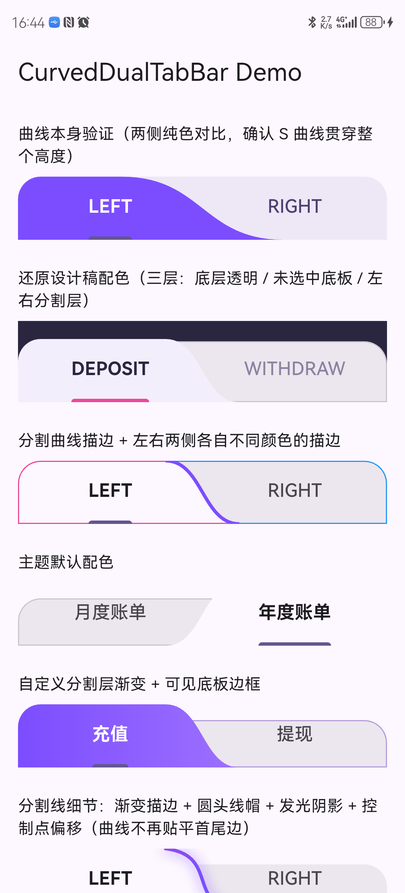

# curved_dual_tab_bar

**English** | [简体中文](README.zh-CN.md)

A tab bar with two curved segments and an animated S-curve divider. It sits on top of Flutter's own `TabBar`, so it does not fake taps or selection.

[](https://pub.dev/packages/curved_dual_tab_bar)
[](https://github.com/icodejoo/dart-labs/blob/main/curved_dual_tab_bar/LICENSE)
[](https://icodejoo.github.io/dart-labs/curved_dual_tab_bar/)

**[Live demo](https://icodejoo.github.io/dart-labs/curved_dual_tab_bar/)**: every styling option, interactive.

- **Uses Flutter's `TabBar`.** Tap targets, the selection indicator, ripple/hover/focus feedback and accessibility semantics all come from `TabBar`. This package only paints the curved background around it.
- **Themeable.** Solid colors, gradients, per-side borders, divider color and width, corner radius, lean amplitude, animation duration and curve.
- **Two ways to use it.** `CurvedDualTabBar` is a ready-made header that owns its `TabController`. `CurvedTabBackground` is only the curve painter, for when you already drive a native `TabBar` yourself.

---

## Screenshot

| Demo app |
| :---: |
|  |
| Captured on a physical Android device from the [example app](https://github.com/icodejoo/dart-labs/tree/main/curved_dual_tab_bar/example) |

> You can also try every variant on the [demo site](https://icodejoo.github.io/dart-labs/curved_dual_tab_bar/).

---

## Install

```yaml
dependencies:
  curved_dual_tab_bar: ^0.2.0
```

## Usage

```dart
import 'package:curved_dual_tab_bar/curved_dual_tab_bar.dart';

CurvedDualTabBar(
  titles: const ['DEPOSIT', 'WITHDRAW'],
  selectedIndex: selectedIndex,
  onChanged: (i) => setState(() => selectedIndex = i),
)
```

This gives you a working, animated two-tab header. `CurvedDualTabBar` creates its own `TabController` and keeps it in sync with `selectedIndex` and `onChanged`.

### Already have a native `TabBar`?

Use `CurvedTabBackground` as plain decoration and let your own `TabController` drive it:

```dart
CurvedTabBackground(
  selectedIndex: selectedIndex,
  progress: tabController.animation,
  child: TabBar(
    controller: tabController,
    indicatorColor: Colors.transparent,
    dividerColor: Colors.transparent,
    tabs: const [Tab(text: 'LEFT'), Tab(text: 'RIGHT')],
  ),
)
```

### Styling

Both widgets take `activeColor`/`inactiveColor` (or `activeGradient`/`inactiveGradient`), `unselectedColor`/`unselectedBorderColor`, `activeBorderColor`/`inactiveBorderColor`, `borderRadius`, `leanAmplitude` (how far the S-curve leans), and `duration`/`curve` for the transition animation. The [example app](https://github.com/icodejoo/dart-labs/tree/main/curved_dual_tab_bar/example) shows the combinations side by side.

### Divider styling

The divider has its own options, separate from the fill colors:

```dart
CurvedDualTabBar(
  titles: const ['DEPOSIT', 'WITHDRAW'],
  selectedIndex: selectedIndex,
  onChanged: (i) => setState(() => selectedIndex = i),
  dividerGradient: const LinearGradient(colors: [Colors.pink, Colors.purple, Colors.blue]),
  dividerWidth: 3,
  dividerCap: StrokeCap.round,
  dividerShadow: const BoxShadow(color: Colors.black26, blurRadius: 10, spreadRadius: 1),
  topControlOffset: const Offset(16, 6),
  bottomControlOffset: const Offset(-16, -6),
)
```

- `dividerColor`/`dividerWidth`: solid stroke color and width.
- `dividerGradient`: a gradient stroke; it overrides `dividerColor`.
- `dividerCap`: `StrokeCap.butt` (default, a flat cut at the top and bottom edges), `.round` or `.square`.
- `dividerShadow`: a `BoxShadow` drawn once behind the divider as a soft glow or shadow. Its `spreadRadius` makes the stroke wider; it does not grow a filled shape.
- `topControlOffset`/`bottomControlOffset`: move the curve's bezier control points directly. By default the curve is flat where it meets the top and bottom edges, like a wave crest or trough. These offsets remove that and let you reshape the S-curve independently of `leanAmplitude`.

## Why exactly 2 tabs?

The divider is a single S-shaped curve between an active and an inactive half, and that shape only makes sense for 2 segments. So `CurvedDualTabBar` asserts `titles.length == 2`. For more segments, use a plain `TabBar`.

## License

MIT — see [LICENSE](LICENSE).
