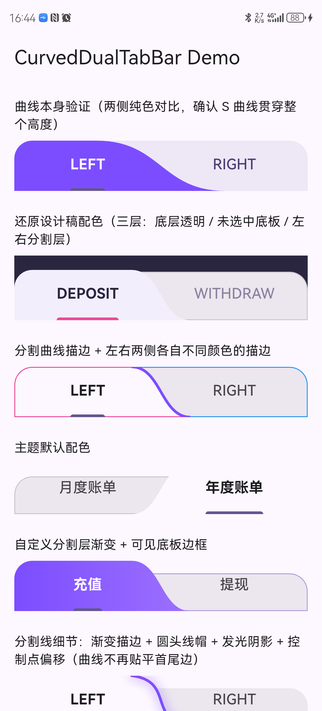

# curved_dual_tab_bar

[English](README.md) | **简体中文**

一个分成两段、中间有 S 形曲线分隔线的 Tab 栏，切换时分隔线带动画。它建立在 Flutter 自带的 `TabBar` 之上，点击和选中状态都不是自己模拟的。

[](https://pub.dev/packages/curved_dual_tab_bar)
[](https://github.com/icodejoo/dart-labs/blob/main/curved_dual_tab_bar/LICENSE)
[](https://icodejoo.github.io/dart-labs/curved_dual_tab_bar/)

**[在线 Demo](https://icodejoo.github.io/dart-labs/curved_dual_tab_bar/)**：所有样式选项都能在页面上直接调。

- **底层就是 Flutter 的 `TabBar`。** 点击区域、选中指示器、水波纹/悬停/聚焦反馈和无障碍语义都来自 `TabBar`，本包只负责在它外面画弯曲的背景。
- **样式可调。** 纯色、渐变、各边边框、分隔线颜色和宽度、圆角、倾斜幅度、动画时长和曲线。
- **两种用法。** `CurvedDualTabBar` 是现成的头部组件，自己管理 `TabController`。`CurvedTabBackground` 只画曲线背景，适合你已经在用原生 `TabBar` 的情况。

---

## 截图

| Demo 应用 |
| :---: |
|  |
| 在 Android 真机上截取，来自[示例应用](https://github.com/icodejoo/dart-labs/tree/main/curved_dual_tab_bar/example) |

> 也可以到[在线 Demo](https://icodejoo.github.io/dart-labs/curved_dual_tab_bar/)里试各种样式。

---

## 安装

```yaml
dependencies:
  curved_dual_tab_bar: ^0.2.0
```

## 用法

```dart
import 'package:curved_dual_tab_bar/curved_dual_tab_bar.dart';

CurvedDualTabBar(
  titles: const ['DEPOSIT', 'WITHDRAW'],
  selectedIndex: selectedIndex,
  onChanged: (i) => setState(() => selectedIndex = i),
)
```

这样就得到一个能用的、带动画的两段式头部。`CurvedDualTabBar` 内部会创建自己的 `TabController`，并和 `selectedIndex`、`onChanged` 保持同步。

### 已经有原生 `TabBar`？

把 `CurvedTabBackground` 当作纯装饰，由你自己的 `TabController` 驱动它：

```dart
CurvedTabBackground(
  selectedIndex: selectedIndex,
  progress: tabController.animation,
  child: TabBar(
    controller: tabController,
    indicatorColor: Colors.transparent,
    dividerColor: Colors.transparent,
    tabs: const [Tab(text: 'LEFT'), Tab(text: 'RIGHT')],
  ),
)
```

### 样式

两个组件都支持 `activeColor`/`inactiveColor`（或 `activeGradient`/`inactiveGradient`）、`unselectedColor`/`unselectedBorderColor`、`activeBorderColor`/`inactiveBorderColor`、`borderRadius`、`leanAmplitude`（S 形曲线的倾斜幅度），以及控制切换动画的 `duration`/`curve`。各种组合并排展示在[示例应用](https://github.com/icodejoo/dart-labs/tree/main/curved_dual_tab_bar/example)里。

### 分隔线样式

分隔线有一组独立于填充色的选项：

```dart
CurvedDualTabBar(
  titles: const ['DEPOSIT', 'WITHDRAW'],
  selectedIndex: selectedIndex,
  onChanged: (i) => setState(() => selectedIndex = i),
  dividerGradient: const LinearGradient(colors: [Colors.pink, Colors.purple, Colors.blue]),
  dividerWidth: 3,
  dividerCap: StrokeCap.round,
  dividerShadow: const BoxShadow(color: Colors.black26, blurRadius: 10, spreadRadius: 1),
  topControlOffset: const Offset(16, 6),
  bottomControlOffset: const Offset(-16, -6),
)
```

- `dividerColor`/`dividerWidth`：分隔线的颜色和宽度。
- `dividerGradient`：用渐变描边，会覆盖 `dividerColor`。
- `dividerCap`：`StrokeCap.butt`（默认，在顶部和底部边缘平直截断）、`.round` 或 `.square`。
- `dividerShadow`：一个 `BoxShadow`，在分隔线后面描一次，做成柔和的光晕或阴影。它的 `spreadRadius` 会让描边变粗，不会长出一块填充区域。
- `topControlOffset`/`bottomControlOffset`：直接移动曲线的贝塞尔控制点。默认情况下，曲线在顶部和底部边缘的切线是水平的，像波峰和波谷刚好擦过边缘。设了这两个偏移就不再是这样，你可以不依赖 `leanAmplitude` 来调整 S 形曲线的形状。

## 为什么只能是 2 个 Tab？

分隔线是夹在“选中”和“未选中”两半之间的一条 S 形曲线，只有分成 2 段时，这个形状才说得通。所以 `CurvedDualTabBar` 会断言 `titles.length == 2`。需要更多段的话，请用普通的 `TabBar`。

## 许可证

MIT，见 [LICENSE](LICENSE)。
