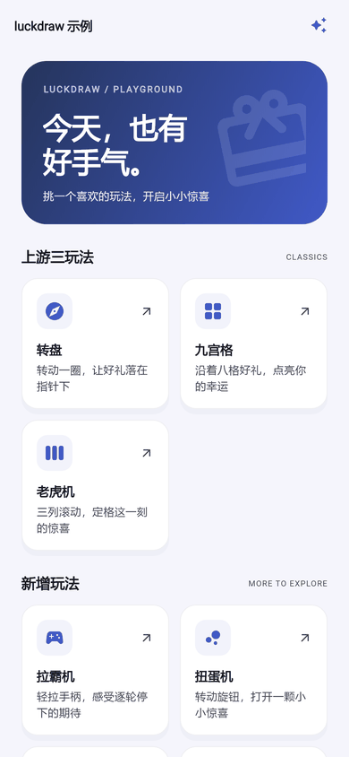
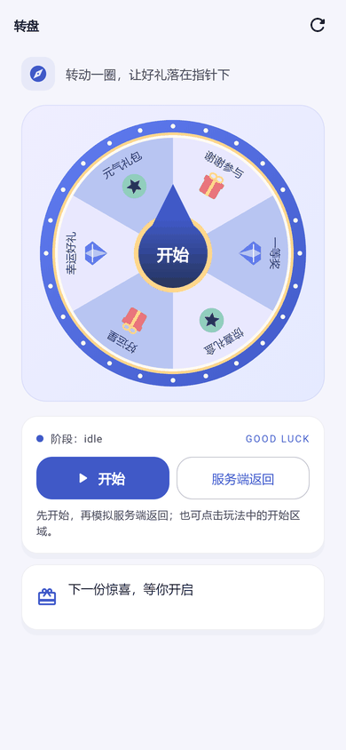
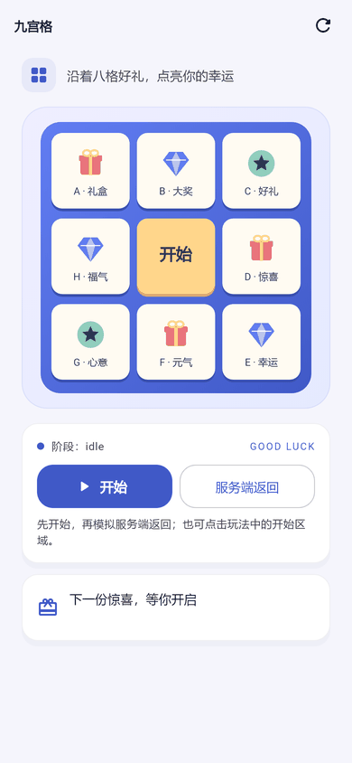
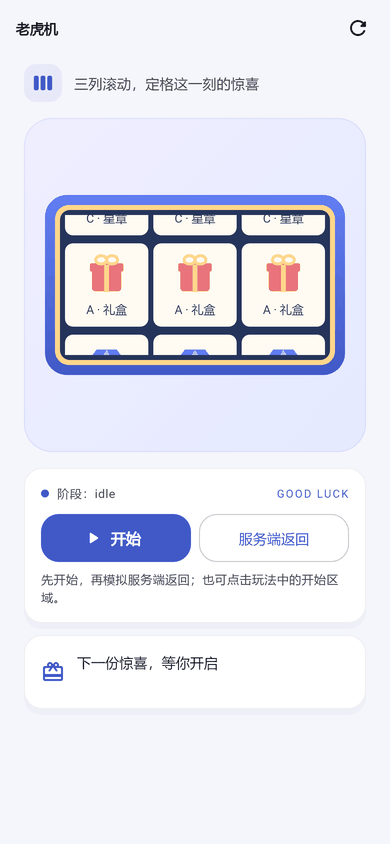
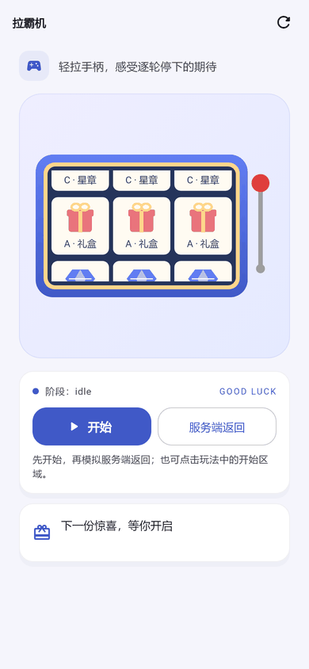
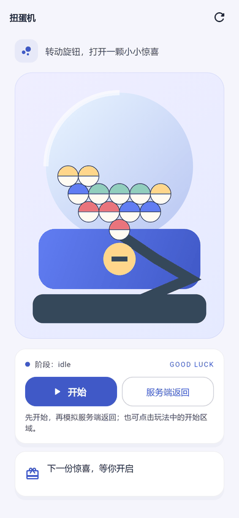
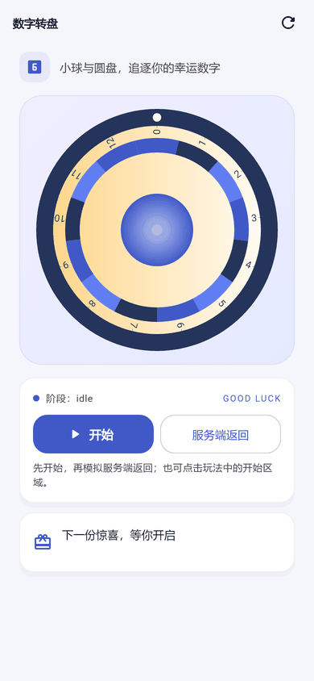
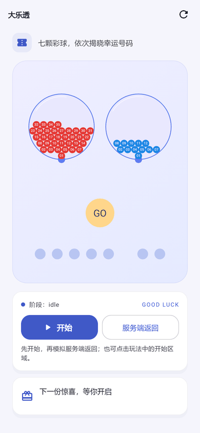

# luckdraw

**[▶ Live Demo](https://icodejoo.github.io/dart-labs/luckdraw/)** — all eight modes, runnable in the browser.

> Status: 0.1.0 candidate, not yet published to pub.dev.
>
> 简体中文: [README.zh-CN.md](./README.zh-CN.md)
>
> **Unofficial port.** luckdraw ports [lucky-canvas](https://github.com/buuing/lucky-canvas)
> (Apache-2.0) to Flutter. It is not affiliated with or endorsed by its authors.
> See [NOTICE](NOTICE) for upstream attribution.

A Flutter lucky-draw toolkit for wheels, nine-grids, slot machines, lever slots,
capsule machines, number wheels, drawing lots and super-lotto machines, with a pluggable rendering core.

**Status: 0.1.0 candidate, not yet published to pub.dev.** Repository gates pass with
zero analysis issues, 1051 tests (zero skipped), 100% `lib/` line coverage (6792/6792),
formatting, imports, static/runtime acceptance checks and parity manifest verification.
Windows and Android integration each passed 33/33 runs. Local Flutter 3.24.5 / Dart 3.5.4
analysis has zero issues and 951 non-golden tests passed; web and APK tree-shaking each
passed all ten probes without leakage. Device performance acceptance is **not fully passed**;
shadow comparisons retain measured differences and a clipped slot sample. Linux goldens,
remote CI and real pub.dev publication remain unverified. See
[the release checklist](https://github.com/icodejoo/dart-labs/blob/main/luckdraw/docs/RELEASE_CHECKLIST.md).
The 12 Dart blocks across both READMEs retain the signatures already analyzed with zero
issues in a temporary Flutter project (REL/B17b).

## Screenshots

Example app renderings, produced by this project; these are not upstream demo captures
or evidence of pixel-for-pixel matching. Light theme examples:

















Images use absolute repository raw URLs because `docs/` is excluded from the pub archive.
They require the corresponding files to be present on the repository's `main` branch;
publication of these changes has not been performed. Local originals are in
`docs/example_audit/after/` (the complete audit contains 45 PNGs, about 1.26 MB).

## Features

The implementation includes:

- Immutable typed configuration, Controllers, result callbacks and phase notifications.
- Explicit prize indices, weighted selection and asynchronous server-selected results.
- Canvas 2D rendering with cached static `ui.Picture` content and per-frame transforms.
- An effective timeline with pause/resume, background freezing and refresh-rate-independent speed.
- Separate game, renderer, easing and prize-picker interfaces; no third-party runtime dependencies.
- A separate lucky-canvas JSON compatibility layer and opt-in strict comparison preset.

The five additions beyond upstream are lever slots, capsule machines, number wheels,
drawing lots and super-lotto machines. They have no upstream equivalents to compare against.
They use deterministic animation by default; the capsule machine and lotto can opt in to a built-in physics collision mode (`physics: LuckyPhysics()`), with no third-party engine. 3D rendering is an extension path.

## Install

Planned dependency for the first release:

```yaml
dependencies:
  flutter:
    sdk: flutter
  luckdraw: ^0.1.0
```

Before the first release, check pub.dev for the actual published version and availability;
this snippet does not mean `0.1.0` is available today.
The current manifest declares Dart `^3.5.0` and Flutter `>=3.24.0`.

## Quick start

Each quick-start example is a separate `lib/main.dart` for a Flutter app using the local package.
They use text only, require no assets or server, and dispose their own Controller.
Start a round, then press **Stop** to request deceleration to the second prize (zero-based index `1`).
An accepted stop request completes through the animation; `onEnd` reports the result.

### Wheel

```dart
import 'package:flutter/material.dart';
import 'package:luckdraw/wheel.dart';

void main() => runApp(const MaterialApp(
  home: Scaffold(body: Center(child: WheelDemo())),
));

class WheelDemo extends StatefulWidget {
  const WheelDemo({super.key});
  @override
  State<WheelDemo> createState() => _WheelDemoState();
}

class _WheelDemoState extends State<WheelDemo> {
  final _controller = WheelController();
  static const _config = WheelConfig(
    prizes: [
      WheelPrize(background: LuckyFill.color(Color(0xFFE9E8FE)),
        texts: [LuckyText('Try again')], weight: 3),
      WheelPrize(background: LuckyFill.color(Color(0xFFB8C5F2)),
        texts: [LuckyText('Gift')], weight: 1),
    ],
    buttons: [
      WheelButton(radius: LuckyLength.percent(30), pointer: true,
        background: LuckyFill.color(Color(0xFF617DF2)),
        texts: [LuckyText('Spin', top: LuckyLength.px(-10))]),
    ],
  );

  @override
  Widget build(BuildContext context) => Column(
    mainAxisSize: MainAxisSize.min,
    children: [
      LuckyWheel(config: _config, controller: _controller,
        width: 300, height: 300,
        onStart: () { _controller.play(); },
        onEnd: (result) => debugPrint('Wheel: $result')),
      TextButton(onPressed: () { _controller.stop(1); },
        child: const Text('Stop')),
    ],
  );

  @override
  void dispose() {
    _controller.dispose();
    super.dispose();
  }
}
```

### Nine-grid

Prize-list order determines stop indices; `x` and `y` determine cell positions.
The eight prizes below run clockwise around the center button.

```dart
import 'package:flutter/material.dart';
import 'package:luckdraw/grid.dart';

void main() => runApp(const MaterialApp(
  home: Scaffold(body: Center(child: GridDemo())),
));

class GridDemo extends StatefulWidget {
  const GridDemo({super.key});
  @override
  State<GridDemo> createState() => _GridDemoState();
}

class _GridDemoState extends State<GridDemo> {
  final _controller = GridController();
  static const _config = GridConfig(rows: 3, cols: 3,
    prizes: [
      GridPrize(x: 0, y: 0, texts: [LuckyText('A')]),
      GridPrize(x: 1, y: 0, texts: [LuckyText('B')]),
      GridPrize(x: 2, y: 0, texts: [LuckyText('C')]),
      GridPrize(x: 2, y: 1, texts: [LuckyText('D')]),
      GridPrize(x: 2, y: 2, texts: [LuckyText('E')]),
      GridPrize(x: 1, y: 2, texts: [LuckyText('F')]),
      GridPrize(x: 0, y: 2, texts: [LuckyText('G')]),
      GridPrize(x: 0, y: 1, texts: [LuckyText('H')]),
    ],
    buttons: [GridButton(x: 1, y: 1, texts: [LuckyText('Spin')])],
    activeStyle: LuckyCellStyle(
      background: LuckyFill.color(Color(0xFFFFCE98))),
  );

  @override
  Widget build(BuildContext context) => Column(
    mainAxisSize: MainAxisSize.min,
    children: [
      LuckyGrid(config: _config, controller: _controller,
        width: 300, height: 300,
        onStart: () { _controller.play(); },
        onEnd: (result) => debugPrint('Grid: $result')),
      TextButton(onPressed: () { _controller.stop(1); },
        child: const Text('Stop')),
    ],
  );

  @override
  void dispose() {
    _controller.dispose();
    super.dispose();
  }
}
```

### Slot machine

Slots have no built-in start button or `onStart`; use an external control.
`stop(1)` targets prize `1` on every reel; `stopEach([0, 1, 2])` targets reels separately.

```dart
import 'package:flutter/material.dart';
import 'package:luckdraw/slot.dart';

void main() => runApp(const MaterialApp(
  home: Scaffold(body: Center(child: SlotDemo())),
));

class SlotDemo extends StatefulWidget {
  const SlotDemo({super.key});
  @override
  State<SlotDemo> createState() => _SlotDemoState();
}

class _SlotDemoState extends State<SlotDemo> {
  final _controller = SlotController();
  static const _config = SlotConfig(
    prizes: [
      SlotPrize(texts: [LuckyText('A')]),
      SlotPrize(texts: [LuckyText('B')]),
      SlotPrize(texts: [LuckyText('C')]),
    ],
    reels: [SlotReel(order: [0, 1, 2]), SlotReel(), SlotReel(direction: -1)],
    options: SlotOptions(mode: SlotMode.vertical, colSpacing: 5, cellAspectRatio: 0.8),
  );

  @override
  Widget build(BuildContext context) => Column(
    mainAxisSize: MainAxisSize.min,
    children: [
      LuckySlotMachine(config: _config, controller: _controller,
        width: 300, height: 180,
        onEnd: (result) => debugPrint('Slots: $result')),
      Row(mainAxisAlignment: MainAxisAlignment.center, children: [
        TextButton(onPressed: () { _controller.play(); },
          child: const Text('Spin')),
        TextButton(onPressed: () { _controller.stop(1); },
          child: const Text('Stop')),
      ]),
    ],
  );

  @override
  void dispose() {
    _controller.dispose();
    super.dispose();
  }
}
```

### Lever slot

The lever variant of the slot machine: drag the lever to start, then stop reels with `stopEach`.

```dart
import 'package:flutter/material.dart';
import 'package:luckdraw/slot.dart';

class LeverDemo extends StatefulWidget {
  const LeverDemo({super.key});

  @override
  State<LeverDemo> createState() => _LeverDemoState();
}

class _LeverDemoState extends State<LeverDemo> {
  final _controller = SlotController();
  static const _config = SlotConfig(
    prizes: [
      SlotPrize(texts: [LuckyText('7')]),
      SlotPrize(texts: [LuckyText('BAR')]),
      SlotPrize(texts: [LuckyText('★')]),
    ],
    reels: [SlotReel(), SlotReel(), SlotReel()],
  );

  @override
  Widget build(BuildContext context) => Column(
        mainAxisSize: MainAxisSize.min,
        children: [
          LuckyLeverSlotMachine(
            config: _config,
            controller: _controller,
            width: 300,
            height: 180,
            onPull: () => debugPrint('Lever pulled'),
            onEnd: (result) => debugPrint('Lever: ${result.indices}'),
          ),
          TextButton(
            onPressed: () {
              _controller.stopEach([0, 0, 0]);
            },
            child: const Text('Server result'),
          ),
        ],
      );

  @override
  void dispose() {
    _controller.dispose();
    super.dispose();
  }
}
```

### Capsule machine

Tap the knob to start; `stop(1)` drops capsule `1`. The `physics` option switches to the built-in collision mode; remove it for the deterministic animation.

```dart
import 'package:flutter/material.dart';
import 'package:luckdraw/capsule.dart';

class CapsuleDemo extends StatefulWidget {
  const CapsuleDemo({super.key});

  @override
  State<CapsuleDemo> createState() => _CapsuleDemoState();
}

class _CapsuleDemoState extends State<CapsuleDemo> {
  final _controller = CapsuleController();
  static const _config = CapsuleConfig(
    prizes: [
      CapsulePrize(
        topFill: LuckyFill.color(Color(0xFFFF8A65)),
        bottomFill: LuckyFill.color(Color(0xFFFFF3E0)),
        texts: [LuckyText('Gift')],
        weight: 1,
      ),
      CapsulePrize(
        topFill: LuckyFill.color(Color(0xFF64B5F6)),
        bottomFill: LuckyFill.color(Color(0xFFFFF3E0)),
        texts: [LuckyText('Grand')],
        weight: 1,
      ),
    ],
    options: CapsuleOptions(physics: LuckyPhysics()),
  );

  @override
  Widget build(BuildContext context) => Column(
        mainAxisSize: MainAxisSize.min,
        children: [
          LuckyCapsuleMachine(
            config: _config,
            controller: _controller,
            width: 300,
            height: 400,
            onStart: () {
              _controller.play();
            },
            onEnd: (result) => debugPrint('Capsule: ${result.index}'),
          ),
          TextButton(
            onPressed: () {
              _controller.stop(1);
            },
            child: const Text('Server result'),
          ),
        ],
      );

  @override
  void dispose() {
    _controller.dispose();
    super.dispose();
  }
}
```

### Number wheel

Stops by number instead of index: `stopNumber(8)` lands the ball in pocket 8.

```dart
import 'package:flutter/material.dart';
import 'package:luckdraw/number_wheel.dart';

class NumberWheelDemo extends StatefulWidget {
  const NumberWheelDemo({super.key});

  @override
  State<NumberWheelDemo> createState() => _NumberWheelDemoState();
}

class _NumberWheelDemoState extends State<NumberWheelDemo> {
  final _controller = NumberWheelController();
  static final _config = NumberWheelConfig.range(0, 12);

  @override
  Widget build(BuildContext context) => Column(
        mainAxisSize: MainAxisSize.min,
        children: [
          LuckyNumberWheel(
            config: _config,
            controller: _controller,
            width: 300,
            height: 300,
            onStart: () {
              _controller.play();
            },
            onEnd: (result) => debugPrint('Number: ${result.prize?.number}'),
          ),
          TextButton(
            onPressed: () {
              _controller.stopNumber(8);
            },
            child: const Text('Server result'),
          ),
        ],
      );

  @override
  void dispose() {
    _controller.dispose();
    super.dispose();
  }
}
```

### Drawing lots

Shake the cylinder, a stick comes out and unfolds; `weight` drives the default draw, `stop(0)` forces stick `0`.

```dart
import 'package:flutter/material.dart';
import 'package:luckdraw/lots.dart';

class LotsDemo extends StatefulWidget {
  const LotsDemo({super.key});

  @override
  State<LotsDemo> createState() => _LotsDemoState();
}

class _LotsDemoState extends State<LotsDemo> {
  final _controller = LotsController();
  static const _config = LotsConfig(sticks: [
    LotsStick(label: 'Great luck', weight: 1),
    LotsStick(label: 'Good luck', weight: 2),
    LotsStick(label: 'Small luck', weight: 3),
  ]);

  @override
  Widget build(BuildContext context) => Column(
        mainAxisSize: MainAxisSize.min,
        children: [
          LuckyLots(
            config: _config,
            controller: _controller,
            width: 300,
            height: 400,
            onStart: () {
              _controller.play();
            },
            onEnd: (result) => debugPrint('Lots: ${result.prize?.label}'),
          ),
          TextButton(
            onPressed: () {
              _controller.stop(0);
            },
            child: const Text('Server result'),
          ),
        ],
      );

  @override
  void dispose() {
    _controller.dispose();
    super.dispose();
  }
}
```

### Super lotto

`LottoConfig.superLotto` is the 5 + 2 preset. `stopWith(LottoDraw(...))` applies a server-drawn set of numbers; `onBallDrawn` reports each ball as it appears.

```dart
import 'package:flutter/material.dart';
import 'package:luckdraw/lotto.dart';

class LottoDemo extends StatefulWidget {
  const LottoDemo({super.key});

  @override
  State<LottoDemo> createState() => _LottoDemoState();
}

class _LottoDemoState extends State<LottoDemo> {
  final _controller = LottoController();
  static final _config = LottoConfig.superLotto(
    options: const LottoOptions(physics: LuckyPhysics()),
  );

  @override
  Widget build(BuildContext context) => Column(
        mainAxisSize: MainAxisSize.min,
        children: [
          LuckyLotto(
            config: _config,
            controller: _controller,
            width: 300,
            height: 400,
            onStart: () {
              _controller.play();
            },
            onBallDrawn: (pool, number) => debugPrint('Pool $pool: $number'),
            onEnd: (result) => debugPrint('Lotto: ${result.draw?.numbers}'),
          ),
          TextButton(
            onPressed: () {
              _controller.stopWith(const LottoDraw([
                [7, 1, 18, 25, 35],
                [12, 3],
              ]));
            },
            child: const Text('Server result'),
          ),
        ],
      );

  @override
  void dispose() {
    _controller.dispose();
    super.dispose();
  }
}
```

## Controller

Commands act on a Controller attached to a game Widget (or an explicit headless clock).
Boolean command results indicate acceptance. For example, `play()` returns `false`
while a round is running; a stop request during acceleration waits for deceleration.

| API | Use |
| --- | --- |
| `play()` | Start from idle, settled or idle-spinning. |
| `stop(index)` | Request a zero-based prize index, bypassing weights. |
| `stop()` | Let the picker select; the default is `WeightedPrizePicker`. |
| `pause()` / `resume()` | Freeze/unfreeze effective time without resetting the round. |
| `reset()` | Return to idle and reset position. |
| `cancel()` | Void a round; ignored once deceleration starts. |
| `phase.value` / `phaseChanges` | Read the current phase / subscribe to its lazy broadcast stream. |
| `frameListenable` / `frame` | Observe frames; treat the reused frame snapshot as read-only. |
| `lastResult` | Read the previous result; also available through Widget `onEnd`. |

For weighted selection, start a new round with `play()`, then call `stop()`.
The wheel example has weights `3` and `1`, giving probabilities `3/4` and `1/4`.
Null, non-positive and NaN weights are not selectable; with no eligible weight,
selection cancels rather than choosing uniformly. Disabled prizes are excluded by default.
The grid and slot examples use explicit indices, so they do not require weights.

To wait for a server result, add this method inside `_WheelDemoState` above.
Pass your request function, returning a valid index for the current prize list.
Keep one request in flight and keep that list stable until it finishes.

```dart
Future<void> drawFromServer(Future<int> Function() requestIndex) async {
  if (!_controller.play()) return;
  try {
    final index = await requestIndex();
    if (!mounted) return;
    _controller.stop(index);
  } catch (_) {
    if (mounted) _controller.cancel();
    rethrow;
  }
}
```

Alternatively, `WheelController.playUntil(resolveIndex, minSpinDuration: ...)` wraps
start, asynchronous selection and stop, returning `Future<LuckyResult<WheelPrize>>`.
Its resolver is `FutureOr<int?> Function()`; slots instead resolve `List<int>?` for all reels.

To observe phases, add this method to `_WheelDemoState` and pass a Future representing
the observation period; the subscription is cancelled when it completes.
Use Widget `onPhaseChanged` for a callback managed by the Widget lifecycle.

```dart
Future<void> observePhases(Future<void> untilDone) async {
  final subscription = _controller.phaseChanges.listen((phase) {
    debugPrint('Phase: $phase');
  });
  try {
    await untilDone;
  } finally {
    await subscription.cancel();
  }
}
```

## Import only what you use

All paths below are under `package:luckdraw/`. Game entries also export the core
user API from `luckdraw.dart`; that core entry does not export game Widgets.

| Entry | Purpose |
| --- | --- |
| `wheel.dart` | `LuckyWheel`, wheel configuration and Controller. |
| `grid.dart` | `LuckyGrid`, grid configuration and Controller. |
| `slot.dart` | `LuckySlotMachine` and the `LuckyLeverSlotMachine` variant. |
| `capsule.dart` | `LuckyCapsuleMachine`, capsule configuration and Controller. |
| `number_wheel.dart` | `LuckyNumberWheel`, numbered pockets and Controller. |
| `lots.dart` | `LuckyLots`, sticks and Controller. |
| `lotto.dart` | `LuckyLotto`, number pools, sampling and Controller. |
| `compat.dart` | JSON converters and CSS parsers; does not re-export games. |
| `extend.dart` | Custom game/rendering SPI, clocks and core user APIs exported directly from `src/core/`. |
| `testing.dart` | `ManualLuckyClock`, `SequenceRandom`, `LuckyFrameRecorder`. |

The design keeps core independent of games, games independent of each other, and compat
explicitly imported. There is no global auto-registration; an optional registry is caller-owned.
Dart tree-shakes reachable declarations, so re-exporting core does not retain every core type.
[ARCHITECTURE §17](https://github.com/icodejoo/dart-labs/blob/main/luckdraw/docs/ARCHITECTURE.md#17-摇树设计需求-6) records successful web builds
and source/symbol checks across all ten package probes, with measured size budgets.
The APK backend only parses existing size reports; its CI job is disabled pending real builds.

## Migrate from lucky-canvas

Choose the converter for your game; there is no universal JSON dispatcher:

| Converter | Converted configuration |
| --- | --- |
| `wheelFromLuckyCanvasConfig` | Wheel |
| `gridFromLuckyCanvasConfig` | Nine-grid |
| `slotFromLuckyCanvasConfig` | Slot machine |

```dart
import 'package:flutter/widgets.dart';
import 'package:luckdraw/compat.dart';
import 'package:luckdraw/wheel.dart';

Widget migratedWheel(Map<String, Object?> json) {
  final converted = wheelFromLuckyCanvasConfig(json,
    options: LuckyCanvasCompatOptions.strictUpstream());
  for (final warning in converted.warnings) {
    debugPrint(warning.toString());
  }
  return LuckyWheel(config: converted.config,
    width: converted.width, height: converted.height,
    alignment: Alignment.topLeft);
}
```

Give this Widget bounded parent constraints if the JSON omits dimensions.
For ordinary migration, `const LuckyCanvasCompatOptions(remBase: 16)` uses default behavior.
CSS strings are parsed only in compat; typed configuration uses `Color`, `LuckyFill`
and logical pixels, with `LuckyLength.px/percent` on supported fields.

The validated 1:1 scope uses npm lucky-canvas `1.7.26`, with SHA-256-locked baselines
and the source reference recorded in [NOTICE](NOTICE).
`strictUpstream()` selects `LuckyTimebase.frame` and `UpstreamStopSolver`; controlled comparisons
also use matching random sequences, fonts and assets. All 6720 numerical frames across 16 cases
match exactly after documented mappings. Keyframes pass explicit standard/text-heavy/edge-aa
tolerances; see [TEST_STRATEGY §6.5](https://github.com/icodejoo/dart-labs/blob/main/luckdraw/docs/TEST_STRATEGY.md#65-容差与已知差异) for limits.
Default mode uses `LuckyTimebase.time` and `MonotonicStopSolver`. Intentional differences include:

- Protection against reverse/zero-displacement stops, invalid inputs and background time jumps.
- Progressive images, error/fallback callbacks and controlled configuration/size updates.
- Unicode code-point text splitting; Flutter font, antialiasing and shadow differences.
- `onEnd` on the settled tick rather than one tick later; slot deceleration preserves its starting scroll.
- Visible-window slot rendering and per-reel clipping instead of a long offscreen image.
- Explicit errors for an invalid `stopEach` length; no DOM/platform wrappers or source-compatible image formatter.

Strict mode retains documented fixes and deviations; it does not recreate every upstream bug.
See [FIDELITY §8](https://github.com/icodejoo/dart-labs/blob/main/luckdraw/docs/FIDELITY.md#8-偏离与疑点清单) for the full list and comparison exclusions,
and [UPSTREAM_ISSUES](https://github.com/icodejoo/dart-labs/blob/main/luckdraw/docs/UPSTREAM_ISSUES.md) for the research behind the mitigations.
The added games have separate acceptance tests; the lotto preset draws 5 of 35 and 2 of 12
without replacement. It is an animation component, not a real lottery service.

## Extend

Use `extend.dart` to implement a custom `LuckyGame` and `LuckyRenderer`, then pass implementations
explicitly. Renderers consume layout/frame data; `LuckyEasing` and `PrizePicker` replace easing
and selection. The default backend uses Canvas; custom backends can return other Widgets.
The example below swaps only the renderer of a wheel; game logic and the Controller stay the same.

```dart
import 'package:flutter/material.dart';
import 'package:luckdraw/extend.dart';
import 'package:luckdraw/wheel.dart';

final class IndexRenderer extends LuckyRenderer<WheelConfig, WheelLayout,
    WheelFrame, LuckyResult<WheelPrize>> {
  const IndexRenderer();

  @override
  Widget buildSurface(BuildContext context,
          LuckySurfaceData<WheelConfig, WheelLayout, WheelFrame> data) =>
      Center(child: Text('pointer: ${data.frame.pointerIndex}'));
}

Widget customWheel(WheelController controller, WheelConfig config) =>
    LuckyWheel(
      config: config,
      controller: controller,
      renderer: const IndexRenderer(),
    );
```

See [ARCHITECTURE §6](https://github.com/icodejoo/dart-labs/blob/main/luckdraw/docs/ARCHITECTURE.md#6-扩展机制需求-1需求-6-7) for the extension contract.

## Testing

`testing.dart` provides `ManualLuckyClock` (advance time by hand), `SequenceRandom` (replay fixed random
values) and `LuckyFrameRecorder` (record frames). A Controller can run headless, without any Widget:

```dart
import 'package:luckdraw/testing.dart';
import 'package:luckdraw/wheel.dart';

///
int? runHeadlessWheel() {
  final clock = ManualLuckyClock();
  final controller = WheelController(random: SequenceRandom([0.5]));
  controller.attachHeadless(
    clock: clock,
    config: const WheelConfig(prizes: [
      WheelPrize(texts: [LuckyText('A')]),
      WheelPrize(texts: [LuckyText('B')]),
      WheelPrize(texts: [LuckyText('C')]),
    ]),
  );
  controller.play();
  controller.stop(2);
  while (controller.phase != LuckyPhase.settled) {
    clock.advanceFrames(1);
  }
  final index = controller.lastResult!.index;
  controller.dispose();
  clock.dispose();
  return index;
}
```

## Performance

STEADY (2026-11-11), one vivo V2417: instrumented grid/slot/lotto still fail the frozen gates; lots passes this run's three rounds. Wheel process / UI+platform / Raster CPU medians are 39.291% / 14.931% / 18.299%. A lotto preparation-reuse candidate showed no stable net benefit and was reverted. See the [STEADY report](https://github.com/icodejoo/dart-labs/blob/main/luckdraw/tool/bench/results/steady/REPORT.md); the following INSTR/MET2 records retain their historical scope.

INSTR (2026-11-11, isolated candidate): exact text-width caching reduced cold wheel/grid TextPainter.layout calls from 276/128 to 63/22. Instrumented build-duration medians changed from 38.412/24.214 ms to 27.075/12.993 ms. Increments over the historical DEVFIN blank (2.883 ms) are 24.192/10.110 ms; calibrated increment budgets are 26.612/11.121 ms. Both still miss the original 4 ms target and the three-round spread is large. CPU uses /proc tick deltas and actual host intervals; UI and platform are reported together. Wheel has only 2/5 complete driver runs, so no three-run median; lotto CPU covers mixing only. Library changes are delivered as patches for the shared workspace, pending merge. See the [INSTR report](https://github.com/icodejoo/dart-labs/blob/main/luckdraw/tool/bench/results/pending2/REPORT.md). The DEVFIN/MET2 text below remains historical and does not establish complete performance compliance.

DEVFIN (2026-11-11) reran four scenes on one vivo V2417 (Android 16), three rounds each. grid_steady: failed; slot_raster: failed; lots_shaking: uncertain; lotto_draw: failed. The 12 ms combined and 4 ms UI p99 gates were not relaxed. Cold-push UI increments (wheel/grid/slot minus blank) were 38.087/10.520/0.245 ms; calibrated increment budgets are 41.896/11.572/0.270 ms. Wheel and grid miss the original 4 ms estimate. Wheel/grid driver summarization succeeded only 2/5 and 1/5 times; raw FrameTiming responses were retained separately. All five CPU projects had 0/5 valid attempts because native statistics referred to stale intervals/PIDs. CPU remains unmeasured, and collection did not pass. Calibration does not establish design-target compliance. See the [DEVFIN report](https://github.com/icodejoo/dart-labs/blob/main/luckdraw/tool/bench/results/pending/REPORT.md).

The following MET2 results are the historical baseline; DEVFIN supersedes only the four retested scenes. Other scenes were not rerun.

`LuckyCacheMode.auto` uses bounded bitmap caching while supported segments move and vector replay when idle; strict upstream comparison retains `picture`.

All 130 saved steady windows delivered ~60 fps (59.829927–60.176516), with complete frame delivery and no real dropped frames under the timeline delivery check. Some Raster windows are contaminated by vsync backpressure unrelated to drawing content: the reference square exhibits it too. These traces do not independently measure physical display presentation. Initial regression budgets have been calibrated from measured device data; **this does not mean all original design targets were met**.

Memory meets its effective FIN RSS target. Wheel, slot_steady, lever, capsule and number_wheel pass calibrated regression budgets while missing original design targets. Grid, slot_raster and lotto fail the new per-clean-window headroom gates (combined build+raster p99 ≤12 ms, UI p99 ≤4 ms): combined maxima are 12.231, 16.905 and 12.229 ms respectively; lotto UI p99 reaches 4.386 ms. Lots remains uncertain because clean Raster costs vary too much and needs a new controlled run.

Complete list of original design target gaps (measured median / original target − 1):

| Scene missing original design targets | Metric and gap |
| --- | --- |
| wheel_steady | Raster average +1.99% |
| grid_steady | UI average +70.72%、UI P90 +18.67%、Raster average +37.49% |
| slot_steady | UI average +35.76% |
| slot_raster | UI average +6.41% |
| lever_steady | UI average +39.99%、UI P90 +4.80% |
| capsule_mixing | UI average +10.27% |
| number_wheel_spin | UI average +13.57% |
| lots_shaking | UI average +37.82%、UI P90 +1.20% |
| lotto_draw | UI average +47.92%、UI P90 +10.75% |

Ratio stability uses a 1 percentage point absolute tolerance; timings with median <0.5 ms use 0.15 ms, and other timings use 30% relative range. Normal comparisons use frozen calibrated budgets. RSS retains five cycles, informational warmup and a 1.5 MiB steady-growth gate. Cold first frame (40.378 ms) and process CPU measurement await the next device session; CPU busy indicators are estimates from frame durations, not measured process CPU.

These conclusions use three rounds on one vivo V2417 (Android 16), with the same mixed DEV/PERF sample identities as MET, not a cross-device guarantee or a single-APK rerun. See the [metric correction report](https://github.com/icodejoo/dart-labs/blob/main/luckdraw/docs/METRIC_FIX_REPORT.md) and [MET2 per-metric results](https://github.com/icodejoo/dart-labs/blob/main/luckdraw/tool/bench/results/met2/REPORT.md).

## License

[Apache-2.0](LICENSE). Based on lucky-canvas by Li Dong Qi (ldq), copyright 2021;
luckdraw copyright 2026 codejoo. Preserve the upstream attribution in [NOTICE](NOTICE).
