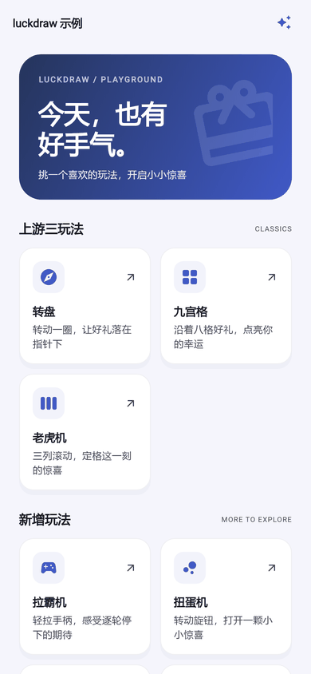
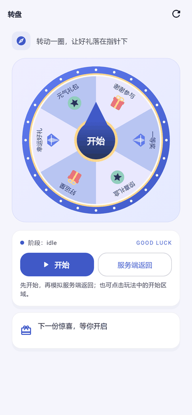
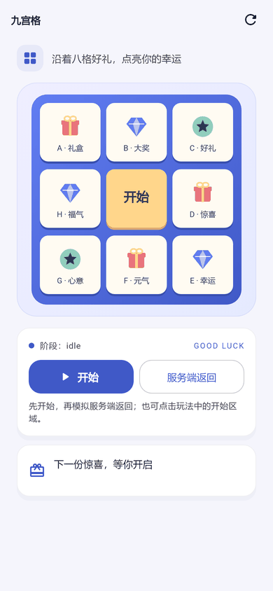
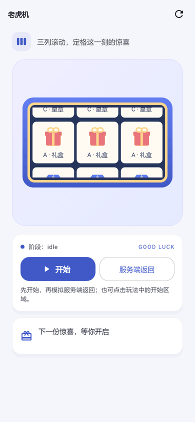
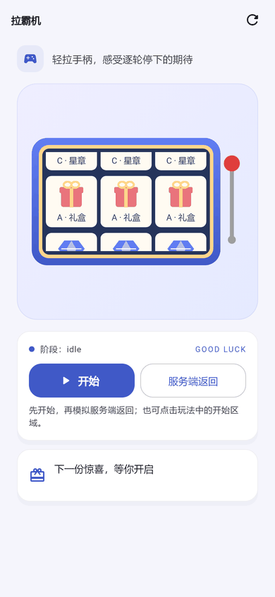
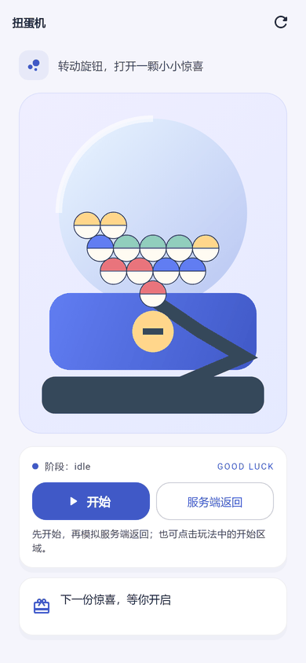
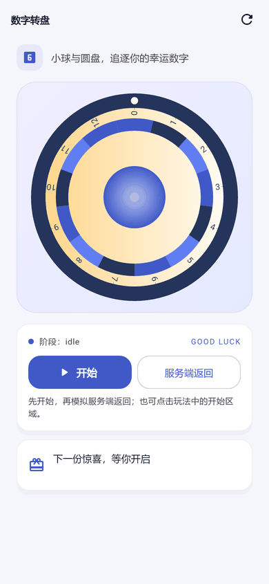
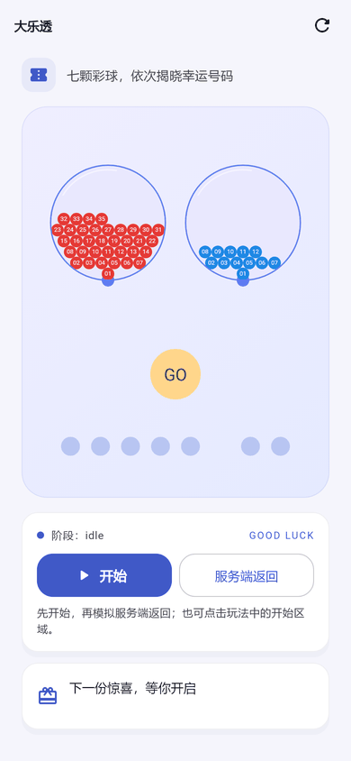

# luckdraw

**[在线 Demo](https://icodejoo.github.io/dart-labs/luckdraw/)**：八种玩法，浏览器里直接试玩。

> 状态：0.1.1，已发布到 pub.dev。
>
> English: [README.md](./README.md)
>
> **非官方移植。** luckdraw 把 [lucky-canvas](https://github.com/buuing/lucky-canvas)
>（Apache-2.0）移植到 Flutter，和 lucky-canvas 的作者没有关系，也没有得到他们的认可。
> 上游署名见 [NOTICE](NOTICE)。

Flutter 抽奖组件：大转盘、九宫格、老虎机、拉霸机、扭蛋机、数字转盘、抽签、大乐透。渲染核心可以替换。

**状态：0.1.1，已发布到 pub.dev。** 仓库检查全部通过：analyze 无问题，
1051 条测试通过（0 条跳过），`lib/` 行覆盖率 100%（6792/6792），格式、imports、
静态/运行 JSON 验收和 parity manifest 校验也都通过。Windows 和安卓集成测试各跑 33 次，全部通过。
本地 Flutter 3.24.5 / Dart 3.5.4 下，analyze 无问题，951 条非 golden 测试通过。
Web 和 APK 的摇树检查各跑十个探针，都没有泄漏。真机性能验收**还没有全部通过**：
阴影对照仍有实测差异，老虎机有一个样本被裁剪。还没验证的有 Linux golden、远程 CI 和真实发布，详见
[发布检查清单](https://github.com/icodejoo/dart-labs/blob/main/luckdraw/docs/RELEASE_CHECKLIST.md)。
两份 README 里的 12 段 Dart 代码沿用了签名，这些签名已在临时 Flutter 工程里 analyze 通过，无问题（REL/B17b）。

## 截图

以下是本项目示例工程的渲染图，不是上游演示的截图，也不代表逐像素一致。浅色主题：

















`docs/` 不在发布包里，所以图片用仓库 raw 的绝对地址。这些文件要先在仓库 `main`
分支上存在才能显示，而这些改动还没有发布。本地原图在 `docs/example_audit/after/`，
完整审计共 45 张 PNG，约 1.26 MB。

## 特性

已有的功能：

- 不可变的类型化配置、Controller、结果回调和阶段通知。
- 指定奖品下标、按权重选奖、异步等待服务端结果。
- 默认 Canvas 2D 渲染，静态内容缓存为 `ui.Picture`，每帧只做变换与回放。
- 有效时间轴：暂停恢复、后台冻结、不同刷新率下保持转速一致。
- 玩法、渲染器、缓动、选奖策略各是独立接口，要用哪个就显式传入；没有第三方运行时依赖。
- 独立的 lucky-canvas JSON 迁移层，可选严格对照预设。

拉霸机、扭蛋机、数字转盘、抽签、大乐透是新加的玩法，上游没有，没法做对照。
动画默认是确定性的；扭蛋机和大乐透可以选择开启内置的物理碰撞模式（`physics: LuckyPhysics()`），不依赖第三方物理引擎。3D 渲染只留了扩展路径。

## 安装

添加依赖：

```yaml
dependencies:
  flutter:
    sdk: flutter
  luckdraw: ^0.1.2
```

当前清单声明 Dart `^3.5.0`、Flutter `>=3.24.0`。

## 快速开始

每个示例都可以单独当作依赖本包的 Flutter 应用的 `lib/main.dart`。
示例只用文字，不需要图片资源和服务端，会自己释放 Controller。
先点开始，再点「停止」，让它减速停在第二个奖品（下标从 0 开始，即 `1`）。
停止请求被接受后，动画还要播完，结果由 `onEnd` 返回。

### 大转盘

```dart
import 'package:flutter/material.dart';
import 'package:luckdraw/wheel.dart';

void main() => runApp(const MaterialApp(
  home: Scaffold(body: Center(child: WheelDemo())),
));

class WheelDemo extends StatefulWidget {
  const WheelDemo({super.key});
  @override
  State<WheelDemo> createState() => _WheelDemoState();
}

class _WheelDemoState extends State<WheelDemo> {
  final _controller = WheelController();
  static const _config = WheelConfig(
    prizes: [
      WheelPrize(background: LuckyFill.color(Color(0xFFE9E8FE)),
        texts: [LuckyText('谢谢参与')], weight: 3),
      WheelPrize(background: LuckyFill.color(Color(0xFFB8C5F2)),
        texts: [LuckyText('礼品')], weight: 1),
    ],
    buttons: [
      WheelButton(radius: LuckyLength.percent(30), pointer: true,
        background: LuckyFill.color(Color(0xFF617DF2)),
        texts: [LuckyText('开始', top: LuckyLength.px(-10))]),
    ],
  );

  @override
  Widget build(BuildContext context) => Column(
    mainAxisSize: MainAxisSize.min,
    children: [
      LuckyWheel(config: _config, controller: _controller,
        width: 300, height: 300,
        onStart: () { _controller.play(); },
        onEnd: (result) => debugPrint('转盘：$result')),
      TextButton(onPressed: () { _controller.stop(1); },
        child: const Text('停止')),
    ],
  );

  @override
  void dispose() {
    _controller.dispose();
    super.dispose();
  }
}
```

### 九宫格

`stop` 的下标就是奖品在列表里的顺序；`x`、`y` 决定格子位置。
下面八个奖品顺时针围着中心按钮。

```dart
import 'package:flutter/material.dart';
import 'package:luckdraw/grid.dart';

void main() => runApp(const MaterialApp(
  home: Scaffold(body: Center(child: GridDemo())),
));

class GridDemo extends StatefulWidget {
  const GridDemo({super.key});
  @override
  State<GridDemo> createState() => _GridDemoState();
}

class _GridDemoState extends State<GridDemo> {
  final _controller = GridController();
  static const _config = GridConfig(rows: 3, cols: 3,
    prizes: [
      GridPrize(x: 0, y: 0, texts: [LuckyText('A')]),
      GridPrize(x: 1, y: 0, texts: [LuckyText('B')]),
      GridPrize(x: 2, y: 0, texts: [LuckyText('C')]),
      GridPrize(x: 2, y: 1, texts: [LuckyText('D')]),
      GridPrize(x: 2, y: 2, texts: [LuckyText('E')]),
      GridPrize(x: 1, y: 2, texts: [LuckyText('F')]),
      GridPrize(x: 0, y: 2, texts: [LuckyText('G')]),
      GridPrize(x: 0, y: 1, texts: [LuckyText('H')]),
    ],
    buttons: [GridButton(x: 1, y: 1, texts: [LuckyText('开始')])],
    activeStyle: LuckyCellStyle(
      background: LuckyFill.color(Color(0xFFFFCE98))),
  );

  @override
  Widget build(BuildContext context) => Column(
    mainAxisSize: MainAxisSize.min,
    children: [
      LuckyGrid(config: _config, controller: _controller,
        width: 300, height: 300,
        onStart: () { _controller.play(); },
        onEnd: (result) => debugPrint('九宫格：$result')),
      TextButton(onPressed: () { _controller.stop(1); },
        child: const Text('停止')),
    ],
  );

  @override
  void dispose() {
    _controller.dispose();
    super.dispose();
  }
}
```

### 老虎机

老虎机没有内置开始按钮，也没有 `onStart`，要自己放按钮来启动。
`stop(1)` 让所有列都停在奖品 `1`；`stopEach([0, 1, 2])` 分别指定每一列。

```dart
import 'package:flutter/material.dart';
import 'package:luckdraw/slot.dart';

void main() => runApp(const MaterialApp(
  home: Scaffold(body: Center(child: SlotDemo())),
));

class SlotDemo extends StatefulWidget {
  const SlotDemo({super.key});
  @override
  State<SlotDemo> createState() => _SlotDemoState();
}

class _SlotDemoState extends State<SlotDemo> {
  final _controller = SlotController();
  static const _config = SlotConfig(
    prizes: [
      SlotPrize(texts: [LuckyText('A')]),
      SlotPrize(texts: [LuckyText('B')]),
      SlotPrize(texts: [LuckyText('C')]),
    ],
    reels: [SlotReel(order: [0, 1, 2]), SlotReel(), SlotReel(direction: -1)],
    options: SlotOptions(mode: SlotMode.vertical, colSpacing: 5, cellAspectRatio: 0.8),
  );

  @override
  Widget build(BuildContext context) => Column(
    mainAxisSize: MainAxisSize.min,
    children: [
      LuckySlotMachine(config: _config, controller: _controller,
        width: 300, height: 180,
        onEnd: (result) => debugPrint('老虎机：$result')),
      Row(mainAxisAlignment: MainAxisAlignment.center, children: [
        TextButton(onPressed: () { _controller.play(); },
          child: const Text('开始')),
        TextButton(onPressed: () { _controller.stop(1); },
          child: const Text('停止')),
      ]),
    ],
  );

  @override
  void dispose() {
    _controller.dispose();
    super.dispose();
  }
}
```

### 拉霸机

老虎机的拉杆版本：拖动拉杆开始，再用 `stopEach` 逐轴停下。

```dart
import 'package:flutter/material.dart';
import 'package:luckdraw/slot.dart';

/// 拉霸机；拖动拉杆开始，再由外部命令错峰停轮。
class LeverDemo extends StatefulWidget {
  /// 创建拉霸机示例。
  const LeverDemo({super.key});

  /// 创建状态。
  @override
  State<LeverDemo> createState() => _LeverDemoState();
}

class _LeverDemoState extends State<LeverDemo> {
  final _controller = SlotController();
  static const _config = SlotConfig(
    prizes: [
      SlotPrize(texts: [LuckyText('7')]),
      SlotPrize(texts: [LuckyText('BAR')]),
      SlotPrize(texts: [LuckyText('★')]),
    ],
    reels: [SlotReel(), SlotReel(), SlotReel()],
  );

  @override
  Widget build(BuildContext context) => Column(
        mainAxisSize: MainAxisSize.min,
        children: [
          LuckyLeverSlotMachine(
            config: _config,
            controller: _controller,
            width: 300,
            height: 180,
            onPull: () => debugPrint('Lever pulled'),
            onEnd: (result) => debugPrint('Lever: ${result.indices}'),
          ),
          TextButton(
            // 拉杆触发 play 后，由服务端结果决定每个转轴停在哪个奖品。
            onPressed: () {
              _controller.stopEach([0, 0, 0]);
            },
            child: const Text('Server result'),
          ),
        ],
      );

  @override
  void dispose() {
    _controller.dispose();
    super.dispose();
  }
}
```

### 扭蛋机

点击旋钮开始，`stop(1)` 掉出第 1 个胶囊。`physics` 选项切换到内置碰撞模式，去掉即为确定性动画。

```dart
import 'package:flutter/material.dart';
import 'package:luckdraw/capsule.dart';

/// 扭蛋机；点击旋钮开始，服务端结果到达后掉出指定胶囊。
class CapsuleDemo extends StatefulWidget {
  /// 创建扭蛋机示例。
  const CapsuleDemo({super.key});

  /// 创建状态。
  @override
  State<CapsuleDemo> createState() => _CapsuleDemoState();
}

class _CapsuleDemoState extends State<CapsuleDemo> {
  final _controller = CapsuleController();
  static const _config = CapsuleConfig(
    prizes: [
      CapsulePrize(
        topFill: LuckyFill.color(Color(0xFFFF8A65)),
        bottomFill: LuckyFill.color(Color(0xFFFFF3E0)),
        texts: [LuckyText('Gift')],
        weight: 1,
      ),
      CapsulePrize(
        topFill: LuckyFill.color(Color(0xFF64B5F6)),
        bottomFill: LuckyFill.color(Color(0xFFFFF3E0)),
        texts: [LuckyText('Grand')],
        weight: 1,
      ),
    ],
    // 打开碰撞模式：胶囊从顶部落下，与球壁、拨杆碰撞；删掉这行即为确定性动画。
    options: CapsuleOptions(physics: LuckyPhysics()),
  );

  @override
  Widget build(BuildContext context) => Column(
        mainAxisSize: MainAxisSize.min,
        children: [
          LuckyCapsuleMachine(
            config: _config,
            controller: _controller,
            width: 300,
            height: 400,
            onStart: () {
              _controller.play();
            },
            onEnd: (result) => debugPrint('Capsule: ${result.index}'),
          ),
          TextButton(
            onPressed: () {
              _controller.stop(1);
            },
            child: const Text('Server result'),
          ),
        ],
      );

  @override
  void dispose() {
    _controller.dispose();
    super.dispose();
  }
}
```

### 数字转盘

按号码而不是下标停下：`stopNumber(8)` 让球落进 8 号袋。

```dart
import 'package:flutter/material.dart';
import 'package:luckdraw/number_wheel.dart';

/// 数字转盘；按号码而不是下标停下。
class NumberWheelDemo extends StatefulWidget {
  /// 创建数字转盘示例。
  const NumberWheelDemo({super.key});

  /// 创建状态。
  @override
  State<NumberWheelDemo> createState() => _NumberWheelDemoState();
}

class _NumberWheelDemoState extends State<NumberWheelDemo> {
  final _controller = NumberWheelController();
  // 0 到 12 共 13 个号码袋。
  static final _config = NumberWheelConfig.range(0, 12);

  @override
  Widget build(BuildContext context) => Column(
        mainAxisSize: MainAxisSize.min,
        children: [
          LuckyNumberWheel(
            config: _config,
            controller: _controller,
            width: 300,
            height: 300,
            onStart: () {
              _controller.play();
            },
            onEnd: (result) => debugPrint('Number: ${result.prize?.number}'),
          ),
          TextButton(
            onPressed: () {
              _controller.stopNumber(8);
            },
            child: const Text('Server result'),
          ),
        ],
      );

  @override
  void dispose() {
    _controller.dispose();
    super.dispose();
  }
}
```

### 抽签

摇签筒、出签、展开签文；`weight` 决定默认抽取概率，`stop(0)` 指定第 0 支签。

```dart
import 'package:flutter/material.dart';
import 'package:luckdraw/lots.dart';

/// 抽签；摇签筒、出签、展开签文。
class LotsDemo extends StatefulWidget {
  /// 创建抽签示例。
  const LotsDemo({super.key});

  /// 创建状态。
  @override
  State<LotsDemo> createState() => _LotsDemoState();
}

class _LotsDemoState extends State<LotsDemo> {
  final _controller = LotsController();
  static const _config = LotsConfig(sticks: [
    LotsStick(label: 'Great luck', weight: 1),
    LotsStick(label: 'Good luck', weight: 2),
    LotsStick(label: 'Small luck', weight: 3),
  ]);

  @override
  Widget build(BuildContext context) => Column(
        mainAxisSize: MainAxisSize.min,
        children: [
          LuckyLots(
            config: _config,
            controller: _controller,
            width: 300,
            height: 400,
            onStart: () {
              _controller.play();
            },
            onEnd: (result) => debugPrint('Lots: ${result.prize?.label}'),
          ),
          TextButton(
            onPressed: () {
              _controller.stop(0);
            },
            child: const Text('Server result'),
          ),
        ],
      );

  @override
  void dispose() {
    _controller.dispose();
    super.dispose();
  }
}
```

### 大乐透

`LottoConfig.superLotto` 是 5 + 2 预设。`stopWith(LottoDraw(...))` 使用服务端摇出的整组号码，`onBallDrawn` 逐球回调。

```dart
import 'package:flutter/material.dart';
import 'package:luckdraw/lotto.dart';

/// 大乐透；多个号码池逐球摇出，可由服务端指定整组号码。
class LottoDemo extends StatefulWidget {
  /// 创建大乐透示例。
  const LottoDemo({super.key});

  /// 创建状态。
  @override
  State<LottoDemo> createState() => _LottoDemoState();
}

class _LottoDemoState extends State<LottoDemo> {
  final _controller = LottoController();
  // 5 + 2 的超级大乐透预设；options 里的 physics 打开碰撞模式。
  static final _config = LottoConfig.superLotto(
    options: const LottoOptions(physics: LuckyPhysics()),
  );

  @override
  Widget build(BuildContext context) => Column(
        mainAxisSize: MainAxisSize.min,
        children: [
          LuckyLotto(
            config: _config,
            controller: _controller,
            width: 300,
            height: 400,
            onStart: () {
              _controller.play();
            },
            onBallDrawn: (pool, number) => debugPrint('Pool $pool: $number'),
            onEnd: (result) => debugPrint('Lotto: ${result.draw?.numbers}'),
          ),
          TextButton(
            onPressed: () {
              _controller.stopWith(const LottoDraw([
                [7, 1, 18, 25, 35],
                [12, 3],
              ]));
            },
            child: const Text('Server result'),
          ),
        ],
      );

  @override
  void dispose() {
    _controller.dispose();
    super.dispose();
  }
}
```

## Controller

Controller 要先挂到玩法 Widget 上（或挂到无头时钟上），命令才有效。
返回 bool 的命令，用返回值告诉你请求有没有被接受。例如一局进行中再调 `play()` 会返回 `false`；
加速阶段收到的停止请求，要等进入减速阶段才处理。

| API | 用法 |
| --- | --- |
| `play()` | 从空闲、已结束或待机慢转开始一局。 |
| `stop(index)` | 指定从零开始的奖品下标，不走权重。 |
| `stop()` | 交给选奖器；默认是 `WeightedPrizePicker`。 |
| `pause()` / `resume()` | 冻结/恢复有效时间，不重置本局。 |
| `reset()` | 回到空闲，位置归零。 |
| `cancel()` | 作废本局；开始减速后忽略。 |
| `phase.value` / `phaseChanges` | 读取当前阶段 / 订阅惰性创建的广播流。 |
| `frameListenable` / `frame` | 监听动画帧；帧快照对象会复用，只读使用。 |
| `lastResult` | 读取上一局结果，也可用 Widget 的 `onEnd` 接收。 |

按概率抽奖时，先用 `play()` 开始新一局，再调用无参 `stop()`。
转盘示例的权重是 `3` 和 `1`，对应概率为 `3/4` 和 `1/4`。
空值、非正数、NaN 权重不参与选奖；没有有效权重时作废，不会自动均匀抽取。
默认也排除已禁用的奖品。九宫格和老虎机示例用指定下标，不需要权重。

要等服务端结果时，把下面的方法加到上面的 `_WheelDemoState` 里。
传入你自己的请求函数，它要返回当前奖品列表里的有效下标。同一时间只发一个请求，请求结束前别改奖品列表。

```dart
Future<void> drawFromServer(Future<int> Function() requestIndex) async {
  if (!_controller.play()) return;
  try {
    final index = await requestIndex();
    if (!mounted) return;
    _controller.stop(index);
  } catch (_) {
    if (mounted) _controller.cancel();
    rethrow;
  }
}
```

也可以用 `WheelController.playUntil(resolveIndex, minSpinDuration: ...)`，它把开始、
异步选奖和停止合成一次调用，返回 `Future<LuckyResult<WheelPrize>>`。
它的 resolver 签名是 `FutureOr<int?> Function()`；老虎机的 resolver 返回覆盖全部列的 `List<int>?`。

要监听阶段变化，把下面的方法加到 `_WheelDemoState` 里，传入一个表示监听结束的 Future，
它完成时订阅就会取消。想让 Widget 帮你管理回调，用 `onPhaseChanged`。

```dart
Future<void> observePhases(Future<void> untilDone) async {
  final subscription = _controller.phaseChanges.listen((phase) {
    debugPrint('阶段：$phase');
  });
  try {
    await untilDone;
  } finally {
    await subscription.cancel();
  }
}
```

## 按需引入

下列路径均以 `package:luckdraw/` 为前缀。玩法入口同时导出 `luckdraw.dart` 的核心用户 API；
核心入口本身不导出玩法 Widget。

| 入口 | 用途 |
| --- | --- |
| `wheel.dart` | `LuckyWheel`、转盘配置与 Controller。 |
| `grid.dart` | `LuckyGrid`、九宫格配置与 Controller。 |
| `slot.dart` | `LuckySlotMachine` 及拉霸变体 `LuckyLeverSlotMachine`。 |
| `capsule.dart` | `LuckyCapsuleMachine`、扭蛋配置与 Controller。 |
| `number_wheel.dart` | `LuckyNumberWheel`、号码格与 Controller。 |
| `lots.dart` | `LuckyLots`、签条与 Controller。 |
| `lotto.dart` | `LuckyLotto`、号码池、抽样与 Controller。 |
| `compat.dart` | JSON 转换与 CSS 解析，不重新导出玩法。 |
| `extend.dart` | 自定义玩法/渲染 SPI、时钟与核心用户 API，直接从 `src/core/` 导出。 |
| `testing.dart` | `ManualLuckyClock`、`SequenceRandom`、`LuckyFrameRecorder`。 |

设计上 core 不依赖玩法，玩法互不依赖，compat 只在显式引入时使用。
没有全局自动注册；可选注册表由调用方创建和维护。
Dart 按可达性摇树，重新导出 core 也不会把所有核心类型都留下来。
[ARCHITECTURE §17](https://github.com/icodejoo/dart-labs/blob/main/luckdraw/docs/ARCHITECTURE.md#17-摇树设计需求-6) 记录了真实包全部十个探针的 Web 构建及
源码/符号检查通过，体积预算已按实测回填。APK 后端只解析已有的体积报告，CI 作业已停用，等有真实构建再开。

## 从 lucky-canvas 迁移

按玩法选择转换函数，没有通用 JSON 分派器：

| 转换函数 | 转换后的配置 |
| --- | --- |
| `wheelFromLuckyCanvasConfig` | 大转盘 |
| `gridFromLuckyCanvasConfig` | 九宫格 |
| `slotFromLuckyCanvasConfig` | 老虎机 |

```dart
import 'package:flutter/widgets.dart';
import 'package:luckdraw/compat.dart';
import 'package:luckdraw/wheel.dart';

Widget migratedWheel(Map<String, Object?> json) {
  final converted = wheelFromLuckyCanvasConfig(json,
    options: LuckyCanvasCompatOptions.strictUpstream());
  for (final warning in converted.warnings) {
    debugPrint(warning.toString());
  }
  return LuckyWheel(config: converted.config,
    width: converted.width, height: converted.height,
    alignment: Alignment.topLeft);
}
```

JSON 没写尺寸时，父容器要给出有界约束。
普通迁移可以改用 `const LuckyCanvasCompatOptions(remBase: 16)`，走默认行为。
CSS 字符串只由 compat 解析；类型化配置用 `Color`、`LuckyFill` 和逻辑像素，
支持的字段还能用 `LuckyLength.px/percent`。

1:1 对照基线来自 npm lucky-canvas `1.7.26`，由 SHA-256 锁定，源码参照见 [NOTICE](NOTICE)。
`strictUpstream()` 选择 `LuckyTimebase.frame` 和 `UpstreamStopSolver`；受控对照还需相同随机序列、字体与资源。
16 个用例共 6720 帧的数值，经过已记录的映射后全部精确相等；关键帧按 standard/text-heavy/edge-aa 三档容差通过，
具体上限见 [TEST_STRATEGY §6.5](https://github.com/icodejoo/dart-labs/blob/main/luckdraw/docs/TEST_STRATEGY.md#65-容差与已知差异)。
默认模式使用 `LuckyTimebase.time` 和 `MonotonicStopSolver`。有意做的差异主要有：

- 避免停止时倒转或零位移卡住；防住非法输入；限制从后台恢复时的时间跳变。
- 图片渐进显示、错误和回退回调，配置与尺寸受控更新。
- 文字按 Unicode 码点拆分；Flutter 的字体、抗锯齿、阴影存在平台差异。
- `onEnd` 在 settled 当帧触发，比上游早一帧；老虎机减速首帧保留起始滚动量。
- 老虎机只画可见窗口、按列裁剪，不拼超长离屏图。
- `stopEach` 长度不对会抛错；不移植 DOM/平台壳，原图片 formatter 的源码签名也不兼容。

严格模式仍保留已记录的修复与偏离，不会复刻全部上游错误。
完整差异和对照排除项见 [FIDELITY §8](https://github.com/icodejoo/dart-labs/blob/main/luckdraw/docs/FIDELITY.md#8-偏离与疑点清单)，
规避方案的调研依据见 [UPSTREAM_ISSUES](https://github.com/icodejoo/dart-labs/blob/main/luckdraw/docs/UPSTREAM_ISSUES.md)。
新增玩法单独验收；大乐透预设为前区 35 选 5、后区 12 选 2，各池无放回抽样。
它只是动画组件，不是真正的彩票服务。

## 扩展

用 `extend.dart` 实现自定义的 `LuckyGame` 和 `LuckyRenderer`，再显式传进去。
渲染器读取布局和帧数据；`LuckyEasing` 和 `PrizePicker` 分别用来替换缓动和选奖策略。
默认后端用 Canvas，自定义后端可以返回别的 Widget。
下面的例子只换掉转盘的渲染器，玩法逻辑和 Controller 不变。

```dart
import 'package:flutter/material.dart';
import 'package:luckdraw/extend.dart';
import 'package:luckdraw/wheel.dart';

/// 自定义渲染后端：不画 Canvas，只用 Text 显示当前指针指向的奖品下标。
final class IndexRenderer extends LuckyRenderer<WheelConfig, WheelLayout,
    WheelFrame, LuckyResult<WheelPrize>> {
  /// 创建渲染后端。
  const IndexRenderer();

  /// 读取布局和逐帧数据，返回任意 Widget。
  @override
  Widget buildSurface(BuildContext context,
          LuckySurfaceData<WheelConfig, WheelLayout, WheelFrame> data) =>
      Center(child: Text('pointer: ${data.frame.pointerIndex}'));
}

/// 把自定义渲染后端显式传给转盘；玩法逻辑和控制器保持不变。
Widget customWheel(WheelController controller, WheelConfig config) =>
    LuckyWheel(
      config: config,
      controller: controller,
      renderer: const IndexRenderer(),
    );
```

扩展契约见 [ARCHITECTURE §6](https://github.com/icodejoo/dart-labs/blob/main/luckdraw/docs/ARCHITECTURE.md#6-扩展机制需求-1需求-6-7)。

## 测试

`testing.dart` 提供 `ManualLuckyClock`（手动推进时间）、`SequenceRandom`（重放固定随机数）和
`LuckyFrameRecorder`（记录帧）。Controller 可以不挂 Widget 无头运行：

```dart
import 'package:luckdraw/testing.dart';
import 'package:luckdraw/wheel.dart';

/// 无 Widget 的确定性测试；用手动时钟推进动画，用固定随机序列选奖。
///
/// 返回结算后的奖品下标；没有结果时为 null。
int? runHeadlessWheel() {
  final clock = ManualLuckyClock();
  final controller = WheelController(random: SequenceRandom([0.5]));
  controller.attachHeadless(
    clock: clock,
    config: const WheelConfig(prizes: [
      WheelPrize(texts: [LuckyText('A')]),
      WheelPrize(texts: [LuckyText('B')]),
      WheelPrize(texts: [LuckyText('C')]),
    ]),
  );
  controller.play();
  controller.stop(2);
  // 每帧 16ms；到达 settled 即停止推进。
  while (controller.phase != LuckyPhase.settled) {
    clock.advanceFrames(1);
  }
  final index = controller.lastResult!.index;
  controller.dispose();
  clock.dispose();
  return index;
}
```

## 性能

下面的数据都来自同一台 vivo V2417（Android 16），不代表其他设备。各节按时间从新到旧排列，旧的几节只对应各自当时的范围。

STEADY（2026-11-11）：带打点复测后，grid、slot、lotto 仍未通过冻结的门禁，lots 这轮三轮都通过。wheel 的进程 / UI+platform / Raster CPU 中位数分别是 39.291% / 14.931% / 18.299%。lotto“准备复用”的候选改动没有稳定的净收益，已回滚。见 [STEADY 报告](https://github.com/icodejoo/dart-labs/blob/main/luckdraw/tool/bench/results/steady/REPORT.md)。

INSTR（2026-11-11，在代码副本上试的候选改动）：精确缓存文字宽度后，wheel/grid 冷首帧的 `TextPainter.layout` 次数从 276/128 降到 63/22，带打点的构建耗时中位数从 38.412/24.214 ms 降到 27.075/12.993 ms。随机、多语言、emoji、`lineClamp` 文本的输出等价。减去 DEVFIN 历史空白值（2.883 ms）后，增量是 24.192/10.110 ms，新的增量预算是 26.612/11.121 ms，都没达到原定的 4 ms 目标，三轮之间波动很大。CPU 用 `/proc` 的累计节拍差和实际主机间隔计算，UI 与平台合并标为 UI+platform。wheel 只有 2/5 次完整跑通，给不出三轮中位数；lotto 的 CPU 只覆盖搅拌阶段。库改动以补丁形式交付，没有直接改共享工作区，还没合并。见 [INSTR 报告](https://github.com/icodejoo/dart-labs/blob/main/luckdraw/tool/bench/results/pending2/REPORT.md)。下面的 DEVFIN 和 MET2 是历史记录，不代表性能已全部达标。

DEVFIN（2026-11-11）重跑了四个场景，各三轮：grid_steady 失败，slot_raster 失败，lots_shaking 不确定，lotto_draw 失败。两个门禁（合计 12 ms、UI p99 4 ms）没有放宽。冷 push 的 UI 增量（wheel/grid/slot 减去空白值）是 38.087/10.520/0.245 ms，标定后的增量预算是 41.896/11.572/0.270 ms；wheel 和 grid 没达到原定的 4 ms 估算目标。wheel/grid 的 driver 汇总只成功了 2/5 和 1/5 次，所以另外保留了原始 FrameTiming 响应。五个项目的 CPU 各五次尝试都没有有效数据（0/5），因为原生统计引用的是过期的时间段和 PID。CPU 仍然没测到，采集没有通过。标定不等于达到了设计目标。[本次报告](https://github.com/icodejoo/dart-labs/blob/main/luckdraw/tool/bench/results/pending/REPORT.md)里分别列出了全部持续动画窗口的交付结果和每轮的硬门禁，CPU 缺测和 driver 失败也都保留着。

下面的 MET2 结果是历史基线。DEVFIN 只替换它重测的四个场景，其余场景没有重跑。

`LuckyCacheMode.auto`：支持的运动段用有上限的位图缓存，静止时用矢量回放。严格上游对照仍用 `picture`。

MET2（2026-11-10，纯离线复算）：保存下来的 130 个稳定窗口帧率都约 60 fps（59.829927 到 60.176516），帧交付完整，按 timeline 的交付口径没有真实丢帧。个别窗口的 Raster 时间被 vsync 背压污染，和绘制内容无关（参照方块也一样），这些窗口测不出纯绘制成本。首版回归预算已按真机实测标定。**这不代表最初的设计目标都达到了**：1 项满足有效目标（memory，RSS 沿用 FIN 口径），5 个场景已标定但没达到最初设计目标，3 个场景失败，1 个不确定，另有 1 个首帧信息项。

回归结果：memory 满足有效 RSS 目标；wheel、slot_steady、lever、capsule、number_wheel 已按实测标定，但没达到最初设计目标；grid、slot_raster、lotto 因帧预算余量不足而失败，lots 因 Raster 不稳定而不确定，需要重新做一次受控测试。硬门禁是每个未污染窗口合计 P99 ≤ 12 ms 且 UI P99 ≤ 4 ms，实测超限的分别是 grid 12.231 ms、slot_raster 16.905 ms、lotto 12.229 ms；lotto 的 UI P99 达到 4.386 ms。

未达到最初设计目标的场景（实测中位数 / 最初目标 − 1）：

| 场景 | 指标与差距 |
| --- | --- |
| wheel_steady | Raster 均值 +1.99% |
| grid_steady | UI 均值 +70.72%、UI P90 +18.67%、Raster 均值 +37.49% |
| slot_steady | UI 均值 +35.76% |
| slot_raster | UI 均值 +6.41% |
| lever_steady | UI 均值 +39.99%、UI P90 +4.80% |
| capsule_mixing | UI 均值 +10.27% |
| number_wheel_spin | UI 均值 +13.57% |
| lots_shaking | UI 均值 +37.82%、UI P90 +1.20% |
| lotto_draw | UI 均值 +47.92%、UI P90 +10.75% |

比例稳定性用 1 个百分点的绝对容差；中位数小于 0.5 ms 的耗时用 0.15 ms，其余用 30% 的相对极差。正常回归只和冻结的预算比较。RSS 仍是五次循环，预热只作参考，后四次净增长 ≤ 1.5 MiB。首帧（40.378 ms）和进程 CPU 要等下次真机会话再测。CPU 忙占比只是由帧耗时推算的，不是进程 CPU 实测。

MET2 的样本沿用 MET 的 DEV/PERF 混合来源，不是同一个 APK 全量重测。见[第二轮度量修正报告](https://github.com/icodejoo/dart-labs/blob/main/luckdraw/docs/METRIC_FIX_REPORT.md)和 [MET2 逐指标报告](https://github.com/icodejoo/dart-labs/blob/main/luckdraw/tool/bench/results/met2/REPORT.md)。

## 许可证

[Apache-2.0](LICENSE)。基于 Li Dong Qi（ldq）的 lucky-canvas，保留上游 2021 年版权署名；
luckdraw 版权为 2026 codejoo。上游声明须按 [NOTICE](NOTICE) 保留。
