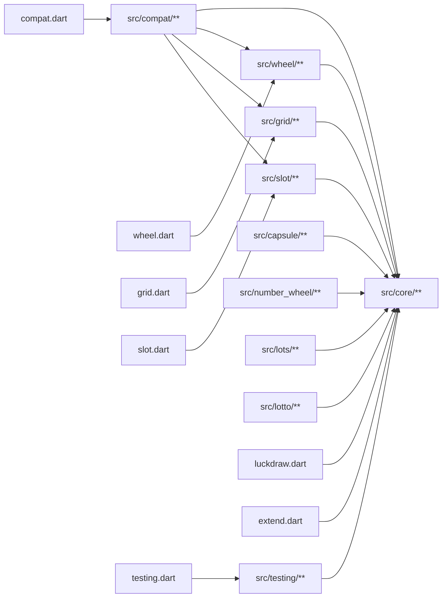
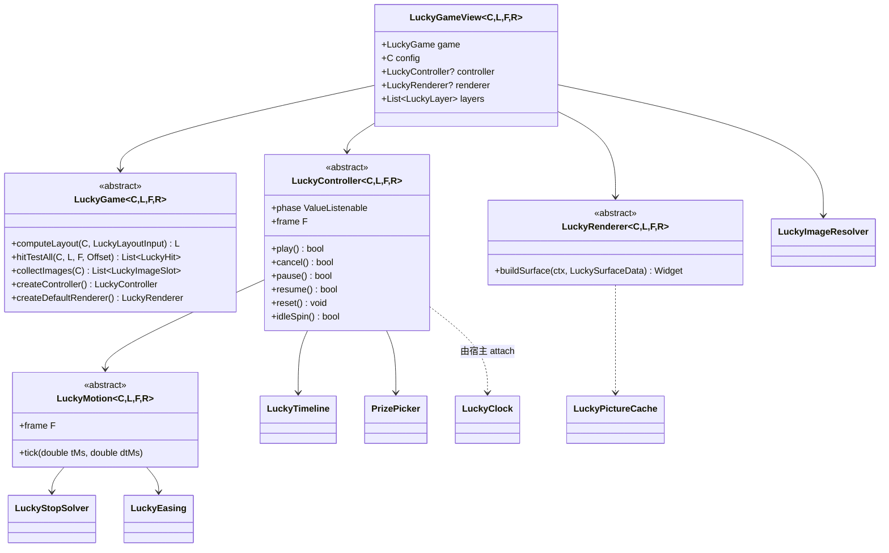
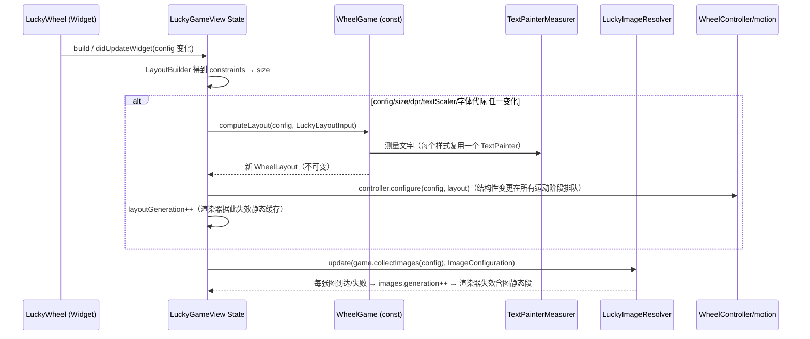
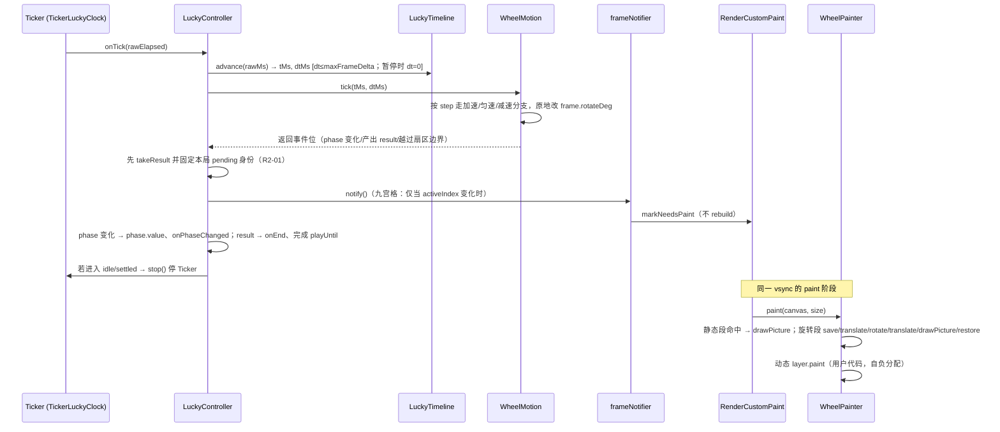
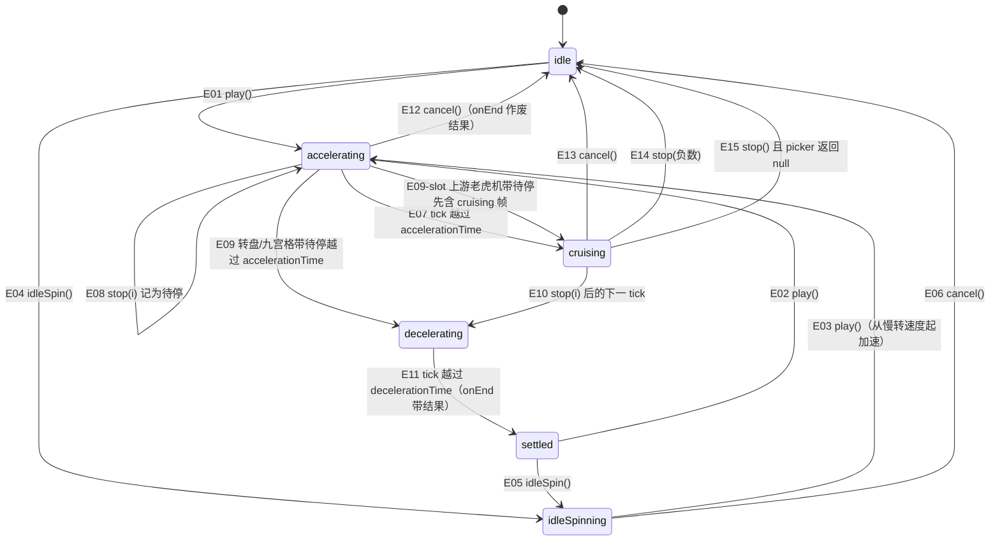

# luckdraw 架构设计

> 状态：已按落地事实对齐（第三轮，2026-11-10）。真机集成、最低版本与 Web/APK 摇树已取得本地证据；真机性能验收未完全通过，Linux/远程 CI 与真实发布仍待验证。
> 配套文档：[FIDELITY.md](FIDELITY.md)（上游逐项对照）、[IMPLEMENTATION_GUIDE.md](IMPLEMENTATION_GUIDE.md)（任务卡与代码骨架）、[TEST_STRATEGY.md](TEST_STRATEGY.md)（测试、门禁、验收矩阵）、[UPSTREAM_ISSUES.md](UPSTREAM_ISSUES.md)（上游 issue 调研，只读输入）。
> 本文中的验收编号（`R1-03`、`SM-E07`、`IMP-05`、`ISS-419` …）全部在 TEST_STRATEGY.md §5 矩阵草稿里定义，并映射到真实测试名。

---

## 0. 一页结论

| 主题 | 结论 |
| --- | --- |
| 包形态 | **单包 `luckdraw`、多入口 library**：`luckdraw.dart`（核心用户 API）/`extend.dart`（扩展 SPI）/`wheel.dart`/`grid.dart`/`slot.dart`（含拉霸机）/`capsule.dart`（扭蛋机）/`number_wheel.dart`（数字转盘）/`lots.dart`（抽签）/`lotto.dart`（大乐透）/`compat.dart`/`testing.dart`。玩法只依赖 core，core 不依赖玩法，玩法互不依赖，compat 只被用户显式引入。3D 等带重依赖的后端将来作为独立包 `luckdraw_3d`，只依赖 `luckdraw` 的 core 与对应玩法入口。（ADR-01） |
| 插件机制 | **抽象类 + 用户显式传入**，没有库级全局注册表、没有加载期自动注册；可选的 `LuckyGameRegistry` 是用户自己 `new` 出来、自己 `add` 的实例。摇树已在 scratchpad 实测成立（§17）。（ADR-02） |
| 渲染 | 默认 Canvas 2D（`CustomPainter`），**默认 auto：支持位图的运动段使用位图，静止时矢量回放**；所有位图受 `maxRasterSide` 约束。不做长条离屏图（规避 #297）。（ADR-03、ADR-11） |
| 时间 | `Ticker` 驱动 + **有效时间轴**（单帧 dt 钳制、后台/显式暂停冻结）；默认 `LuckyTimebase.time`（120Hz 与 60Hz 转速一致），`LuckyTimebase.frame` 逐帧复刻上游语义供 1:1 对照。（ADR-04） |
| 停止求解 | 保留上游"刻舟求剑"离散搜索，**默认加单调约束**（只在上游会产生非正位移时与上游不同，修 #419），另提供 `UpstreamStopSolver` 逐位复刻。（ADR-05） |
| 单位/样式 | 核心 API：`double` 逻辑像素 + `LuckyLength`（仅 `px`/`percent`，且只用在上游有明确基准的字段）；颜色用 `Color`，填充用 `LuckyFill`（纯色 / Flutter `Gradient` / 上游几何的线性渐变）。**一切 CSS 字符串解析只在 `compat.dart`**。（ADR-06、ADR-07） |
| 玩法 | 上游三种（大转盘、九宫格、老虎机）+ 用户追加五种（拉霸机、扭蛋机、数字转盘、抽签、大乐透，§21）；追加玩法全部只依赖 core，拉霸机是老虎机区内的变体。 |
| 1:1 口径 | B1 已接受：严格逐帧承诺仅限 `compat` 的 `LuckyCanvasCompatOptions.strictUpstream()`（`frame` + `UpstreamStopSolver`），保留 IMP/DEV 例外。三玩法 16 例共 6720 帧数值经映射全部精确相等，关键帧按分层容差通过（TEST_STRATEGY §6.5）；默认 `time` + `MonotonicStopSolver` 含时间归一化差异，跨平台图像仍待验证；真机阴影已采集但存在差异及老虎机缺样本。 |

---

## 1. 目标与非目标

### 1.1 目标

1. 把 lucky-canvas core（大转盘 / 九宫格 / 老虎机）的**几何、动画、选奖、文字换行、图片摆放语义**移植到 Flutter，并能用同一份上游 JSON 配置做 1:1 对照（FIDELITY.md）。
2. 架构可扩展：玩法、渲染后端、动画时钟与缓动、选奖策略、图片加载五类关注点拆开，每类都有抽象与显式注入点；新增玩法/后端**不改 core**（R1）。
3. 性能可度量：稳态旋转零 rebuild、每帧零/近零分配、静态层缓存、后台暂停；预算与真机 profile 基准见 §8、TEST_STRATEGY §7（R2）。
4. API 丰富：不可变 const 配置 + Controller（play / stop / 异步 stop / 暂停恢复 / 重置 / 待机慢转 / 状态流）+ 回调 + 生命周期钩子 + 自定义绘制层 + 选奖策略 + 可注入 `Random` 与时钟（R3）。
5. 质量门禁：`lib/` 行覆盖率 100%（豁免逐行登记）、验收矩阵与真实测试名双向校验、import 依赖图静态校验、摇树产物检查（R4、R6）。
6. 摇树友好：只用转盘的 App 产物里不含九宫格/老虎机/compat 代码（R6）。
7. 用户追加玩法：拉霸机、扭蛋机、数字转盘（外缘数字刻度 + 小球）、抽签、大乐透（摇奖机），作为 core 扩展点的真实使用者落地（R7，§21）。

### 1.2 非目标

- 不移植 vue/react/uni/taro/mini 平台壳、上游 `observer/*` 响应式系统、`polyfill.js`、平台 flag（`WEB`/`MP-WX`…）、`rAF`/`setTimeout` 注入、`handleCssUnit` 以外的 DOM 逻辑。
- 不实现 3D、音效、粒子特效、GIF 动图播放，以及用户未点名的新玩法（刮刮乐、翻牌、砸金蛋等）——**只给扩展点**（§6）。不引入第三方物理引擎：扭蛋机/大乐透默认的翻滚是确定性参数化轨迹（§21.2），可选的内置圆形碰撞模式见 [PHYSICS_DESIGN](PHYSICS_DESIGN.md)（ADR-36）。
- 不依赖 Flutter GPU、`flutter_scene`、shader 编译产物；不引入任何第三方运行时依赖。
- 不保证在"上游自身出错"的输入上复刻错误（NaN、死循环、抛异常），见 FIDELITY.md §8。
- 不提供上游 `imgs[].formatter` 的源码兼容（上游拿 `HTMLCanvasElement`，这里是 `ui.Image`），只提供语义等价的 `LuckyImageFormatter`。

---

## 2. 术语

| 术语 | 含义 |
| --- | --- |
| 玩法（game） | 一种抽奖形态的"规则包"：配置模型、几何布局、动画状态机、命中测试、选奖接线。v1 有 wheel/grid/slot。 |
| 布局（layout） | 由「配置 + 尺寸 + dpr + 文字环境」算出的不可变几何结果（`WheelLayout` 等）；只在这些输入变化时重算。 |
| 帧（frame） | 动画在某一时刻的可变快照（`WheelFrame.rotateDeg`、`GridFrame.activeIndex`、`SlotFrame.scroll`），由 motion 原地更新、**复用同一对象**。 |
| motion | 玩法的动画状态机 + 数学（上游 `run()`/`carveOnGunwaleOfAMovingBoat()`/`play()`/`stop()`）。 |
| 有效时间 | 由 `LuckyTimeline` 把时钟原始时间戳转换成的、经过 dt 钳制与暂停冻结的毫秒数；所有动画公式只用有效时间。 |
| 静态段 / 动态段 | 渲染时只依赖布局的内容（录成 `Picture`）/ 依赖帧的内容（每帧计算）。 |
| step | 上游内部阶段号 0/1/2/3；luckdraw 的 motion 内部保留同名语义，对外派生 `LuckyPhase`（§9）。 |
| compat | `package:luckdraw/compat.dart`，上游 JSON → luckdraw 配置的迁移层，也是 1:1 对照测试的数据入口。 |

---

## 3. 总体分层

### 3.1 分层图

```mermaid
flowchart TB
  subgraph APP[应用]
    UI[业务 Widget / 服务端选奖]
  end
  subgraph ENTRY[入口 library（用户 import）]
    E1[wheel.dart]
    E2[grid.dart]
    E3[slot.dart 含拉霸机]
    E8[capsule / number_wheel / lots / lotto.dart]
    E4[compat.dart]
    E5[luckdraw.dart 核心用户 API]
    E6[extend.dart 扩展 SPI]
    E7[testing.dart]
  end
  subgraph GAMES[玩法层 lib/src/wheel|grid|slot]
    GW[Wheel: model / layout / motion / controller / render / widget]
    GG[Grid: 同构]
    GS[Slot: 同构 + lever 子目录]
    GN[Capsule / NumberWheel / Lots / Lotto: 同构]
  end
  subgraph CORE[core 层 lib/src/core]
    W[widgets: LuckyGameView / LuckyItemOverlay / 生命周期]
    C[control: LuckyController / hooks / events]
    R[render: LuckyRenderer / LuckyLayer / LuckyPictureCache]
    I[image: LuckyImageResolver]
    M[motion: LuckyClock / LuckyTimeline / LuckyStopSolver / LuckyPhase]
    P[picker: PrizePicker 系列]
    EZ[easing: LuckyEasing 与 7 个上游缓动]
    T[text: splitLuckyText / LuckyTextMeasurer]
    GEO[geometry: 扇形 / 圆角矩形 / 图片盒]
    F[foundation: LuckyLength / LuckyFill / LuckyText / LuckyImage …]
  end
  subgraph COMPAT[compat 层 lib/src/compat]
    CSS[CSS 单位/颜色/渐变/阴影/字体解析]
    CV[wheel/grid/slot 三个独立转换函数]
  end
  UI --> E1 & E2 & E3 & E4
  E1 --> GW
  E2 --> GG
  E3 --> GS
  E8 --> GN
  GN --> W & C & R & I & M & P & EZ & T & GEO & F
  E4 --> CV
  CV --> CSS
  CV --> GW & GG & GS
  GW & GG & GS --> W & C & R & I & M & P & EZ & T & GEO & F
  W --> C & R & I & M
  C --> M & P
  R --> GEO & F & T
  M --> EZ
  T --> F
  GEO --> F
  I --> F
```

ASCII 速览（箭头 = "依赖于"）：

```
 app ──► wheel.dart ──► src/wheel ─┐
 app ──► grid.dart  ──► src/grid  ─┼──► src/core (widgets → control/render/image → motion/picker/easing/text/geometry → foundation)
 app ──► slot.dart  ──► src/slot  ─┘
 app ──► compat.dart ─► src/compat ──► src/wheel | src/grid | src/slot | src/core
 plugin ─► extend.dart ─► src/core（SPI 子集）
```

### 3.2 各层职责

| 层 | 职责 | 允许依赖 | 不允许 |
| --- | --- | --- | --- |
| `core/foundation` | 纯数据模型与值类型（长度、填充、阴影、边框、文字项、图片项、单元格样式、常量） | `dart:*`、`flutter/foundation.dart`、`flutter/painting.dart` | widgets、任何玩法 |
| `core/geometry` `core/text` `core/easing` | 纯算法：扇形/圆角路径、canvas arc 语义、图片盒尺寸、逐码点换行、文字测量、缓动 | foundation、`dart:ui`、`flutter/painting.dart` | widgets、scheduler |
| `core/motion` `core/picker` `core/kinematics` | 时间轴、停止求解、阶段、结果、选奖、确定性搅拌运动学（扭蛋机/大乐透共用） | 上一行、`flutter/foundation.dart`、`flutter/scheduler.dart`（仅 `clock.dart`） | widgets |
| `core/image` `core/render` `core/control` `core/game` | 图片解析与生命周期、渲染 SPI 与 Picture 缓存、Controller 基类、玩法 SPI | 以上全部、`flutter/widgets.dart`（仅 `image`/`render`/`game` 中需要 `BuildContext` 的文件） | 任何玩法 |
| `core/widgets` | 通用宿主 `LuckyGameView`、叠加层 `LuckyItemOverlay`、生命周期桥 | core 全部 | 任何玩法 |
| `wheel` / `grid` / `slot` / `capsule` / `number_wheel` / `lots` / `lotto` | 各自的 model / layout / motion / controller / render / widget / game（拉霸机在 `slot` 区的 `lever/` 子目录） | core 全部 | 其它玩法、compat |
| `compat` | 字符串解析 + 三个转换函数 | core、三个玩法 | — |
| `testing` | `ManualLuckyClock`、`SequenceRandom`、`LuckyFrameRecorder`、`LuckyConformance` | core；仅 conformance.dart 可依赖 wheel/grid/slot/lots | 其它玩法、compat |

`material.dart`/`cupertino.dart` 在整个 `lib/` 禁用（减小依赖面，规则 `IMP-R10`，见 §4.3）。

---

## 4. 入口 library 与 import 依赖图

### 4.1 入口文件

| 入口 | 导出内容 | 典型使用者 |
| --- | --- | --- |
| `package:luckdraw/luckdraw.dart` | core 的用户 API：foundation 模型、`LuckyEasing`/`LuckyEasings`/7 个缓动类/`CurveEasing`、`LuckyMotionOptions`/`LuckyTimebase`/`LuckyStopSolver` 两个实现、`LuckyPhysics`/`LuckyPhysicsReduceMotion`（物理碰撞模式参数）、`LuckyPhase`、`LuckyResult`、`PrizePicker` 系列、`LuckyController`（基类，仅类型）、`LuckyHooks`、`LuckyLayer`/`LuckyLayerPosition`/`LuckyLayerContext`/`LuckyCallbackLayer`、`LuckyPerformanceOptions`/`LuckyCacheMode`/`LuckyTextScaling`、`LuckyImageError`、`LuckyItemOverlay`、`LuckyGameRegistry` | 所有用户（通常经由玩法入口间接得到） |
| `package:luckdraw/extend.dart` | §16 的 core 用户 API 与扩展 SPI；逐文件使用 `export 'src/core/...' show ...` 直接导出，不转导出 `luckdraw.dart`（D1）；插件只 import 此入口即可取得所需符号 | 写新玩法/新后端的人（含将来的 `luckdraw_3d`） |
| `package:luckdraw/wheel.dart` | 转盘全部公共类型；并 `export 'luckdraw.dart'` | 转盘用户 |
| `package:luckdraw/grid.dart` | 九宫格全部公共类型；并 `export 'luckdraw.dart'` | 九宫格用户 |
| `package:luckdraw/slot.dart` | 老虎机全部公共类型；并 `export 'luckdraw.dart'` | 老虎机用户 |
| `package:luckdraw/capsule.dart` | 扭蛋机全部公共类型；并 `export 'luckdraw.dart'` | 扭蛋机用户 |
| `package:luckdraw/number_wheel.dart` | 数字转盘全部公共类型；并 `export 'luckdraw.dart'` | 数字转盘用户 |
| `package:luckdraw/lots.dart` | 抽签全部公共类型；并 `export 'luckdraw.dart'` | 抽签用户 |
| `package:luckdraw/lotto.dart` | 大乐透（摇奖机）全部公共类型；并 `export 'luckdraw.dart'` | 大乐透用户 |
| `package:luckdraw/compat.dart` | `wheelFromLuckyCanvasConfig` / `gridFromLuckyCanvasConfig` / `slotFromLuckyCanvasConfig`、`LuckyCanvasCompatOptions`、`LuckyCanvasCompatResult`、`LuckyCanvasCompatWarning`、`parseCss*` 系列；**不** re-export 玩法（用户自己 import 用到的玩法入口） | 迁移用户、1:1 对照测试 |
| `package:luckdraw/testing.dart` | `ManualLuckyClock`、`SequenceRandom`、`LuckyFrameRecorder` | 用户写测试、本仓库测试 |

玩法入口 re-export `luckdraw.dart` 只是方便一行 import；re-export 不会让未使用的声明进入产物（Dart 摇树基于可达性，不基于 import，§17 实测）。

### 4.2 依赖图



### 4.3 可校验规则（`tool/check_imports.dart` 实现，测试见 TEST_STRATEGY §4.3）

以 `lib/` 下文件的路径前缀判定所属"区"：`core` = `lib/src/core/`，`wheel`/`grid`/`slot`/`compat`/`testing` 同理，`entry` = `lib/*.dart`。

| 规则号 | 规则 | 违规示例 |
| --- | --- | --- |
| IMP-R1 | `core` 区只能 import `dart:*`、`package:flutter/*`、同区相对路径 | `src/core/...` import `../wheel/...` |
| IMP-R2 | 玩法区（`wheel`/`grid`/`slot`/`capsule`/`number_wheel`/`lots`/`lotto`）只能 import `dart:*`、`package:flutter/*`、`core` 区、本区；**不得** import 其它玩法区或 `compat` 区 | `src/grid/...` import `../wheel/...` |
| IMP-R3 | `compat` 区可 import `core`、三个玩法区、本区 | — |
| IMP-R4 | `testing` 区只能 import `core` 区与本区；仅 `src/testing/conformance.dart` 可额外 import wheel/grid/slot/lots | 其它 `src/testing/...` import `../slot/...` |
| IMP-R5 | `entry` 文件只含 `library;`、`export`、文档注释；`luckdraw.dart`/`extend.dart` 只 export `src/core/`；`wheel.dart` 只 export `src/wheel/` 与 `luckdraw.dart`（其它玩法入口同理）；`compat.dart` 只 export `src/compat/`；`testing.dart` 只 export `src/testing/` | `wheel.dart` export `src/grid/...` |
| IMP-R6 | `lib/` 内禁止 `part`/`part of` | 大 barrel 用 part 拼装 |
| IMP-R7 | `lib/src/**` 内禁止用 `package:luckdraw/...` 自引用（一律相对路径），禁止 `dart:mirrors` | — |
| IMP-R8 | `lib/` 内禁止**带初始化表达式的非 const 顶层变量与 static 字段**（`final x = …;`、`static final y = …;`、`var`、`late`），只允许 `const`；例外须在行尾写 `// imports:allow-global <理由>` | `final _registry = LuckyGameRegistry()..add(...)` |
| IMP-R9 | `lib/` 内禁止出现 `runtimeType`（工厂分派）与 `Type` 字面量做 map key；例外须写 `// imports:allow-runtimeType <理由>` | `switch (game.runtimeType)` |
| IMP-R10 | `lib/` 内禁止 import `package:flutter/material.dart`、`package:flutter/cupertino.dart` | — |
| IMP-R11 | `core/foundation`、`core/geometry`、`core/text`、`core/easing`、`core/motion`（除 `clock.dart`）、`core/picker`、各玩法 `model/`、`layout/`、`motion/` 目录不得 import `package:flutter/widgets.dart` | layout 里拿 `BuildContext` |

| IMP-R12 | `pubspec.yaml` 的 `flutter:` 段不得声明 `assets:`/`fonts:` | 包内打包示例图片 |

规则全部基于逐行正则，不需要 analyzer 依赖；`tool/check_imports.dart` 退出码非 0 即 CI 失败。

落地补充：core 的 const 表同样不得集中引用多种具体实现（字符串缓动表只在 compat）。函数类型别名不是初始化状态；当前个别 typedef 仍需 `imports:allow-global` 说明避开轻量扫描器误报，识别精度改进待落地验证，不能删去检查或无理由放行。

---

## 5. 核心抽象与职责

> 签名级定义见 IMPLEMENTATION_GUIDE.md 各任务卡；这里说明职责、持有的状态和协作关系。泛型参数统一记为：`C` 配置、`L` 布局、`F` 帧、`R` 结果。

### 5.1 一览

| 抽象 | 所在入口 | 职责 | 持有状态 | 生命周期 |
| --- | --- | --- | --- | --- |
| `LuckyGame<C, L, F, R>` | extend | 玩法策略对象（`const`，无状态）：`computeLayout`、`hitTestAll`、`collectImages`、`createController`、`createDefaultRenderer`、`semanticsLabel`、`isStructuralChange` | 无 | 由用户/玩法 Widget 以 const 实例传入 |
| `LuckyLayout` | extend | 布局基类：`size`、`isEmpty`（尺寸为 0 或无内容）；子类不可变 | 几何数据（double/Rect/Path/文本行） | 配置/尺寸/dpr/字体环境变化时整体替换 |
| `LuckyFrame` | extend | 帧基类：`phase`；子类为可变快照，motion 原地写 | 位置量 | 与 motion 同寿命 |
| `LuckyMotion<C, L, F, R>` | extend | 状态机 + 动画数学；只认有效时间（毫秒 double），不接触 Ticker/Widget | 上游 step、开始/停止时刻、stop/end 位置、FPS、帧计数、待处理结构性配置 | 由 Controller 创建并持有 |
| `LuckyController<C, L, F, R>` | luckdraw（类型）/ 各玩法子类 | 对外命令面：`play`/`stop`/`cancel`/`pause`/`resume`/`reset`/`idleSpin`/`playUntil`；`phase`（`ValueListenable`）、`phaseChanges`（Stream，惰性）、`frameListenable`、`frame` | motion、`LuckyTimeline`、picker、random、当前宿主（clock）、待完成的 `playUntil` | 用户创建或宿主内部创建；`dispose()` 释放 |
| `LuckyClock` | extend | 时间源：`start(onTick)`/`stop()`/`isTicking`/`dispose()`，回调参数是原始时间戳 `Duration` | 底层 Ticker | 宿主创建（`TickerLuckyClock`）或测试/无头场景用 `ManualLuckyClock` |
| `LuckyTimeline` | extend | 原始时间 → 有效时间：dt 钳制（`maxFrameDelta`）、暂停冻结、首帧 dt=0 | `lastRaw`、`effectiveMs`、`paused` | Controller 持有 |
| `LuckyStopSolver` | luckdraw | 停止位移求解（上游"刻舟求剑"）；`UpstreamStopSolver` / `MonotonicStopSolver` | 无 | const |
| `LuckyEasing` | luckdraw | 缓动对（`easeIn`/`easeOut`，上游 `SpeedType` 语义 `t,b,c,d`）；7 个上游缓动各是独立 const 类，`LuckyEasings` 只是 static const 别名 | 无 | const |
| `PrizePicker` | luckdraw | 无 index 停止时选奖（上游 `computeRange`）；返回 `null` 表示"本局作废"（对应上游 -1） | 视实现（`GuaranteedPrizePicker` 有计数） | 用户传给 Controller |
| `LuckyImageResolver` | extend | 解析 `ImageProvider` → `ui.Image`（按绘制尺寸×dpr 解码、formatter、fallback、错误回调、代际取消、dispose） | 每个图片槽的监听器、句柄、克隆图 | 宿主 State 持有 |
| `LuckyRenderer<C, L, F, R>` | extend | 渲染后端：`Widget buildSurface(BuildContext, LuckySurfaceData)`；默认实现为各玩法的 `*CanvasRenderer` | 无（状态在其返回的 surface State 里） | const |
| `LuckyPictureCache` | extend | 静态段 `ui.Picture`（或位图）缓存与失效；`maxRasterSide` 防护 | Picture/Image、录制计数（测试可见） | surface State 持有并 dispose |
| `LuckyLayer<L, F>` | luckdraw | 用户自定义绘制层：位置（4 档）、静/动、是否随转盘旋转 | 用户自定 | 用户传入 |
| `LuckyGameView<C, L, F, R>` | extend | 通用宿主 Widget：布局计算、Ticker、生命周期暂停、图片解析、手势→命中、语义、`didUpdateWidget` 增量、热重载失效 | State 内持有 controller、resolver、layout、clock | Flutter 管理 |
| `LuckyWheel` / `LuckyGrid` / `LuckySlotMachine` | 各玩法 | 类型化外观 Widget：把参数转交给 `LuckyGameView` | 无 | Flutter 管理 |
| `LuckySwirlMixer` | extend | 确定性搅拌运动学：静止堆积 + 搅拌角 + 搅拌强度 → 每个物体的位置与自转角（写入复用的 `Float64List`）；不含任何玩法类型 | 输出缓冲 | 扭蛋机/大乐透的 motion 持有 |
| `LuckyGameRegistry` | luckdraw | **实例级**、用户自建的 `key → 构建函数` 表，仅用于"服务端下发玩法类型"这类动态分派 | `Map<String, LuckyViewBuilder>` | 用户管理 |

### 5.2 关注点拆分对照（需求 1）

| 关注点 | 抽象 | 默认实现 | 替换方式 |
| --- | --- | --- | --- |
| 玩法（状态机/几何/命中/选奖接线） | `LuckyGame` + `LuckyMotion` + `LuckyLayout` | `WheelGame` / `GridGame` / `SlotGame` | 新写一个 `LuckyGame` 子类，交给 `LuckyGameView(game: …)` |
| 渲染 | `LuckyRenderer` + `LuckyLayer` + `LuckyPictureCache` | `WheelCanvasRenderer` 等 | `LuckyWheel(renderer: MyRenderer())`；或只插 `layers` |
| 动画驱动（时钟、缓动、时间基准、停止求解） | `LuckyClock`、`LuckyTimeline`、`LuckyEasing`、`LuckyStopSolver`、`LuckyMotionOptions` | `TickerLuckyClock`、`QuadEasing`、`MonotonicStopSolver`、`LuckyTimebase.time` | 配置字段与 Controller 构造参数 |
| 选奖策略 | `PrizePicker` | `WeightedPrizePicker` | `WheelController(picker: GuaranteedPrizePicker(...))`；服务端指定则直接 `stop(index)`/`playUntil` |
| 资源加载 | `LuckyImage`（`ImageProvider`）+ `LuckyImageResolver` + `LuckyImageFormatter` | Flutter `ImageProvider` 体系 | 任意 `ImageProvider`（asset/network/memory/自定义）；`formatter` 做像素处理 |

### 5.3 协作关系



关键约定：

1. **motion 不认识 Widget、Ticker、Canvas**；只接受 `tick(tMs, dtMs)`、命令调用和布局（老虎机需要 `cellAndSpacing`）。因此 motion 可纯 Dart 单测，也可被 3D 后端或用户自绘（#342 "只要动画 API"）直接复用：`controller.attachHeadless(clock: ManualLuckyClock(), config: …, size: …)`。
2. **布局是纯函数**：`game.computeLayout(config, input)`，`input` 含 `size`、`devicePixelRatio`、`LuckyTextMeasurer`、`TextDirection`、`alignment`。同输入同输出，可单测。
3. **帧对象复用**：motion 在 `tick` 里原地改 `frame` 字段，然后调用一次 `frameNotifier.notify()`；painter 通过 `CustomPainter(repaint: frameListenable)` 被标脏，**不触发 rebuild**。
4. **回调总是读最新的 Widget**：宿主把事件转发给 `widget.onXxx` 时现取，不在 initState 里闭包捕获（规避 #287）。

---

## 6. 扩展机制（需求 1、需求 6-7）

### 6.1 插件化 = 抽象 + 用户显式传入

luckdraw 的"插件"不是运行时发现，而是：**core 定义抽象类，具体实现由用户在构造 Widget/Controller 时传进来**。

```dart
// 玩法：用哪个 Widget 就引用哪个类
LuckyWheel(config: cfg, controller: wheelCtrl);
// 或通用宿主 + 显式的玩法对象（写新玩法时就是这样接入）
LuckyGameView<WheelConfig, WheelLayout, WheelFrame, LuckyResult<WheelPrize>>(
  game: const WheelGame(), config: cfg, controller: wheelCtrl);
// 渲染后端：显式传入
LuckyWheel(config: cfg, renderer: const MyFancyWheelRenderer());
// 缓动 / 停止求解 / 选奖：显式传入
WheelOptions(motion: LuckyMotionOptions(decelerationEasing: LuckyEasings.cubic,
                                        stopSolver: UpstreamStopSolver()));
WheelController(picker: GuaranteedPrizePicker(inner: const WeightedPrizePicker(), guaranteedIndex: 3, afterMisses: 9));
```

为什么这样（与需求 6 一致）：

- 未被引用的类在编译期不可达，dart2js / AOT 都会把它摇掉；库里**没有**任何"加载时把所有玩法登记进全局表"的副作用代码（规则 IMP-R8 静态禁止）。
- 默认值只引用**同一玩法 library 内**的实现（例如 `LuckyWheel` 的默认渲染器是 `WheelCanvasRenderer`，默认缓动是 core 的 `QuadEasing`）。"用转盘必然要画转盘、必然要缓动"，这类默认引用不会把其它玩法拖进来。禁止的是：core 的默认参数引用某个玩法、玩法的默认参数引用其它玩法或 compat。
- `LuckyGameRegistry` 只服务"服务端下发 `type: 'wheel'`，客户端动态选择 Widget"这一种场景，它是**用户 new 出来、自己 add 的实例**，库里没有默认填充：

```dart
final registry = LuckyGameRegistry()
  ..add('wheel', (context, json) => LuckyWheel(config: wheelFromLuckyCanvasConfig(json).config))
  ..add('grid', (context, json) => LuckyGrid(config: gridFromLuckyCanvasConfig(json).config));
// 只 add 了 wheel/grid，slot 不会进产物。
```

### 6.2 新增一种抽奖类型（以"翻牌 FlipCard"为例，不改 core）

本节 FlipCard、FlipConfig/Layout/Frame/Result/Motion/Controller/Game/CanvasRenderer、LuckyFlip 均为扩展示例，未内置于 lib；§6.4 的 Wheel3DRenderer 及 §6.1 的 MyFancyWheelRenderer 也是用户自定义示例。测试内假玩法只用于验证插件接缝，不属于包导出面。

1. 新建 library（可以在用户 App 里，也可以是独立包 `luckdraw_flip`），只 `import 'package:luckdraw/extend.dart';`。
2. 定义 `FlipConfig`（不可变、const 构造、`==`/`hashCode`）、`FlipLayout extends LuckyLayout`、`FlipFrame extends LuckyFrame`、`FlipResult extends LuckyResult<FlipCard>`。
3. 实现 `FlipMotion extends LuckyMotion<FlipConfig, FlipLayout, FlipFrame, FlipResult>`：状态机与时间公式只读 `tick(tMs, dtMs)` 给的有效时间；需要停止求解就复用 `LuckyStopSolver` + `LuckyStopProblem`。
4. 实现 `FlipController extends LuckyController<…>`：构造里 `super(motion: FlipMotion(), …)`，再加类型化的 `flip(int index)` 等命令（内部调用 motion，再调用基类的 `commitCommand()`）。
5. 实现 `FlipGame extends LuckyGame<…>`：`computeLayout`、`hitTestAll`、`collectImages`、`createController`、`createDefaultRenderer`。
6. 实现 `FlipCanvasRenderer extends LuckyRenderer<…>`：`buildSurface` 返回一个 StatefulWidget，State 持有 `LuckyPictureCache`，painter 用 `repaint: data.frameListenable`。
7. 对外暴露 `LuckyFlip` Widget（薄包装 `LuckyGameView`）。

刮刮乐这种"手势驱动而非时间驱动"的玩法同样适配：`LuckyGame.wantsPanGestures` 返回 true 时，`LuckyGameView` 才挂 `onPanStart/Update/End` 并转给 `LuckyGame.handlePan(controller, layout, details)`（默认空实现）；motion 改 frame（刮开蒙版的路径），渲染器每帧把增量路径画进可擦除层。转盘/九宫格/老虎机不付这个成本。本仓库在 `test/core/widgets/game_view_test.dart` 里定义一个测试内的假玩法 `_CounterGame` 证明上述流程不需要改 core（`R1-02`）。

### 6.3 新增渲染后端

后端 = 一个 `LuckyRenderer<C, L, F, R>` 实现，拿到 `LuckySurfaceData`：

| 字段 | 内容 |
| --- | --- |
| `config` / `layout` / `layoutGeneration` | 当前配置与布局（不可变）以及布局代际号 |
| `frame` / `frameListenable` | 可变帧快照与它的通知器 |
| `images` | `LuckyImageSet`：已解析图片的只读视图 + `generation`（图片到达时 +1，同时触发 `frameListenable` 之外的 `imagesListenable`） |
| `layers` / `hooks` | 用户绘制层与生命周期钩子 |
| `devicePixelRatio` / `textDirection` / `performance` | 渲染环境 |
| `textScale` | `TextScaler`，默认 TextScaler.noScaling；宿主传入与测量器相同的缩放，paint 助手同名参数接收 |

后端可以返回任何 Widget：`CustomPaint`（默认）、自定义 `RenderObject`、`Texture`（外部引擎）、甚至 `Stack` + 普通 Widget。core 不假设后端用 Canvas。shader 类效果（光晕、模糊）优先通过 `LuckyLayer` 在默认后端里叠加：用户在自己的 layer 里用 `FragmentProgram`，luckdraw 本身不编译、不打包任何 shader（避免资产被无条件打包）。

### 6.4 3D 接入路径（只预留，不实现）

- 形态：独立包 `luckdraw_3d`（同仓库 `dart-labs/luckdraw_3d/`），`dependencies: luckdraw: ^x.y.z` + 它自己的 3D 依赖。luckdraw 本包永远不依赖它。
- **复用玩法规则、替换渲染**：3D 转盘直接复用 `WheelConfig`、`WheelController`（含 motion、停止求解、选奖）、`WheelLayout`（扇区起止角、半径、文字行、图片槽），自己实现 `Wheel3DRenderer extends LuckyRenderer<WheelConfig, WheelLayout, WheelFrame, LuckyResult<WheelPrize>>`，每帧读 `frame.rotateDeg` 驱动 3D 场景的旋转。用户代码：`LuckyWheel(config: cfg, controller: c, renderer: const Wheel3DRenderer())`。
- **全新 3D 玩法**（扭蛋机、抽签箱）：只依赖 `package:luckdraw/extend.dart`，按 §6.2 写一个新玩法；物理/场景由 3D 包负责，luckdraw 只提供时间轴、状态机基类、选奖、Controller 命令面和宿主 Widget。
- 场景描述与渲染分离的保证：`LuckyLayout`/`LuckyFrame` 不含任何 `Canvas`/`Picture` 字段（`Path` 除外——它是几何描述，3D 后端可以忽略）；Picture 缓存只存在于 Canvas 渲染器的 surface State 里。
- 无头驱动：3D 引擎若有自己的帧循环，用 `controller.attachHeadless(clock: clock, config: …, layout: …)`，在引擎帧回调里 `clock.tick(elapsed)`；ManualLuckyClock 从 testing.dart 导入，layout 由玩法提前计算，attachHeadless 没有 size 参数。

### 6.5 单包多入口 vs 拆多包（ADR-01 的论证）

| 维度 | 单包 + 多入口 library（推荐） | 拆成 luckdraw_core / _wheel / _grid / _slot / _compat |
| --- | --- | --- |
| 摇树效果 | 与多包**相同**：Dart 摇树按可达性而非按包；scratchpad 实测只引用 wheel 时 grid/compat 源文件与符号都不在产物里（§17.2） | 相同 |
| 依赖隔离 | 靠 IMP-R1…R11 静态规则 + CI 保证 | 靠 pubspec 天然隔离（更强，但 luckdraw 无第三方依赖，隔离收益很小） |
| 发布/版本 | 一个版本号、一次 `pub publish`；core 改动与玩法改动原子提交 | 5 个包版本矩阵；core 破坏性改动要协调发版；用户要对齐多个版本约束 |
| 测试与门禁 | 一个覆盖率门禁、一张验收矩阵 | 每包各一套或跨包聚合，脚本复杂 |
| 用户心智 | `luckdraw` 一个依赖，按需 import 入口 | 要知道装哪几个包 |
| 何时该拆 | 某个后端/玩法需要第三方依赖（3D 引擎、音频、Lottie）或独立发布节奏 | — |

结论：**v1 单包多入口**；"带第三方依赖的扩展"才拆独立包（`luckdraw_3d`、将来可能的 `luckdraw_audio`）。这与 §6.1 一致：插件化依赖的是抽象 + 显式传入，而不是包边界；包边界只用来隔离第三方依赖。这样做不算过度设计：抽象只有 `LuckyGame`/`LuckyMotion`/`LuckyRenderer`/`LuckyLayer`/`PrizePicker`/`LuckyEasing`/`LuckyStopSolver`/`LuckyClock` 八个，每个都至少有两个真实实现或明确的替换需求（上游 issue #327/#342/#355/#448），没有为假想需求造层。

---

## 7. 数据流与帧循环时序

### 7.1 配置 → 布局（低频）



分配发生在这里：新布局对象、文本行列表、Path、Picture 录制。频率 = 配置/尺寸/图片/字体变化次数，**与帧率无关**。

### 7.2 帧循环（高频，稳态零分配）



每一步谁持有什么：

| 步骤 | 持有者 | 状态 | 稳态是否分配 |
| --- | --- | --- | --- |
| Ticker 回调 | `TickerLuckyClock`（State 的 `TickerProviderStateMixin` 创建） | `Ticker` | 否（`Duration` 是 Ticker 自己给的） |
| 时间换算 | `LuckyTimeline`（Controller 持有） | 3 个 double + 2 个 int | 否 |
| 动画数学 | `WheelMotion` 等 | 非空 double 字段（AOT 下拆箱）；老虎机用 `Float64List` | 否 |
| 通知 | `LuckyFrameNotifier extends ChangeNotifier` | 监听者列表（宿主 attach 时注册一次） | 否 |
| 绘制 | `WheelPainter`（surface State 内长期持有，不随 rebuild 重建） | 引用 `LuckyPictureCache`、布局阶段预算的中心点/裁剪矩形 | 否（只调用 `canvas.*` 原生方法与 `drawPicture`） |
| 回调 | 宿主读 `widget.onXxx` | — | 只在阶段变化/结束时分配结果对象（每局常数次） |

禁止出现在帧路径上的写法：闭包创建、`List`/`Map` 字面量、字符串插值、`Rect.fromLTWH`/`Offset(...)` 新建（全部在布局阶段预算好）、`Paint()` 新建（Paint 只在录制 Picture 时使用）、`double?` 热字段、`async`。

### 7.3 Ticker 启停与暂停

- Controller 进入 `accelerating`/`cruising`/`decelerating`/`idleSpinning` 时 `clock.start()`，进入 `idle`/`settled` 时 `clock.stop()`：**空闲时不跑 Ticker**，CPU 归零。
- `TickerProviderStateMixin` 自动跟随 `TickerMode`（路由被覆盖、Tab 不可见时静音），无需调用 3.35 起已 deprecated 的 `TickerMode.of/getNotifier`（本机 3.47 实测会报 deprecated_member_use）。
- App 进入 `hidden`/`paused`（`AppLifecycleListener`，Flutter 3.13+）且 `performance.pauseWhenHidden == true`（默认）时，宿主调用 `controller.pauseForLifecycle()`；`resumed` 时 `resumeForLifecycle()`。与用户的 `pause()` 分开记账：两者都解除才真正恢复。
- 即使漏掉生命周期事件（例如 TickerMode 静音后恢复），`LuckyTimeline` 的 `maxFrameDelta`（默认 100ms）保证"一帧跳 10 分钟"只推进 100ms（规避 #308/#378，`ISS-308`）。
- Controller 每 tick 在 `advance` 前读取 `motion.maxFrameDelta`；`LuckyMotion` 提供默认 getter，玩法覆写为当前已应用配置的上限，排队配置不提前生效。两种 `resume` 都调用 `rebase()`，暂停期间无 tick 也不会把暂停间隔计入有效时间。

结算 tick 必须在任何帧/阶段通知前取走并固定本局结果及 pending 身份，再派发通知并仅完成该 pending；监听者 reset、dispose 或立即重开都不能吞掉旧结果、误完成新局（R2-01 / R4-02）。延迟停止闭包抛错同样进入 `playUntil` 错误处理，以 pending 身份检查后 completeError 并取消，不得从 Ticker 逃逸（R2-02）。阶段通知重入先入队、按最新 motion.phase 串行派发，资源关闭延后到派发结束（R2-03）。`reset()` 只清用户暂停及局次，保留生命周期暂停；后台换控制器时把暂停迁到新控制器并恢复旧控制器（R2-04 / R3-05）。

---

## 8. 性能设计（需求 2）

### 8.1 静态/动态分层：三种方案对比（ADR-03、ADR-32）

上游每帧 `clearRect` 后全量重绘：所有扇形 `arc`、所有文字 `measureText` + `fillText`、所有图片 `drawImage`（wheel.ts:295-440，grid.ts:331-483）。

| 方案 | 每帧 UI 线程 | 每帧 Raster | 画质 / 1:1 影响 | 内存 | 结论 |
| --- | --- | --- | --- | --- | --- |
| A. 全量重绘（照搬上游） | 高：建 Path、TextPainter 布局、Paint 分配；12 奖品约数百次 Dart→engine 调用 | 等于 B | 与上游一致 | 低 | 不用：GC 压力大、UI 线程超预算 |
| B. **静态内容录成 `ui.Picture`，每帧变换后回放（严格对照）** | 极低：每段 1 次 `drawPicture` + 若干 `save/translate/rotate/restore` | 与 A 相同（矢量回放，按当前变换重新光栅化） | **矢量重放，旋转后依旧锐利**；与上游"绕中心旋转后重画"在数学上等价，仅浮点舍入差（<1e-12 弧度级） | 低（Picture 是显示列表，十几 KB 量级） | 显式 `LuckyCacheMode.picture`；strictUpstream 与1:1对照保持此模式 |
| C. 静态内容栅格化为 `ui.Image`（`Picture.toImageSync`），每帧旋转贴图 | 极低 | 最低：一次纹理采样 | 旋转贴图有双线性重采样，文字边缘变软；1:1 关键帧对比需放宽容差 | 高：边长×dpr 的 RGBA 纹理（400px 转盘 @3x ≈ 5.8MB/段）；受 GPU 最大纹理边长限制（#297 同类风险） | 可选 `LuckyCacheMode.raster`，带 `maxRasterSide` 防护 |

默认采用 `LuckyPerformanceOptions(cacheMode: LuckyCacheMode.auto)`（ADR-32，取代 ADR-03 的 picture 默认）：DEV/PERF 表明矢量图文回放确有 Raster 成本，运动期缓存可降低它；无需改变几何、分段或 z 序。三值语义如下：

- `picture`：每帧矢量 Picture 回放，旋转后的文字保持矢量采样；strictUpstream 和1:1对照保持它（wheel/grid在auto加frame时回退picture）。
- `raster`：支持的段使用位图，受 `maxRasterSide` 约束；老虎机/拉霸机仍走其显式 raster 图集路径。
- `auto`（用户性能选项的新默认）：支持位图的段运动时用位图，idle/settled 时回放矢量；不支持的段保持 Picture。低层 `LuckyPictureCache` 自身默认仍为 picture，避免未接入玩法意外栅格化。

位图的 `ceil(logicalSize × DPR)` 任一边为零或超过 `maxRasterSide`（默认4096）就返回 null，由调用方退回 Picture；老虎机单格超限也退回 Picture，图集按上限分页。缓存身份包含段ID、设备像素尺寸、DPR、逻辑原点；即使像素尺寸相同，DPR/原点改变也必须重建，旧图释放。尺寸、配置代际及图片代际变化按原失效契约处理。

实验性（可能调整）：`LuckyRasterBudget.instance` 为所有实例、玩法和层共享名义纹理字节账本，`usedBytes` 可查看当前占用。每张纹理（图集按页，含边距及空槽）按 `ceil(logicalWidth × DPR) × ceil(logicalHeight × DPR) × 4` 预占；仅当 `usedBytes + 新增字节 <= 当前 surface 的 performance.maxRasterBytes` 才创建。替换时旧图在销毁前仍占预算，失效、替换、销毁及创建异常均配对释放；图集任一页超限则释放已建页面并整次退回 Picture，不影响奖品内容。

`maxRasterBytes` 默认 `kLuckyDefaultMaxRasterBytes = 32 * 1024 * 1024`（32 MiB），依据 [E2 真机实测](E1_E2_DEVICE_REPORT.md)：名义纹理 52 MiB 内平稳、104 MiB 时掉帧；`dumpsys meminfo` 无法准确计量 GPU 纹理，故使用名义字节数而非进程内存。阈值与设备相关，可按需传入 `LuckyPerformanceOptions(maxRasterBytes: 64 * 1024 * 1024)` 调大，或设为 `0` 禁用 raster；这不是每个实例独享的额度，各 surface 可使用不同上限。debug 下预占失败会调用可选的 `LuckyRasterBudget.debugOnFallback(requested, used, limit)`，关闭 assert 后无通知。

转盘只缓存旋转段，数字盘只缓存盘面，扭蛋按配色复用球纹理，大乐透按号码缓存；九宫格只缓存有背景且有阴影的格子背景，内容仍独立 Picture；slot/lever/lots 没有因 auto 改为整页位图。滤镜遵守 `performance.filterQuality`（默认 low）。

MET复核保存数据后，转盘两个未污染窗口Raster平均中位数为5.0996ms；高档窗口和几乎不画内容的参照方块均可能出现约16.7ms且彼此不同步，证据支持提交阶段等待vsync释放缓冲区的背压。全部130个稳态窗口fps为59.830–60.177且交付完整；不能再把污染窗口的Raster时间当纯绘制成本或将旧dropped_frame_ratio当真实未呈现帧比例。成本门禁仅使用未污染窗口，至少两次；当前仍有失败，见§8.6及[度量修正报告](METRIC_FIX_REPORT.md)。

**z 序保持**：转盘里"随盘旋转"的内容并不是一整块——上游 `drawBlock` 里 `imgs[].rotate == true` 的块图片夹在各 block 背景之间（wheel.ts:271-290）。因此转盘把绘制序列切成**有序的段**（内部类 `_WheelSegment`），每段标记"是否随盘旋转"，相邻同类合并录成一个 Picture。每帧按原顺序回放，旋转段套旋转变换。这样 z 序与上游完全一致。

### 8.2 各玩法的分段与每帧工作

| 玩法 | 静态段（录制一次） | 每帧工作 | 通知频率 |
| --- | --- | --- | --- |
| 转盘 | ① block 背景与非旋转块图片（按 block 顺序切段）② 旋转块图片段 ③ 奖品段（扇形、图片、文字、`WheelPrize.painter`；在 `rotateDeg=0` 坐标系录制）④ 按钮段（圆、指针、图片、文字） | 对②③：`save → translate(cx,cy) → rotate(rad) → translate(-cx,-cy) → drawPicture → restore`；其余直接 `drawPicture`；动态 layer | 每 tick 一次 |
| 九宫格 | ① blocks 段 ② 每个格子两张 Picture：normal / active（含阴影、背景、边框、图片、文字、前景） | 依次 `drawPicture(cell i 的 normal 或 active)`，N 次回放 | **仅当 `activeIndex` 变化时**（上游速度 0.5 格/帧 → 约每 2 帧一次） |
| 老虎机 | ① blocks 段 ② 每个奖品一张"格子 Picture"（尺寸 = 格子宽×高） | 每列：`save → clipRect(预算的列矩形) → 对可见窗口内的每个格子 translate + drawPicture → restore`；可见格数 = `ceil(窗口长度 / cellAndSpacing) + 1` | 每 tick 一次 |

老虎机不做上游那种"所有奖品拼进一张离屏长图再整体复制"（slot.ts:273-380）——那是 #297/#346 在 iOS 上图片消失的根因（维护者确认：离屏 canvas 高度≈奖品数×格高×dpr 超过平台上限）。可见窗口回放的代价与奖品总数无关。`LuckyCacheMode.raster` 下老虎机把每个奖品格子栅格化进**图集**（atlas，按 `maxRasterSide` 分页），每帧每页一次 `Canvas.drawRawAtlas` 回放该页可见格子；窗口裁剪通过源矩形缩小与目标平移完成。单格超限时退回 Picture（T3.4，验收 `R2-07`）。现有测试名中的 one drawAtlas call per frame 为历史名称，断言以每页一次为准。

### 8.3 缓存清单与失效规则

| 缓存 | 位置 | 键/内容 | 失效条件 | 释放 |
| --- | --- | --- | --- | --- |
| 布局 `L` | `LuckyGameView` State | config、size、dpr、textScaler、textDirection、alignment、`fontGeneration` | 任一输入变化（`==` 比较；config 为不可变值对象）；`reassemble`（热重载） | 替换即丢弃（布局不持有原生资源） |
| 静态段 Picture | 渲染器 surface State 的 `LuckyPictureCache` | 段 id | `layoutGeneration` 变化、`images.generation` 变化（只失效含图片的段）、某个 static `LuckyLayer.shouldRepaint` 为 true、`performance.cacheMode` 变化、dpr 变化（raster 模式） | `Picture.dispose()` / `Image.dispose()`；surface dispose 时全部释放 |
| 文字测量器 | `TextPainterMeasurer`（每次布局创建，布局完即 dispose） | 样式（family/size/weight/fallback/locale） → 一个复用的 `TextPainter` | 布局结束 | `TextPainter.dispose()` |
| 解码图片 | Flutter 全局 `ImageCache`（不另建缓存） + `LuckyImageResolver` 持有的 `ui.Image` 克隆句柄 | `ImageProvider`（含 `ResizeImage` 包装后的 key） | 配置里图片源变化、目标解码尺寸变化超出滞回区间（新尺寸 > 已解码 1.25 倍或 < 0.5 倍） | 移除监听器、`image.dispose()` |
| formatter 产物 | `LuckyImageResolver` | (源 key, formatter 身份) | 源或 formatter 变化 | `image.dispose()`（luckdraw 拥有返回图片的所有权） |

宿主把同一文字缩放交给布局测量器与 `LuckySurfaceData.textScale`（类型 `TextScaler`，默认 `TextScaler.noScaling`）；绘制助手参数名为 `textScale`，保留系统非线性缩放。surface 长期复用 painter 时，缓存失效后须主动 `markNeedsPaint`，仅比较 `shouldRepaint` 无法刷新同一可变实例。

`LuckyInvalidationMonitor`（实验性，`extend.dart` 导出）仅在 assert 中监控 config 变化引起的缓存失效。
每个 Canvas surface 独立统计：滚动 2 秒内至少 8 次时输出含玩法名的中文 `debugPrint` 告警，两次告警至少相隔 2 秒。
把 build 内新建的 painter、闭包或缓动对象提升为 `static final` 或稳定引用即可修复；图片更新等独立失效不计数。
profile/release 关闭 assert 时自动关闭诊断，无运行时开关；测试可注入 `now`，并用 `debugOnWarning` 接收文本，置 null 只关闭钩子。

### 8.4 图片解码与内存

- 只接受 `ImageProvider`；`LuckyImageResolver` 用 `provider.resolve(createLocalImageConfiguration(context))` 订阅 `ImageStream`，拿到首帧后 `info.image.clone()` 持有、`info.dispose()`，再移除监听（GIF 只取首帧，与上游一致；动图请用 `LuckyItemOverlay` 放 `Image` Widget）。
- **目标尺寸解码**：图片项显式给了 `width` 或 `height`（px 或可在布局时解析的 percent）时，用 `ResizeImage(provider, width: round(w×dpr), height: …, policy: ResizeImagePolicy.fit, allowUpscaling: false)` 解码；两者都没给时保持原尺寸（上游此时按图片自然尺寸绘制，必须知道原尺寸）。自然尺寸取 `image.width / info.scale`。
- 内存上限：luckdraw 不改 `PaintingBinding.instance.imageCache` 的全局上限；自身额外持有 = 正在使用的图片句柄（与 `ImageCache` 共享底层像素，克隆不复制像素）+ formatter 产物 + raster 模式纹理。预算见 §8.6。
- 失败：错误进入 `onImageError(LuckyImageError)`，有 `fallback` 时改用 fallback；失败图片槽画空（与上游"图片缺失则跳过"一致），**不阻塞首帧与其它图片**（#417）。
- 代际取消：每次 `update()` 自增 generation，迟到的旧回调直接丢弃（#264 疑似竞态，推测）。
- `dispose()` 移除全部 `ImageStreamListener`、释放全部克隆图与 formatter 产物；测试用自定义 completer 断言监听数归零（`R2-09`）。

formatter 输出决定 `LuckyResolvedImage.naturalSize`，包括尺寸和宽高比改变；请求取消只标记失效，异步 formatter 完成前保留其源图，完成后再释放源图及失效产物。`DefaultAssetBundle` 身份变化须重新解析图片请求，不能仅凭相同配置跳过（R3-02…04）。

### 8.5 其它性能措施

| 措施 | 落点 |
| --- | --- |
| repaint 由 `Listenable` 驱动：`CustomPaint(painter: P(repaint: frameListenable))`，不调用 setState | 各 `*CanvasRenderer` |
| `RepaintBoundary` 包住动画层，周围 Widget 不随之重绘 | `LuckyGameView` 构建树 |
| 动画中 `CustomPaint.willChange = true`，避免引擎为每帧变化的层做无用光栅缓存；静止时 false | surface Widget |
| 禁止 `saveLayer`（不用 `Paint.colorFilter` 叠层、不用 `canvas.saveLayer` 做透明度）；阴影用 `MaskFilter.blur` 画在 Picture 内 | 代码评审 + `R2-05` 测试（录制用的 `Canvas` 代理断言无 `saveLayer` 调用） |
| 空闲不 tick；后台/不可见暂停 | §7.3 |
| 九宫格只在高亮变化时通知 | `GridMotion` |
| 布局只在输入变化时重算；`LayoutBuilder` 只在约束变化时重建 | `LuckyGameView` |
| 热路径无 `double?` 字段、无装箱集合；老虎机滚动量用 `Float64List` | motion |
| `Timeline` 打点仅在 `bool.fromEnvironment('LUCKDRAW_TIMELINE')` 为 true 时编译进来（release 下摇掉） | `core/render/perf_trace.dart` |

### 8.6 预算与真机实测（TEST_STRATEGY §7；MET2更新）

MET2（2026-11-10）纯离线复算：**帧交付完整（全部130个窗口约60fps，59.829927–60.176516，无真实丢帧，按timeline交付口径）；偶发窗口的Raster时间被vsync背压污染且与绘制内容无关（参照方块同样出现）；按真机实测标定了首版回归预算。** 不是性能全部达标：1项满足有效目标（memory，RSS沿用FIN口径）、5场景已标定但未达最初设计目标、3场景失败、1场景不确定、1首帧信息项。首帧与进程级CPU待下次真机会话标定；性能结论基于单台设备vivo V2417（Android 16）三轮数据，不是跨设备保证。PERF五场景与DEV其余场景沿用MET/FIN身份，并非同一APK全量重测。现有timeline不等于独立面板呈现测量；污染窗口无法测量纯绘制成本。

| 场景 | 未污染/总窗口 | UI均值 ms | Raster均值/P90 ms | 结论 |
| --- | --- | --- | --- | --- |
| wheel_steady | 2/3 | 0.9365 | 5.0996/6.7480 | 已按实测标定（未达最初设计目标） |
| wheel_first_frame | 不适用 | — | —/— | 信息项，待标定 |
| grid_steady | 3/3 | 1.0243 | 5.4998/6.5570 | 失败 |
| slot_steady | 2/3 | 1.3576 | 3.4481/3.9580 | 已按实测标定（未达最初设计目标） |
| slot_raster | 3/3 | 1.0641 | 2.7681/3.1630 | 失败 |
| lever_steady | 3/3 | 1.3999 | 3.7137/4.2170 | 已按实测标定（未达最初设计目标） |
| capsule_mixing | 3/3 | 1.6541 | 3.8083/4.3140 | 已按实测标定（未达最初设计目标） |
| number_wheel_spin | 2/3 | 1.1357 | 2.9759/3.3465 | 已按实测标定（未达最初设计目标） |
| lots_shaking | 2/3 | 1.3782 | 3.8951/4.8300 | 不确定，需补跑 |
| lotto_draw | 2/3 | 2.2188 | 4.8241/5.4880 | 失败 |
| memory_cycles | 不适用 | — | —/— | 满足设计目标 |

比例类（`dropped_frame_ratio`及同类0–1比例）稳定性采用绝对极差≤0.01（1个百分点），避免近零中位数放大相对误差；时间类中位数<0.5ms时绝对极差≤0.15ms，其余时间/字节相对极差≤30%。RSS仍只按FIN绝对上限，不做相对稳定性门禁。成本至少2个未污染窗口，偶数取中间两项平均；不足或不稳定均为「不确定，需补跑」。所有稳态窗口必须fps≥59且帧数≥期望98%，否则失败；污染判定仍追加Raster P90≥15.5ms，阈值与窗口规则不变。

显式首版标定仅用于稳定时间指标：`max(实测中位数×1.1向上取整到0.001ms, 有来源且不高于FIN/MET既有批准值的历史标定下限)`；未标定的设计估算不能充当下限，比例/GC/RSS不重标。正常`compare.dart`只比较冻结后的`budgets.json`，不得每次回归自动放宽；`--calibrate`仅输出建议。最初`design_target`来自DEV保存的设计快照，MET前目标（含FIN批准值）另存`target`，`gap_to_design=实测中位数/design_target−1`，零目标差距无定义。历史标定下限及来源在`budgets.status.json.met2`冻结，重复重算不叠加。原设计目标达成与回归门禁通过分开列示。

新增硬门禁独立检查**每一个未污染窗口**：同帧build+raster合计P99≤12.0ms（16.67ms至少预留4.5ms），且UI P99≤4ms。任一超标直接失败，优先于不确定，不能用跨窗口中位数掩盖。保存数据中grid=12.231ms、slot_raster=16.905ms、lotto=12.229ms超合计上限，lotto UI P99还达4.386ms；不调整阈值。lots的Raster均值/P90相对极差41.69%/53.75%，仍不稳定，需下次同配置调查补跑，不能挑好窗口。

最初设计目标差距完整清单（不能将实测标定写成设计达成）：

| 未达最初设计目标的场景 | 指标与差距（实测中位数/最初目标−1） |
| --- | --- |
| wheel_steady | Raster均值 +1.99% |
| grid_steady | UI均值 +70.72%、UI P90 +18.67%、Raster均值 +37.49% |
| slot_steady | UI均值 +35.76% |
| slot_raster | UI均值 +6.41% |
| lever_steady | UI均值 +39.99%、UI P90 +4.80% |
| capsule_mixing | UI均值 +10.27% |
| number_wheel_spin | UI均值 +13.57% |
| lots_shaking | UI均值 +37.82%、UI P90 +1.20% |
| lotto_draw | UI均值 +47.92%、UI P90 +10.75% |

RSS保持五次循环，首次返回预热仅信息，后四次净增长中位数≤1572864B，页面峰值≤5622989B；独立memory稳态中位数933888B。冷首帧40.378ms待空白页三轮基线，layout/record与解码字节诊断仍未接线。CPU忙占比只是帧耗时×fps/1000推算，未做进程级CPU实测，待下次真机会话；详见[TEST_STRATEGY §7](TEST_STRATEGY.md#7-性能基准真机-profile)。预算和逐窗口证据见[MET2完整报告](../tool/bench/results/met2/REPORT.md)。

本节依本轮主会话决定更新ADR-35中的历史15%政策和P99信息口径；历史ADR原文留待T4.8统一对齐，现行政策以本节为准。污染分类仍是操作性推断，不能直接证明swap等待，至少两轮未污染加独立硬门禁共同约束风险。
已知后端差异：Skia与Impeller阴影半径差1–2物理像素、扫描线峰值差20.8–23.8/255。主会话决定不在库内按后端调整sigma：Skia与Chrome的1:1对照已在容差内；Impeller的模糊近似与Skia不同，按后端分支换算不可靠且难以验证。老虎机阴影在视口内被裁剪，缺少可观察样本，未量化；不把它写成阴影验收通过。

---

## 9. 状态机（全部玩法共用阶段，语义对齐上游 step / prizeFlag / currIndex）

### 9.1 阶段与上游 step 的对应

九宫格 `GridOptions.maxStepsPerSecond`（实验性）可限制巡航换格频率，默认 null 不显式限速。
速度换算为 `speed × 60 / kLuckyGridSpeedDivisor(40) = 1.5 × speed` 格/秒。
`reduceMotion` 默认 system，跟随 `MediaQuery.maybeDisableAnimationsOf`；无 MediaQuery 视为 false。
always 或系统减少动效生效时，上限取显式值与 `kLuckyReducedStepsPerSecond = 3` 的较小值，依据 [WCAG 2.3.1](https://www.w3.org/WAI/WCAG22/Understanding/three-flashes-or-below-threshold.html) 的每秒三次闪烁阈值。
`LuckyGrid` 先封顶配置再交给控制器、游戏与停止求解；待机速度及加速起点同步受限，无上限时保留原配置引用。
设 `reduceMotion: GridReduceMotion.never` 可关闭自动封顶；同时保持 maxStepsPerSecond 为 null 即恢复原有速度，仅九宫格提供此能力。

```dart
enum LuckyPhase { idle, idleSpinning, accelerating, cruising, decelerating, settled }
```

| LuckyPhase | 上游对应 | 说明 |
| --- | --- | --- |
| `idle` | `step == 0`，且从未结束过一局或刚 `cancel`/`reset` | 九宫格无高亮（上游 `prizeFlag == -1`） |
| `idleSpinning` | 上游无（#370 用户用 speed=1 的 play 模拟） | 待机慢转，`LuckyMotionOptions.idleSpinSpeed` 恒速；可 `play()` 直接加速 |
| `accelerating` | `step == 1`，或 `step == 2` 但 `startInterval < accelerationTime`（加速中已收到 stop，上游提前把 step 置 2 但仍走加速分支，wheel.ts:523） | |
| `cruising` | 走匀速分支（wheel.ts:532-541） | |
| `decelerating` | `step == 3` | |
| `settled` | `step == 0` 且本局正常结束 | 九宫格保留中奖高亮（上游 `prizeFlag >= 0` 时 `isActive` 成立，grid.ts:386-388）；可再次 `play()` |

motion 内部保留整数 `step` 与 `prizeFlag` 的上游语义，用于逐帧对照；`LuckyPhase` 每次 tick/命令后由 `derivePhase()` 计算，变化才通知。

### 9.2 迁移边（全部显式化，每条对应测试，测试名见 TEST_STRATEGY §5.3）



| 边 | 触发 | 前置阶段 | 后置阶段 | 返回值/回调 | 上游依据 |
| --- | --- | --- | --- | --- | --- |
| SM-E01 | `play()` | idle | accelerating | true；`afterStart`、`onPhaseChanged` | wheel.ts:467-479 |
| SM-E02 | `play()` | settled | accelerating | true；九宫格高亮继续显示（prizeFlag=undefined） | 同上 |
| SM-E03 | `play()` | idleSpinning | accelerating | true；保留位置/相位，速度从待机值加速；抽签振幅按 T5.7 从零增长 | 改进（#370） |
| SM-E04 | `idleSpin()` | idle | idleSpinning | true；启动 Ticker | 改进 |
| SM-E05 | `idleSpin()` | settled | idleSpinning | true；九宫格清除结果高亮 | 改进 |
| SM-E06 | `cancel()` | idleSpinning | idle | true；不发 onEnd | 改进 |
| SM-E07 | tick 且 `startInterval ≥ accelerationTime`、无待停 | accelerating | cruising | onPhaseChanged | wheel.ts:523-531 |
| SM-E08 | `stop(i)` | accelerating | accelerating（`stopPending`） | true | wheel.ts:485-500（step=2 但仍加速） |
| SM-E09 | tick 越过加速时长且有待停 | accelerating | 转盘/九宫格直接 decelerating，无独立 cruising 帧；老虎机上游路径含 cruising 帧后再减速 | 按实际阶段变化通知，不插入额外运动帧 | wheel.ts:523-541；grid 同构；slot.ts:562-581 |
| SM-E10 | `stop(i)` 后下一 tick | cruising | decelerating | onPhaseChanged；下一 tick 求解停止位移 | wheel.ts:536-541、517 |
| SM-E11 | 上游玩法减速结束；追加玩法须连同掉落、升签、落袋、展示、出球排序等尾段及待发通知全部结束 | decelerating | settled | onEnd(结果)；`playUntil` 完成 | wheel.ts:544-547、510-512；追加玩法见 §21 |
| SM-E12 | `cancel()` | accelerating | idle | true；onEnd(cancelled)（老虎机除外，见 SM-E25） | 上游 `stop(-1)` |
| SM-E13 | `cancel()` | cruising | idle | 同上 | 同上 |
| SM-E14 | `stop(负数)` | accelerating/cruising | idle | true；onEnd(cancelled) | wheel.ts:493-495 |
| SM-E15 | `stop()` 且 picker 返回 null | accelerating/cruising | idle | true；onEnd(cancelled) | `computeRange` 返回 -1（index.ts:132-147） |
| SM-E16 | `stop(…)`/`cancel()` | decelerating | 不变 | false | wheel.ts:486 |
| SM-E17 | `stop(…)` | idle/settled/idleSpinning | 不变 | false | wheel.ts:486 |
| SM-E18 | `play()` | 运动中（accelerating/cruising/decelerating） | 不变 | false；按钮点击仍触发 `onButtonTap`（#370） | wheel.ts:468 |
| SM-E19 | `pause()`/`resume()` | 任意运动阶段 | 不变（有效时间冻结） | true；idle/settled 下返回 false | 改进 |
| SM-E20 | `reset()` | 任意 | idle（角度/索引/滚动归零，高亮清除） | void；运动中被打断时 onEnd(cancelled) | 上游 `init()` |
| SM-E21 | Widget/Controller `dispose()` | 任意 | — | 之后不再回调；`playUntil` 以 cancelled 完成 | 改进 |
| SM-E22 | `stop(…)` | idleSpinning | 不变 | false | 改进（明确语义） |
| SM-E23 | 连续 100 次 play→stop→settled | — | 每次都回到 settled 且可再 play | — | #175 |
| SM-E24 | `stop()` 无 index | accelerating/cruising | 正常减速（不"突然停"） | — | #355 |
| SM-E25 | 老虎机 `cancel()`/`stopEach` 含 -1 | accelerating/cruising | idle | **不发 onEnd**（上游 slot.ts:517-524 + 549 的行为） | slot.ts |
| SM-E26 | `pause()` | idle/settled | 不变 | false | — |

D7 只规定上游对应路径：追加玩法按各自 motion 与 §21 的子阶段执行，不据此强制同一 E09 轨迹。现有 E09 测试名仍含 `cruising one tick`，为保持任务卡、测试与验收矩阵逐字一致，本轮保留历史名称并在 TEST_STRATEGY §5.2 解释；协调改名待 T4.8。不得把名称当作转盘/九宫格插帧要求。

F2 已删除 g05 第 157 帧的人造 cruising 投影，420 帧数值和阶段验证通过，已解除跳过。E03 从待机启动保留位置/角度并从待机速度加速；抽签保留摇动相位，但振幅仍按 T5.7 的 `Amax × easeIn` 公式从零增长，历史测试名中的 “from idle speed” 不表示振幅也从待机值插值。

---

## 10. 错误处理与边界

F2 补充边界契约：转盘 stopRange 极值落点钳在扇区内部，有限极端 sectorWeight 归一化不得溢出；停机修改 offsetDegree 后重算 pointerIndex。老虎机正整数目标先取余再写 Int32List，不能因32位截断命中错误奖品。绕过宿主直接 configure 的空奖品、数量/列数缩减必须重映射、重算或取消，不能越界结算；无布局的抽签保留待停而不取模零。数字转盘 settled resize 只缩放几何，球仍在中奖袋；扭蛋及签条缩减清理失效结果/可见槽引用。对应终审回归在 ACCEPTANCE 的 ISS-R4/R5/R6 与 F2 追加行。

| 情况 | 上游行为 | luckdraw 行为 | 验收 |
| --- | --- | --- | --- |
| 奖品为空（转盘/九宫格） | 转盘 `prizeDeg = Infinity`，`stop(0)` 得 `prizeFlag = NaN`，求解循环 `while(++i)` 永不退出（推测会卡死，源码推导，未实测） | 正常绘制 blocks/按钮；`play()` 返回 false 并 `debugPrint` 一次 | `R3-21` |
| 老虎机无列或无奖品 | `_p = 0`，取模得 NaN | `play()` 返回 false | `R3-21` |
| index 越界 | `index % prizes.length` 回绕 | 同上游（回绕） | `FID-W12` |
| index 为负 | 取消本局（老虎机仅 -1，其它负数会落到最后一格，见 FIDELITY §8） | 一律取消本局；老虎机按 SM-E25 不发 onEnd | SM-E14、SM-E25 |
| 老虎机 `stopEach` 长度不等于列数 | `console.error` + 取消 | 抛 `ArgumentError`，状态不变 | `R3-22` |
| 重复 `play()` | 忽略 | 返回 false | SM-E18 |
| 尺寸为 0 / 无界约束 | `console.error('无法获取到宽度或高度')` | 尺寸 0：不绘制、不抛；无界且未给 width/height：抛 `FlutterError`（说明需要给尺寸或放进有界父组件） | `R3-23` |
| 半径/内容区为负（padding 过大、极小容器） | `arc` 负半径抛 `IndexSizeError`（#336/#416，根因"推测"） | 几何全部 `max(0, …)`；负半径段跳过绘制 | `ISS-336` |
| 图片加载失败 | 内部 `console.error`，所属类别不再触发整体重绘 | `onImageError` + fallback + 继续渲染 | `ISS-417` |
| 加载中途配置改变 | 旧 Promise 仍会写缓存 | 代际丢弃 | `ISS-264` |
| 动画中途 dispose | rAF 链继续跑（上游无 destroy） | Ticker 停、监听移除、`playUntil` 以 cancelled 完成、之后无回调 | SM-E21、`R2-09` |
| 热重载 | — | `reassemble` 失效布局与全部 Picture；motion 状态保留 | `R3-24` |
| 求解输入非有限（NaN/Infinity，例如时长 0） | 可能死循环 | 求解器迭代上限 100000，超限或非有限时返回首个有限且方向正确的候选，无则返回 0 | `R2-11` |
| `accelerationTime`/`decelerationTime` ≤ 0 | 0/0 得 NaN | const 构造不比较 Duration；玩法 `motion.configure` 中作 debug 断言，运行期访问器至少取 1ms（含不足 1ms 的正时长） | `R3-25` |
| 字体晚到（FontLoader 动态加载） | 不感知 | 监听 `PaintingBinding.instance.systemFonts`，`fontGeneration++` 触发重新布局 | `R3-26` |
| 运行中修改配置 | watcher 局部重绘或 `init()` 全重置 | 外观类立即生效；结构类在所有运动阶段排队到本局结算后（§11.4） | `ISS-382` |

错误呈现原则：编程错误（参数不合法）抛 `ArgumentError`/`FlutterError` 或 `assert`；运行环境问题（图片、字体）走回调不抛；被忽略的命令返回 `false` 而不是静默。

---

## 11. 与上游的 1:1 策略与关键语义决策

逐函数、逐配置项、逐默认值的对照在 [FIDELITY.md](FIDELITY.md)。这里给口径与几个必须拍板的语义。

用户默认缓存auto不承诺旋转帧逐像素一致；`LuckyCanvasCompatOptions.strictUpstream()`显式picture，1:1数值与图像保持原配置和容差。Skia/Impeller阴影已量化半径差1–2物理像素、扫描线峰值差20.8–23.8/255；按主会话决定登记为已知后端差异，不按后端调sigma，依据见§8.6。老虎机阴影被视口裁剪，缺少可观察样本，未量化。

### 11.1 一致性等级

| 等级 | 含义 | 举例 |
| --- | --- | --- |
| 逐位一致 | 同输入同输出，浮点运算顺序照搬（允许 `cos/sin/pow` 等超越函数 ≤1 ulp 差异） | 7 组缓动、`computeRange`、`splitText`、停止候选公式、逐帧 `rotateDeg`/`currIndex`/`scroll`（`frame` 时间基准 + `UpstreamStopSolver`） |
| 几何等价 | 数学等价，渲染在容差内一致 | `fanShapedByArc` → `Path.addArc`、`roundRectByArc` → `RRect`、Picture 回放代替逐帧重画 |
| 有意改进（IMP） | 按 FIDELITY 各条明确的范围改变行为，独立验收；停止求解正常候选区间与上游相同，默认 time 的采样轨迹则普遍不同 | 单调停止求解、时间归一化、dt 钳制、老虎机减速首帧不归零 |
| 有意偏离（DEV） | 平台差异或 API 形态原因的不同，与 issue 无关 | 文字度量引擎、阴影 sigma 换算、`formatter` 签名 |
| 不支持（N/A） | 不移植 | 平台 flag、observer、`$set/$watch` |

### 11.2 时间基准与 1:1 动画对比口径（#308/#378/C5）

| 项 | 上游 | luckdraw `frame` 模式 | luckdraw `time` 模式（默认） |
| --- | --- | --- | --- |
| 时间源 | 每次 `run()` 里 `Date.now()` | 有效时间（Ticker 时间戳经 `LuckyTimeline`） | 同左 |
| 加速/减速 | 按 `startInterval`/`endInterval` 毫秒套缓动 | 同上游 | 同上游 |
| 加速期位移 | 每帧 `+= easeIn(...) % 360` | 每 tick 同上游 | 每 tick `+= (easeIn(...) % 360) × dt / (1000/60)` |
| 匀速期位移 | 每帧 `+= speed % 360`（**帧率相关**：120Hz 快一倍） | 同上游 | 每 tick `+= (speed % 360) × dt / (1000/60)`（帧率无关） |
| FPS（停止求解用的首帧时长） | 加速期实测 `startInterval / num` | 同上游（首 tick 不更新，避免 0/0） | 固定 `1000/60` |
| 单帧 dt | 不钳制（后台回来巨大时间差直接进公式） | 钳制 `maxFrameDelta`（默认 100ms） | 同左 |

1:1 对比口径（TEST_STRATEGY §6）：上游在无头 Chrome 里用**伪时钟**驱动（第 0 帧只执行 `play()` 内同步 `run(0)`，之后每帧前进 16ms），luckdraw 用 `ManualLuckyClock` 以同样步长驱动 `frame` 模式 + `UpstreamStopSolver` + 相同随机序列。相对误差门限 ≤ 1e-9；IMP-05、DEV-06/07/12 等例外单列。固定 16ms 不触发 dt 钳制。最终转盘 6 例 2520 帧、九宫格 5 例 2100 帧、老虎机 5 例 2100 帧经既定映射全部精确相等，关键帧按 TEST_STRATEGY §6.5 的标准/text-heavy/edge-aa 分层通过。IMP-05 无条件生效，strict/frame 也不得恢复首减速帧归零。

`time` 模式的 `ISS-120HZ` 验收按 D7：**最终停点一致，加速段中间相位差 ≤ 6°**。右端采样公式在默认 speed=20、accelerationTime=2500ms 时，60/120Hz 加速终点差约 5.0167°；不能承诺任意时刻 ≤ 0.5°。参考步长应精确使用 `1000/60`ms；写成截断的 16.667ms 不应再声称逐帧误差必然 ≤1e-6°。

### 11.3 停止求解（#419）与对比口径

上游转盘（wheel.ts:445-462）逐圈试探候选 `endDeg_i = 360·i − flag·prizeDeg − rotateDeg − offsetDegree + stopRange − prizeDeg/2`，取第一个"减速首帧位移 > speed"的 i，再在 i 与 i−1 之间挑首帧位移更接近 speed 的那个。**i−1 的候选可能 ≤ 0**：按 quad 近似（首帧位移 ≈ endDeg·r，r = 2x − x²，x = FPS/T），选中 i−1 的条件是 `endDeg_i ≥ speed/r + 180`，此时 `endDeg_{i−1} = endDeg_i − 360 ≥ speed/r − 180`，当 `speed/r < 180` 即 **`decelerationTime ≲ 360·FPS/speed`** 时可能为负（倒转，#419），恰为 0 时上游会因 `!this.endDeg` 每帧重新求解、`endTime` 每帧重置而**永远停不下来**（源码推导，未在浏览器复现）。这与维护者"速度低于 10 会回转"的说法一致（speed=5 时阈值约 1.2s）。

调研建议用解析解；**不采纳**为默认，原因：解析解会改变所有参数下的停点与减速曲线，破坏"未出问题的路径与上游一致"。采用：

- `MonotonicStopSolver`（默认）：同样的离散搜索与"挑更接近者"规则，但候选 `i−1` 只有在 `direction × 候选 > 0` 时才可被选；否则取 i。**上游候选为正的所有参数下结果与上游逐位相同**。nearest 规则比较的是 `(easeOut − start) × direction`，`direction = 1`（转盘/九宫格）时与上游逐位相同；数字转盘的小球在随盘坐标系里反向运动，用 `direction = −1` 复用同一求解器（§21.4）。
- `UpstreamStopSolver`：逐位复刻（包括选出负值）；不复刻"位移恰为 0 时每帧重新求解导致永不结束"——用独立已求解标记只求解一次，位移 0 正常减速后 settled（DEV-07）。仅在兼容组合 `frame` + `UpstreamStopSolver` 下，零位移哨兵可能不与目标同余，此时豁免 IMP-18 对齐断言；默认单调策略及非零结果仍须校验对齐。
- 两者都有迭代上限 100000 与非有限值保护（规避上游 NaN 死循环，§10）。
- 对比口径：1:1 测试用 `UpstreamStopSolver`；另有网格测试断言"在上游候选为正的参数区间内两求解器逐位相同"、"在 #419 区间内 `MonotonicStopSolver` 的角度序列单调不减、`UpstreamStopSolver` 能复现倒转"（`ISS-419`）。
- 预留：`LuckyStopSolver` 是接口，将来可加"速度严格连续"的求解器（调整减速时长使首帧速度恰等于匀速速度，彻底消除 #205 的速度跳变），不影响现有 API。

#205 的半周期首帧速度差上界仅适用于未触发方向修正的 nearest 搜索；单调策略舍弃非正候选后不保证该上界。保留现有测试名，网格验证此前提，并断言方向修正反例，不能把上界解释为无条件承诺。

### 11.4 受控 Widget 与运行中配置变更（#382/#287/#550/#246）

选定语义（F2 统一决定，取代原「仅减速期排队」）：**游戏视图对 `isStructuralChange` 为 true 的配置，在一局进行中（`accelerating` / `cruising` / `decelerating`）排队到本局结算后应用；待机慢转（`idleSpinning`）没有本局可破坏，结构变更立即应用，若 motion 因此回到静止则视图续上待机慢转；外观变更立即生效且不重置动画。** 结构判断以已应用的配置为基准，连续更新保留最新待应用配置，后来的外观更新不能清除待应用结构身份（R3-01）。若最新配置仍含待应用结构差异，整份配置继续排队，不能提前替换本局奖品身份。

| 玩法 | 结构类字段（影响落点几何或目标解释） | 其余都算外观类 |
| --- | --- | --- |
| 转盘 | `prizes.length`、各奖品 `sectorWeight`、`options.offsetDegree` | 颜色、文字、图片、blocks、buttons、gutter、style、motion 参数（新参数从下一次加速/减速起生效） |
| 九宫格 | `prizes.length`、`buttons.length`、`rows`、`cols`、奖品与按钮各格 `x/y/col/row` | 同上 |
| 老虎机 | `reels.length`、各列 `order`、`prizes.length`、`options.mode`、`rowSpacing`、`colSpacing`、`cellAspectRatio` | 同上 |
| 扭蛋机 | `prizes.length`、`capsules` 列表内容、`capsulesPerPrize` | 其余字段按当前 isStructuralChange 判定为外观 |
| 数字转盘 | `pockets.length`、`options.offsetDegree` | 同上 |
| 抽签 | `sticks.length`、`options.visibleSticks` | 同上 |
| 大乐透 | `pools.length`、每池 `min/max/count` | 同上 |

理由：目标可能在加速/匀速时已选定，待机也需保持几何连续；只保护减速期不足以防止奖品身份和落点失配。判定由 `LuckyGame.isStructuralChange(oldConfig, newConfig)` 完成；排队期间渲染继续用已应用配置/布局，结果使用本局配置。回调永远读 `widget` 上最新的函数。尺寸变化（#146）只重算布局，不重置 motion；老虎机像素滚动量随 `新 cellAndSpacing / 旧 cellAndSpacing` 等比缩放 `scroll`/`stopScroll`/`endScroll`，保持格号。

各玩法 motion 的 `configure()` 另有防御性钳制、重映射或取消，保护绕过宿主的直接调用（数量缩减、空列表、失效目标、列数变化）；这不允许游戏视图提前应用结构更新。大乐透直接 configure 改池时清除旧待停号码；追加玩法的排队覆盖完整收尾，不能按一个 `decelerationTime` 估算，待机慢转的更新也不强制即时生效。减速中 motion 参数变化保留当前减速参数，结算后应用。

### 11.5 单位（需求 3 的 Length 与调研建议的取舍）

结论：

- **核心 API 不解析任何字符串单位**。长度字段分两类：
  - 上游**有明确基准**的字段（图片 `width/height/top/left`、文字 `top/left/lengthLimit`、转盘按钮 `radius`）用 `LuckyLength`：`LuckyLength.px(12)` 或 `LuckyLength.percent(50)`，按上游各自的基准解析（基准表见 FIDELITY §4.4）。
  - 上游**没有基准**的字段（字号、行高、gutter、padding、圆角、间距、阴影偏移）一律 `double` 逻辑像素。上游对这些字段写 `%` 时实际按"分母 1"换算（`'50%'` → 0.5px，lucky.ts:324-338），这是怪癖不是特性，核心 API 不提供。
- `rem`、`vw`、带单位字符串、`handleCssUnit` 回调**只存在于 `compat.dart`**：`LuckyCanvasCompatOptions(remBase: 16, viewportWidth: …, handleCssUnit: …)`，转换时一次性折算成 `double`/`LuckyLength`。不用 compat 的用户不会引入字符串解析代码（§17）。
- dpr：核心 API 全是逻辑像素，dpr 由 Flutter 提供；上游需要用户传 `dpr` 的地方（阴影 blur 的设备像素语义）用 `LuckyShadow.blurSpace` 表达（DEV-03）。

### 11.6 文字

- 测量与绘制统一走 `TextPainter`（默认 `TextScaler.noScaling`，`LuckyTextScaling.system` 时传递系统 `TextScaler`，保留非线性缩放）；字号按上游 `fontSize >> 0` 向零取整后再用于测量与绘制。surface 字段与 paint 助手参数统一为 `textScale`。
- 上游 `fillText(line, x, y)` 的 y 是**字母基线**（Canvas 默认 `textBaseline = 'alphabetic'`），x 是左边缘（`textAlign = 'start'`、LTR）。luckdraw 绘制时 `offset.dy = y − computeDistanceToActualBaseline(alphabetic)`。
- `splitText` 逐**码点**（`String.runes`）累加（上游按 UTF-16 码元，会把 emoji 代理对切开，IMP-06）；BMP 文本与上游逐字相同。
- `fontStyle`（上游实为字体族名）→ `fontFamily`；回退链只能用 `fontFamilyFallback` 近似，这是 1:1 图像对比只用 ASCII + 指定字体的原因（DEV-01）。
- RTL：只影响文字整形（`TextPainter.textDirection` 取环境 `Directionality`）；几何（顺时针、格子坐标）不镜像。

测量和绘制将 Canvas 空白字符 `\t \n \f \r \v U+2028 U+2029 U+0085` 统一替换为 U+0020；`splitLuckyText` 仍保留显式换行及逐码点拆分契约。基线取实际绘制该行的 painter，不能使用空格 painter 的缓存基线，以免回退字体（如 emoji）下移（R1-02/03）。

### 11.7 颜色、渐变、阴影

- 颜色字段一律 `Color`；读透明度只经 `colorAlpha8()` 一个函数（内部 `// ignore: deprecated_member_use`，因为 3.24 没有 `.a`、3.47 上 `.alpha` 已 deprecated——本机实测）。
- 填充 `LuckyFill`：`LuckyFill.color(Color)`、`LuckyFill.gradient(Gradient)`（Flutter 原生，按目标矩形 `createShader`）、`LuckyFill.legacyLinear(...)`（复刻上游 `getLinearGradient` 的 8 扇区端点公式与 `>> 0` 取整，math.ts:87-127）。三种在三个玩法的所有背景字段通用（上游只有九宫格支持渐变，IMP-09）。
- 阴影 `LuckyShadow(offsetX, offsetY, blur, color, blurSpace)`：Canvas 的 `shadowBlur` 不受变换影响、按设备像素计，Canvas 规范 sigma = blur/2；上游又把偏移乘 dpr、blur 不乘（grid.ts:400-405）。所以 compat 生成 `blurSpace: LuckyShadowBlurSpace.device`，渲染时 `sigma = blur / 2 / dpr`（逻辑像素）；类型化 API 默认 `logical`，`sigma = blur / 2`。阴影 alpha 乘以纯色填充的 alpha（模拟 Canvas"阴影取自绘制内容的 alpha"）；渐变填充不乘（DEV-04）。
- `hasBackground` 语义照搬上游：只有"没有背景"（null）才算无背景；`Color(0x00000000)` 也算有背景（上游 `rgba(0,0,0,0)` 被判为有背景，FIDELITY §8 的 U-02），因此会触发九宫格阴影的矩形收缩。

legacy 线性渐变端点重合（无方向或亚像素取整后重合）时不绘制，不能退化成最后一个色标的纯色（R1-01）。

---

## 12. 已知上游问题的规避

依据 [UPSTREAM_ISSUES.md](UPSTREAM_ISSUES.md)。"根因"列保留调研里的"推测/未确认"标注。

### 12.1 Top 10 与各主题条目

| issue | 问题 | 根因（调研标注） | luckdraw 对策 | 落地位置 | 验收 |
| --- | --- | --- | --- | --- | --- |
| #419 | 停止时偶尔倒转 | 用户读源码定位；本文 §11.3 给出触发条件（源码推导） | `MonotonicStopSolver` 默认；`UpstreamStopSolver` 保留复刻 | `core/motion/stop_solver.dart` | ISS-419 |
| #308 #378 | 切后台/失焦回来卡死 | **未确认**（维护者推测离屏 canvas；调研推测时间差追赶） | 有效时间轴：dt 钳制 + 生命周期暂停 + 空闲停 Ticker | `core/motion/timeline.dart`、`core/widgets/game_view.dart` | ISS-308 |
| #417 | 图片失败无回调 | 维护者确认是内部错误不可捕获 | `onImageError` + `fallback` + 不阻塞 | `core/image/image_resolver.dart` | ISS-417 |
| #264 | 远程图偶发空白 | **无结论**（竞态为推测） | 代际取消迟到结果 | 同上 | ISS-264 |
| #382 #287 #550 #246 | 改配置不生效、回调闭包过期 | #287 用户读源码：`componentDidUpdate` 未监听回调 | 受控 Widget，`didUpdateWidget` 增量，回调现取 | `core/widgets/game_view.dart` | ISS-382、ISS-287 |
| #175 | play 后只能点一次 | 维护者：`startTime` 未复位（已修） | settled 可再 play；连抽 100 次测试 | `core/control/controller.dart` | SM-E23 |
| #370 | play 中点按钮不触发 start；想要待机慢转 | 维护者故意屏蔽 | `onStart` 保持上游语义；新增 `onButtonTap` 任意阶段触发；`idleSpin()` | controller、各玩法 widget | ISS-370、SM-E03…E06 |
| #355 #196 #174 | 不传 index 戛然而止/无法停止 | 维护者：不传 index 不知道停哪；#196 **未确认** | `stop()` 走 `PrizePicker`，减速曲线始终生效；picker 返回 null 时明确取消 | `core/picker/prize_picker.dart`、motion | SM-E24、SM-E15 |
| #146 | 滚动触发 resize 重置抽奖 | 维护者确认只有 js 包监听 resize | 尺寸变化只重算布局 | `game_view.dart`、`slot_motion.dart`（滚动量缩放） | ISS-146 |
| #336 #416 | `arc` 负半径报错 | **未确认**；调研推测容器尺寸为 0/减 padding 为负 | 几何 `max(0,…)`、负值跳过 | `core/geometry/*`、各 layout | ISS-336 |
| #297 #346 #305 #251 #351 #329 | iOS 奖品多时图片不显示 | 维护者：离屏 canvas 超平台像素上限；#305 **未确认**同因 | 老虎机可见窗口回放，不拼长图；raster 模式 `maxRasterSide` + 图集分页 | `slot/render/slot_painter.dart`、`core/render/picture_cache.dart` | ISS-297 |
| #448 | stop 的 index 与指针不一致 | 维护者称无问题，**未确认** | 结束时由最终角度反算指针下的扇区，debug 下 `assert` 与目标一致；结果对象带目标 index | `wheel/motion/wheel_motion.dart` | ISS-448 |
| #182 | 老虎机多列各停不同奖 | 维护者：三列相同才算中奖（**推测**） | `stopEach(List<int>)`；`SlotResult.indices`；`SlotConfig.winPredicate` 可替换 | `slot/*` | ISS-182 |
| #308 #321 | 无 destroy / 疑似泄漏 | **未证实** | `dispose` 释放 Ticker、监听、图片、Picture | 各 State/Controller | R2-09 |
| #205 | 停止期瞬间加速、闪第 0 格 | 维护者：为保证停止时间可控而瞬间加速 | 保留"挑更接近者"；半周期增量上界只在未触发方向修正的 nearest 搜索成立，并覆盖反例（§11.3）；Picture 回放无清屏中间态；老虎机减速首帧不归零（IMP-05） | stop_solver、slot_motion | ISS-205 |
| #176 #278 | 切标签页后圆心跑偏 | **未确认**；#278 维护者归因 uni-app | 每帧绘制自包含 `save/restore`，不跨帧累积变换；测试断言 save 计数平衡 | 各 painter | ISS-176 |
| #150 | 指针停在两区交界 | 维护者：旧版 bug | `stopRange`/`offsetDegree` 语义照搬并写清零点（指针在 −90°，顺时针为正） | wheel layout/motion | ISS-150 |
| #327 | 减速手感不可定制 | 维护者：缓动固定 | `accelerationEasing`/`decelerationEasing` 可配，`CurveEasing` 接 Flutter `Curve` | `core/easing/easing.dart` | ISS-327 |
| #342 #275 | 只要动画 API，自己渲染 | 维护者同意可抛出 | `frameListenable` + `attachHeadless` + 自定义 renderer | controller、`LuckyRenderer` | ISS-342 |
| C5（无 issue） | 高刷屏速度变化 | **推测**（调研未读到佐证；本文源码确认匀速段按帧累加） | `LuckyTimebase.time` 默认 | motion | ISS-120HZ |
| #254 #285 | 图片无圆角/阴影 | 上游只给 formatter 方案 | v1：`LuckyImage.borderRadius`（clip）；图片阴影 v2 | 各 painter | ISS-254 |
| #335 | GIF 只渲染首帧 | 维护者：不支持 | 同上游只取首帧；推荐 `LuckyItemOverlay` 放 `Image` Widget | `core/widgets/item_overlay.dart` | ISS-335 |
| #402 | 渐变背景报错 | 维护者建议用图片 | `LuckyFill.gradient` 三玩法通用；compat 修正上游色标解析 | `core/foundation/fill.dart`、`compat/css_fill.dart` | ISS-402 |
| #354 #275 | 文字不能沿半径/竖排 | 维护者：不支持 | v2 加 `orientation`（加字段不破坏 API）；v1 用 `WheelPrize.painter` 自绘 | wheel render | ISS-354 |
| #142 | 长文本截断 | 上游已加 lineClamp | 移植 lineClamp 与省略号宽度算法 | `core/text/split_text.dart` | FID-U16 |
| #334 | 文字内嵌图标 | 维护者：放 imgs | 不做；painter 自绘 | — | — |
| #265 | 老虎机强制正方形、无音效回调 | 维护者承诺后续 | `cellAspectRatio`；`onCellPassed(reel, prize)` | slot layout/motion | ISS-265 |
| #179 | padding 不响应单位 | 维护者承认漏做 | 核心 API 无字符串单位 | — | （设计规避，无需测试） |
| #151 #331 | 扇区不能不等分 | 维护者：今年没戏 | `WheelPrize.sectorWeight`；求解基于扇区起止角 | wheel layout/motion | ISS-151 |
| #304 #347 | activeStyle 无边框、被图片盖住 | 维护者承认设计不合理 | `LuckyCellStyle` 普通/激活同构，含 `border`、`foreground`（画在图片之上） | `core/foundation/cell_style.dart`、grid | ISS-304 |
| #227 | 老虎机无中奖指示器 | 维护者建议图片盖在 blocks | `LuckyLayer(position: foreground)` 或 Stack | layer | ISS-227 |
| #233 | 单列老虎机不渲染 | **未确认** | 单列测试 | slot layout | ISS-233 |
| #153 | 按钮只做展示 | 用户靠不注册回调 | 不传 `onStart`/`onButtonTap` 时不挂手势识别器 | `game_view.dart` | ISS-153 |
| G5（未读到） | 容器 0 尺寸初始化 | 未读到 issue，源码可见上游只 `console.error` | 0 尺寸不绘制、尺寸可用后正常 | game_view | R3-23 |

### 12.2 相关性为"无"的主题

| issue | 一句话原因 |
| --- | --- |
| #322 #301 #283 #192 #294 #268 #313 #271 #290 #302 #328 #528 #533 #490 #181 | 小程序/uni-app/taro/RN 原生 canvas 与打包问题，Flutter 不存在这些平台层 |
| #258 #136 #137 #156 #239 | vue/TS 包装层的打包与类型导出问题 |
| #286 | 浏览器 CORS；Flutter 原生网络栈无 CORS |
| #491 | 外部 CSS 干扰画布尺寸；Flutter 无 DOM 样式 |
| #403 | 恶意/噪音 |

调研未读到但从源码自行覆盖的主题：高刷屏（ISS-120HZ）、字体加载时机（R3-26）、0 尺寸（R3-23）、九宫格合并格与多按钮（FID-G05、R3-14）、事件监听泄漏与 destroy（R2-09）、暂停/恢复 API（SM-E19）。

---

## 13. 上游结构性缺陷与对策

| 结构性缺陷 | 表现 | luckdraw 的做法 | 与性能设计的一致性 |
| --- | --- | --- | --- |
| 命令式 + 全量重绘 | 每帧清屏重画；更新靠 `init()` | 声明式不可变配置 + `didUpdateWidget` 增量；静态段 Picture 缓存，帧只做变换回放 | §8.1 方案 B |
| 缓动硬编码 | `speedFunction` 默认值存在但 `run()` 永远用 `quad`（wheel.ts:126-134 vs 526/544） | 加速/减速缓动各自可配，默认 quad；7 个上游缓动都是独立 const 类 | 缓动是纯函数，无分配 |
| 停止"毫秒级可控"靠瞬间加速（#205） | 减速首帧速度与匀速速度不连续 | 保留上游选择规则（可对比），跳变上界有测试；`LuckyStopSolver` 接口留给"速度连续"求解器 | 求解只在减速开始时执行一次 |
| 字符串单位解析 | px/%/rem/vw 混杂，padding 漏适配 | 核心只有 double + `LuckyLength`，字符串只在 compat | 布局期一次性解析 |
| 老虎机离屏长图（#297） | 平台像素上限、内存 | 可见窗口回放；raster 模式图集分页 + `maxRasterSide` | §8.2 |
| 渲染与业务耦合 | 按钮点击直接屏蔽回调、拿不到纯动画 | motion/controller/renderer 三分；`onButtonTap` 不受阶段影响；`attachHeadless` | motion 无 Widget 依赖 |
| 样式模型不对称 | 背景能圆角图片不能；activeStyle 无边框；只能等分 | `LuckyCellStyle` 同构；`LuckyImage.borderRadius`；`sectorWeight` | 都在静态段录制里完成，零帧成本 |
| 图片加载无错误通道 | 只 `console.error` | `onImageError`、`fallback`、`onReady` | resolver 不阻塞首帧 |
| GPU 纹理上限（静态层位图化同样会撞） | — | picture 无位图；auto/raster 模式每个位图边长 ≤ `maxRasterSide`（默认 4096，可调低到 2048 适配低端机），超限自动退回 Picture | `LuckyPictureCache.raster` 统一守卫，`R2-07` |

---

## 14. v1 范围判定

原则：v1 不膨胀；但**数据模型一开始就能容纳**未来功能，避免破坏性改动。

| 功能 | 判定 | 说明 | 对 1:1 的影响 |
| --- | --- | --- | --- |
| 扇区不等分（#151/#331） | **v1 做** | `WheelPrize.sectorWeight`（默认 1，等分时与上游逐位一致）；布局与停止候选都基于扇区起止角 | 默认等分，无影响 |
| 文字方向 radial/upright/tangent（#354） | **v2** | v2 新增 `LuckyText.orientation`（默认 tangential=上游）不破坏 API；v1 用 `WheelPrize.painter` | 无 |
| 图片圆角（#254） | **v1 做** | `LuckyImage.borderRadius`，录制时 `clipRRect` | 默认 null，无影响 |
| 图片阴影（#254） | v2 | 预留：`LuckyImage` 将来加 `shadow` 字段 | 无 |
| 九宫格 border + activeStyle 同构（#304/#347） | **v1 做** | `LuckyCellStyle{background, shadow, borderRadius, border, foreground, text}` | 新字段默认 null，无影响 |
| 渐变背景（#402） | **v1 做** | `LuckyFill` 三玩法通用 | 上游转盘/老虎机写渐变串是无效输入（canvas 忽略），compat 下属有意改进 IMP-09 |
| 老虎机非正方形格（#265） | **v1 做** | `SlotOptions.cellAspectRatio`（null=正方形=上游） | 默认无影响 |
| 每列滚动经过回调（#265） | **v1 做** | `onCellPassed`；转盘 `onSectorPassed`、九宫格 `onActiveChanged` 同理 | 无 |
| 待机慢转 idleSpin（#370） | **v1 做** | 新阶段 `idleSpinning` | 不调用就无影响 |
| 中奖指示器叠加层（#227） | **v1 做（零新增 API）** | `LuckyLayer` foreground 位置；文档给示例 | 无 |
| 图片失败占位 + onImageError（#417） | **v1 做** | `LuckyImage.fallback`、`onImageError`、`onReady` | 上游失败时什么也不画；不给 fallback 时一致 |
| 奖品 Widget 内容（`LuckyItemOverlay`） | **v1 做（M4）** | Flow 叠加，用户自选；GIF 走这里 | 无 |
| 速度连续停止求解（#205） | v2 | 接口已在；扭蛋机/抽签/大乐透的"自由停"已经用速度连续的位移（§21） | 无 |
| 拉霸机（用户追加） | **v1 做（M5）** | 老虎机区内变体：拉杆交互 + 错峰停轮 `SlotReel.stopDelay`（默认 0）+ 多赔付线 | `stopDelay = 0` 时老虎机与上游逐位一致 |
| 扭蛋机 / 数字转盘 / 抽签 / 大乐透（用户追加） | **v1 做（M5）** | 各自独立区，只依赖 core（§21） | 上游无对应，不参与 1:1 |
| 音效 | 不做 | 回调已给（`onSectorPassed` 等），用户接自己的音频库 | — |
| 3D | 不做 | §6.4 路径 | — |

---

## 15. 公共 API 总览

> 这里是签名级概览与用法；字段默认值以 FIDELITY §4 为准，完整代码骨架与中文文档注释在 IMPLEMENTATION_GUIDE。

### 15.1 转盘最小用法与服务端选奖

```dart
import 'package:luckdraw/wheel.dart';

final controller = WheelController();

const config = WheelConfig(
  blocks: [WheelBlock(padding: 13, background: LuckyFill.color(Color(0xFF869CFA)))],
  prizes: [
    WheelPrize(background: LuckyFill.color(Color(0xFFE9E8FE)), texts: [LuckyText('谢谢参与', top: LuckyLength.px(10))]),
    WheelPrize(background: LuckyFill.color(Color(0xFFB8C5F2)), texts: [LuckyText('一等奖', top: LuckyLength.px(10))], weight: 1),
    // …
  ],
  buttons: [
    WheelButton(radius: LuckyLength.percent(35), background: LuckyFill.color(Color(0xFF617DF2)), pointer: true,
        texts: [LuckyText('开始', top: LuckyLength.px(-10))]),
  ],
);

LuckyWheel(
  config: config,
  controller: controller,
  width: 300,
  height: 300,
  onStart: () => controller.playUntil(() => api.drawPrizeIndex(), minSpinDuration: const Duration(seconds: 2)),
  onEnd: (result) => showResult(result.isCancelled ? null : result.prize),
);
```

### 15.2 Controller

```dart
abstract class LuckyController<C extends Object, L extends LuckyLayout, F extends LuckyFrame, R extends LuckyResult<Object?>> {
  ValueListenable<LuckyPhase> get phase;     // 当前阶段
  Stream<LuckyPhase> get phaseChanges;       // 阶段变化流（惰性创建的广播流）
  Listenable get frameListenable;            // 帧通知（自绘/3D/叠加层用）
  F get frame;                               // 当前帧快照（只读使用，勿持有引用跨帧比较）
  R? get lastResult;                         // 上一局结果
  bool get isAttached;                       // 是否已挂到宿主或无头时钟
  bool get isPaused;                         // 是否被用户暂停
  bool play();                               // 开始；非 idle/settled/idleSpinning 返回 false
  bool cancel();                             // 作废本局（上游 stop(-1)）；减速中返回 false
  bool pause();                              // 冻结有效时间
  bool resume();                             // 解冻
  void reset();                              // 回到 idle、位置归零（上游 init()）
  bool idleSpin();                           // 进入待机慢转
  void attachHeadless({required LuckyClock clock, required C config, L? layout}); // 无宿主驱动
  void detach();                             // 解除宿主/无头时钟
  void dispose();                            // 释放
}

class WheelController extends LuckyController<WheelConfig, WheelLayout, WheelFrame, LuckyResult<WheelPrize>> {
  WheelController({PrizePicker picker = const WeightedPrizePicker(), math.Random? random});
  bool stop([int? index]);                                    // 上游 stop(index)；null 走 picker
  bool stopAt(int index, {int extraRevolutions = 0});        // 额外整圈
  Future<LuckyResult<WheelPrize>> playUntil(FutureOr<int?> Function() resolveIndex, {Duration minSpinDuration = Duration.zero});
}
class GridController … { bool stop([int? index]); bool stopAt(int index, {int extraLaps = 0}); Future<LuckyResult<GridPrize>> playUntil(…); }
class SlotController … { bool stop([int? index]); bool stopEach(List<int> indices); Future<SlotResult> playUntil(FutureOr<List<int>?> Function() resolveIndices, {Duration minSpinDuration = Duration.zero}); }
// 追加玩法（§21）：CapsuleController / LotsController 与 WheelController 同形；
// NumberWheelController 另有 stopNumber(int number)；LottoController 为 stop()（抽样）+ stopWith(LottoDraw)。
```

### 15.3 Widget 参数（转盘为例，九宫格/老虎机同构）

| 参数 | 类型 | 默认 | 说明 |
| --- | --- | --- | --- |
| `config` | `WheelConfig` | 必填 | 不可变配置 |
| `controller` | `WheelController?` | null（内部创建，dispose 时释放） | |
| `width` / `height` | `double?` | null（取父约束，必须有界） | 上游 `width/height` |
| `alignment` | `AlignmentGeometry` | `Alignment.topLeft` | 非正方形容器里转盘的位置；上游固定左上（圆心 `(R,R)`） |
| `onStart` | `VoidCallback?` | null | 点中按钮且阶段为 idle/settled/idleSpinning（上游 `start`） |
| `onButtonTap` | `LuckyButtonTapCallback?` | null | 点中第 i 个按钮，任意阶段，附当前阶段 |
| `onEnd` | `ValueChanged<LuckyResult<WheelPrize>>?` | null | settled 或作废 |
| `onPhaseChanged` | `ValueChanged<LuckyPhase>?` | null | |
| `onSectorPassed` | `ValueChanged<int>?` | null | 指针越过扇区边界（音效钩子） |
| `onImageError` | `ValueChanged<LuckyImageError>?` | null | |
| `onReady` | `VoidCallback?` | null | 全部图片已有结论（成功或失败） |
| `hooks` | `LuckyHooks` | `const LuckyHooks()` | beforeInit/afterInit/beforeDraw/afterDraw/afterStart/beforeResize/afterResize |
| `layers` | `List<LuckyLayer<WheelLayout, WheelFrame>>` | `const []` | 自定义绘制层 |
| `overlayBuilder` | `Widget Function(BuildContext, LuckySurfaceData<WheelConfig, WheelLayout, WheelFrame, LuckyResult<WheelPrize>>)?` | null | 三玩法均支持；组合 renderer 和 LuckyItemOverlay，老虎机按条带副本及所属 reel 窗口裁剪 |
| `renderer` | `LuckyRenderer<…>?` | null → `WheelCanvasRenderer` | |
| `performance` | `LuckyPerformanceOptions` | `const LuckyPerformanceOptions()` | cacheMode / maxRasterSide / pauseWhenHidden |
| `textScaling` | `LuckyTextScaling` | `none` | 是否跟随系统字号 |
| `semanticsLabel` | `String?` | null → 由 game 生成 | |
| `semanticsValueBuilder` | `String Function(LuckyPhase, LuckyResult<WheelPrize>?)?` | null → 不提供 value | 结果用 `Semantics(liveRegion: true)` 播报（不用已 deprecated 的 `SemanticsService.announce`） |

九宫格多 `onCellTap(int index)`、`onActiveChanged(int index)`；老虎机没有按钮，所以没有 `onStart/onButtonTap`，多 `onCellPassed(int reel, int prizeIndex)`。

### 15.4 配置模型（摘要）

```dart
// core
const LuckyText('一等奖', top: LuckyLength.px(10), color: Color(0xFFFF0000), fontSize: 16, lineClamp: 2);
const LuckyImage(AssetImage('assets/gift.png'), width: LuckyLength.percent(40), top: LuckyLength.px(30),
    borderRadius: 8, fallback: AssetImage('assets/gift_fallback.png'));
const LuckyFill.color(Color(0xFFFFFFFF));
LuckyFill.gradient(const LinearGradient(colors: [Color(0xFFFF0000), Color(0xFF0000FF)]));
const LuckyFill.legacyLinear(LuckyLegacyGradientDirection.angle(90), [LuckyColorStop(Color(0xFFFF0000)), LuckyColorStop(Color(0xFF0000FF))]);
const LuckyShadow(offsetX: 0, offsetY: 5, blur: 0, color: Color(0xFFDBD5D2));
const LuckyCellStyle(background: LuckyFill.color(Color(0xFFFFCE98)), border: LuckyBorder(width: 2, color: Color(0xFFFF0000)));
const LuckyMotionOptions(speed: 20, accelerationTime: Duration(milliseconds: 2500), decelerationEasing: LuckyEasings.cubic);

// wheel
const WheelConfig(blocks: [...], prizes: [...], buttons: [...], options: WheelOptions(gutter: 2, stopRange: 0.8), style: WheelStyle());
// grid
const GridConfig(rows: 3, cols: 3, prizes: [GridPrize(x: 0, y: 0, texts: [...])], buttons: [GridButton(x: 1, y: 1)],
    activeStyle: LuckyCellStyle(background: LuckyFill.color(Color(0xFFFFCE98))));
// slot
const SlotConfig(prizes: [...], reels: [SlotReel(order: [0, 1, 2]), SlotReel(), SlotReel(direction: -1)],
    options: SlotOptions(mode: SlotMode.vertical, colSpacing: 5, cellAspectRatio: 0.8));
```

### 15.5 选奖、缓动、时钟、随机

```dart
WheelController(
  picker: GuaranteedPrizePicker(inner: const WeightedPrizePicker(), guaranteedIndex: 0, afterMisses: 9),
  random: math.Random(42),                     // 可复现：picker 与 stopRange 共用
);
// 测试 / 无头
final clock = ManualLuckyClock();
controller.attachHeadless(clock: clock, config: config);
controller.play();
clock.tick(const Duration(milliseconds: 16));  // 逐帧推进
// 自定义曲线
const LuckyMotionOptions(decelerationEasing: CurveEasing(Curves.easeOutBack)); // Curves 来自 flutter/animation.dart（widgets 已导出）
```

### 15.6 迁移入口

```dart
import 'package:luckdraw/compat.dart';
import 'package:luckdraw/wheel.dart';

final r = wheelFromLuckyCanvasConfig(jsonDecode(upstreamJson) as Map<String, dynamic>,
    options: const LuckyCanvasCompatOptions(remBase: 16));
for (final w in r.warnings) debugPrint(w.toString());
LuckyWheel(config: r.config, width: r.width, height: r.height, alignment: Alignment.topLeft);
// 严格复刻上游动画（1:1 对照用）：
wheelFromLuckyCanvasConfig(json, options: LuckyCanvasCompatOptions.strictUpstream());
```

没有单一的 `fromLuckyCanvasConfig(map)` 分派函数：上游 JSON 本身不带玩法类型字段，且单一分派函数会让任何调用者都把三种玩法拉进产物（§17.2 反例实测）。

---

## 16. 包导出面

| 入口 | 导出的公共符号（完整清单，落地时 `export … show …` 显式列出） |
| --- | --- |
| `luckdraw.dart` | `LuckyLength` `LuckyPx` `LuckyPercent` `LuckyEdgeInsets` `LuckyFill` `LuckyColorFill` `LuckyGradientFill` `LuckyLegacyLinearFill` `LuckyLegacyGradientDirection` `LuckyGradientKeyword` `LuckyColorStop` `LuckyShadow` `LuckyShadowBlurSpace` `LuckyBorder` `LuckyText` `LuckyTextDefaults` `LuckyTextOverride` `LuckyCellStyle` `LuckyBoxBlock` `LuckyImage` `LuckyImageFormatter` `LuckyImageError` `LuckyEasing` `QuadEasing` `CubicEasing` `QuartEasing` `QuintEasing` `SineEasing` `ExpoEasing` `CircEasing` `CurveEasing` `LuckyEasings` `LuckyMotionOptions` `LuckyTimebase` `LuckyStopSolver` `MonotonicStopSolver` `UpstreamStopSolver` `LuckyPhase` `LuckyPhaseX` `LuckyResult` `PrizePicker` `PrizePickContext` `WeightedPrizePicker` `GuaranteedPrizePicker` `LuckyController` `LuckyHooks` `LuckyDrawHook` `LuckyButtonTapCallback` `LuckyLayer` `LuckyCallbackLayer` `LuckyLayerPosition` `LuckyLayerContext` `LuckyPerformanceOptions` `LuckyCacheMode` `LuckyTextScaling` `LuckyItemOverlay` `LuckyGameRegistry` `LuckyViewBuilder` |
| `extend.dart` | 上一行全部（直接从 `src/core/` 逐文件 `show` 导出，不 export `luckdraw.dart`）+ `LuckyGame` `LuckyLayout` `LuckyFrame` `LuckyFrameNotifier` `LuckyLayoutInput` `LuckyHit` `LuckyHitKind` `LuckyPanEvent` `LuckyPanPhase` `LuckyImageSlot` `LuckyImageRequest` `LuckyImagePlacement` `LuckySwirlMixer` `packCirclesInCircle` `layoutLuckyTextLines` `luckyDegToRad` `LuckyMotion` `LuckyMotionEvents` `LuckyControllerHost` `LuckyClock` `TickerLuckyClock` `LuckyTimeline` `LuckyStopProblem` `LuckyStopSelection` `LuckyStopCandidate` `LuckyRenderer` `LuckySurfaceData` `LuckyGameView` `LuckyImageResolver` `LuckyImageSet` `LuckyResolvedImage` `LuckyPictureCache` `LuckyItemGeometry` `LuckyItemClipGeometry` `buildFanPath` `buildRoundRectPath` `canvasArcSweep` `computeImageBox` `splitLuckyText` `removeLineBreaks` `LuckyTextMeasurer` `TextPainterMeasurer` `LuckyTextLine` `colorAlpha8` `kLuckyReferenceFrameMs` |
| `wheel.dart` | `luckdraw.dart` 全部 + `WheelConfig` `WheelBlock` `WheelBlockImage` `WheelPrize` `WheelButton` `WheelOptions` `WheelStyle` `WheelController` `LuckyWheel` `WheelGame` `WheelLayout` `WheelSectorAngles` `WheelSector` `WheelBlockLayout` `WheelButtonLayout` `WheelFrame` `WheelPrizePainter` `WheelPrizePaintContext` `WheelCanvasRenderer` |
| `grid.dart` | `luckdraw.dart` 全部 + `GridConfig` `GridCell` `GridPrize` `GridButton` `GridImage` `GridOptions` `GridStyle` `GridController` `LuckyGrid` `GridGame` `GridLayout` `GridBlockLayout` `GridCellGeometry` `GridCellVisual` `GridFrame` `GridCellPainter` `GridCanvasRenderer` |
| `slot.dart` | `luckdraw.dart` 全部 + `SlotConfig` `SlotPrize` `SlotReel` `SlotOptions` `SlotMode` `SlotStyle` `SlotController` `LuckySlotMachine` `SlotGame` `SlotLayout` `SlotReelLayout` `SlotBlockLayout` `SlotCellContent` `SlotFrame` `SlotResult` `SlotWinPredicate` `upstreamSlotWinPredicate` `SlotPayline` `SlotPaylinePredicate` `allEqualPaylinePredicate` `SlotPaylineLayer` `SlotCellPainter` `SlotCanvasRenderer`；拉霸机 `LuckyLeverSlotMachine` `LeverOptions` `LeverSide` |
| `capsule.dart` | `luckdraw.dart` 全部 + `CapsuleConfig` `CapsulePrize` `CapsulePrizePainter` `CapsuleOptions` `CapsuleStyle` `CapsuleController` `LuckyCapsuleMachine` `CapsuleGame` `CapsuleLayout` `CapsuleFrame` `CapsuleStage` `CapsuleCanvasRenderer` |
| `number_wheel.dart` | `luckdraw.dart` 全部 + `NumberWheelConfig` `NumberWheelPocket` `NumberWheelOptions` `NumberWheelStyle` `kNumberWheelDefaultPalette` `NumberWheelController` `LuckyNumberWheel` `NumberWheelGame` `NumberWheelLayout` `NumberWheelFrame` `NumberWheelCanvasRenderer` |
| `lots.dart` | `luckdraw.dart` 全部 + `LotsConfig` `LotsStick` `LotsStickPainter` `LotsOptions` `LotsStyle` `LotsController` `LuckyLots` `LotsGame` `LotsLayout` `LotsFrame` `LotsStage` `LotsCanvasRenderer` |
| `lotto.dart` | `luckdraw.dart` 全部 + `LottoConfig` `LottoPool` `kSuperLottoFront` `kSuperLottoBack` `LottoOptions` `LottoStyle` `LottoDraw` `LottoResult` `LottoSampler` `UniformLottoSampler` `LottoController` `LuckyLotto` `LottoGame` `LottoLayout` `LottoFrame` `LottoCanvasRenderer` |
| `compat.dart` | `wheelFromLuckyCanvasConfig` `gridFromLuckyCanvasConfig` `slotFromLuckyCanvasConfig` `LuckyCanvasCompatOptions` `LuckyCanvasCompatResult` `LuckyCanvasCompatWarning` `parseCssLength` `parseCssColor` `parseCssFill` `parseCssShadow` `parseCssFontWeight` `parseCssPadding` `kLuckyCanvasEasingNames` |
| `testing.dart` | `ManualLuckyClock` `SequenceRandom` `LuckyFrameRecorder` |

不导出：各玩法 `*Motion`（经 Controller 使用）、`*Painter`、`*Segment`、测试用 Canvas 断言助手（`test/support/recording_canvas.dart`，基于 flutter_test 导出的 `TestRecordingCanvas`）、内部常量。导出面变更 = 公共 API 变更，需在 CHANGELOG 记录。

上述 `*Painter` 指渲染器实现类；`LotsStickPainter`、`CapsulePrizePainter` 等内容绘制回调 typedef 按表导出。compat 的 `parseCssFontFamily`、`imageProviderFromSrc` 仅内部使用，不在导出面。T4.2 转换文件已在后续批次落盘，验收依据以 ACCEPTANCE 追加记录为准，不能单凭此清单推断验证完成。

---

## 17. 摇树设计（需求 6）

### 17.1 设计规则

1. 插件 = 抽象 + 显式传入（§6.1），无库级注册表、无加载期副作用（IMP-R8）。
2. 每个缓动是独立 const 类；`LuckyEasings` 只是 `abstract final class` 里的 `static const` 别名。上游 `speedFunction: 'quad'` 这种**字符串名映射表 `kLuckyCanvasEasingNames` 只在 compat**。
3. 多入口 + 依赖方向规则 IMP-R1…R11；core 不 import 任何玩法；玩法互不 import；玩法不 import compat。
4. compat 拆成三个独立顶层函数，不做按类型分派。
5. 默认参数只引用同一玩法 library 内或 core 内的实现。
6. 包不声明任何 `flutter: assets:` / `fonts:`（声明了就会被无条件打包）；测试字体用 Flutter SDK 自带的 Roboto（运行时按路径加载），示例资源只放 `example/`。
7. Timeline 打点用 `bool.fromEnvironment` 常量开关，release 默认摇掉。

### 17.2 scratchpad 实测（2026-11-10，Flutter 3.47.0 / Dart 3.13.0，`flutter build web --release --source-maps`）

在 scratchpad 建了一个假包（`core.dart`/`wheel.dart`/`grid.dart`/`compat.dart` 四个入口，结构与本设计相同）和一个 web 应用：

| 场景 | sourcemap `sources` 中的包文件 | sourcemap `names` 中的相关符号 |
| --- | --- | --- |
| 只引用 core + wheel，用 `Easings.quad` | `src/wheel/wheel.dart`、`src/core/core.dart` | `WheelGame…`、`QuadEasing…`、`Easing`、`LuckyGame`；**无** `ExpoEasing`、`GridGame`、`LuckyRegistry`、compat 符号 |
| 调用 compat 的单一分派函数（按 type 选玩法 + 字符串缓动表） | compat、grid、wheel、core 全部 | 全部玩法与全部缓动都在 |

结论：(1) 多入口 + 显式引用的摇树有效，粒度到类/static const；(2) 单一分派函数 + 字符串表会把所有实现拉进来——这就是 compat 必须独立入口、并拆成三个函数的原因；(3) 极小的类会被 dart2js 整体内联进调用点、在 sourcemap 里看不到名字，所以验证工具以"**源文件路径是否出现在 sources**"为主断言、符号名为辅（TEST_STRATEGY §8）。Android AOT（`--analyze-size`）因本机内存紧张未实测，CI 上以同样口径校验，JSON 结构需在落地时以实测为准。

### 17.3 常见"摇不掉"的坑（落地禁止清单，IMPLEMENTATION_GUIDE §3.4 同步）

| 坑 | 为什么摇不掉 | luckdraw 的规则 |
| --- | --- | --- |
| 顶层/静态字段的副作用初始化（`final registry = …..add(Wheel)`） | 只要字段可达，初始化表达式引用的类全部可达 | IMP-R8 静态禁止 |
| `const` 表里引用所有实现（`const easings = {'quad': …, 'expo': …}`） | 表可达则全部实现可达 | 只允许在 compat；core 只有 `static const` 单项别名 |
| 反射式/字符串名查找 | 编译器无法判断用到哪个 | 禁止 `dart:mirrors`（IMP-R7）；字符串映射只在 compat |
| 抽象基类里 `switch` 枚举构造所有子类 | 基类可达则全部子类可达 | core 不 import 玩法（IMP-R1）；sealed 层级只用于值类型（如 `LuckyFill`），且全部子类同属一个小文件、本就都要用 |
| 单个大 barrel 用 `part` 拼装 | part 属同一 library，`import` 粒度失效（虽不影响可达性分析，但易诱发跨玩法私有耦合） | IMP-R6 禁止 part |
| 用 `Type`/`runtimeType` 做工厂分派 | `Map<Type, Factory>` 把所有工厂拉进来 | IMP-R9 |
| 默认参数里 new 其它 library 的具体实现 | 强引用 | §17.1 第 5 条 + 评审 |
| 在 pubspec 里声明字体/图片资源 | 资产无条件进包 | 包内零资源（§17.1 第 6 条），`tool/check_imports.dart` 同时检查 `pubspec.yaml` 无 `assets:`/`fonts:` |

### 17.4 验证（细节见 TEST_STRATEGY §8）

- 静态依赖门禁覆盖145个 lib 文件；真实 Web 与 APK 各10探针已构建并检查，无无关玩法或受检查符号泄漏。Web为跨批累计证据，APK首批加APK2补测闭环，不冒充同一轮构建。
- APK支持自动构建及已有 `--size-json` 报告两种入口，十项预算均已按实测×1.1向上取整回填；CI `treeshake-apk` 已重新启用，目前选择 baseline/wheel/grid/slot/all_games 五项，远程成功仍需证据。完整十项本地结果见 [摇树报告](../tool/treeshake/README.md)。
- Web的Dart GZipCodec与GNU gzip预算分别保存；F2后lotto_only重定Dart4859/GNU4278 B。§17.2假包实验和解析器夹具都不替代真实产物证据。

---

## 18. 决策记录（ADR）

| ADR | 决策点 | 方案 | 取舍 | 结论 |
| --- | --- | --- | --- | --- |
| ADR-01 | 包形态 | 单包多入口 / 多包 | 摇树效果相同（实测）；多包增加版本矩阵与发布成本，隔离收益小 | 单包多入口；带第三方依赖的扩展拆独立包 |
| ADR-02 | 摇树友好 vs 便利注册表 | 全局静态注册表自动注册 / 显式传入 + 实例级注册表 | 全局表让所有玩法可达；显式传入多写一行 import | 显式传入；`LuckyGameRegistry` 仅实例级、空初始化 |
| ADR-03 | 静态/动态分层 | 全量重绘 / Picture 回放 / 位图旋转 | 见 §8.1 | 原决定 picture 默认；默认已由 ADR-32 的 auto 取代，位图仍受 `maxRasterSide` 约束 |
| ADR-04 | 时间基准 | 逐帧（上游） / 时间归一化 | 逐帧 120Hz 快一倍；归一化偏离上游数值 | 默认 `time`，`frame` 供 1:1；dt 钳制 100ms |
| ADR-05 | 停止求解 | 照搬 / 解析解 / 照搬 + 单调约束 | 解析解改变所有停点；照搬保留 #419 | 照搬 + 单调约束为默认，另保留逐位复刻求解器 |
| ADR-06 | 单位 | 全面 CSS 单位 / double + LuckyLength / 纯 double | 字符串解析是上游 bug 源；纯 double 无法表达"相对格子宽 50%" | double + `LuckyLength(px/percent)`，字符串只在 compat |
| ADR-07 | 颜色/渐变 | 字符串 / Flutter 类型 / 双入口 | Flutter 类型类型安全；上游渐变几何非 CSS 标准 | `Color` + `LuckyFill`（含 `legacyLinear` 复刻上游几何）；CSS 串只在 compat |
| ADR-08 | 运行中改配置 | 立即全量 / 排队到 idle / 外观立即 + 结构运动期排队 | 目标可能在加速时已选定，原仅减速期排队不足 | 外观立即；所有运动阶段结构排队（§11.4，ADR-26 取代原范围） |
| ADR-09 | 文字 | Canvas 风格自绘 / TextPainter | TextPainter 是唯一可靠排版；度量与浏览器不同 | TextPainter + 逐码点 `splitLuckyText` + 基线对齐；默认不跟随系统缩放 |
| ADR-10 | 图片 | 自建缓存 / Flutter ImageCache + 句柄 | 自建缓存重复且难控内存 | 复用 ImageCache，按绘制尺寸×dpr 解码，失败通道 |
| ADR-11 | 老虎机滚动 | 长条离屏图 / 可见窗口回放 / 图集 | 长图撞纹理上限（#297） | 默认可见窗口 Picture 回放；raster 模式图集 + drawAtlas |
| ADR-12 | 迁移入口形态 | 单一分派 / 三个函数 | 单一分派破坏摇树（实测） | 三个函数 |
| ADR-13 | 阶段模型 | 只暴露 step / 显式 `LuckyPhase` + 边表 | step 语义含糊（加速中 stop 即置 2） | 内部保留 step，对外派生 `LuckyPhase` |
| ADR-14 | deprecated Color API | 用新 API（3.27+） / 集中豁免 | 新 API 违反最低版本 3.24 | `colorAlpha8()` 单点 `// ignore: deprecated_member_use` |
| ADR-15 | 性能/分配度量依赖 | 加 `vm_service` dev 依赖 / 只用 SDK 自带 integration_test + timeline | vm_service 能精确统计分配但是第三方依赖 | D4/N5 已定不加；用 timeline GC 事件 + 结构性测试（录制计数），真机采集已完成，性能验收未完全通过 |
| ADR-16 | 九宫格重绘粒度 | 每帧 / 高亮变化才通知 | 上游每帧重画 | 高亮变化才通知 |

落地期决定记录（2026-11-10；细节已同步到对应正文；记录决定不代表所有验收完成）：

| ADR | 决策点 | 方案 | 取舍 | 结论 |
| --- | --- | --- | --- | --- |
| ADR-17 | D1：扩展入口 | 转导出用户入口 / 直接 core SPI | 旧 §4.1 与 IMP-R5 矛盾 | 直接 `export 'src/core/...' show ...`；不 export `luckdraw.dart`，允许两个入口导出同一符号，插件只需 extend |
| ADR-18 | D2：无可执行行覆盖率 | 强制所有文件有 DA / 按源码判定 | Flutter 不为纯声明生成记录 | 仅指令、顶层 const、纯 typedef、无成员普通枚举等无可执行行文件无需记录，0/0 通过；其它缺记录失败，含成员枚举不放行 |
| ADR-19 | D3：B1/B2 | 默认改进语义 / 严格复刻；范围裁剪 / 全做 | 默认 time 归一化与逐帧复刻不同 | B1 接受默认 time + Monotonic；严格逐帧仅 compat strictUpstream。B2 全部改进及追加玩法都做，按 IMPLEMENTATION_GUIDE §4 排期，发布不因临时裁剪而缺项 |
| ADR-20 | D4/D5/D6：推荐默认与验收记录 | N1–N16；共享夹具 / 独立夹具 | 并行落地不应覆盖其它玩法数据 | N1–N16 全按推荐；各玩法独立夹具，转盘沿用 fixtures 并派生渲染夹具；状态标「已落地」，T4.8 才统一最终状态 |
| ADR-21 | D7：上游边界与验收口径 | 人造统一状态 / 保留真实路径 | SM-E09、零哨兵及高刷旧描述过强 | wheel/grid 提前 stop 直接减速，slot 保留 cruising 帧；零位移对齐例外只限 frame + Upstream；ISS-120HZ 为最终停点一致、加速段中间相位差 ≤6°。测试历史名称暂保留 |
| ADR-22 | D8：文档冲突处理 | 停止全部工作 / 保守继续并留证 | 不允许自行改变架构 | 优先已拍板决定，其余保守处理并汇报位置、现象、临时方案，继续独立工作；未验证事项标「待落地验证」 |
| ADR-23 | SPI 接线补全 | 缩放与时间上限的显式传递 | 原骨架无法保持测量/绘制及配置一致 | `LuckySurfaceData.textScale` 为 TextScaler、paint 参数 textScale；`LuckyMotion.maxFrameDelta` getter 接入 timeline；两类 resume 都 rebase |
| ADR-24 | 渲染骨架补全 | 赔付线参数、分页图集、缓存键 | 原骨架缺上下文或可能键碰撞 | `SlotPaylineLayer` 接收 paylines/mode；raster 每帧每页一次 drawRawAtlas；乐透号码球用池/球二维索引与连续缓存 ID，LottoResult 正常/取消构造分开 |
| ADR-25 | 测试与工具状态 | 软件测试 / 跨平台与真实产物 | 工具夹具通过不等于产物通过 | golden 标签已注册，probes 已排除；F1/F2、三玩法 parity、真实 Web 摇树及 Windows 集成已验，MIN本地非golden951通过，APK十探针/安卓集成33/33已验；阴影有差异与缺样本，基准未完全通过，Linux/远程CI仍待验 |
| ADR-26 | F2 结构更新范围 | 原 ADR-08 仅减速期排队 / 所有运动期排队 | 提前选奖及待机时同样可能破坏身份/几何 | 取代原 ADR-08 范围，四个运动阶段全部排队；已应用配置比较基准及最新待应用身份不丢失；motion configure 另做防御 |
| ADR-27 | F1 通知与异步契约 | 通知后取结果 / 通知前固定结果及 pending | reset/重开重入、延迟 stop 抛错可使 Future 悬挂 | R2-01…04：先固定结果/身份，延迟错误归 playUntil，阶段串行化，reset 保留生命周期暂停；换控制器迁移暂停 |
| ADR-28 | CurveEasing 零分配 | 每次 curve.flipped / 缓存 / 直接等价求值 | 包装分配、缓存与 const/无静态可变状态冲突 | R2-05：保留 const；x=clamp(t/d)，无 outCurve 时直接 `1 - curve.transform(1 - x)`，不创建 FlippedCurve |
| ADR-29 | 图像和文字生命周期 | 旧尺寸/提前释放/空格基线 / 实际绘制资源 | formatter 改比例、取消竞态、回退字体、退化渐变 | R1-01…03、R3-02…05：重合渐变不画，空白归 U+0020，实际 painter 基线；naturalSize 取输出，异步完成后释放，bundle 变化重解 |
| ADR-30 | F1 门禁可靠性 | 词法近似 / 保守解析与真实注册核验 | 嵌套注释、豁免位置和转义/插值可绕过检查；静态 phantom | R3-06…09：嵌套注释/串解析，保留豁免位置，URI 解码及插值表达式检查；CI 默认 --from-json，静态快速路径保留 |
| ADR-31 | 最终对照与产物边界 | 统一放宽 / 按帧分层 | DIAG 证实文字/边缘采样，几何无误 | 标准1.8%/1.8；text-heavy仅w04/60；edge-aa仅四标签实测×1.1；Web/APK各十探针已验，APK CI重新启用；Windows/安卓各33/33，真机性能未完全通过 |

| ADR-32 | FIN/PERF：默认缓存 | picture / raster / auto | 图文矢量回放有实测Raster成本；位图旋转采样与1:1不同 | 取代ADR-03默认值：用户选项auto，运动位图/静止矢量；低层缓存、strictUpstream和parity仍picture，纹理上限与DPR/原点/尺寸键不变 |
| ADR-33 | FIN：RSS口径 | 五次总增长 / 首次预热与后四次净增长 | DEV首次返回约3.72–4.19MiB，后四次0.102–1.168MiB且不单调，RSS不足以判泄漏 | 5次循环不变；预热仅信息，稳态增长预算1572864B；绝对上限/三轮中位数，确定性释放由dispose计数测试保证 |
| ADR-34 | FIN：预算与验收边界（历史，度量由ADR-35修正） | 初始估算 / 三轮实测重定UI | 指定UI批准值与统一0.1ms取整并非完全相符 | UI平均批准1.0/1.3/2.0/2.5/1.2ms继续有效；历史高档解释、Raster/P90预算及首帧门禁按MET修正，当前性能仍未完全通过 |
| ADR-35 | MET：交付与成本度量（主会话已拍板） | 线程耗时代理 / 背压分类后独立交付和成本检查 | 130稳态窗口交付完整，P90有8.848–16.490ms间隙，参照也独立高档 | fps≥59、帧数≥期望98%、P90≥15.5判污染；全部窗口查交付，成本至少两轮未污染；稳定指标超目标≤15%首版标定，>15%或不稳定不放宽；首帧信息待基线；RSS沿用FIN，细节见§8.6 |
| ADR-36 | 可选物理碰撞模式（用户拍板：方案 A、可选模式） | A 自研圆形求解器 / B forge2d / C 独立包 `luckdraw_physics` + forge2d | 场景只有同半径圆与圆形容器，通用刚体引擎能力用不上；A 保住零依赖与同平台可复现，B 破坏零依赖，C 在无第三方依赖时隔离收益小 | 选 A，默认关闭（`physics: null`），参数化轨迹继续是默认与基线；物理只决定球在容器里的位置，相位序列、事件、结果、时长与另一模式逐帧等价；目标球导引强度过半后变幽灵，保证到位。**推翻**：§1“不引入物理引擎”改为“不引入第三方物理引擎”；实测与落地见 [PHYSICS_DESIGN](PHYSICS_DESIGN.md) |

---

## 19. 风险清单与缓解

| 风险 | 影响 | 缓解 |
| --- | --- | --- |
| TextPainter 与 Chrome `measureText` 宽度差异导致换行位置不同 | 1:1 图像对比失败、换行数不同 | 对比用例只用 ASCII + 两端同一 Roboto 字体；换行断点单测用注入的固定宽度测量器（逐位）；图像容差按首轮实测校准（TEST_STRATEGY §6.5） |
| 阴影 blur→sigma 换算与 Chrome 渲染差 | 阴影边缘差异 | 只在阴影用例放宽容差；`R3-05` 断言 sigma 公式 |
| Picture 回放与 Chrome 抗锯齿亚像素差 | 图像对比误差 | 容差 + 只比关键帧 |
| `--analyze-size` JSON 结构随 Flutter 版本变化 | CI 摇树检查失效 | web 后端为主断言；apk 解析器做结构自检，结构不符时显式失败而不是放行 |
| 上游 npm 1.7.26 产物与参照 commit 不完全一致 | 基线偏差 | MANIFEST 记录 tarball sha256；首轮生成时用参照 commit 的 `lib/*.ts` 关键函数与产物做文本抽查（`carveOnGunwaleOfAMovingBoat`、`splitText` 字面比对） |
| 3.24 与 3.47 API 差异（deprecated、行为） | 最低版本编译失败或 analyze 报 info | CI 增加 min-sdk 作业（3.24.5）跑 analyze + 非 golden 测试；deprecated 读取集中到一个函数 |
| 老虎机滚动量在 resize 时缩放的浮点误差 | 停点偏 1px | 结束时按目标格子吸附（settled 时把 scroll 设为求解终点的精确值） |
| Ticker 在测试中残留 | 测试框架报错 | `dispose` 路径有专门测试；`ManualLuckyClock` 用于纯逻辑 |
| `MaskFilter.blur` sigma 是否随 CTM 缩放在 Skia/Impeller 上一致 | 阴影大小在不同后端不同 | 已知后端差异：半径差1–2物理像素、扫描线峰值差20.8–23.8/255；主会话决定不按后端调sigma，原因见§8.6；老虎机阴影被裁剪且未量化。 |

---

## 20. 用户拍板记录（已决定；保留编号）

### 20.1 原阻塞项（D3 已拍板）

| # | 问题 | 已拍板方案 | 当前状态 |
| --- | --- | --- | --- |
| B1 | 严格逐帧 1:1 的承诺范围 | 已接受：默认 `time` + `MonotonicStopSolver`；严格逐帧仅 `LuckyCanvasCompatOptions.strictUpstream()`，含 §11 / FIDELITY 已列例外 | 三玩法6720帧经映射精确相等及分层关键帧已验，跨平台仍待验证 |
| B2 | v1 范围与发布顺序 | 已决定：§14 改进与五种追加玩法全部做；按 IMPLEMENTATION_GUIDE §4 排期，在上游三玩法与 compat 之后完成追加玩法；不裁剪 T3.4 / T4.4 | 无范围阻塞；T4.8 仍要求全部前置验收 |

### 20.2 非阻塞项（D4：N1–N16 全按下表推荐执行）

| # | 问题 | 推荐默认 |
| --- | --- | --- |
| N1 | `alignment` 默认值 | `Alignment.topLeft`（与上游一致；正方形容器下无差别） |
| N2 | 文字是否默认跟随系统字号 | 不跟随（`LuckyTextScaling.none`），可选开启 |
| N3 | 1:1 基线来源 | npm 上 `lucky-canvas@1.7.26` 的 tarball（`dist/index.umd.js`），sha256 锁定在 MANIFEST；**不**在上游克隆里构建 |
| N4 | 基线生成工具依赖 | 只用本机 Chrome 的 `--headless=new --dump-dom` + `dart:io`，不引入 Node/puppeteer；需要本机安装 Chrome |
| N5 | `vm_service`（dev 依赖，用于精确分配统计） | 不加；需要时再议 |
| N6 | 测试字体 | 使用 `$FLUTTER_ROOT/bin/cache/artifacts/material_fonts/roboto-regular.ttf`（Apache-2.0，SDK 自带），不提交字体文件 |
| N7 | parity 基线 PNG 是否随包发布 | 不发布：新增 `.pubignore` 排除 `test/parity/baselines/` |
| N8 | 最低版本 CI 作业 | Flutter 3.24.5，跑 analyze + 非 golden 测试 |
| N9 | 结果回调时机 | settled 当帧回调（上游晚一帧，DEV-06） |
| N10 | `testing.dart` 是否作为公共入口发布 | 发布（用户写测试有用；一致性工具可依赖本次支持的四玩法，见 IMP-R4） |
| N11 | 老虎机 `stopEach` 长度不符 | 抛 `ArgumentError`（上游是打印错误 + 取消） |
| N12 | example 的 Windows runner 改为"小窗口 + 不抢焦点"启动 | 改（只影响 example，见 TEST_STRATEGY §9） |
| N13 | 首个发布版本号 | 0.1.0（只做 `pub publish --dry-run`，真实发布由用户执行） |
| N14 | 大乐透预设 | 只提供 `LottoConfig.superLotto()`（前区 35 选 5 + 后区 12 选 2）；双色球等其它规则由用户用 `LottoPool` 自组，不内置 |
| N15 | 数字转盘默认号码 | 只提供 `NumberWheelConfig.range(min, max)` 与显式 `pockets`；不内置任何博彩轮盘的号码顺序 |
| N16 | 抽签/扭蛋机的"摇一摇手机触发" | 不内置（需要传感器第三方依赖）；文档示例演示用户自行检测后调用 `controller.play()` |

---

## 21. 用户追加玩法的设计（拉霸机、扭蛋机、数字转盘、抽签、大乐透）

这五种玩法上游没有，是在 v1 设计过程中由用户追加的。它们同时是 §6 扩展机制的"真实用户"：除拉霸机外都是新的独立区，只 import core；它们证明了"新增玩法不改 core"（R1-02）。

### 21.1 共同约定

| 约定 | 说明 |
| --- | --- |
| 状态机 | 全部使用 `LuckyPhase` 与 §9.2 的边（参数化测试 `state_machine_test.dart` 覆盖 7 个玩法）；"掉落 / 升起 / 出球 / 落袋 / 开蛋展示"等收尾动作都属于 `decelerating`，结束才 `settled`。细分阶段放在各自 frame 的 `stage` 字段（`CapsuleStage`、`LotsStage`），不扩充 `LuckyPhase` |
| 命令面 | `play / stop([index]) / cancel / pause / resume / reset / idleSpin / playUntil`；大乐透没有"下标"概念，用 `stop()`（抽样）与 `stopWith(LottoDraw)` |
| 选奖 | 扭蛋机、数字转盘、抽签用 `PrizePicker`（权重 = 各条目 `weight`）；大乐透用 `LottoSampler`（每池无放回均匀抽样，注入 `Random` 可复现） |
| "自由停"的速度连续 | 扭蛋机搅拌、抽签摇动、数字转盘圆盘、大乐透球体不需要落在特定角度：减速位移取 `c = speed / decEase.easeOut(frameMs, 0, 1, decMs)`，使减速首帧速度恰等于匀速速度（没有 #205 那种跳变）。需要对准目标的量（数字转盘小球的相对角）仍走 `LuckyStopSolver` |
| 性能 | 静态外观（机身、球体、刻度盘、签筒、号码球、胶囊、奖品卡）全部录成 Picture，每帧只做变换回放；动态物体位置写入复用的 `Float64List`；不 `saveLayer`；空闲停 Ticker |
| 物理 | 默认不用物理：翻滚/弹跳是确定性参数化轨迹（同配置、同时间序列必得同画面），便于 golden 与回放。可选 `physics` 参数开启内置圆形碰撞模拟（`LuckyCircleWorld`，零第三方依赖，结果与状态机语义不变），见 [PHYSICS_DESIGN](PHYSICS_DESIGN.md)、ADR-36 |
| 1:1 | 无上游，不做对照；只做单元、widget、golden、集成、基准 |

### 21.2 core 搅拌运动学 `LuckySwirlMixer`

扭蛋机与大乐透都需要"N 个物体在圆形容器里翻滚"。为了不让这两个玩法互相依赖，把这块放到 `core/kinematics/`：`packCirclesInCircle()` 给出确定的静止堆积，`LuckySwirlMixer.update(swirlDeg, mix, {excluded})` 按 IMPLEMENTATION_GUIDE T5.0 的公式写出每个物体的位置与自转角。构造时创建并公开 x/y/angle 三个 `Float64List`，跨帧复用；没有接收外部缓冲区的参数。历史测试名 caller-provided buffers 验证的是公开引用复用。它不知道"胶囊"或"号码球"，只处理圆。

### 21.3 拉霸机（`slot` 区，`LuckyLeverSlotMachine`）

F2 已固定拉杆回调顺序：先接受自动 play 再通知 onPull，使回调中同步 stop 可被接受；跨格 itemPassed 按实际跨越数逐个派发（含整圈并有上限保护）。raster 栅格化不额外按单格裁去阴影；整图含文字的 Picture/raster 不承诺逐像素一致，DIAG2 的临时探针差异0.558824%仅作诊断记录，不放宽普通 golden 门槛。

- 定位：老虎机的交互变体，不是新玩法区（避免 slot ↔ lever 跨区依赖）。文件在 `lib/src/slot/lever/`，只用 `LuckySlotMachine` 的 App 产物里不含这些文件（`slot_only` 探针断言）。
- 拉杆：右（或左）侧独立 `CustomPaint`，竖直拖动超过 `pullThreshold`（默认 0.6）视为有效拉杆 → `onPull`，阶段允许时自动 `play()`；未过阈值回弹不触发；点按拉杆头等价有效拉杆（无障碍）。回弹用自己的短动画，结束即停 Ticker。
- 错峰停轮：`SlotReel.stopDelay`（老虎机通用字段，默认 0 = 上游同时停，逐位一致）；拉霸机对未显式设置的列填 `r × staggerStop`（默认 300ms）。实现为每列独立的减速开始时刻与独立求解。
- 赔付线：`SlotConfig.paylines`（每列相对中心行的偏移），settled 时由各列 order 与目标推出整窗符号，按 `paylinePredicate`（默认全相同）判定，结果写进 `SlotResult.winningPaylines`；`SlotPaylineLayer` 在 foreground 画中奖线。
- `SlotPaylineLayer(result:, paylines:, mode:)` 需要与老虎机一致的赔付线定义和方向，拉霸机自动传入；只给结果无法恢复线的位置。

### 21.4 数字转盘（`number_wheel` 区，`LuckyNumberWheel`）

用户描述：圆盘外边缘有数字刻度，有一个小球。

- 结构（由外到内，半径比例可配）：静止外轨（小球滚动的轨道）→ 随盘旋转的数字刻度环（每格中线一条刻度线 + 数字）→ 随盘旋转的格子环（交替配色，小球最终落在这里）→ 中心毂（点按 = 开始）。
- 运动：圆盘顺时针、小球逆时针（相对速度相加）。减速开始时：圆盘按"自由停"规则；小球在**随盘坐标系**里的相对角 `ψ` 用 `LuckyStopSolver`（`direction = −1`、nearest）求到目标格中线，默认 `MonotonicStopSolver` 保证小球相对圆盘不反向（与 #419 同一套保护）。减速最后 `dropFraction`（默认 35%）里小球从外轨半径插值到格子半径，叠加衰减弹跳；settled 时小球在目标格中心并随盘静止。
- 多格：上百格时数字按可用弧长抽稀（刻度线全画），整盘仍只录一次 Picture。
- 结果：`LuckyResult<NumberWheelPocket>`，控制器提供 `stopNumber(int)`（号码不存在抛 `ArgumentError`）与 `lastNumber`。

### 21.5 扭蛋机（`capsule` 区，`LuckyCapsuleMachine`）

- 外观：透明球体 + 机身 + 旋钮 + 出口滑道 + 托盘；胶囊两色（上下半球）。
- 运动：`play()` 后搅拌加速/匀速（旋钮随之转动）；`stop()` 时确定目标奖品与目标胶囊（该奖品中离出口最近的一个），搅拌按"自由停"减速归位；然后目标胶囊沿预计算折线掉入托盘（`quad.easeIn` 模拟重力），可选开蛋展示奖品卡（`revealOnSettle`）；下一局开始时胶囊放回。
- 命中：旋钮 → 开始；settled 后托盘胶囊/奖品卡 → `onItemTap`。

### 21.6 抽签（`lots` 区，`LuckyLots`）

- 外观：签筒 + 筒口呈扇形的若干支签（签面朝内看不到字）。
- 运动：摇动角 `A·sin(φ)`，相位速度复用 `motion.speed`；加速期幅度随 easeIn 增大，匀速期保持 `maxShakeDeg`，减速期幅度阻尼到 0；然后目标签升起并翻出签名（如"上上签"），可选展示签文卡。
- 命中：签筒 → 开始；settled 后升起的签/签文卡 → `onItemTap`。
- 不内置"摇一摇手机"触发（需要传感器依赖，N16），用户检测到摇动后调用 `play()` 即可。

### 21.7 大乐透（`lotto` 区，`LuckyLotto`）

- 外观：每个号码池一个搅拌球体（大乐透：前区红球 01–35、后区蓝球 01–12），球体底部出口，底部一排结果槽（前 5 + 后 2，中间留空），中部开始按钮。
- 运动：加速/匀速时所有球体搅拌；`stop()`（抽样）或 `stopWith(LottoDraw)`（服务端号码，校验数量/范围/不重复）后进入开奖序列：搅拌强度降到 `drawMix`，按 `drawInterval` 逐个出球（先前区后后区），每个球从当前位置经出口飞入结果槽并触发 `onBallDrawn`；每池结束且 `sortResults` 时滑到升序位置；最后一球落定后搅拌归零 → settled，`onEnd(LottoResult)`。
- 开奖序列中 `cancel()` 被忽略（与其它玩法的 decelerating 一致，SM-E16）。
- 预设：只提供 `LottoConfig.superLotto()`；其它规则（例如 6+1）用户自己组合 `LottoPool`（N14）。本组件只是动画展示，不涉及任何真实彩票业务。
- 结果：`LottoResult(draw: draw)` 把 draw 存为 prize，`LottoResult.cancelled()` 的 prize/draw 均为 null。号码球缓存不能使用「池×100+号码」；自组池可超出 100，以池/球二维索引与连续内部 ID 防碰撞。
- 长帧可能同时完成多球：motion 先记录通知队列，每 tick 通过 core 的单次 itemPassed 接口按序发一条，全部排空后才 settled/onEnd；不能一次 tick 覆盖前面的通知。
