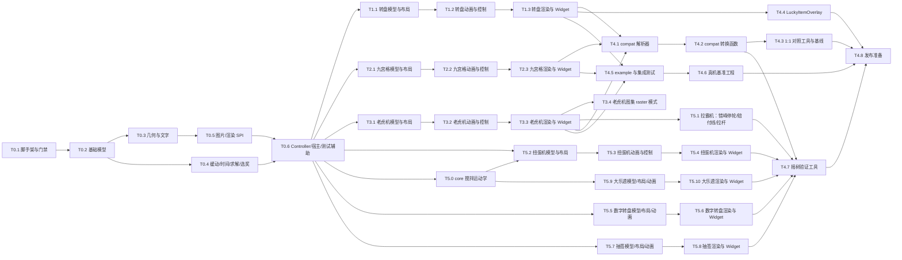

# luckdraw 代码落地指导

> 状态：已按落地事实对齐（第三轮，2026-11-10）。真机集成、最低版本与 Web/APK 摇树已取得本地证据；真机性能验收未完全通过，Linux/远程 CI 与真实发布仍待验证。
> 读者：执行落地的 Sonnet / Codex。前置阅读：[ARCHITECTURE.md](ARCHITECTURE.md)（为什么这样设计）、[FIDELITY.md](FIDELITY.md)（每个公式照着翻译）、[TEST_STRATEGY.md](TEST_STRATEGY.md)（门禁与矩阵）。
> 本文给出：最终目录树、全局规范、任务卡（目标 / 前置 / 文件 / 代码骨架 / 算法要点 / 上游位置 / 测试名 / 验收编号 / DoD）、依赖图与并发建议、坑清单。
> 任务卡里的测试名**逐字**使用，验收矩阵（`test/ACCEPTANCE.md`）按同样的名字引用，`tool/check_acceptance.dart` 会双向校验。

---

## 0. 落地者守则（先读）

### 0.1 禁止事项

1. **不得改变架构决策**（ARCHITECTURE §18 的 ADR、§4.3 的 import 规则、§11 的语义决策、§14 的范围）。认为必须改的，写清位置、理由与保守处理并汇报，继续其余独立工作（D8）。
2. **不得新增任何依赖**（`dependencies`、`dev_dependencies`、tool 脚本的依赖）。现有 dev 依赖只有 `flutter_test`、`flutter_lints`；M4 的 example/bench 工程额外允许 SDK 自带的 `integration_test`、`flutter_driver`（`sdk: flutter`），不允许任何 pub.dev 包。
3. **遇到文档矛盾不得自行裁决**。以主会话已拍板 D1–D8 为准，其余保守处理并汇报位置、现象、临时方案，继续其余工作；待验证内容不得写成既成事实。
4. 不得在 `lib/` 中声明顶层/静态的非 const 可变状态、`part`、`runtimeType` 分派、`dart:mirrors`、`material.dart`/`cupertino.dart`（IMP-R6…R10）。
5. 不得在 `pubspec.yaml` 中声明 `flutter: assets:`/`fonts:`。
6. 本轮不执行任何 `git add`、commit、push，由主会话统一版本管理；不得在仓库根 stash/checkout 或改其它包。结束时用 `git -C E:\workspaces\dart-labs log --oneline -2` 核对没有新增提交。
7. 不得在 `E:\workspaces\dart-labs\` 之外的 SDK/缓存目录里做破坏性操作；不要删除用户的 SDK 克隆。
8. 不得为了凑覆盖率写无断言测试；豁免必须登记（TEST_STRATEGY §3）。
9. Windows 上编辑 `.sh` 文件后用 `file <path>` 确认无 CRLF（本项目原则上不需要 .sh）。
10. 不得把上游代码文件直接复制进仓库（许可证上允许，但这里是重写移植，注释里引用上游文件与行号即可）。

### 0.2 每张任务卡的通用 DoD

- `flutter analyze` 0 issue（含 info）；`dart format --output=none --set-exit-if-changed lib test tool` 通过。
- 本卡列出的测试全部存在、名字逐字一致、全部通过；`flutter test --coverage` 后 `dart run tool/coverage.dart --min=100` 通过（未完成模块的文件尚不存在，不影响）。
- `dart run tool/check_imports.dart` 通过；`dart run tool/check_acceptance.dart` 通过（本卡测试已登记进 `test/ACCEPTANCE.md`）。
- 每个新增的类、方法、属性、函数、typedef、枚举值都有中文 `///` 注释；公共 API 写契约（参数、返回值、示例），不写实现细节。
- 交付只包含本卡文件与 `test/ACCEPTANCE.md` 对应行；D6 规定落地行标「已落地」，T4.8 才统一最终状态。已落地不代表所有门禁或真机验收通过；本轮不暂存、不提交。
- 代码卡串行运行 analyze/test，同一条命令 5 分钟无结果则终止并缩小范围重试；覆盖率使用 `--coverage-path=coverage/<批次>.lcov` 并将同一文件传给门禁 `--lcov=`。结束时按命令行识别并清理自有孤儿进程，不按进程名误杀。
- 文档专批按授权只改文档与只读自检；B17b 额外允许临时工程 create/pub get/analyze 验证 README，真实仓库不运行 pub get/build，不改 lib/test/tool/example，不套用代码卡命令扩大范围。

---

## 1. 最终目录树

```text
luckdraw/
├── pubspec.yaml                         包描述；只依赖 flutter SDK（已存在，M0 不改依赖）
├── analysis_options.yaml                严格分析规则（T0.1 改写）
├── .pubignore                           排除 test/parity/baselines/、tool/bench/build/ 等（T0.1 新增）
├── CHANGELOG.md / README.md / LICENSE / NOTICE
├── lib/
│   ├── luckdraw.dart                    核心用户 API 入口（只 export src/core）
│   ├── extend.dart                      扩展 SPI 入口（直接 export src/core/... show，不转导出 luckdraw.dart）
│   ├── wheel.dart                       转盘入口（export luckdraw.dart + src/wheel）
│   ├── grid.dart                        九宫格入口
│   ├── slot.dart                        老虎机入口（含拉霸机 LuckyLeverSlotMachine、赔付线）
│   ├── capsule.dart                     扭蛋机入口（export luckdraw.dart + src/capsule）
│   ├── lots.dart                        抽签入口（export luckdraw.dart + src/lots）
│   ├── lotto.dart                       大乐透（摇奖机）入口（export luckdraw.dart + src/lotto）
│   ├── number_wheel.dart                数字转盘（刻度 + 小球）入口（export luckdraw.dart + src/number_wheel）
│   ├── compat.dart                      lucky-canvas JSON 迁移入口（只 export src/compat）
│   ├── testing.dart                     测试辅助入口（只 export src/testing）
│   └── src/
│       ├── core/
│       │   ├── foundation/
│       │   │   ├── constants.dart       全部共享常量（参考帧、默认值、上游魔数）
│       │   │   ├── angles.dart          luckyDegToRad（上游 getAngle）
│       │   │   ├── color_utils.dart     colorAlpha8 / colorWithAlphaFactor（deprecated 读取的唯一出口）
│       │   │   ├── length.dart          LuckyLength / LuckyPx / LuckyPercent
│       │   │   ├── edge_insets.dart     LuckyEdgeInsets（CSS 1~4 值）
│       │   │   ├── fill.dart            LuckyFill 及三种实现、LuckyColorStop、渐变方向
│       │   │   ├── shadow.dart          LuckyShadow / LuckyShadowBlurSpace
│       │   │   ├── border.dart          LuckyBorder
│       │   │   ├── text.dart            LuckyText / LuckyTextDefaults / LuckyTextOverride
│       │   │   ├── image.dart           LuckyImage / LuckyImageFormatter / LuckyImageSlot / LuckyImageRequest / LuckyImageError
│       │   │   ├── cell_style.dart      LuckyCellStyle
│       │   │   ├── box_block.dart       LuckyBoxBlock（九宫格/老虎机的矩形 block）
│       │   │   └── options.dart         LuckyPerformanceOptions / LuckyCacheMode / LuckyTextScaling
│       │   ├── geometry/
│       │   │   ├── canvas_arc.dart      canvasArcSweep（Canvas arc 的扫角规则）
│       │   │   ├── fan_path.dart        buildFanPath（上游 fanShapedByArc）
│       │   │   ├── round_rect.dart      buildRoundRectPath（上游 roundRectByArc）
│       │   │   └── image_box.dart       computeImageBox / LuckyImagePlacement
│       │   ├── text/
│       │   │   ├── split_text.dart      splitLuckyText / removeLineBreaks / LuckyTextWidth
│       │   │   ├── text_measurer.dart   LuckyTextMeasurer / TextPainterMeasurer
│       │   │   └── text_line.dart       LuckyTextLine / layoutLuckyTextLines（三玩法共用的文字排版）
│       │   ├── easing/easing.dart       LuckyEasing + 7 个上游缓动 + CurveEasing + LuckyEasings
│       │   ├── motion/
│       │   │   ├── timebase.dart        LuckyTimebase
│       │   │   ├── motion_options.dart  LuckyMotionOptions
│       │   │   ├── phase.dart           LuckyPhase + 扩展判断
│       │   │   ├── result.dart          LuckyResult
│       │   │   ├── timeline.dart        LuckyTimeline（有效时间）
│       │   │   ├── clock.dart           LuckyClock / TickerLuckyClock
│       │   │   ├── stop_solver.dart     LuckyStopSolver 及两种实现
│       │   │   └── motion.dart          LuckyMotion 基类 / LuckyMotionEvents / LuckyFrameNotifier
│       │   ├── picker/prize_picker.dart PrizePicker / PrizePickContext / WeightedPrizePicker / GuaranteedPrizePicker
│       │   ├── kinematics/swirl_mixer.dart LuckySwirlMixer / packCirclesInCircle（扭蛋机与大乐透共用的确定性搅拌运动学，无玩法类型）
│       │   ├── game/
│       │   │   ├── layout.dart          LuckyLayout / LuckyLayoutInput
│       │   │   ├── frame.dart           LuckyFrame
│       │   │   ├── game.dart            LuckyGame / LuckyHit / LuckyPanEvent
│       │   │   └── registry.dart        LuckyGameRegistry / LuckyViewBuilder
│       │   ├── control/
│       │   │   ├── hooks.dart           LuckyHooks / LuckyDrawHook / LuckyButtonTapCallback
│       │   │   └── controller.dart      LuckyController / LuckyControllerHost
│       │   ├── image/
│       │   │   ├── image_resolver.dart  LuckyImageResolver
│       │   │   └── image_set.dart       LuckyImageSet / LuckyResolvedImage
│       │   ├── render/
│       │   │   ├── renderer.dart        LuckyRenderer / LuckySurfaceData
│       │   │   ├── layer.dart           LuckyLayer / LuckyCallbackLayer / LuckyLayerPosition / LuckyLayerContext
│       │   │   ├── picture_cache.dart   LuckyPictureCache
│       │   │   ├── paint_helpers.dart   录制期共用绘制：填充+阴影+边框、图片、文字（内部，不导出）
│       │   │   └── perf_trace.dart      Timeline 打点开关（内部）
│       │   └── widgets/
│       │       ├── game_view.dart       LuckyGameView（通用宿主）
│       │       ├── lifecycle.dart       生命周期桥（内部）
│       │       └── item_overlay.dart    LuckyItemOverlay / LuckyItemGeometry
│       ├── wheel/
│       │   ├── model/wheel_config.dart  WheelConfig / WheelOptions / WheelStyle
│       │   ├── model/wheel_parts.dart   WheelBlock / WheelBlockImage / WheelPrize / WheelButton / WheelPrizePainter / WheelPrizePaintContext
│       │   ├── layout/wheel_angles.dart WheelSectorAngles（只由配置决定的扇区角度，motion 与 layout 共用）
│       │   ├── layout/wheel_layout.dart WheelLayout / WheelSector / WheelBlockLayout / WheelButtonLayout / computeWheelLayout
│       │   ├── motion/wheel_motion.dart WheelMotion / WheelFrame
│       │   ├── control/wheel_controller.dart WheelController
│       │   ├── render/wheel_painter.dart     WheelPainter（分段录制 + 回放）
│       │   ├── render/wheel_canvas_renderer.dart WheelCanvasRenderer（surface StatefulWidget）
│       │   ├── wheel_game.dart          WheelGame
│       │   └── widgets/lucky_wheel.dart LuckyWheel
│       ├── grid/  （同构：model/grid_config.dart、model/grid_parts.dart、layout/grid_layout.dart、motion/grid_motion.dart、
│       │           control/grid_controller.dart、render/grid_painter.dart、render/grid_canvas_renderer.dart、grid_game.dart、widgets/lucky_grid.dart）
│       ├── slot/  （同构：model/slot_config.dart、model/slot_parts.dart、model/slot_result.dart、layout/slot_layout.dart、motion/slot_motion.dart、
│       │           control/slot_controller.dart、render/slot_painter.dart、render/slot_atlas.dart、render/slot_canvas_renderer.dart、
│       │           slot_game.dart、widgets/lucky_slot_machine.dart；
│       │           拉霸机：model/payline.dart（SlotPayline / SlotPaylinePredicate）、render/payline_layer.dart（SlotPaylineLayer）、
│       │           lever/lever_options.dart（LeverOptions / LeverSide）、lever/lever_painter.dart、lever/lucky_lever_slot_machine.dart）
│       ├── capsule/
│       │   ├── model/capsule_config.dart CapsuleConfig / CapsuleOptions / CapsuleStyle
│       │   ├── model/capsule_parts.dart  CapsulePrize / CapsulePrizePainter
│       │   ├── layout/capsule_layout.dart CapsuleLayout / computeCapsuleLayout（球体、机身、旋钮、出口、滑道、托盘、静止堆积）
│       │   ├── motion/capsule_motion.dart CapsuleMotion / CapsuleFrame / CapsuleStage
│       │   ├── control/capsule_controller.dart CapsuleController
│       │   ├── render/capsule_painter.dart CapsulePainter
│       │   ├── render/capsule_canvas_renderer.dart CapsuleCanvasRenderer
│       │   ├── capsule_game.dart         CapsuleGame
│       │   └── widgets/lucky_capsule_machine.dart LuckyCapsuleMachine
│       ├── number_wheel/ （同构：model/number_wheel_config.dart（NumberWheelConfig / NumberWheelPocket / NumberWheelOptions / NumberWheelStyle）、
│       │           layout/number_wheel_layout.dart、motion/number_wheel_motion.dart（NumberWheelMotion / NumberWheelFrame）、
│       │           control/number_wheel_controller.dart、render/number_wheel_painter.dart、render/number_wheel_canvas_renderer.dart、
│       │           number_wheel_game.dart、widgets/lucky_number_wheel.dart）
│       ├── lotto/  （同构：model/lotto_config.dart（LottoConfig / LottoPool / LottoDraw / LottoResult，转导出 LottoOptions / LottoStyle）、
│       │           model/lotto_options.dart（LottoOptions / LottoStyle）、model/lotto_sampler.dart（LottoSampler / UniformLottoSampler）、layout/lotto_layout.dart、motion/lotto_frame.dart、motion/lotto_motion.dart、
│       │           control/lotto_controller.dart、render/lotto_painter.dart、render/lotto_canvas_renderer.dart、lotto_game.dart、widgets/lucky_lotto.dart）
│       ├── lots/  （同构：model/lots_config.dart（LotsConfig / LotsOptions / LotsStyle）、model/lots_parts.dart（LotsStick）、
│       │           layout/lots_layout.dart、motion/lots_motion.dart（LotsMotion / LotsFrame / LotsStage）、control/lots_controller.dart、
│       │           render/lots_painter.dart、render/lots_canvas_renderer.dart、lots_game.dart、widgets/lucky_lots.dart）
│       ├── compat/
│       │   ├── compat_options.dart      LuckyCanvasCompatOptions / LuckyCanvasCompatResult / LuckyCanvasCompatWarning
│       │   ├── json_reader.dart         带 warning 收集的 Map 读取助手（内部）
│       │   ├── css_length.dart          parseCssLength
│       │   ├── css_color.dart           parseCssColor + CSS 命名色表
│       │   ├── css_fill.dart            parseCssFill（含 linear-gradient）
│       │   ├── css_shadow.dart          parseCssShadow
│       │   ├── css_misc.dart            parseCssPadding / parseCssFontWeight / parseCssFontFamily / imageProviderFromSrc
│       │   ├── easing_names.dart        kLuckyCanvasEasingNames
│       │   ├── wheel_compat.dart        wheelFromLuckyCanvasConfig
│       │   ├── grid_compat.dart         gridFromLuckyCanvasConfig
│       │   └── slot_compat.dart         slotFromLuckyCanvasConfig
│       └── testing/
│           ├── manual_clock.dart        ManualLuckyClock
│           ├── sequence_random.dart     SequenceRandom
│           └── frame_recorder.dart      LuckyFrameRecorder
├── test/
│   ├── flutter_test_config.dart         全局：加载 Roboto 测试字体、注册容差 golden 比较器
│   ├── ACCEPTANCE.md                    验收矩阵（TEST_STRATEGY §5 的草稿落地）
│   ├── support/
│   │   ├── recording_canvas.dart        基于 flutter_test 导出的 TestRecordingCanvas 的断言助手（无 saveLayer、save 平衡、回放计数）
│   │   ├── test_images.dart             可控的 ImageProvider/Completer（成功/失败/延迟/多帧，暴露监听数）
│   │   ├── fonts.dart                   从 $FLUTTER_ROOT 加载 Roboto 的助手
│   │   ├── golden_comparator.dart       LuckyToleranceComparator
│   │   ├── fixtures.dart                基础图像与转盘标准夹具
│   │   └── <玩法>_fixtures.dart         grid/slot/capsule/number_wheel/lots/lotto 各用独立文件（D5）；渲染派生夹具留在各玩法测试目录
│   ├── core/…  wheel/…  grid/…  slot/…  compat/…  parity/…  testing/…  tool/…   （文件清单见 TEST_STRATEGY §2.2）
│   └── parity/baselines/                1:1 基线（MANIFEST.json + 每个用例的 frames.json 与关键帧 PNG）
├── tool/
│   ├── coverage.dart                    覆盖率门禁（带豁免登记校验）
│   ├── check_acceptance.dart            矩阵 ↔ 测试双向校验
│   ├── check_imports.dart               import 依赖图与摇树静态规则
│   ├── run_integration.dart             集成测试 ×3 执行器（桌面小窗口、不抢焦点）
│   ├── parity/                          generate.dart、harness/index.html、harness/harness.js、cases/*.json、README.md
│   ├── treeshake/                       check_treeshake.dart、probes/<10 个>/main.dart、budgets.json
│   └── bench/                           独立 Flutter 基准工程（pubspec、lib/、integration_test/、test_driver/、budgets.json、compare.dart）
├── example/                             示例 App + integration_test/（M4）
└── docs/                                本组文档
```

lib 下每个文件只放一个主题；单文件超过约 500 行就按职责再拆（同目录、同前缀）。

此树保留最终目录目标，具体文件以仓库为准。FIN第三轮已回填真机33/33、MIN非golden951、Web/APK各十探针；基准未完全通过，阴影有差异与缺样本，Linux/远程CI及真实发布仍留项。

---

## 2. 全局编码规范

### 2.1 注释（硬性）

- 每个类、构造函数、方法、属性、顶层函数、typedef、枚举及枚举值都要有中文 `///` 注释。
- 公共 API：只写契约。格式：

```dart
/// 停止转盘，减速后停在 [index] 对应的奖品上。
///
/// - [index]：目标奖品下标；为 null 时由 [picker] 选奖，选奖返回 null 视为作废本局；
///   为负数时立即作废本局；大于等于奖品数时按奖品数取余。
/// - 返回：命令被接受返回 true；不在加速或匀速阶段时返回 false。
///
/// ```dart
/// final ok = controller.stop(3);
/// ```
bool stop([int? index]);
```

- 私有成员与内部文件也要中文注释，可以写实现要点，并在涉及上游的地方标 `// 上游 wheel.ts:445-462`。
- `analysis_options.yaml` 开启 `public_member_api_docs`，缺注释即 analyze 失败。

### 2.2 命名与常量

- 公共类型前缀：core 用 `Lucky`，玩法用 `Wheel`/`Grid`/`Slot`，Widget 用 `LuckyWheel`/`LuckyGrid`/`LuckySlotMachine`；compat 顶层函数用 `xxxFromLuckyCanvasConfig`、`parseCssXxx`；常量用 `kLucky…`。
- 文件名 snake_case；一个文件一个主题。
- **同一字面量出现 2 次以上必须提取常量**（放 `core/foundation/constants.dart`，玩法私有常量放玩法目录下文件顶部的 `const`）。上游魔数（`40`、`0.1`、`16.6`、`'...'`、`-90`、`0xFFFFCE98` 等）一律命名常量并在注释里写出处。
- 配置类：`@immutable`、全部字段 `final`、`const` 构造、`copyWith`、`==`/`hashCode`（列表字段用 `listEquals`/`Object.hashAll`）、`toString` 可选。
- `copyWith` 的 nullable 参数传 null 表示保留原值，不用于清空字段；const 模型的列表及嵌套列表由调用方保证不可变，不能把 final 列表误当深度冻结。

### 2.3 analysis_options.yaml（T0.1 写入）

```yaml
include: package:flutter_lints/flutter.yaml

analyzer:
  language:
    strict-casts: true
    strict-inference: true
    strict-raw-types: true
  exclude:
    - build/**
    - android/**
    - ios/**
    - web/**
    - windows/**
    - macos/**
    - linux/**
    - example/**
    - tool/bench/**
    - tool/treeshake/probes/**

linter:
  rules:
    public_member_api_docs: true
    always_declare_return_types: true
    avoid_dynamic_calls: true
    avoid_print: true
    directives_ordering: true
    prefer_const_constructors: true
    prefer_const_constructors_in_immutables: true
    prefer_final_fields: true
    prefer_final_locals: true
    sort_constructors_first: true
    unawaited_futures: true
    use_super_parameters: true
```

`example/` 与 `tool/bench/` 是独立工程，各自 `flutter analyze`（CI 中单独一步）；探针复制到临时工程后再分析，主包排除 `tool/treeshake/probes/**`。每次 `flutter pub get --no-example` 后立即检查并恢复本节配置，保留此排除项。

### 2.4 导出面

- 入口文件只用 `export '...' show A, B, C;` 显式列名，清单以 ARCHITECTURE §16 为准；新增公共符号必须同时改 §16 与 CHANGELOG。
- `extend.dart` 按 D1 直接 export core 各文件，不转导出 `luckdraw.dart`；同一符号可由两个入口分别导出。T0.2「全部公共符号」指 §16 所属用户 API / SPI 清单，不指任意实现符号。
- `lib/src/**` 内一律相对路径 import。

### 2.5 版本兼容（最低 Dart 3.5 / Flutter 3.24）

| 可以用 | 不可以用（≥3.27 或已 deprecated） | 替代 |
| --- | --- | --- |
| sealed / final / interface / base 类修饰符、records、patterns、switch 表达式 | `Color.a/.r/.g/.b`、`Color.withValues`、`toARGB32`（3.27+） | `colorAlpha8()`（内部 `// ignore: deprecated_member_use`）、`Color.withAlpha(int)` |
| `Picture.toImageSync`（3.7+）、`ResizeImagePolicy`（3.10+）、`AppLifecycleListener`（3.13+）、`TextScaler`（3.16+）、`MediaQuery.devicePixelRatioOf`（3.10+） | `Color.alpha/.value/.opacity/.withOpacity`（3.47 报 deprecated） | 同上；不透明度用 `withAlpha((255 * o).round())` |
| `TickerProviderStateMixin`（自动处理 TickerMode） | `TickerMode.of`/`TickerMode.getNotifier`（3.35+ deprecated） | mixin 自动处理 |
| `Semantics(liveRegion: true, value: …)` | `SemanticsService.announce`（3.35+ deprecated） | liveRegion |
| `@immutable` 来自 `package:flutter/foundation.dart` | 只 import `painting.dart` 时 `@immutable` 未定义（本机实测报错） | 显式 import foundation |

开发SDK为Flutter3.47.0；MIN已在独立Flutter3.24.5/Dart3.5.4本地分析零诊断、非golden951通过；远程min-sdk仍需CI证据。任何拿不准的 API：先在 scratchpad 的临时工程里 `flutter analyze`，不要在仓库里切 SDK。

---

## 3. 常见坑清单

### 3.1 数值与移植

| 坑 | 正确做法 |
| --- | --- |
| JS `%` 与 Dart `%` 对负数结果不同（本机实测 `-30 % 360`：JS -30，Dart 330） | 移植上游 `%` 一律 `.remainder()` |
| 化简了上游公式的运算顺序，导致逐位对照差 1 ulp | 按 FIDELITY 给的 Dart 写法照抄 |
| `>> 0` 当成 `.round()` | 向零截断：`.toInt()`（只用于正数场景） |
| JS `a \|\| b` 把 `0`/`''` 当缺省 | 类型化 API 用 null；compat 负责把这些假值转 null |
| `Math.random()` 调用次数不一致导致随机序列错位 | stopRange 即使为 0 也调用一次 `nextDouble()`；picker 即使总权重 0 也调用一次 |
| `const` 构造里对 `Duration` 做 `assert(x > Duration.zero)` | 不是常量表达式会编译失败；改为在 `LuckyMotion.configure` 里 debug 断言 + 运行期钳到 1ms |
| 热路径用 `double?` 字段 | 用非空 double + 哨兵值，或 `Float64List` |

### 3.2 Flutter

F1 绘制契约：legacy 渐变重合端点不绘制；测量/绘制的 Canvas 空白统一 U+0020（保留 split 的显式换行），基线取实际绘制 painter，不能拿空格基线代替回退字体。F1 图片契约：naturalSize 取 formatter 输出，取消不提前释放异步 formatter 的源图，AssetBundle 身份变更重新解析；详见 ARCHITECTURE §8.4、§11.6/11.7。

| 坑 | 正确做法 |
| --- | --- |
| 在 `paint()` 里 `setState` 或创建 `Rect`/`Paint`/`TextPainter` | 帧路径只用布局阶段预算好的对象；Paint 只在录制时创建 |
| `CustomPainter` 每次 rebuild 新建导致缓存丢失 | 缓存放在 surface State 里，painter 持有引用；长期复用同一可变 painter 时，缓存失效后主动 `markNeedsPaint`，仅 `shouldRepaint` 比较不够 |
| `TextPainter` 不 dispose | 测量器在布局完成后 `dispose()`；录制时临时创建的 TextPainter 画完即 dispose |
| `ImageStream` 监听不移除 → 泄漏 | 拿到首帧即 `removeListener`；dispose 时兜底移除 |
| `ImageInfo` 不 dispose | `image.clone()` 后立刻 `info.dispose()` |
| Ticker 在 widget 测试结束时仍活跃 | `dispose` 停 Ticker；纯逻辑测试用 `ManualLuckyClock` |
| `pump()` 在模拟 `paused` 后永远等不到帧（真机测试曾卡死） | 不要用 `handleAppLifecycleStateChanged(paused)` 驱动真机测试；用 `controller.pauseForLifecycle()` 或在集成测试里用平台消息模拟并配合 `pumpAndSettle` 超时 |
| golden 在不同 OS 抗锯齿不同 | 统一用 `LuckyToleranceComparator`；golden 测试打 `@Tags(['golden'])`，并在 `dart_test.yaml` 注册 `tags: {golden: {}}`。Windows 基线已有，Linux/最低 SDK 与容差校准待落地验证 |

### 3.3 仓库与工具

| 坑 | 正确做法 |
| --- | --- |
| Flutter 3.47 的 `flutter pub get` 会改动 `analysis_options.yaml`（追加 exclude）、example 的 `pubspec.lock` 与 Windows 生成文件 | 在 luckdraw 目录用 `flutter pub get --no-example`，每次立刻检查并恢复 §2.3 内容；检查 diff，不暂存或提交 |
| origin 一次推两个远端（含公开 GitHub） | 本项目落地任务不 push；push 由用户决定 |
| CI 只在 PR 或 main 上跑 | 本地先跑全量门禁命令（TEST_STRATEGY §10.1） |
| 本机内存紧张 | 不要同时起多个 `flutter build`/Gradle；摇树探针、基准工程放系统临时目录（脚本默认如此）；用完关掉自己起的进程 |
| Windows 长路径 | 临时工程放短路径（`%TEMP%\ldts\…`） |

### 3.4 摇树禁止清单（与 ARCHITECTURE §17.3 一致）

1. 顶层/静态字段的副作用初始化（`final x = Foo()..register(...)`）。
2. 在 core 写包含所有实现的 `const` 表（字符串名 → 缓存/玩法）。
3. 反射或按字符串名查找实现。
4. 抽象基类里 `switch` 枚举构造所有子类。
5. 大 barrel 用 `part` 拼装。
6. `Type`/`runtimeType` 做工厂分派。
7. 默认参数里 new 其它 library 的具体实现（同玩法 library 内的默认渲染器、core 的 `QuadEasing` 除外）。
8. 在包的 pubspec 声明 assets/fonts；示例资源只放 `example/`。
9. 在 core 引用任何玩法类型（哪怕只在注释的代码示例之外用作类型）。

---

## 4. 里程碑、依赖与并发



并发建议（本机同时最多 2 个 Codex，内存紧张）：

| 波次 | 并行任务 | 说明 |
| --- | --- | --- |
| 1 | T0.1 | 单独做，后续都依赖门禁脚本 |
| 2 | T0.2 | 单独 |
| 3 | T0.3 ∥ T0.4 | 互不依赖 |
| 4 | T0.5 | 依赖 T0.3 |
| 5 | T0.6 | 依赖 T0.4、T0.5 |
| 6 | T1.1 ∥ T2.1 | 两个玩法的模型与布局互不依赖 |
| 7 | T1.2 ∥ T2.2 | |
| 8 | T1.3 ∥ T3.1 | |
| 9 | T2.3 ∥ T3.2 | |
| 10 | T3.3 | 先完成上游三玩法 |
| 11 | T3.4 ∥ T4.1 | 图集与 compat 解析器 |
| 12 | T4.2 | 完成 compat 转换；D3/B2 后续再排追加玩法 |
| 13 | T5.0 ∥ T5.1 | core 搅拌与拉霸机 |
| 14 | T5.2 ∥ T5.5 | 扭蛋模型与数字盘 |
| 15 | T5.3 ∥ T5.6 | 扭蛋动画与数字盘渲染 |
| 16 | T5.4 ∥ T5.7 | 扭蛋渲染与抽签 |
| 17 | T5.8 ∥ T5.9 | 抽签渲染与大乐透 |
| 18 | T5.10 ∥ T4.4 | 大乐透渲染与叠加层 |
| 19 | T4.5 | example 汇总全部玩法 |
| 20 | T4.3 → T4.7 | T4.3 要本机 Chrome；T4.7 跑 10 个探针的 web 构建，**两者不要同时构建**，串行 |
| 21 | T4.6 | 需要真机，单独 |
| 22 | T4.8 | 收尾 |

每张卡完成后主会话复跑通用 DoD 的全部命令再统一处理版本管理。D3/B2 已定全部改进与追加玩法都做，不按时间压力砍卡；上表按决定把追加玩法排在上游三玩法与 compat 之后，这是排期约束，不新增跨玩法实现依赖。历史批次已交错落地，不重做已完成工作。本轮由同一执行者顺序工作，不调用子代理；上表为后续排期与可并行性参考。

---

## 5. 任务卡 M0：基础层

> 骨架代码里为节省篇幅出现的单行声明、`/** */` 或行内注释，落地时一律展开成每个成员独立一行并配 `///` 中文注释；签名、默认值、类修饰符以骨架为准。

### T0.1 脚手架与门禁

- **目标**：建立入口文件、严格分析规则、三个门禁脚本及其自测、测试基础设施、CI 工作流、验收矩阵骨架。之后每张卡都靠这些门禁验收。
- **前置**：无。
- **创建/修改**：`analysis_options.yaml`（按 §2.3 改写）、`.pubignore`、`lib/luckdraw.dart`、`lib/extend.dart`、`lib/wheel.dart`、`lib/grid.dart`、`lib/slot.dart`、`lib/capsule.dart`、`lib/number_wheel.dart`、`lib/lots.dart`、`lib/lotto.dart`、`lib/compat.dart`、`lib/testing.dart`（此时只有 `library;` + 文档注释，导出随后续卡补齐）、`tool/coverage.dart`、`tool/check_acceptance.dart`、`tool/check_imports.dart`、`test/flutter_test_config.dart`、`test/support/{fonts,golden_comparator,recording_canvas,test_images,fixtures}.dart`、`test/tool/{check_imports,check_acceptance,coverage,golden_comparator}_test.dart`、`test/ACCEPTANCE.md`、`../.github/workflows/luckdraw-ci.yml`（仓库根，见 TEST_STRATEGY §10）。
- **上游位置**：无。

`.pubignore`：

```text
test/parity/baselines/
tool/bench/build/
tool/bench/.dart_tool/
coverage/
```

入口文件模板（以 `lib/wheel.dart` 为例，最终形态）：

```dart
/// luckdraw 大转盘入口：转盘配置、控制器与 Widget。
///
/// ```dart
/// import 'package:luckdraw/wheel.dart';
/// ```
library;

export 'luckdraw.dart';
export 'src/wheel/control/wheel_controller.dart' show WheelController;
// …按 ARCHITECTURE §16 的清单逐个 show
```

`tool/coverage.dart` 骨架（在 cacheman 版本上增加豁免登记校验；逻辑放在可测试的纯函数里）：

```dart
import 'dart:io';

/// 覆盖率豁免标记的正则：行尾 `// coverage:ignore-line COV-01`、块 `// coverage:ignore-start COV-02` … `// coverage:ignore-end`。
final RegExp kIgnoreMarker = RegExp(r'//\s*coverage:ignore-(line|start|end)(?:\s+(COV-\d{2}))?'); // imports:allow-global 工具脚本，非 lib

/// 单个文件的覆盖结果。
class FileCoverage {
  /// 构造。
  FileCoverage(this.path, this.hit, this.total, this.missing);
  /// 相对包根路径（lib/...）。
  final String path;
  /// 命中行数。
  final int hit;
  /// 计入统计的行数。
  final int total;
  /// 未覆盖的行号。
  final List<int> missing;
}

/// 覆盖率门禁的完整结论。
class CoverageReport {
  /// 构造。
  CoverageReport(this.files, this.errors);
  /// 各文件结果。
  final List<FileCoverage> files;
  /// 门禁错误（缺采集记录、未登记豁免、登记未使用等）。
  final List<String> errors;
  /// 总命中率（百分比）。
  double get percent { /* hit*100/total，total==0 视为 100；缺采集错误另行判失败 */ throw UnimplementedError(); }
}

/// 解析 lcov 与源码、豁免登记表，得出覆盖报告。
///
/// - [lcov]：`coverage/lcov.info` 内容。
/// - [sources]：`lib/` 下每个 dart 文件的路径 → 内容。
/// - [exemptions]：从 `test/ACCEPTANCE.md` 的「覆盖率豁免」表解析出的 `COV-xx → 文件路径`。
CoverageReport computeCoverage({required String lcov, required Map<String, String> sources, required Map<String, String> exemptions}) {
  // 1. 同 cacheman：SF 行归一化为相对路径，只收 lib/；DA 行累加命中。
  // 2. 无可执行行的纯指令、顶层 const、typedef、无成员普通枚举不要求记录；
  //    含可执行实现（包括含成员/构造的枚举）却缺记录 → 错误。D2 不允许用 0/0 掩盖此错误。
  // 3. 解析豁免标记：标记缺 COV 编号 → 错误；编号未在 exemptions 中 → 错误；
  //    exemptions 中的编号登记的文件与标记所在文件不一致 → 错误；登记了但源码中未出现 → 错误。
  // 4. 被豁免的行不计入统计。
  throw UnimplementedError();
}

/// 命令行入口：`dart run tool/coverage.dart --min=100`。
void main(List<String> args) { /* 读文件、调 computeCoverage、打印每个文件与 TOTAL、未达标或有错误时 exitCode = 1 */ }
```

`tool/check_acceptance.dart`：沿用 cacheman 的轻量词法器（`testNames(File)`、`_expand`），改进点：

1. 扫描目录：`test/`、`example/integration_test/`、`tool/bench/integration_test/`（存在才扫），引用路径一律相对包根。
2. 参数化：`for (final x in [<字面量列表>])`，列表元素是字符串字面量时**去掉引号**再代入（cacheman 版本会保留引号）；同一文件多个循环变量名不得重复。
3. 引用两种：`` `path :: group > test` `` 与 `` `cmd: <命令>` ``；`cmd` 中出现 `tool/xxx.dart` 时该文件必须存在。
4. 矩阵表第一列（`ID`）全表唯一；"类型"列为 `人工` 的行允许无引用，其余行至少 1 个引用。
5. 每个注册测试必须至少被引用一次；每个引用必须存在。
6. 纯函数 `AcceptanceCheck checkAcceptance({required String matrix, required Map<String, String> testSources, required bool Function(String path) fileExists, String? testRunJson})`，`main` 只做 IO。

F1（R3-09）已将扫描限制在 main/group 及真正含注册调用的字面量循环，拒绝未调用函数里的 phantom test；正式门禁与 CI 默认 `--from-json <flutter test --reporter=json 输出>`，包内测试按真实注册校验，独立集成/基准仍由各自作业验收。静态模式只作快速路径。

F1（R3-06…08）已支持嵌套块注释、原始串、转义/插值；无法可靠判定无执行行时保守要求采集。覆盖率豁免保留登记位置/范围并核对实际标记，禁止同文件扩用。import URI 按 Dart 转义解码，插值表达式参与规则检查，纯文本示例忽略。

`tool/check_imports.dart`：实现 ARCHITECTURE §4.3 的 IMP-R1…R11 与"pubspec 无 assets/fonts"规则；纯函数 `List<String> checkImports({required Map<String, String> libSources, required String pubspec})` 返回违规列表（每条含文件:行号:规则号:原文）。区（zone）判定：`lib/src/<zone>/…`，zone ∈ {core, wheel, grid, slot, capsule, number_wheel, lots, lotto, compat, testing}；`lib/*.dart` 为 entry。允许的依赖表：

```dart
/// 各区允许 import 的区（不含 dart:* 与 package:flutter/*，它们对所有区开放，material/cupertino 除外）。
const Map<String, Set<String>> kAllowedZoneImports = { // imports:allow-global 工具脚本常量
  'core': {'core'},
  'wheel': {'core', 'wheel'},
  'grid': {'core', 'grid'},
  'slot': {'core', 'slot'},
  'capsule': {'core', 'capsule'},
  'number_wheel': {'core', 'number_wheel'},
  'lots': {'core', 'lots'},
  'lotto': {'core', 'lotto'},
  'compat': {'core', 'wheel', 'grid', 'slot', 'compat'},
  'testing': {'core', 'testing'},
};
```

（工具脚本不在 `lib/`，IMP-R8 不约束它们；示例里的 `// imports:allow-global` 只是提醒。）

`test/flutter_test_config.dart`：

```dart
import 'dart:async';

import 'package:flutter_test/flutter_test.dart';

import 'support/fonts.dart';
import 'support/golden_comparator.dart';

/// 全局测试配置：加载 Roboto 测试字体、注册容差 golden 比较器。
Future<void> testExecutable(FutureOr<void> Function() testMain) async {
  TestWidgetsFlutterBinding.ensureInitialized();
  await loadLuckyTestFonts(); // 从 $FLUTTER_ROOT/bin/cache/artifacts/material_fonts/roboto-regular.ttf 以 family 'Roboto' 加载
  if (goldenFileComparator is LocalFileComparator) {
    goldenFileComparator = LuckyToleranceComparator.fromLocal(goldenFileComparator as LocalFileComparator);
  }
  await testMain();
}
```

`loadLuckyTestFonts()`：用 `Platform.environment['FLUTTER_ROOT']`，缺失时回退为 `Platform.resolvedExecutable` 上溯找 `bin/cache/artifacts/material_fonts`；找不到时显式抛错，不能跳过而报告通过。基础夹具先建立；各玩法模型卡按 D5 补独立夹具。

`LuckyToleranceComparator extends LocalFileComparator`：`compare(imageBytes, golden)` 时解码两张 PNG（`ui.instantiateImageCodec`；SDK 的 `getGoldenBytes` 返回 List<int>，先 `Uint8List.fromList`），计算"通道差 > 32 的像素占比"与"平均绝对误差"，默认阈值 `maxDiffRatio = 0.005`、`maxMeanError = 1.5`（跨平台实测待落地验证后回填 TEST_STRATEGY §4.4）；失败时写出 diff 图。

CI 分阶段启用：后续工具或独立工程尚不存在时，对应步骤须有文件存在条件；工具出现后仍须完成该阶段验收。T0.1 的 CI YAML 解析通过不代表 GitHub 作业或 Flutter 3.24.5 已运行。

- **测试**：

`test/tool/check_imports_test.dart`（工具）：
- `check_imports > accepts the allowed dependency graph` → R1-01, R4-04
- `check_imports > rejects core importing a game` → R1-01
- `check_imports > rejects a game importing another game or compat` → R1-01
- `check_imports > rejects top-level side-effect initializers and part directives` → R6-01
- `check_imports > rejects runtimeType dispatch mirrors and material imports` → R6-01
- `check_imports > rejects asset or font declarations in pubspec` → R6-07

`test/tool/check_acceptance_test.dart`（工具）：
- `check_acceptance > expands string literal list parameters without quotes` → R4-03
- `check_acceptance > reports missing and unmapped references` → R4-03
- `check_acceptance > scans integration_test and bench directories` → R4-03
- `check_acceptance > validates cmd references point at existing scripts` → R4-03

`test/tool/coverage_test.dart`（工具）：
- `coverage gate > ignore markers require a registered exemption id` → R4-02
- `coverage gate > unused registered exemptions fail the gate` → R4-02
- `coverage gate > uninstrumented implementation files fail the gate` → R4-01

`test/tool/golden_comparator_test.dart`（工具）：
- `LuckyToleranceComparator > passes within the pixel tolerance and fails beyond it` → R4-05
- `LuckyToleranceComparator > writes a diff image on failure` → R4-05

- **验收**：R1-01、R4-01…R4-05、R6-01、R6-07。
- **DoD**：通用 DoD；`test/ACCEPTANCE.md` 含"覆盖率豁免"空表与本卡测试的行；CI 工作流文件存在且 `on:` 只含 PR/main/dispatch。

---

### T0.2 基础模型（foundation）

- **目标**：全部值类型与常量；无 widgets 依赖。
- **前置**：T0.1。
- **创建**：`lib/src/core/foundation/*.dart`（13 个文件，见目录树）；`lib/luckdraw.dart` 补导出。
- **上游位置**：lucky.ts:324-350（单位）、index.ts:55-107（hasBackground、computePadding）、math.ts:87-127（渐变几何）、types/*.ts（字段）。算法见 FIDELITY §3.1、§3.4、§3.5、§4。

骨架：

```dart
// constants.dart
import 'dart:ui' show Color;

import 'length.dart';

/// 参考帧时长（毫秒）：上游"每帧速度"语义按 60Hz 换算时使用。
const double kLuckyReferenceFrameMs = 1000 / 60;
/// 上游 FPS 初值（wheel.ts:42 等）。
const double kLuckyInitialFps = 16.6;
/// 有效时间轴单帧最大推进量的默认值。
const Duration kLuckyDefaultMaxFrameDelta = Duration(milliseconds: 100);
/// 停止求解的最大迭代次数。
const int kLuckyMaxSolverIterations = 100000;
/// 位图缓存单边最大像素的默认值。
const int kLuckyDefaultMaxRasterSide = 4096;
/// 文字截断省略号（上游 splitText）。
const String kLuckyEllipsis = '...';
/// 指针所在角度（度），正上方。
const double kLuckyPointerDeg = -90;
/// 九宫格速度除数（grid.ts:153）。
const double kLuckyGridSpeedDivisor = 40;
/// 九宫格加速起点速度（grid.ts:592）。
const double kLuckyGridAccelerationBase = 0.1;
/// 上游默认速度。
const double kLuckyDefaultSpeed = 20;
/// 上游默认加速时长。
const Duration kLuckyDefaultAccelerationTime = Duration(milliseconds: 2500);
/// 上游默认减速时长。
const Duration kLuckyDefaultDecelerationTime = Duration(milliseconds: 2500);
/// 默认待机慢转速度（与 speed 同单位）。
const double kLuckyDefaultIdleSpinSpeed = 2;
/// 透明色：上游默认背景 rgba(0,0,0,0)（被视为"有背景"）。
const Color kLuckyTransparent = Color(0x00000000);
/// 默认文字颜色 #000。
const Color kLuckyDefaultFontColor = Color(0xFF000000);
/// 默认字号 18px。
const double kLuckyDefaultFontSize = 18;
/// 默认 lengthLimit 90%。
const LuckyLength kLuckyDefaultLengthLimit = LuckyLength.percent(90);
/// 九宫格默认激活背景 #ffce98。
const Color kLuckyGridActiveBackground = Color(0xFFFFCE98);
/// 九宫格默认格子间距。
const double kLuckyGridDefaultGutter = 5;
/// 九宫格默认圆角。
const double kLuckyGridDefaultBorderRadius = 20;
/// 老虎机默认列间距。
const double kLuckySlotDefaultColSpacing = 5;
```

```dart
// length.dart（已在 3.47 编译验证该写法）
import 'package:flutter/foundation.dart';

/// 长度：逻辑像素或相对某个基准的百分比；只用于上游有明确基准的字段（基准表见 FIDELITY §4.4）。
///
/// ```dart
/// const LuckyLength.px(12);
/// const LuckyLength.percent(50); // 基准的 50%
/// ```
@immutable
sealed class LuckyLength {
  /// 供子类调用的常量构造。
  const LuckyLength();

  /// 逻辑像素长度。
  const factory LuckyLength.px(double value) = LuckyPx;

  /// 百分比长度，[value] 以百分数计（50 表示 50%）。
  const factory LuckyLength.percent(double value) = LuckyPercent;

  /// 零长度。
  static const LuckyLength zero = LuckyPx(0);

  /// 按基准 [base] 解析为逻辑像素。
  double resolve(double base);
}

/// 逻辑像素长度。
final class LuckyPx extends LuckyLength {
  /// 创建像素长度。
  const LuckyPx(this.value);
  /// 像素值。
  final double value;
  @override
  double resolve(double base) => value;
  @override
  bool operator ==(Object other) => other is LuckyPx && other.value == value;
  @override
  int get hashCode => Object.hash(LuckyPx, value);
}

/// 百分比长度（上游 changeUnits 的 `%`：`n * (base / 100)`）。
final class LuckyPercent extends LuckyLength {
  /// 创建百分比长度。
  const LuckyPercent(this.value);
  /// 百分数。
  final double value;
  @override
  double resolve(double base) => value * (base / 100);
  @override
  bool operator ==(Object other) => other is LuckyPercent && other.value == value;
  @override
  int get hashCode => Object.hash(LuckyPercent, value);
}
```

```dart
// edge_insets.dart
/// 四边内边距（逻辑像素）。核心 API 用 CSS 顺序；上游 4 值顺序由 compat 处理。
@immutable
final class LuckyEdgeInsets {
  /// 分别指定四边。
  const LuckyEdgeInsets.only({this.top = 0, this.right = 0, this.bottom = 0, this.left = 0});
  /// 四边相同。
  const LuckyEdgeInsets.all(double value) : top = value, right = value, bottom = value, left = value;
  /// 上下 / 左右对称。
  const LuckyEdgeInsets.symmetric({double vertical = 0, double horizontal = 0})
      : top = vertical, bottom = vertical, left = horizontal, right = horizontal;
  /// CSS 简写：1 值全部；2 值 上下、左右；3 值 上、左右、下；4 值 上、右、下、左。其它长度抛 [ArgumentError]。
  factory LuckyEdgeInsets.css(List<double> values) { /* switch (values.length) */ throw UnimplementedError(); }
  /// 全零。
  static const LuckyEdgeInsets zero = LuckyEdgeInsets.all(0);
  /// 上。
  final double top;
  /// 右。
  final double right;
  /// 下。
  final double bottom;
  /// 左。
  final double left;
  // ==、hashCode
}
```

```dart
// fill.dart
import 'dart:ui' as ui;

import 'package:flutter/foundation.dart';
import 'package:flutter/painting.dart';

/// 背景填充：纯色、Flutter 渐变或复刻上游几何的线性渐变。null 表示"无背景"（上游 hasBackground=false）。
@immutable
sealed class LuckyFill {
  /// 供子类调用。
  const LuckyFill();
  /// 纯色。
  const factory LuckyFill.color(Color color) = LuckyColorFill;
  /// Flutter 渐变，按目标矩形生成 shader。
  const factory LuckyFill.gradient(Gradient gradient) = LuckyGradientFill;
  /// 上游 `linear-gradient` 几何（端点公式见 FIDELITY §3.5）。
  const factory LuckyFill.legacyLinear(LuckyLegacyGradientDirection direction, List<LuckyColorStop> stops) = LuckyLegacyLinearFill;
  /// 把填充写入 [paint]（纯色：设 color、清 shader；渐变：按 [rect] 设 shader、color 置不透明黑）。
  void applyTo(Paint paint, Rect rect);
  /// 纯色填充的 alpha（0–255）；渐变返回 null。用于阴影 alpha 规则（DEV-04）。
  int? get solidAlpha8;
}

/// 纯色填充。
final class LuckyColorFill extends LuckyFill { /* const LuckyColorFill(this.color); final Color color; applyTo; solidAlpha8 => colorAlpha8(color); ==/hashCode */ }
/// Flutter 渐变填充。
final class LuckyGradientFill extends LuckyFill { /* gradient.createShader(rect) */ }
/// 上游线性渐变填充。
final class LuckyLegacyLinearFill extends LuckyFill {
  /// 创建。
  const LuckyLegacyLinearFill(this.direction, this.stops);
  /// 方向。
  final LuckyLegacyGradientDirection direction;
  /// 色标（offset 缺省时：≤2 个按下标 0、1；>2 个均分，IMP-09）。
  final List<LuckyColorStop> stops;
  @override
  void applyTo(Paint paint, Rect rect) {
    final (Offset p0, Offset p1) = direction.endpoints(rect);
    paint
      ..color = const Color(0xFF000000)
      ..shader = ui.Gradient.linear(p0, p1, [for (final s in stops) s.color], _offsets());
  }
  // _offsets()、solidAlpha8 => null、==/hashCode
}

/// 上游渐变方向关键字。
enum LuckyGradientKeyword {
  /// `to top` 等含 top 的写法。
  top,
  /// 含 bottom。
  bottom,
  /// 含 left。
  left,
  /// 含 right。
  right,
  /// 不含任何关键字（上游得到零长度渐变）。
  none,
}

/// 上游渐变方向：角度或关键字。
@immutable
final class LuckyLegacyGradientDirection {
  /// 角度（度）；负角度先 +360 归一化（IMP-20）。
  const LuckyLegacyGradientDirection.angle(double this.degrees) : keyword = null;
  /// 关键字。
  const LuckyLegacyGradientDirection.keyword(LuckyGradientKeyword this.keyword) : degrees = null;
  /// 角度（度）。
  final double? degrees;
  /// 关键字。
  final LuckyGradientKeyword? keyword;
  /// 按上游 8 扇区公式计算端点，四个坐标向零截断（`>> 0`）。
  (Offset, Offset) endpoints(Rect rect) { /* FIDELITY §3.5 表格逐行实现，deg = degrees!.remainder(360)，<0 时 +360 */ throw UnimplementedError(); }
}

/// 渐变色标。
@immutable
final class LuckyColorStop {
  /// 创建；[offset] 为 0–1，可缺省。
  const LuckyColorStop(this.color, [this.offset]);
  /// 颜色。
  final Color color;
  /// 位置。
  final double? offset;
}
```

`shadow.dart`、`border.dart`、`text.dart`、`image.dart`、`cell_style.dart`、`box_block.dart`、`options.dart` 字段（全部 `@immutable`、const 构造、`copyWith`、`==`/`hashCode`）：

```dart
/// 阴影模糊半径的空间。
enum LuckyShadowBlurSpace {
  /// 逻辑像素：sigma = blur / 2。
  logical,
  /// 设备像素（上游 Canvas 语义）：sigma = blur / 2 / dpr。
  device,
}
/// 阴影（仅九宫格格子使用，语义见 FIDELITY §6.2）。
final class LuckyShadow { const LuckyShadow({this.offsetX = 0, this.offsetY = 0, this.blur = 0, required this.color, this.blurSpace = LuckyShadowBlurSpace.logical});
  /// 计算 MaskFilter 的 sigma。
  double sigma(double devicePixelRatio);
  /// 阴影颜色：纯色填充时 alpha 乘以填充 alpha / 255（DEV-04）。
  Color colorOver(LuckyFill? fill); }
/// 描边（新增，#304/#347）。
final class LuckyBorder { const LuckyBorder({required this.width, required this.color}); }
/// 文字项（上游 fonts[]）。
final class LuckyText { const LuckyText(this.text, {this.top, this.left, this.color, this.fontSize, this.fontFamily, this.fontFamilyFallback, this.fontWeight, this.lineHeight, this.wordWrap, this.lengthLimit, this.lineClamp}); /* 字段见 FIDELITY §4.5 */ }
/// 文字默认值（上游 defaultStyle 的文字部分）。
final class LuckyTextDefaults { const LuckyTextDefaults({this.color = kLuckyDefaultFontColor, this.fontSize = kLuckyDefaultFontSize, this.fontFamily, this.fontFamilyFallback, this.fontWeight = FontWeight.w400, this.lineHeight, this.wordWrap = true, this.lengthLimit = kLuckyDefaultLengthLimit, this.lineClamp}); }
/// 激活态文字覆盖（上游 activeStyle 的文字部分）。
final class LuckyTextOverride { const LuckyTextOverride({this.color, this.fontSize, this.fontFamily, this.fontFamilyFallback, this.fontWeight, this.lineHeight}); }
/// 图片 formatter：拿到解码后的图片，返回要绘制的图片（可原样返回）；返回的新图片所有权归 luckdraw。
typedef LuckyImageFormatter = FutureOr<ui.Image> Function(ui.Image source);
/// 图片项（上游 imgs[]）。
class LuckyImage { const LuckyImage(this.image, {this.top, this.left, this.width, this.height, this.formatter, this.borderRadius, this.opacity = 1, this.fallback, this.semanticLabel}); }
/// 图片槽：标识图片属于哪个分组/条目/序号/是否激活图，toString 形如 `prizes[1].imgs[0]`。
final class LuckyImageSlot { const LuckyImageSlot(this.group, this.itemIndex, this.imageIndex, {this.active = false}); /* ==/hashCode */ }
/// 图片加载请求（玩法 collectImages 产出）：槽、图片项、要解析的 provider、解码目标逻辑尺寸（可空）。
final class LuckyImageRequest { const LuckyImageRequest({required this.slot, required this.image, required this.provider, this.decodeLogicalWidth, this.decodeLogicalHeight}); }
/// 图片加载错误。
final class LuckyImageError { const LuckyImageError({required this.slot, required this.error, this.stackTrace, this.usedFallback = false}); }
/// 单元格样式（普通/激活同构，#304）。
final class LuckyCellStyle { const LuckyCellStyle({this.background, this.shadow, this.borderRadius, this.border, this.foreground, this.text}); }
/// 矩形 block（九宫格、老虎机）。
final class LuckyBoxBlock { const LuckyBoxBlock({this.padding = LuckyEdgeInsets.zero, this.borderRadius = 0, this.background, this.border, this.images = const []}); }
/// 静态段缓存模式。
enum LuckyCacheMode { /** 矢量 Picture 回放（严格上游）。 */ picture, /** 位图（受 maxRasterSide 约束）。 */ raster, /** 运动位图、静止矢量（用户选项默认）。 */ auto }
/// 文字缩放策略。
enum LuckyTextScaling { /** 不跟随系统字号（默认，与上游一致）。 */ none, /** 跟随 MediaQuery.textScalerOf。 */ system }
/// 性能选项。
final class LuckyPerformanceOptions { const LuckyPerformanceOptions({this.cacheMode = LuckyCacheMode.auto, this.maxRasterSide = kLuckyDefaultMaxRasterSide, this.pauseWhenHidden = true, this.filterQuality = FilterQuality.low}); }
```

（上面单行写法只为节省篇幅，落地时每个字段单独一行并带 `///` 注释；枚举值注释用 `///`，不要用 `/** */`。）

`color_utils.dart`：

```dart
/// 读取颜色 alpha（0–255）。全包唯一允许读取 deprecated 颜色分量的位置。
int colorAlpha8(Color color) {
  // ignore: deprecated_member_use
  return color.alpha;
}

/// 把颜色 alpha 乘以 [factor]（0–1）并四舍五入。
Color colorWithAlphaFactor(Color color, double factor) => color.withAlpha((colorAlpha8(color) * factor).round().clamp(0, 255));
```

- **测试**：

`test/core/foundation/length_test.dart`（单元）：
- `LuckyLength > px resolves to its value regardless of base` → R3-01, FID-L16
- `LuckyLength > percent resolves as value * (base / 100) like upstream changeUnits` → R3-01, FID-L15
- `LuckyLength > equality and hashCode are value based` → R3-01, R3-34
- `LuckyLength > zero constant resolves to 0` → R3-01

`test/core/foundation/edge_insets_test.dart`（单元）：
- `LuckyEdgeInsets > css shorthand with 1 value applies to all sides` → R3-02
- `LuckyEdgeInsets > css shorthand with 2 values is vertical then horizontal` → R3-02
- `LuckyEdgeInsets > css shorthand with 3 values is top, horizontal, bottom` → R3-02
- `LuckyEdgeInsets > css shorthand with 4 values follows CSS top-right-bottom-left order` → R3-02
- `LuckyEdgeInsets > css shorthand rejects empty or more than 4 values` → R3-02

`test/core/foundation/fill_test.dart`（单元）：
- `LuckyFill > color fill creates a solid paint` → R3-03
- `LuckyFill > gradient fill creates a shader for the given rect` → R3-03, ISS-402
- `LuckyFill > legacy linear gradient endpoints match upstream at $deg deg`（参数 `deg` ∈ {0, 30, 45, 60, 90, 120, 135, 150, 180, 200, 225, 250, 270, 300, 315, 340}，共 16 条） → R3-04, FID-U06
- `LuckyFill > legacy linear gradient keywords top bottom left right map to upstream endpoints` → R3-04, FID-U06
- `LuckyFill > legacy linear gradient truncates endpoints toward zero like >> 0` → R3-04, FID-U06
- `LuckyFill > negative angle is normalized into 0..360 (IMP-20)` → R3-04, IMP-20
- `LuckyFill > hasBackground semantics: only null means no background` → FID-U12

`test/core/foundation/shadow_test.dart`（单元）：
- `LuckyShadow > logical blur converts to sigma blur / 2` → R3-05, DEV-03
- `LuckyShadow > device blur converts to sigma blur / (2 * dpr)` → R3-05, DEV-03
- `LuckyShadow > zero blur produces no mask filter` → R3-05
- `LuckyShadow > shadow alpha is multiplied by solid fill alpha only` → R3-05, DEV-04

`test/core/foundation/color_utils_test.dart`（单元）：
- `colorAlpha8 > reads alpha of opaque and translucent colors` → R3-03
- `colorAlpha8 > colorWithAlphaFactor multiplies alpha and rounds` → R3-03

`test/core/foundation/models_test.dart`（单元）：
- `core models > LuckyText LuckyImage LuckyCellStyle and LuckyBoxBlock are const and value-equal` → R3-34
- `core models > copyWith replaces only the given fields` → R3-34
- `core models > LuckyTextDefaults match upstream defaultStyle` → FID-W04

- **验收**：R3-01…R3-05、R3-34、FID-U06、FID-U12、IMP-20、DEV-03、DEV-04。
- **DoD**：通用 DoD；`luckdraw.dart` 导出本卡全部公共符号。

---

### T0.3 几何与文字

- **前置**：T0.2。
- **创建**：`lib/src/core/geometry/{canvas_arc,fan_path,round_rect,image_box}.dart`、`lib/src/core/text/{split_text,text_measurer,text_line}.dart`、`lib/src/core/foundation/angles.dart`（若 T0.2 未建）。
- **上游位置**：math.ts:6-82、lucky.ts:290-316、index.ts:30-32、155-188。算法：FIDELITY §3.1（computeImageBox）、§3.2（buildFanPath、canvasArcSweep）、§3.4（splitLuckyText）。

骨架：

```dart
/// 上游 getAngle：度 → 弧度（先 π/180 再乘）。
double luckyDegToRad(double deg) => math.pi / 180 * deg;

/// Canvas `arc(…, anticlockwise: false)` 的实际扫角（弧度）。
double canvasArcSweep(double start, double end);

/// 扇形路径（上游 fanShapedByArc）：外弧 + 内侧顶点；[outerRadius] ≤ 0 返回空 Path。
Path buildFanPath({required double outerRadius, required double start, required double end, required double gutter});

/// 圆角矩形路径（上游 roundRectByArc）；宽或高 ≤ 0 返回空 Path，负半径按 0。
Path buildRoundRectPath(Rect rect, double radius);

/// 图片绘制尺寸（上游 computedWidthAndHeight）。
Size computeImageBox({required Size natural, LuckyLength? width, LuckyLength? height, required double maxWidth, required double maxHeight});

/// 图片摆放规则：容器矩形 + 各长度的基准；拿到图片自然尺寸后算出绘制矩形。
@immutable
final class LuckyImagePlacement {
  /// 创建。
  const LuckyImagePlacement({required this.slot, required this.image, required this.box, required this.maxWidth, required this.maxHeight, required this.leftBase, required this.topBase, this.yOffset = 0});
  /// 图片槽。
  final LuckyImageSlot slot;
  /// 图片项。
  final LuckyImage image;
  /// 容器矩形（水平居中基于 box.width；转盘用宽 0 的 box 表示"以 x 为中心"）。
  final Rect box;
  /// computeImageBox 的最大宽 / 高。
  final double maxWidth, maxHeight;
  /// left / top 百分比基准。
  final double leftBase, topBase;
  /// 附加纵向偏移（转盘 block 图的 `- radius`）。
  final double yOffset;
  /// 绘制矩形：x = box.left + (box.width - w)/2 + left.resolve(leftBase)；y = box.top + top.resolve(topBase) + yOffset。
  Rect place(Size natural);
}
```

```dart
/// 测量单行文字宽度的函数。
typedef LuckyTextWidth = double Function(String text);

/// 上游 splitText 的移植（逐码点，IMP-06）；伪代码见 FIDELITY §3.4。
List<String> splitLuckyText(String text, LuckyTextWidth measure, double Function(int finishedLines) maxWidthOf, {int? lineClamp});

/// 上游 removeEnter：删除所有 `\n`。
String removeLineBreaks(String text) => text.replaceAll('\n', '');

/// 文字测量器：为一种已解析样式提供宽度测量与基线距离。
abstract interface class LuckyTextMeasurer {
  /// 用 [style] 测量 [text] 的宽度（等价 Canvas measureText().width，含尾随空格）。
  double measure(String text, TextStyle style);
  /// [style] 的字母基线到行顶的距离（把 Canvas 基线 y 换成 TextPainter 的绘制原点）。
  double baseline(TextStyle style);
  /// 释放内部 TextPainter。
  void dispose();
}

/// 基于 TextPainter 的测量器：每种样式复用一个 TextPainter（按 TextStyle 相等性缓存，最多 32 个，超出整体清空）。
final class TextPainterMeasurer implements LuckyTextMeasurer {
  /// 创建；[textScaler] 默认不缩放，[textDirection] 只影响整形。
  TextPainterMeasurer({TextScaler textScaler = TextScaler.noScaling, TextDirection textDirection = TextDirection.ltr});
  // measure：painter.text = TextSpan(text: text, style: style); painter.layout(); return painter.width;
}

/// 一行已排版文字：内容、左边 x、基线 y、样式（布局阶段产出，录制阶段绘制）。
@immutable
final class LuckyTextLine { const LuckyTextLine(this.text, this.x, this.baselineY, this.style); final String text; final double x; final double baselineY; final TextStyle style; }

/// 三玩法共用的文字排版：把一个 [LuckyText] 按默认值解析、换行、计算每行 x/基线 y。
///
/// - [box]：文字容器（x 方向居中基于 box.width；转盘传宽 0 的 box）。
/// - [leftBase]/[topBase]：left/top 百分比基准。
/// - [maxWidthOf]：换行宽度函数（转盘按行号变化；九宫格/老虎机为常量）。
/// - [dropEmptyLines]：转盘奖品为 true（wheel.ts:387），其余 false。
/// - [wrap]：按钮文字强制 false（只按 `\n` 分行）。
List<LuckyTextLine> layoutLuckyTextLines({required LuckyText text, required LuckyTextDefaults defaults, LuckyTextOverride? override, required LuckyTextMeasurer measurer, required Rect box, required double leftBase, required double topBase, required double Function(int finishedLines, double fontY) maxWidthOf, bool dropEmptyLines = false, bool wrap = true});
```

`layoutLuckyTextLines` 的要点：字号 `size = (override?.fontSize ?? text.fontSize ?? defaults.fontSize)`，测量/绘制用 `size.truncateToDouble()`（向零截断，`>> 0`）；行高按 FIDELITY §4.5；`fontY(i) = top.resolve(topBase) + (i + 1) * lineHeight`；转盘的 `maxWidthOf` 需要 `fontY(lines.length)`，所以回调把它一并传入。`TextStyle` 只设 `color/fontSize/fontFamily/fontFamilyFallback/fontWeight/height: null`，**不要**设 `height`（行距由我们自己按基线摆放）。

- **测试**：

`test/core/geometry/canvas_arc_test.dart`（单元）：
- `canvasArcSweep > positive clockwise sweep is end minus start` → FID-U04
- `canvasArcSweep > negative clockwise sweep wraps modulo 2pi like the canvas spec` → FID-U04
- `canvasArcSweep > sweep of 2pi or more becomes a full circle` → FID-U04

`test/core/geometry/fan_path_test.dart`（单元）：
- `buildFanPath > zero gutter fan apex is the center` → FID-U04
- `buildFanPath > gutter shrinks the outer arc by gutter / (2 * radius) radians on each side` → FID-U04
- `buildFanPath > apex lies on the bisector at gutter / 2 / abs(sin(half sweep))` → FID-U04, FID-U02
- `buildFanPath > non-positive outer radius yields an empty path` → ISS-336, IMP-10

`test/core/geometry/round_rect_test.dart`（单元）：
- `buildRoundRectPath > radius is clamped to half of the shorter side` → FID-U05
- `buildRoundRectPath > zero radius produces a plain rectangle` → FID-U05
- `buildRoundRectPath > non-positive width or height yields an empty path` → ISS-336, IMP-10
- `buildRoundRectPath > negative radius is treated as zero` → ISS-336, IMP-10

`test/core/geometry/image_box_test.dart`（单元）：
- `computeImageBox > no width and height uses natural size` → FID-L14
- `computeImageBox > only width scales height proportionally` → FID-L14
- `computeImageBox > only height scales width proportionally` → FID-L14
- `computeImageBox > both width and height are used as given` → FID-L14
- `computeImageBox > percent sizes resolve against the provided max box` → FID-L14

`test/core/text/split_text_test.dart`（单元）：
- `splitLuckyText > returns the whole text as one line when it fits` → FID-U16
- `splitLuckyText > breaks lines exactly when measured width exceeds max width` → FID-U16
- `splitLuckyText > maxWidthOf receives the number of finished lines` → FID-U16
- `splitLuckyText > lineClamp appends ellipsis and counts its width on the last line` → FID-U16
- `splitLuckyText > lineClamp of zero or negative means unlimited` → FID-U16
- `splitLuckyText > negative max width returns the lines collected so far` → FID-U16
- `splitLuckyText > empty text yields a single empty line` → FID-U16
- `splitLuckyText > a first character wider than max width produces a leading empty line like upstream` → FID-U16
- `splitLuckyText > iterates by code point so surrogate pairs are never split (IMP-06)` → IMP-06
- `splitLuckyText > removeLineBreaks strips only newline characters` → FID-U10

`test/core/text/text_measurer_test.dart`（单元）：
- `TextPainterMeasurer > font size is truncated toward zero like fontSize >> 0` → FID-W10, DEV-01
- `TextPainterMeasurer > measures with family weight and no text scaling by default` → R3-20, DEV-01
- `TextPainterMeasurer > system text scaling multiplies font size when enabled` → R3-20
- `TextPainterMeasurer > text direction follows the ambient direction for shaping only` → R3-20
- `TextPainterMeasurer > reuses one TextPainter per style and disposes them` → R2-09
- `TextPainterMeasurer > trailing spaces are included in measured width like canvas measureText` → DEV-01
- `TextPainterMeasurer > baseline offset converts a canvas baseline y into a paint offset` → DEV-01

- **验收**：FID-U01、FID-U02、FID-U04、FID-U05、FID-U10、FID-U16、FID-L14、IMP-06、IMP-10、ISS-336、R3-20、DEV-01。
- **DoD**：通用 DoD；`splitLuckyText` 的测试用注入的固定宽度测量器（每字符宽 10）做逐位断言，不依赖字体。

---

### T0.4 缓动、时间、求解、选奖

- **前置**：T0.2。
- **创建**：`lib/src/core/easing/easing.dart`、`lib/src/core/motion/{timebase,motion_options,phase,result,timeline,stop_solver}.dart`、`lib/src/core/picker/prize_picker.dart`。
- **上游位置**：tween.ts 全文；wheel.ts:445-462、grid.ts:512-528、slot.ts:459-481；index.ts:132-147。公式：FIDELITY §3.3、§3.4、§5.3、§7.4。

```dart
/// 缓动对（上游 SpeedType）：t 当前时间、b 起始值、c 变化量、d 时长；t ≥ d 时按 d 计算。
abstract interface class LuckyEasing {
  /// 加速曲线。
  double easeIn(double t, double b, double c, double d);
  /// 减速曲线。
  double easeOut(double t, double b, double c, double d);
}
/// 二次（上游 quad，默认）。
final class QuadEasing implements LuckyEasing { /** const 构造 */ const QuadEasing(); /* FIDELITY FID-U08a */ }
// CubicEasing / QuartEasing / QuintEasing / SineEasing / ExpoEasing / CircEasing 同构
/// 用 Flutter Curve 构造缓动对；缺省 easeOut 等价于 flipped，但直接求值而不分配包装。
final class CurveEasing implements LuckyEasing { const CurveEasing(this.curve, {this.outCurve}); final Curve curve; final Curve? outCurve; }
/// 上游 7 个缓动的 const 别名；只是别名，不是注册表（未引用的缓动会被摇掉）。
abstract final class LuckyEasings {
  /// 二次。
  static const LuckyEasing quad = QuadEasing();
  /// 三次。
  static const LuckyEasing cubic = CubicEasing();
  // quart / quint / sine / expo / circ
}
```

R2-05 落地公式：`x = (t / d).clamp(0.0, 1.0)`；easeOut 返回 `b + c * (outCurve == null ? 1 - curve.transform(1 - x) : outCurve.transform(x))`，保留 const 构造，无缓存、无静态可变状态、无每帧 FlippedCurve 分配。

```dart
/// 时间基准。
enum LuckyTimebase {
  /// 按时间归一化（默认）：位移 × dt/(1000/60)，求解用固定参考帧。
  time,
  /// 逐帧（上游语义）：每 tick 加一次速度，FPS 按加速期实测。
  frame,
}

/// 动画参数（上游 defaultConfig 的动画部分）。
@immutable
final class LuckyMotionOptions {
  /// 创建；时长必须为正（在 motion.configure 中 debug 断言，运行期按 ≥1ms 使用）。
  const LuckyMotionOptions({
    this.speed = kLuckyDefaultSpeed,
    this.accelerationTime = kLuckyDefaultAccelerationTime,
    this.decelerationTime = kLuckyDefaultDecelerationTime,
    this.accelerationEasing = LuckyEasings.quad,
    this.decelerationEasing = LuckyEasings.quad,
    this.timebase = LuckyTimebase.time,
    this.stopSolver = const MonotonicStopSolver(),
    this.maxFrameDelta = kLuckyDefaultMaxFrameDelta,
    this.idleSpinSpeed = kLuckyDefaultIdleSpinSpeed,
  });
  // 字段 + copyWith + ==/hashCode
  /// 加速时长（毫秒，≥1）。
  double get accelerationMs => math.max(1, accelerationTime.inMicroseconds / 1000);
  /// 减速时长（毫秒，≥1）。
  double get decelerationMs => math.max(1, decelerationTime.inMicroseconds / 1000);
}

/// 抽奖阶段（与上游 step 的对应见 ARCHITECTURE §9.1）。
enum LuckyPhase { /// 空闲。
  idle, /// 待机慢转。
  idleSpinning, /// 加速。
  accelerating, /// 匀速。
  cruising, /// 减速。
  decelerating, /// 已出结果。
  settled }
/// 阶段判断扩展。
extension LuckyPhaseX on LuckyPhase {
  /// 是否需要 Ticker（idleSpinning/accelerating/cruising/decelerating）。
  bool get isMoving;
  /// 是否接受 play()（idle/settled/idleSpinning）。
  bool get canPlay;
  /// 是否触发 onStart（同 canPlay）。
  bool get acceptsStart => canPlay;
}

/// 一局结果；作废时 [cancelled] 为 true、[index] 与 [prize] 为 null。
@immutable
class LuckyResult<P> { const LuckyResult({this.index, this.prize, this.cancelled = false}); const LuckyResult.cancelled() : index = null, prize = null, cancelled = true; final int? index; final P? prize; final bool cancelled; }
```

```dart
/// 有效时间轴：原始时间戳 → 钳制、可暂停的毫秒时间（ARCHITECTURE §7.3）。
final class LuckyTimeline {
  /// 创建。
  LuckyTimeline({this.maxFrameDelta = kLuckyDefaultMaxFrameDelta});
  /// 单帧最大推进量。
  Duration maxFrameDelta;
  /// 当前有效时间（毫秒）。
  double get nowMs => _now;
  /// 最近一次推进量（毫秒）。
  double get lastDeltaMs => _delta;
  /// 是否暂停（用户或生命周期任一暂停即为 true）。
  bool get isPaused => _userPaused || _lifecyclePaused;
  /// 让下一次 [advance] 作为基准帧（dt=0），在时钟（重新）启动时调用。
  void rebase() => _needsRebase = true;
  /// 推进到原始时间 [raw]；原地更新，不分配。
  void advance(Duration raw) {
    final rawMs = raw.inMicroseconds / 1000;
    var d = 0.0;
    if (_needsRebase) {
      _needsRebase = false;
    } else {
      d = rawMs - _lastRaw;
      final max = maxFrameDelta.inMicroseconds / 1000;
      if (d < 0) d = 0;
      if (d > max) d = max;
      if (isPaused) d = 0;
    }
    _lastRaw = rawMs;
    _now += d;
    _delta = d;
  }
  /// 用户暂停 / 恢复；生命周期暂停 / 恢复（分开记账）。
  void pauseUser() => _userPaused = true;
  /// 恢复用户暂停。
  void resumeUser() { _userPaused = false; rebase(); }
  /// 生命周期暂停。
  void pauseLifecycle() => _lifecyclePaused = true;
  /// 生命周期恢复。
  void resumeLifecycle() { _lifecyclePaused = false; rebase(); }
  double _now = 0, _delta = 0, _lastRaw = 0;
  bool _needsRebase = true, _userPaused = false, _lifecyclePaused = false;
}
```

```dart
/// 第 i 个停止候选位移（i 从 1 开始），由玩法按上游运算顺序给出。
typedef LuckyStopCandidate = double Function(int i);
/// 候选选择规则。
enum LuckyStopSelection { /// 转盘/九宫格：首个超速者与前一个之间取更接近者。
  nearest, /// 老虎机：首个 |速度| 超过阈值者。
  firstExceeding }
/// 一次停止求解的输入（只在减速开始时构造一次）。
@immutable
final class LuckyStopProblem {
  /// 创建。
  const LuckyStopProblem({required this.start, required this.candidate, required this.cruiseSpeed, required this.frameMs, required this.decelerationMs, required this.easing, required this.selection, this.direction = 1});
  /// 当前位置 b。
  final double start;
  /// 候选函数。
  final LuckyStopCandidate candidate;
  /// 匀速阶段每帧速度（老虎机为未取绝对值的配置速度）。
  final double cruiseSpeed;
  /// 首帧时长（FPS 或参考帧）。非有限或 ≤0 时按参考帧（DEV-12）。
  final double frameMs;
  /// 减速时长。
  final double decelerationMs;
  /// 减速缓动。
  final LuckyEasing easing;
  /// 选择规则。
  final LuckyStopSelection selection;
  /// 运动方向（+1/−1）。
  final int direction;
}
/// 停止求解器。
abstract interface class LuckyStopSolver { /// 返回减速位移 c（easeOut 的变化量）。
  double solve(LuckyStopProblem problem); }
/// 逐位复刻上游（含 #419 负位移）。
final class UpstreamStopSolver implements LuckyStopSolver { /// 常量构造。
  const UpstreamStopSolver(); }
/// 默认：同上游规则，但只接受方向正确的候选（IMP-01/IMP-16）。
final class MonotonicStopSolver implements LuckyStopSolver { /// 常量构造。
  const MonotonicStopSolver(); }
```

两个求解器共享私有函数 `double _solveStop(LuckyStopProblem p, {required bool monotonic})`：循环 `i = 1…kLuckyMaxSolverIterations`；`raw(i) = easing.easeOut(frameMs, start, cand, decelerationMs) - start`；**nearest** 比较 `v(i) = raw(i) * direction` 与 `cruiseSpeed`（`direction == 1` 时乘 1 精确，与上游逐位相同；数字转盘的小球用 `direction = -1`），**firstExceeding** 比较 `raw(i).abs()` 与 `cruiseSpeed`（上游老虎机）；规则细节见 FIDELITY §5.3、§7.4；记录第一个"方向正确且有限"的候选作兜底；循环耗尽或候选非有限时返回兜底（没有兜底则返回 0）。

```dart
/// 选奖上下文。
@immutable
final class PrizePickContext { const PrizePickContext({required this.weights, required this.disabled, required this.random}); final List<double?> weights; final List<bool> disabled; final math.Random random; }
/// 选奖策略：返回奖品下标，null 表示作废本局（上游 -1）。
abstract interface class PrizePicker { int? pick(PrizePickContext context); }
/// 按权重选奖（上游 computeRange 逐位）。
final class WeightedPrizePicker implements PrizePicker { const WeightedPrizePicker({this.honorDisabled = true}); final bool honorDisabled; }
/// 保底：连续 [afterMisses] 次未抽中 [guaranteedIndex] 后，下一次强制返回它（强制时不消耗随机数）。
final class GuaranteedPrizePicker implements PrizePicker { GuaranteedPrizePicker({required this.inner, required this.guaranteedIndex, required this.afterMisses}); final PrizePicker inner; final int guaranteedIndex; final int afterMisses; int get misses; void resetMisses(); }
```

注意：服务端直接给 index 的 `stop(index)` 不经过 picker，因此不会更新 `GuaranteedPrizePicker` 的计数（在类注释里写明）。

- **测试**：

`test/core/easing/easing_test.dart`（单元）：
- `LuckyEasings > $name easeIn matches the upstream formula on a sample grid`（参数 `name` ∈ {quad, cubic, quart, quint, sine, expo, circ}，共 7 条） → R3-06, FID-U08
- `LuckyEasings > $name easeOut matches the upstream formula on a sample grid`（参数 `name` ∈ {quad, cubic, quart, quint, sine, expo, circ}，共 7 条） → R3-06, FID-U08
- `LuckyEasings > every easing clamps t to d before evaluating` → FID-U08
- `LuckyEasings > expo special-cases t == 0 and t == d like upstream` → FID-U08
- `LuckyEasings > CurveEasing maps Curve.transform onto t b c d` → R3-06, ISS-327
- `LuckyEasings > easing aliases are const and identical across accesses` → R3-06, R6-05

`test/core/motion/timeline_test.dart`（单元）：
- `LuckyTimeline > first tick after start has zero delta` → R3-07
- `LuckyTimeline > raw delta above maxFrameDelta is clamped` → R3-07, IMP-02
- `LuckyTimeline > a single 10 minute jump advances effective time by at most maxFrameDelta` → ISS-308, IMP-02
- `LuckyTimeline > paused timeline does not advance and resumes without a jump` → R3-07, SM-E19
- `LuckyTimeline > user pause and lifecycle pause are tracked separately` → R2-04
- `LuckyTimeline > negative raw delta is treated as zero` → R3-07

`test/core/motion/motion_options_test.dart`（单元）：
- `LuckyMotionOptions > defaults match upstream defaultConfig` → FID-W04
- `LuckyMotionOptions > asserts positive durations and runtime treats non-positive as 1ms` → R3-25, IMP-08
- `LuckyMotionOptions > equality and copyWith are value based` → R3-34

`test/core/motion/stop_solver_test.dart`（单元）：
- `UpstreamStopSolver > picks the first candidate whose first-frame speed exceeds cruise speed or the closer previous one` → FID-W11
- `UpstreamStopSolver > reproduces negative displacement when deceleration is short (#419)` → ISS-419
- `UpstreamStopSolver > firstExceeding selection matches the upstream slot carve for both directions` → FID-S08
- `MonotonicStopSolver > equals upstream whenever the upstream displacement is positive` → ISS-419, IMP-01
- `MonotonicStopSolver > never returns a displacement against the direction across the parameter grid` → ISS-419, IMP-01, IMP-16
- `MonotonicStopSolver > falls back after maxIterations with non-finite inputs instead of hanging` → R2-11, IMP-08
- `MonotonicStopSolver > decel first-frame speed differs from cruise by at most half a period increment (#205)` → ISS-205

  该历史测试名只对未触发方向修正的 nearest 搜索验证半周期上界；方向修正反例另行断言（ARCHITECTURE §11.3），不修改测试名。

`test/core/motion/phase_test.dart`（单元）：
- `LuckyPhase > isMoving is true only for moving phases` → R3-18
- `LuckyPhase > canPlay is true for idle settled and idleSpinning` → R3-18

`test/core/picker/prize_picker_test.dart`（单元）：
- `WeightedPrizePicker > matches upstream computeRange on a recorded random sequence` → FID-U15, R3-08
- `WeightedPrizePicker > zero negative and null weights are never picked` → FID-U15
- `WeightedPrizePicker > returns null when all weights are absent (upstream -1 cancels)` → FID-U15, R3-08
- `WeightedPrizePicker > disabled prizes are excluded when honorDisabled is true (IMP-13)` → IMP-13, R3-08
- `WeightedPrizePicker > uses the injected Random for reproducible picks` → R3-29
- `GuaranteedPrizePicker > forces the guaranteed index after the configured number of misses` → R3-09
- `GuaranteedPrizePicker > resets the miss counter after a hit` → R3-09

- **验收**：R3-06…R3-09、R3-18、R3-25、R3-29、R2-11、FID-U08、FID-U15、FID-W11、FID-S08、ISS-419、ISS-205、ISS-327、IMP-01、IMP-02、IMP-08、IMP-13、IMP-16。
- **DoD**：通用 DoD；缓动测试的样本网格：`t ∈ {0, 0.1d, 0.5d, 0.9d, d, 1.5d}`、`b ∈ {0, 123.4}`、`c ∈ {360, -50}`、`d ∈ {2500, 1}`，期望值用 FIDELITY 的公式在测试里内联计算（不是调用被测函数）；#419 网格：`speed ∈ {1, 5, 10, 20, 40}`、`decelerationMs ∈ {150, 300, 1000, 2500}`、`frameMs ∈ {16, 1000/60, 8.33}`、`n ∈ {2, 6, 12}`、`target ∈ {0, n-1}`、`start ∈ {0, 123.4, 359.9, 5000}`。

---

### T0.5 图片解析与渲染 SPI

- **前置**：T0.3。
- **创建**：`lib/src/core/image/{image_resolver,image_set}.dart`、`lib/src/core/render/{renderer,layer,picture_cache,paint_helpers,perf_trace}.dart`、`lib/src/core/game/{layout,frame,game}.dart`（这三个在 T0.6 前就要有，供 renderer 泛型使用）。
- **共享 SPI 前置子步骤**：先声明 T0.6 的 Controller/Host、Hooks、ItemGeometry 等互相引用的接口，再完成本卡与 T0.6 实现并统一验收，避免把签名互引误作循环实现依赖。
- **上游位置**：lucky.ts:214-280；wheel.ts:202-269；grid.ts:290-326。

```dart
/// 图片解析器：订阅 ImageStream、按绘制尺寸×dpr 解码、formatter、fallback、错误回调、代际取消。
final class LuckyImageResolver {
  /// 创建；三个回调都在图片事件到达时同步调用（宿主负责转发给 Widget 回调）。
  LuckyImageResolver({required VoidCallback onChanged, required ValueChanged<LuckyImageError> onError, required VoidCallback onReady});
  /// 当前已解析图片的只读视图。
  LuckyImageSet get images;
  /// 用新的请求集合更新：相同 provider+解码尺寸（滞回区间内）的槽复用，其余取消/新建；自增 generation。
  void update(List<LuckyImageRequest> requests, ImageConfiguration configuration, double devicePixelRatio);
  /// 释放：移除所有监听、dispose 持有的图片与 formatter 产物。
  void dispose();
  /// 测试可见：当前挂着的 ImageStream 监听数。
  @visibleForTesting
  int get debugListenerCount;
  /// 测试/基准可见：持有图片的解码字节估算（宽×高×4 之和）。
  int get debugDecodedBytes;
}

/// 已解析图片集合（只读）。
abstract interface class LuckyImageSet {
  /// 每次有图片到达或失败结论时 +1。
  int get generation;
  /// 槽对应的图片；尚未到达或失败时为 null。
  LuckyResolvedImage? operator [](LuckyImageSlot slot);
  /// 全部请求都有结论（成功或失败）。
  bool get isSettled;
}
/// 解析后的图片与自然尺寸（逻辑像素 = 像素 / ImageInfo.scale；解码前的原始宽高比由 ResizeImage 保持）。
@immutable
final class LuckyResolvedImage { const LuckyResolvedImage(this.image, this.naturalSize); final ui.Image image; final Size naturalSize; }
```

解码目标尺寸：请求带 `decodeLogicalWidth/Height` 时 provider 包成 `ResizeImage(provider, width: (w * dpr).round(), height: h == null ? null : (h * dpr).round(), policy: ResizeImagePolicy.fit, allowUpscaling: false)`；此时自然尺寸需要原图比例——`ResizeImage` 保持比例，自然尺寸按"请求的逻辑宽 × 原比例"计算：`natural = Size(image.width / dpr, image.height / dpr)` 只在两个维度都指定时使用；只指定一个维度时用解码图的宽高比换算（DEV-13）。

```dart
/// 渲染后端：把会话数据变成 Widget（默认实现为各玩法的 *CanvasRenderer）。
abstract class LuckyRenderer<C extends Object, L extends LuckyLayout, F extends LuckyFrame, R extends LuckyResult<Object?>> {
  /// 常量构造。
  const LuckyRenderer();
  /// 构建渲染表面；只在宿主 build 时调用（配置/尺寸/环境变化），动画帧不经过这里。
  Widget buildSurface(BuildContext context, LuckySurfaceData<C, L, F> data);
}

/// 渲染所需的全部输入（ARCHITECTURE §6.3）。
@immutable
final class LuckySurfaceData<C extends Object, L extends LuckyLayout, F extends LuckyFrame> {
  /// 创建。
  const LuckySurfaceData({required this.config, required this.layout, required this.layoutGeneration, required this.frame, required this.frameListenable, required this.images, required this.imagesListenable, required this.layers, required this.hooks, required this.devicePixelRatio, this.textScale = TextScaler.noScaling, required this.textDirection, required this.performance, required this.isAnimating});
  /// 与布局测量器共用的缩放，默认不缩放，保留系统非线性缩放。
  final TextScaler textScale;
  // 字段注释略（每个都要写）
}

/// 自定义绘制层的位置。
enum LuckyLayerPosition { /// 最底层（blocks 之前）。
  background, /// blocks 之后、奖品/格子/列之前。
  belowItems, /// 奖品/格子/列之后、按钮之前。
  aboveItems, /// 最上层。
  foreground }
/// 自定义绘制层。
abstract class LuckyLayer<L extends LuckyLayout, F extends LuckyFrame> {
  /// 创建；[isStatic] 为 true 时内容只依赖布局，会被录进静态缓存；[rotatesWithWheel] 只对转盘 belowItems/aboveItems 有效。
  const LuckyLayer({this.position = LuckyLayerPosition.foreground, this.isStatic = false, this.rotatesWithWheel = false});
  /// 位置。
  final LuckyLayerPosition position;
  /// 是否静态。
  final bool isStatic;
  /// 是否随转盘旋转。
  final bool rotatesWithWheel;
  /// 绘制；[context] 是复用对象，不要保存引用。
  void paint(Canvas canvas, LuckyLayerContext<L, F> context);
  /// 静态层内容是否变化（返回 true 时宿主失效对应缓存）。
  bool shouldRepaint(covariant LuckyLayer<L, F> oldLayer) => false;
}
/// 绘制层上下文（复用、可变；每次 paint 前由渲染器写入）。
final class LuckyLayerContext<L extends LuckyLayout, F extends LuckyFrame> { /// 创建空上下文。
  LuckyLayerContext(); late Size size; late L layout; late F frame; double devicePixelRatio = 1; }
/// 回调式绘制层。
final class LuckyCallbackLayer<L extends LuckyLayout, F extends LuckyFrame> extends LuckyLayer<L, F> {
  /// 创建。
  const LuckyCallbackLayer(this.onPaint, {super.position, super.isStatic, super.rotatesWithWheel});
  /// 绘制回调。
  final void Function(Canvas canvas, LuckyLayerContext<L, F> context) onPaint;
  @override
  void paint(Canvas canvas, LuckyLayerContext<L, F> context) => onPaint(canvas, context);
}

/// 静态段缓存：按整数段 id 缓存 Picture 或位图。
final class LuckyPictureCache {
  /// 创建。
  LuckyPictureCache({this.mode = LuckyCacheMode.picture, this.maxRasterSide = kLuckyDefaultMaxRasterSide});
  /// 缓存模式。
  LuckyCacheMode mode;
  /// 位图单边上限（像素）。
  int maxRasterSide;
  /// 取段 [id] 的 Picture，不存在时用 [record] 录制（录制计数 +1）。
  ui.Picture picture(int id, void Function(Canvas canvas) record);
  /// raster 模式下取段位图：`logicalSize × dpr` 任一边超过 [maxRasterSide] 时返回 null（调用方退回 Picture）。
  ui.Image? raster(int id, Size logicalSize, double devicePixelRatio, void Function(Canvas canvas) record);
  /// 失效单个段（dispose 旧对象）。
  void invalidate(int id);
  /// 失效全部。
  void invalidateAll();
  /// 释放全部。
  void dispose();
  /// 测试可见：累计录制次数。
  @visibleForTesting
  int get debugRecordCount;
}
```

玩法 SPI（`lib/src/core/game/`）：

```dart
/// 布局基类：玩法布局的公共部分（不可变；不含 Canvas/Picture，3D 等后端可复用）。
@immutable
abstract class LuckyLayout {
  /// 创建。
  const LuckyLayout({required this.size});
  /// 布局所针对的盒子尺寸。
  final Size size;
  /// 是否无可绘制内容（尺寸为 0、无奖品等）；为 true 时渲染器不绘制、命中测试返回空。
  bool get isEmpty;
}

/// 布局输入（同输入必得同布局）。
@immutable
final class LuckyLayoutInput {
  /// 创建。
  const LuckyLayoutInput({required this.size, required this.devicePixelRatio, required this.measurer, this.textDirection = TextDirection.ltr, this.alignment = Alignment.topLeft});
  /// 无宿主场景（无头驱动、3D、测试）：内部创建 TextPainterMeasurer（不缩放、LTR），调用方用完后 `measurer.dispose()`。
  factory LuckyLayoutInput.headless(Size size, {double devicePixelRatio = 1});
  /// 盒子尺寸。
  final Size size;
  /// 设备像素比。
  final double devicePixelRatio;
  /// 文字测量器。
  final LuckyTextMeasurer measurer;
  /// 文字方向（只影响整形）。
  final TextDirection textDirection;
  /// 非正方形盒子里的对齐（转盘、数字转盘使用）。
  final AlignmentGeometry alignment;
}

/// 帧基类：可变、由 motion 原地更新、跨帧复用。
abstract class LuckyFrame {
  /// 当前阶段。
  LuckyPhase phase = LuckyPhase.idle;
}

/// 命中类型。
enum LuckyHitKind {
  /// 按钮（转盘中心按钮、九宫格按钮格、扭蛋机旋钮、签筒、开始按钮）。
  button,
  /// 条目（九宫格奖品格、托盘里的胶囊、升起的签等）。
  item,
}

/// 命中结果。
@immutable
final class LuckyHit {
  /// 命中第 [index] 个按钮。
  const LuckyHit.button(this.index) : kind = LuckyHitKind.button;
  /// 命中第 [index] 个条目。
  const LuckyHit.item(this.index) : kind = LuckyHitKind.item;
  /// 类型。
  final LuckyHitKind kind;
  /// 下标。
  final int index;
}

/// 拖动阶段（手势驱动的玩法用，例如将来的刮刮乐）。
enum LuckyPanPhase {
  /// 开始。
  start,
  /// 移动。
  update,
  /// 结束。
  end,
}

/// 拖动事件。
@immutable
final class LuckyPanEvent {
  /// 创建。
  const LuckyPanEvent(this.phase, this.localPosition);
  /// 阶段。
  final LuckyPanPhase phase;
  /// 相对玩法盒子的位置。
  final Offset localPosition;
}

/// 玩法 SPI：无状态策略对象（const），把配置变成布局、命中、图片请求、控制器与默认渲染器。
///
/// ```dart
/// final class FlipGame extends LuckyGame<FlipConfig, FlipLayout, FlipFrame, FlipResult> { const FlipGame(); … }
/// ```
abstract class LuckyGame<C extends Object, L extends LuckyLayout, F extends LuckyFrame, R extends LuckyResult<Object?>> {
  /// 常量构造。
  const LuckyGame();
  /// 计算布局（纯函数）。
  L computeLayout(C config, LuckyLayoutInput input);
  /// 命中测试：返回命中的全部按钮/条目（九宫格重叠按钮全部触发，与上游一致）；无命中返回空列表。
  List<LuckyHit> hitTestAll(C config, L layout, F frame, Offset position) => const [];
  /// 需要解析的图片（含解码尺寸提示）。
  List<LuckyImageRequest> collectImages(C config, L layout);
  /// 创建默认控制器（Widget 未传 controller 时使用）。
  LuckyController<C, L, F, R> createController();
  /// 创建默认渲染器（同一玩法 library 内的 Canvas 实现）。
  LuckyRenderer<C, L, F, R> createDefaultRenderer();
  /// 新旧配置之间是否有结构类变化（ARCHITECTURE §11.4）。
  bool isStructuralChange(C oldConfig, C newConfig);
  /// 默认无障碍标签。
  String semanticsLabel(C config);
  /// 条目几何（供 LuckyItemOverlay 使用）；不支持时为 null。
  LuckyItemGeometry<L, F>? get itemGeometry => null;
  /// 是否需要拖动手势（默认 false，宿主不挂 onPan*）。
  bool get wantsPanGestures => false;
  /// 处理拖动（wantsPanGestures 为 true 时由宿主调用）。
  void handlePan(LuckyController<C, L, F, R> controller, L layout, LuckyPanEvent event) {}
}
```

`paint_helpers.dart`（内部，录制阶段用；全部是顶层函数）：`paintLuckyFill(Canvas, Path, LuckyFill, Rect bounds, {LuckyShadow? shadow, double dpr})`（先阴影，仅 `sigma > 0` 才创建 MaskFilter；零模糊保留偏移硬阴影；再填充）、`strokeLuckyBorder(Canvas, Rect, double radius, LuckyBorder)`、`drawLuckyImage(Canvas, ui.Image, Rect dst, {double? borderRadius, double opacity, FilterQuality})`（圆角用 `save/clipRRect/restore`，不透明度用 Paint alpha）、`paintLuckyTextLines(Canvas, List<LuckyTextLine>, LuckyTextMeasurer? baselineCache, {TextDirection textDirection = TextDirection.ltr, TextScaler textScale = TextScaler.noScaling})`（与布局使用同一 scaler；每行临时 TextPainter 按基线绘制后 dispose）。T0.2 的零模糊测试只验证 sigma=0；实际不创建 filter 由本卡 helper 验证。

- **测试**：

`test/core/image/image_resolver_test.dart`（widget）：
- `LuckyImageResolver > image arrivals bump the generation and notify listeners` → ISS-417, DEV-14, FID-W07, FID-L12
- `LuckyImageResolver > failure calls onImageError and does not block other images (#417)` → ISS-417, IMP-04
- `LuckyImageResolver > fallback provider is used when the primary fails` → ISS-417
- `LuckyImageResolver > changing sources drops late results from stale generations (#264)` → ISS-264
- `LuckyImageResolver > decodes at draw size times device pixel ratio when a size is specified` → R2-08, DEV-13
- `LuckyImageResolver > natural size uses image width divided by ImageInfo.scale` → R2-08, DEV-13
- `LuckyImageResolver > formatter output replaces the image and is disposed on eviction` → R3-10, DEV-05
- `LuckyImageResolver > dispose removes all ImageStream listeners and disposes held images` → R2-09
- `LuckyImageResolver > onReady fires once after every image settled including failures` → ISS-417, IMP-04
- `LuckyImageResolver > only the first frame of an animated image is kept` → ISS-335

`test/core/render/picture_cache_test.dart`（单元）：
- `LuckyPictureCache > records once and reuses the picture until invalidated` → R2-02
- `LuckyPictureCache > invalidate disposes the previous picture` → R2-09
- `LuckyPictureCache > raster mode falls back to picture when side times dpr exceeds maxRasterSide` → R2-07, ISS-297
- `LuckyPictureCache > dispose releases pictures and images` → R2-09

`test/core/render/layer_test.dart`（widget）：
- `LuckyLayer > static layers are recorded into the cache and not repainted per frame` → R1-06, R3-31
- `LuckyLayer > dynamic layers paint every frame in position order` → R1-06, R3-31
- `LuckyLayer > hooks beforeDraw and afterDraw wrap all layers` → R3-11
- `LuckyLayer > foreground layer draws above items for indicators (#227)` → ISS-227

- **验收**：R1-06、R2-02、R2-07、R2-08、R2-09、R3-10、R3-11、R3-31、ISS-417、ISS-264、ISS-297、ISS-227、ISS-335、IMP-04、DEV-05、DEV-13、DEV-14、FID-L12、FID-W07。
- **DoD**：通用 DoD；resolver 测试用 `test/support/test_images.dart` 的可控 provider（可设定成功/失败/延迟/两帧动图，并暴露 completer 的监听数）。

---

### T0.6 Controller、宿主、测试辅助

- **前置**：T0.4、T0.5。
- **创建**：`lib/src/core/motion/{clock,motion}.dart`、`lib/src/core/control/{hooks,controller}.dart`、`lib/src/core/game/registry.dart`、`lib/src/core/widgets/{game_view,lifecycle,item_overlay}.dart`（item_overlay 只建空壳到 T4.4）、`lib/src/testing/*.dart`、`lib/extend.dart` 与 `lib/testing.dart` 导出。
- **上游位置**：各玩法 `play/stop/run`（状态机语义）；ARCHITECTURE §7、§9。

```dart
/// 动画时间源。
abstract interface class LuckyClock {
  /// 开始回调 [onTick]（参数为时钟自己的原始时间戳）；已在运行则替换回调。
  void start(void Function(Duration raw) onTick);
  /// 停止回调（可再次 start）。
  void stop();
  /// 是否在运行。
  bool get isTicking;
  /// 释放。
  void dispose();
}
/// 基于 Ticker 的时钟（宿主 State 用 TickerProviderStateMixin 提供 vsync）。
final class TickerLuckyClock implements LuckyClock { TickerLuckyClock(TickerProvider vsync); }

/// tick/命令返回的事件位（避免分配）。
abstract final class LuckyMotionEvents {
  /// 无事件。
  static const int none = 0;
  /// 阶段变化。
  static const int phaseChanged = 1 << 0;
  /// 正常出结果（settled）。
  static const int settled = 1 << 1;
  /// 本局作废。
  static const int cancelled = 1 << 2;
  /// 越过一个条目边界（扇区/格子/列格），见 passedReel/passedIndex。
  static const int itemPassed = 1 << 3;
  /// 需要重绘。
  static const int repaint = 1 << 4;
}

/// 帧通知器（只暴露 notify）。
final class LuckyFrameNotifier extends ChangeNotifier { /// 通知监听者重绘。
  void notify() => notifyListeners(); }

/// 玩法动画状态机基类：只认有效时间，不接触 Widget/Ticker/Canvas。
abstract class LuckyMotion<C extends Object, L extends LuckyLayout, F extends LuckyFrame, R extends LuckyResult<Object?>> {
  /// 当前已应用配置的时间轴上限；玩法覆写此 getter，缺省 100ms。
  Duration get maxFrameDelta => kLuckyDefaultMaxFrameDelta;
  /// 当前帧（复用对象）。
  F get frame;
  /// 当前阶段（由 step 等派生）。
  LuckyPhase get phase;
  /// 最近一次 itemPassed 事件对应的列（非老虎机为 0）与条目下标。
  int get passedReel;
  /// 同上。
  int get passedIndex;
  /// 应用配置与布局（布局可为 null，老虎机/扭蛋机需要布局时会保持静止直到布局有效）。
  void configure(C config, L? layout);
  /// 开始（上游 play）；当前为 idleSpinning 时，加速 easeIn 的起点 b 取慢转速度。返回是否接受。
  bool start();
  /// 进入待机慢转。
  bool idleSpin();
  /// 作废本局（上游 stop(-1)）。返回是否接受。
  bool cancel();
  /// 回到初始状态（上游 initLucky）。
  void reset();
  /// 推进一帧，返回 LuckyMotionEvents 位。
  int tick(double tMs, double dtMs);
  /// 取走本局结果（settled 或 cancelled 后可取一次）。
  R? takeResult();
}

/// Controller 与宿主之间的回调接口（宿主 = LuckyGameView 的 State 或无头宿主）。
abstract interface class LuckyControllerHost<R extends LuckyResult<Object?>> {
  /// 时间源。
  LuckyClock get clock;
  /// 阶段变化。
  void handlePhaseChanged(LuckyPhase phase);
  /// 出结果或作废。
  void handleResult(R result);
  /// 越过条目。
  void handleItemPassed(int reel, int index);
  /// play 被接受（触发 hooks.afterStart）。
  void handleStarted();
}
```

```dart
/// 抽奖控制器基类：命令面 + 状态流 + 时间轴；玩法子类补充类型化的 stop。
abstract class LuckyController<C extends Object, L extends LuckyLayout, F extends LuckyFrame, R extends LuckyResult<Object?>> {
  /// 创建；[random] 缺省为 math.Random()。
  LuckyController({required this.motion, this.picker = const WeightedPrizePicker(), math.Random? random})
      : random = random ?? math.Random();
  /// 无 index 停止时使用的选奖策略。
  final PrizePicker picker;
  /// 随机源（选奖与 stopRange 共用，可注入以复现）。
  final math.Random random;
  /// 动画状态机（供子类调用类型化命令）。
  @protected
  final LuckyMotion<C, L, F, R> motion;
  // ── 公共 API（签名见 ARCHITECTURE §15.2）──
  ValueListenable<LuckyPhase> get phase => _phase;
  Stream<LuckyPhase> get phaseChanges; // 惰性 StreamController.broadcast(sync: true)
  Listenable get frameListenable => _frameNotifier;
  F get frame => motion.frame;
  R? get lastResult => _lastResult;
  bool get isAttached => _host != null;
  bool get isPaused => _timeline.isPaused;
  bool play() => commitCommand(motion.start());
  bool cancel() => commitCommand(motion.cancel());
  bool pause();   // 运动中才接受：_timeline.pauseUser()
  bool resume();
  void reset();   // motion.reset() → 若之前在运动，按作废发结果；停时钟
  bool idleSpin() => commitCommand(motion.idleSpin());
  /// 宿主挂接（LuckyGameView 调用）；一个 controller 同时只能挂一个宿主（assert）。
  void attach(LuckyControllerHost<R> host);
  /// 无宿主驱动：用 [clock] 推进；[layout] 对老虎机/扭蛋机必填。
  void attachHeadless({required LuckyClock clock, required C config, L? layout});
  /// 解除挂接（停止时钟）。
  void detach();
  /// 直接配置的防御入口；已有队列或 structural 且处于减速时保留最新配置。
  void configure(C config, L? layout, {bool structural = false});
  /// 生命周期暂停/恢复（与用户暂停分开记账）。
  void pauseForLifecycle();
  /// 同上。
  void resumeForLifecycle();
  /// 子类在调用 motion 的类型化命令后调用：同步阶段、启停时钟、发事件；返回 [accepted]。
  @protected
  bool commitCommand(bool accepted);
  /// 子类的 playUntil 实现：play → 等 [resolve] → 等到 minSpin（有效时间）→ [applyStop]；返回本局结果的 Future。
  @protected
  Future<R> runPlayUntil<T>(FutureOr<T> Function() resolve, Duration minSpin, bool Function(T target) applyStop);
  /// 作废时是否向宿主报告结果（触发 onEnd）；老虎机覆写为 false（上游 slot 取消不回调，SM-E25）。
  @protected
  bool get shouldReportCancelled => true;
  /// 子类提供"作废"结果对象（dispose 或取消时完成 playUntil 用）。
  @protected
  R createCancelledResult();
  /// 释放：停时钟、关流、完成未决 playUntil（cancelled）。
  void dispose();
}
```

`_onTick(Duration raw)`：设 `motion.maxFrameDelta` → advance → motion.tick → **在任何通知前 takeResult 并固定 pending 身份、释放该局待停身份** → repaint / itemPassed / 阶段通知 → 用固定结果完成该 pending、应用排队配置并回调 → 延迟 stop → 同步时钟。reset/重开重入不能吞结果或误完成新局（R2-01/R4-02）。阶段事件重入串行化，始终读取最新 motion.phase，dispose 延迟关闭通知资源（R2-03）。reset 保留生命周期暂停，仅清用户暂停；换控制器时迁移后台暂停并恢复旧控制器（R2-04/R3-05）。启动时钟及两种 resume 均 rebase，排队配置不提前改变时间上限。

`runPlayUntil` 的取消与错误：resolve 或延迟 applyStop 抛错都按 pending 身份检查后 completeError 并 cancel，包含 minSpin 为零与正数路径，不能逃逸 Ticker 导致悬挂（R2-02）。dispose 以子类 createCancelledResult 完成未决 Future。

游戏视图结构更新按 F2 的四运动阶段排队规则（ARCHITECTURE §11.4），以已应用配置比较并保留最新待应用结构身份；连续外观更新不能使它提前应用（R3-01）。各玩法 motion configure 另有数量/目标钳制、重映射或取消保护，无头直接配置同样安全。

`LuckyGameView` 的 State 职责清单（按调用时机）：

| 时机 | 动作 |
| --- | --- |
| `initState` | `hooks.beforeInit`；controller = widget.controller ?? game.createController()；`_clock = TickerLuckyClock(this)`；`controller.attach(this)`；创建 resolver；`AppLifecycleListener(onHide/onShow/onPause/onResume…)`；监听 `PaintingBinding.instance.systemFonts` |
| `didChangeDependencies` | 读 dpr、textScaler（按 `textScaling`）、Directionality；标记布局输入变化；`resolver.update(...)` |
| `build` | `LayoutBuilder` → 解析尺寸（width/height 或约束；无界且未给尺寸抛 `FlutterError`）→ 必要时重算布局（`hooks.beforeResize/afterResize` 包住尺寸变化引起的重算）→ `controller.configure(...)` → `renderer.buildSurface(...)`，外包 `RepaintBoundary`、`Semantics`、`GestureDetector`（仅当存在点击回调或 game 需要） |
| `didUpdateWidget` | controller 变化：旧的恢复生命周期暂停再 detach（内部创建则 dispose）、新的 attach 并迁移暂停；config 变化：与已应用 config 比较结构差异，四运动阶段排队且保留最新待应用身份；图片请求变化：resolver.update |
| `reassemble` | 布局与 `layoutGeneration` 失效 |
| 图片事件 | `onChanged` → setState 只在 `images.generation` 用于 surface 失效（不重算布局）；`onError` → `widget.onImageError`；`onReady` → `hooks.afterInit` + `widget.onReady` |
| 点击 | `game.hitTestAll(...)` → 按钮：`widget.onButtonTap(i, phase)`；`phase.acceptsStart` 时 `widget.onStart()`；条目：`widget.onItemTap(i)` |
| `dispose` | lifecycle listener dispose、systemFonts 移除监听、resolver.dispose、controller.detach（内部创建则 dispose）、clock.dispose |

```dart
/// 动态分派用的 Widget 构建函数（服务端下发 JSON 场景）。
typedef LuckyViewBuilder = Widget Function(BuildContext context, Map<String, dynamic> json);
/// 实例级玩法注册表：默认为空，只包含用户 add 的构建函数（不是全局单例）。
final class LuckyGameRegistry {
  /// 创建空注册表。
  LuckyGameRegistry();
  /// 注册 [key]；重复注册覆盖旧值。
  void add(String key, LuckyViewBuilder builder);
  /// 用 [key] 构建；未注册返回 null。
  Widget? build(String key, BuildContext context, Map<String, dynamic> json);
  /// 已注册的 key。
  Iterable<String> get keys;
}
```

测试辅助（`lib/src/testing/`）：

```dart
/// 手动时钟：测试或外部引擎逐帧推进。
final class ManualLuckyClock implements LuckyClock {
  /// 把原始时间设为 [raw] 并触发一次回调（未 start 时只记录时间）。
  void tick(Duration raw);
  /// 原始时间前进 [delta] 并触发一次回调。
  void advance(Duration delta);
  /// 按固定步长连续推进 [frames] 帧。
  void advanceFrames(int frames, {Duration step = const Duration(milliseconds: 16)});
}
/// 回放给定小数序列的 Random（与上游 Math.random 序列对齐用），耗尽时抛 StateError。
final class SequenceRandom implements math.Random { SequenceRandom(List<double> values); }
/// 记录每个 tick 后某个帧数值的工具（用于对照测试）。
final class LuckyFrameRecorder<F extends LuckyFrame> { LuckyFrameRecorder(Listenable frameListenable, F frame, double Function(F frame) read); List<double> get values; void dispose(); }
```

- **测试**：

`test/core/game/registry_test.dart`（widget）：
- `LuckyGameRegistry > is empty by default and only contains explicitly added builders` → R1-05, R6-01
- `LuckyGameRegistry > builds a widget from a registered builder by key` → R1-05
- `LuckyGameRegistry > unknown key returns null` → R1-05

`test/core/widgets/game_view_test.dart`（widget）：
- `LuckyGameView > hosts a custom game defined outside the package (plugin seam)` → R1-02
- `LuckyGameView > zero size paints nothing and does not throw` → R3-23, FID-L03
- `LuckyGameView > ticker runs only while the controller is moving` → R2-03
- `LuckyGameView > pauses when the app is hidden and resumes on resumed` → R2-04, ISS-308
- `LuckyGameView > steady spin triggers no widget rebuilds` → R2-01
- `LuckyGameView > didUpdateWidget always uses the latest callbacks (#287)` → ISS-287
- `LuckyGameView > swapping controllers detaches the old one` → R3-12
- `LuckyGameView > dispose stops the ticker and completes pending playUntil as cancelled` → R2-09, SM-E21
- `LuckyGameView > reassemble invalidates render caches (hot reload)` → R3-24
- `LuckyGameView > system font change invalidates text layout` → R3-26
- `LuckyGameView > semantics exposes label, tap action and live result value` → R3-19
- `LuckyGameView > lifecycle hooks fire in upstream order` → R3-11, FID-L21, FID-W06
- `LuckyGameView > without tap callbacks no gesture recognizer is attached (#153)` → ISS-153
- `LuckyGameView > resize keeps motion state and only recomputes layout (#146)` → ISS-146, IMP-07, FID-L01, FID-L02

`test/core/control/state_machine_test.dart`（单元）：
- `state machine > $game E01 idle play() -> accelerating and returns true`（参数 `game` ∈ {wheel, grid, slot, capsule, lots, lotto, numberWheel}，共 7 条） → SM-E01, FID-W12, FID-S09
- `state machine > $game E02 settled play() -> accelerating and returns true`（参数 `game` ∈ {wheel, grid, slot, capsule, lots, lotto, numberWheel}，共 7 条） → SM-E02
- `state machine > $game E03 idleSpinning play() -> accelerating from idle speed`（参数 `game` ∈ {wheel, grid, slot, capsule, lots, lotto, numberWheel}，共 7 条） → SM-E03, ISS-370
- `state machine > $game E04 idle idleSpin() -> idleSpinning`（参数 `game` ∈ {wheel, grid, slot, capsule, lots, lotto, numberWheel}，共 7 条） → SM-E04
- `state machine > $game E05 settled idleSpin() -> idleSpinning`（参数 `game` ∈ {wheel, grid, slot, capsule, lots, lotto, numberWheel}，共 7 条） → SM-E05
- `state machine > $game E06 idleSpinning cancel() -> idle without end callback`（参数 `game` ∈ {wheel, grid, slot, capsule, lots, lotto, numberWheel}，共 7 条） → SM-E06
- `state machine > $game E07 accelerating past accelerationTime -> cruising`（参数 `game` ∈ {wheel, grid, slot, capsule, lots, lotto, numberWheel}，共 7 条） → SM-E07
- `state machine > $game E08 accelerating stop(i) stays accelerating with stop pending`（参数 `game` ∈ {wheel, grid, slot, capsule, lots, lotto, numberWheel}，共 7 条） → SM-E08
- `state machine > $game E09 pending stop at end of acceleration -> cruising one tick -> decelerating`（参数 `game` ∈ {wheel, grid, slot, capsule, lots, lotto, numberWheel}，共 7 条） → SM-E09

  D7：此为现存历史名称，本轮保留。wheel/grid 提前 stop 直接进入 decelerating，没有独立 cruising 帧；slot 上游路径含 cruising 帧。追加玩法按各自 motion 验证，不强制同一轨迹，协调改名待 T4.8。
- `state machine > $game E10 cruising stop(i) -> decelerating on the next tick`（参数 `game` ∈ {wheel, grid, slot, capsule, lots, lotto, numberWheel}，共 7 条） → SM-E10
- `state machine > $game E11 decelerating past decelerationTime -> settled with result`（参数 `game` ∈ {wheel, grid, slot, capsule, lots, lotto, numberWheel}，共 7 条） → SM-E11, DEV-06
- `state machine > $game E12 accelerating cancel() -> idle cancelled`（参数 `game` ∈ {wheel, grid, slot, capsule, lots, lotto, numberWheel}，共 7 条） → SM-E12
- `state machine > $game E13 cruising cancel() -> idle cancelled`（参数 `game` ∈ {wheel, grid, slot, capsule, lots, lotto, numberWheel}，共 7 条） → SM-E13
- `state machine > $game E14 cruising stop(negative) -> idle cancelled`（参数 `game` ∈ {wheel, grid, slot, capsule, lots, lotto, numberWheel}，共 7 条） → SM-E14
- `state machine > $game E15 stop() with picker returning null -> idle cancelled`（参数 `game` ∈ {wheel, grid, slot, capsule, lots, lotto, numberWheel}，共 7 条） → SM-E15
- `state machine > $game E16 decelerating ignores stop() and cancel()`（参数 `game` ∈ {wheel, grid, slot, capsule, lots, lotto, numberWheel}，共 7 条） → SM-E16
- `state machine > $game E17 idle and settled ignore stop()`（参数 `game` ∈ {wheel, grid, slot, capsule, lots, lotto, numberWheel}，共 7 条） → SM-E17
- `state machine > $game E18 moving ignores play() (#370)`（参数 `game` ∈ {wheel, grid, slot, capsule, lots, lotto, numberWheel}，共 7 条） → SM-E18, ISS-370
- `state machine > $game E19 pause() freezes and resume() continues without a jump`（参数 `game` ∈ {wheel, grid, slot, capsule, lots, lotto, numberWheel}，共 7 条） → SM-E19
- `state machine > $game E20 reset() from any phase -> idle at origin`（参数 `game` ∈ {wheel, grid, slot, capsule, lots, lotto, numberWheel}，共 7 条） → SM-E20, FID-W03, FID-S02
- `state machine > $game E21 dispose while moving emits no further callbacks`（参数 `game` ∈ {wheel, grid, slot, capsule, lots, lotto, numberWheel}，共 7 条） → SM-E21
- `state machine > $game E22 idleSpinning ignores stop()`（参数 `game` ∈ {wheel, grid, slot, capsule, lots, lotto, numberWheel}，共 7 条） → SM-E22
- `state machine > $game E23 100 consecutive draws return to settled (#175)`（参数 `game` ∈ {wheel, grid, slot, capsule, lots, lotto, numberWheel}，共 7 条） → SM-E23
- `state machine > $game E24 stop() without index uses the picker and still decelerates (#355)`（参数 `game` ∈ {wheel, grid, slot, capsule, lots, lotto, numberWheel}，共 7 条） → SM-E24
- `state machine > $game E26 pause() is ignored when idle or settled`（参数 `game` ∈ {wheel, grid, slot, capsule, lots, lotto, numberWheel}，共 7 条） → SM-E26

`test/testing/testing_helpers_test.dart`（单元）：
- `testing helpers > ManualLuckyClock ticks only while started` → R3-32
- `testing helpers > SequenceRandom replays values and throws when exhausted` → R3-32
- `testing helpers > LuckyFrameRecorder records one entry per tick` → R3-32

注意：`state_machine_test.dart` 在本卡先只放骨架（`for (final game in [...])` 循环 + 每个玩法的 `_Harness` 工厂），玩法尚未实现的分支用 `skip:` 标注并**不登记**进矩阵；T1.2/T2.2/T3.2/T5.3 各自完成后去掉对应 skip 并登记。`check_acceptance.dart` 只统计非 skip 的注册测试（实现：解析 `skip:` 参数为非 null/false 的调用时，把该测试计为"跳过"并要求矩阵**不**引用它）。

- **验收**：R1-02、R1-04、R1-05、R2-01、R2-03、R2-04、R3-11、R3-12、R3-19、R3-23、R3-24、R3-26、R3-32、ISS-146、ISS-153、ISS-287、ISS-308、SM-E*（随玩法逐步登记）、FID-L01…L03、FID-L21、FID-W06。
- **DoD**：通用 DoD；`game_view_test.dart` 内定义的 `_CounterGame`（只 import `package:luckdraw/extend.dart`）跑通 play→settled。

---

## 6. 任务卡 M1：大转盘

### T1.1 转盘模型与布局

- **前置**：T0.6。
- **创建**：`lib/src/wheel/model/{wheel_config,wheel_parts}.dart`、`lib/src/wheel/layout/{wheel_angles,wheel_layout}.dart`；`lib/wheel.dart` 导出。
- **上游位置**：types/wheel.ts；wheel.ts:79-85、123-152、271-440。默认值 FIDELITY §4.1；几何 FIDELITY §5.2；基准 FIDELITY §4.4。

```dart
/// 大转盘配置（上游 LuckyWheelConfig 中的数据部分；尺寸与回调在 Widget 上）。
///
/// ```dart
/// const WheelConfig(prizes: [WheelPrize(texts: [LuckyText('一等奖')])], buttons: [WheelButton(radius: LuckyLength.percent(35), pointer: true)]);
/// ```
@immutable
final class WheelConfig {
  /// 创建。
  const WheelConfig({this.blocks = const [], this.prizes = const [], this.buttons = const [], this.options = const WheelOptions(), this.style = const WheelStyle()});
  /// 由外向内的圆环 block。
  final List<WheelBlock> blocks;
  /// 奖品（扇区），顺时针排列，第 0 个从指针处开始。
  final List<WheelPrize> prizes;
  /// 中心按钮（同心圆，后者画在前者之上）。
  final List<WheelButton> buttons;
  /// 行为参数（上游 defaultConfig）。
  final WheelOptions options;
  /// 默认样式（上游 defaultStyle）。
  final WheelStyle style;
  /// 复制并替换部分字段。
  WheelConfig copyWith({List<WheelBlock>? blocks, List<WheelPrize>? prizes, List<WheelButton>? buttons, WheelOptions? options, WheelStyle? style});
  // ==（listEquals）/ hashCode（Object.hashAll）
}

/// 转盘行为参数。
@immutable
final class WheelOptions {
  /// 创建；默认值与上游 defaultConfig 一致。
  const WheelOptions({this.gutter = 0, this.offsetDegree = 0, this.stopRange = 0, this.motion = const LuckyMotionOptions()});
  /// 扇区间隙（逻辑像素）。
  final double gutter;
  /// 起始角偏移（度，顺时针为正）。
  final double offsetDegree;
  /// 停点在扇区内的随机范围（0–1，1 表示整个扇区宽度）。
  final double stopRange;
  /// 动画参数。
  final LuckyMotionOptions motion;
}

/// 转盘默认样式。
@immutable
final class WheelStyle {
  /// 创建；默认背景为透明色（上游 rgba(0,0,0,0)，视为"有背景"）。
  const WheelStyle({this.background = const LuckyFill.color(kLuckyTransparent), this.text = const LuckyTextDefaults()});
  /// 奖品缺省背景。
  final LuckyFill? background;
  /// 文字缺省值。
  final LuckyTextDefaults text;
}

/// 圆环 block。
@immutable
final class WheelBlock { const WheelBlock({this.padding = 0, this.background, this.images = const []}); final double padding; final LuckyFill? background; final List<WheelBlockImage> images; }
/// block 图片（可随盘旋转）。
@immutable
class WheelBlockImage extends LuckyImage { const WheelBlockImage(super.image, {super.top, super.left, super.width, super.height, super.formatter, super.borderRadius, super.opacity, super.fallback, super.semanticLabel, this.rotate = false}); final bool rotate; }
/// 奖品扇区。
@immutable
final class WheelPrize {
  /// 创建。
  const WheelPrize({this.background, this.texts = const [], this.images = const [], this.weight, this.sectorWeight = 1, this.disabled = false, this.painter, this.semanticsLabel});
  /// 背景；null 时用 [WheelStyle.background]。
  final LuckyFill? background;
  /// 文字。
  final List<LuckyText> texts;
  /// 图片。
  final List<LuckyImage> images;
  /// 选奖权重（上游 range）。
  final double? weight;
  /// 扇区相对大小（新增，#151）；全部相等时为等分（与上游逐位一致）。
  final double sectorWeight;
  /// 是否不可被 picker 选中（新增）。
  final bool disabled;
  /// 自定义绘制（在扇区局部坐标系，录制进静态缓存）。
  final WheelPrizePainter? painter;
  /// 无障碍描述。
  final String? semanticsLabel;
}
/// 扇区自定义绘制回调；局部坐标：原点在外缘中点，+y 指向圆心。
typedef WheelPrizePainter = void Function(Canvas canvas, WheelPrizePaintContext context);
/// 扇区绘制上下文。
@immutable
final class WheelPrizePaintContext { const WheelPrizePaintContext({required this.index, required this.sweepRad, required this.prizeRadius, required this.prizeHeight, required this.shortSide}); final int index; final double sweepRad, prizeRadius, prizeHeight, shortSide; }
/// 中心按钮。
@immutable
final class WheelButton { const WheelButton({this.radius = LuckyLength.zero, this.pointer = false, this.background, this.texts = const [], this.images = const []}); /* 字段注释 */ }
```

```dart
/// 只由配置决定的扇区角度（度）；motion 与 layout 共用，保证求解与绘制一致。
@immutable
final class WheelSectorAngles {
  /// 从配置计算：全部 sectorWeight 相等 → uniform（startDeg(i) = i * prizeDeg，与上游 `prizeFlag * prizeDeg` 逐位一致）；否则按权重累加。
  factory WheelSectorAngles.fromConfig(WheelConfig config);
  /// 扇区数。
  final int count;
  /// 是否等分。
  final bool uniform;
  /// 等分扇区角 360 / n（n == 0 时为 0）。
  final double prizeDeg;
  /// 第 i 个扇区相对起点的起始角。
  double startDeg(int i);
  /// 第 i 个扇区的角宽。
  double sweepDeg(int i);
  /// 转盘转到 [rotateDeg] 时指针（−90°）下的扇区：a = (−(rotateDeg + offsetDegree)).remainder(360)，a < 0 时 +360，再找 startDeg(k) ≤ a < startDeg(k)+sweepDeg(k)。
  int sectorAtPointer(double rotateDeg, double offsetDegree);
}
```

```dart
/// 转盘布局（rotateDeg = 0 时的几何；坐标原点在圆心，绘制时整体平移到 [center]）。
@immutable
final class WheelLayout extends LuckyLayout {
  /// 圆心（盒子坐标）。
  final Offset center;
  /// 外半径 R = min(w, h) / 2。
  final double radius;
  /// 奖品区半径（R 减去各 block padding，≥ 0）。
  final double prizeRadius;
  /// 按钮最大半径（先于奖品计算，DEV-08）。
  final double maxBtnRadius;
  /// 扇区角度。
  final WheelSectorAngles angles;
  /// block 圆环（由外到内）。
  final List<WheelBlockLayout> blocks;
  /// 扇区。
  final List<WheelSector> sectors;
  /// 按钮。
  final List<WheelButtonLayout> buttons;
  /// 扇区间隙。
  final double gutter;
  @override
  bool get isEmpty => radius <= 0;
}
/// 一个扇区的几何与内容（文字/图片坐标在扇区局部坐标系）。
@immutable
final class WheelSector {
  /// 扇区下标。
  final int index;
  /// 中线角（弧度，rotateDeg = 0 时）：等分为 luckyDegToRad(-90 + prizeDeg/2 + offsetDegree) + i * prizeAng。
  final double middleRad;
  /// 角宽（弧度）。
  final double sweepRad;
  /// 扇形路径（圆心坐标）：buildFanPath(outerRadius: prizeRadius, start: middleRad - sweepRad/2, end: middleRad + sweepRad/2, gutter)。
  final Path fan;
  /// 局部坐标原点：(cos(middleRad) * prizeRadius, sin(middleRad) * prizeRadius)。
  final Offset anchor;
  /// 局部坐标旋转：middleRad + π/2。
  final double localRotation;
  /// prizeRadius − maxBtnRadius。
  final double prizeHeight;
  /// 弦长 prizeRadius * sin(sweepRad/2) * 2。
  final double shortSide;
  /// 实际背景（prize.background ?? style.background）。
  final LuckyFill? background;
  /// 图片摆放（box 宽 0 位于 x=0）。
  final List<LuckyImagePlacement> images;
  /// 文字行（已过滤空行）。
  final List<LuckyTextLine> texts;
}
// WheelBlockLayout { radius, background, images（LuckyImagePlacement，yOffset = -radius），rotate: List<bool> }
// WheelButtonLayout { radius, background, pointer, pointerPath（三角形 (-r,0)→(r,0)→(0,-2r)，仅 pointer && background != null），images, texts }

/// 计算转盘布局（纯函数）。
WheelLayout computeWheelLayout(WheelConfig config, LuckyLayoutInput input);
```

`computeWheelLayout` 步骤（对照 FIDELITY §5.2）：
1. `R = min(w, h) / 2`；`center` 由 `input.alignment` 在盒子里放置直径 `2R` 的正方形后取中心（topLeft → `(R, R)`）。
2. blocks：`radius` 从 R 开始，每个 block 记录当前 `radius`，然后 `radius -= block.padding`；`prizeRadius = max(0, radius)`。block 图片：`LuckyImagePlacement(box: Rect.fromLTWH(0, 0, 0, 0), maxWidth: 2r, maxHeight: 2r, leftBase: 2r, topBase: 2r, yOffset: -r)`。
3. 按钮半径：`r_b = button.radius.resolve(prizeRadius)`；`maxBtnRadius = max(0, r_b...)`。
4. 扇区：用 `WheelSectorAngles`；`sweepRad = luckyDegToRad(sweepDeg)`；图片 `maxWidth = sweepRad * prizeRadius`（等分时即上游 `prizeAng * prizeRadius`）、`maxHeight = prizeHeight`、`leftBase = shortSide`、`topBase = prizeHeight`、box 宽 0 于 x=0；文字 `layoutLuckyTextLines(box: Rect.fromLTWH(0,0,0,0), leftBase: shortSide, topBase: prizeHeight, maxWidthOf: (L, fontY) => lengthLimit.resolve((prizeRadius - fontY) * math.tan(sweepRad / 2) * 2 - gutter), dropEmptyLines: true)`。
5. 按钮文字：`wrap: false`，`leftBase: shortSide`（**奖品**弦长；无奖品时为 0），`topBase: r_b`，`dropEmptyLines: false`；按钮图片 `maxWidth/Height: 2r_b`、`leftBase/topBase: r_b`。
6. 任何非有限值（例如 0 个奖品）都不产生扇区；`prizeDeg = 0`。

- **测试**：

`test/wheel/wheel_layout_test.dart`（单元）：
- `computeWheelLayout > radius is half the shorter side and center is (R, R) for topLeft alignment` → FID-W02
- `computeWheelLayout > alignment center moves the wheel into the box middle` → R3-17, DEV-11
- `computeWheelLayout > blocks shrink prize radius by the first padding token` → FID-W09
- `computeWheelLayout > uniform sector middles start at -90 + prizeDeg / 2 + offsetDegree` → FID-W10, ISS-150, FID-U01
- `computeWheelLayout > sector weights produce proportional sweeps (#151)` → ISS-151, IMP-17
- `computeWheelLayout > button radius resolves percent against prize radius and maxBtnRadius is computed upfront` → FID-W10, DEV-08
- `computeWheelLayout > prize text wraps with the per-line upstream width formula` → FID-W10
- `computeWheelLayout > prize text without wordWrap splits on newlines and drops empty lines` → FID-W10
- `computeWheelLayout > button text splits on newlines without wrapping and keeps empty lines` → FID-W10
- `computeWheelLayout > text baseline y is top + (lineIndex + 1) * lineHeight` → FID-W10
- `computeWheelLayout > line height falls back lineHeight -> default lineHeight -> fontSize -> default fontSize` → FID-W10
- `computeWheelLayout > button text left offset resolves against the prize chord like upstream` → FID-W10
- `computeWheelLayout > prize image box uses arc length and prize height as max box` → FID-W10
- `computeWheelLayout > block image is centered and offset by top - radius` → FID-W09, FID-L17
- `computeWheelLayout > empty prizes produce no sectors and no NaN` → R3-21
- `computeWheelLayout > padding larger than the radius clamps to zero without throwing (#336)` → ISS-336, IMP-10
- `computeWheelLayout > sectorAtPointer inverts the final angle to the target sector` → ISS-448

- **验收**：FID-W02、FID-W09、FID-W10、FID-L17、FID-U01、R3-17、R3-21、ISS-150、ISS-151、ISS-336、ISS-448、IMP-10、IMP-17、DEV-08、DEV-11。
- **DoD**：通用 DoD；布局测试用注入的固定宽度测量器（`_FixedMeasurer`：每字符 10、基线 8）。

### T1.2 转盘动画与控制

- **前置**：T1.1。
- **创建**：`lib/src/wheel/motion/wheel_motion.dart`、`lib/src/wheel/control/wheel_controller.dart`；在 `test/core/control/state_machine_test.dart` 去掉 wheel 的 skip。
- **上游位置**：wheel.ts:445-555。伪代码 FIDELITY §5.3（逐行照抄）。

```dart
/// 转盘帧快照（复用对象）。
final class WheelFrame extends LuckyFrame {
  /// 转盘旋转角（度，不取模，与上游 rotateDeg 相同）。
  double rotateDeg = 0;
  /// 本局目标扇区（未确定时 −1）。
  int targetIndex = -1;
  /// 指针当前所在扇区（每 tick 更新，用于 onSectorPassed）。
  int pointerIndex = -1;
}

/// 转盘动画状态机（上游 run/carve/play/stop 的逐位移植）。
final class WheelMotion extends LuckyMotion<WheelConfig, WheelLayout, WheelFrame, LuckyResult<WheelPrize>> {
  /// 创建；[random] 与 [picker] 由 controller 传入。
  WheelMotion({required math.Random random, required PrizePicker picker});
  /// 请求停止（上游 stop(index)）：null → picker（null 视为 −1）；负数作废；否则 index.remainder(n)。
  bool requestStop(int? index, {int extraRevolutions = 0});
  // 私有状态：_step、_prizeFlag(int?)、_startTime、_endTime、_stopDeg、_endDeg、_fps = kLuckyInitialFps、_num、_pendingStart、_base、_extraRevolutions、_angles、_options
}

/// 转盘控制器。
class WheelController extends LuckyController<WheelConfig, WheelLayout, WheelFrame, LuckyResult<WheelPrize>> {
  /// 创建。
  WheelController({PrizePicker picker = const WeightedPrizePicker(), math.Random? random}) : this._(picker, random ?? math.Random());
  WheelController._(PrizePicker picker, math.Random random)
      : super(motion: WheelMotion(random: random, picker: picker), picker: picker, random: random);
  // 其它玩法的控制器同样用"公开构造 → 私有构造"把同一个 Random/picker 交给 motion。
  /// 停止（上游 stop(index)），见 §15.2 契约。
  bool stop([int? index]) => commitCommand(_wheelMotion.requestStop(index));
  /// 停在 [index]，并额外多转 [extraRevolutions] 整圈（初始减速速度会相应变大，建议同时加大 decelerationTime）。
  bool stopAt(int index, {int extraRevolutions = 0});
  /// 开始并等待异步结果：至少转 [minSpinDuration]（有效时间）后用 [resolveIndex] 的结果停止；结果为 null 时作废。
  Future<LuckyResult<WheelPrize>> playUntil(FutureOr<int?> Function() resolveIndex, {Duration minSpinDuration = Duration.zero});
  /// 当前旋转角（度）。
  double get rotateDeg => frame.rotateDeg;
}
```

实现要点：

1. `tick` 照 FIDELITY §5.3；`frame` 模式 `k = 1.0`，`time` 模式 `k = dtMs / kLuckyReferenceFrameMs`。
2. `phase` 派生：`_step == 0` → 若本局正常结束为 settled，否则 idle；`_idleSpinning` 为 true → idleSpinning；`_step == 1 || (_step == 2 && startInterval < accMs)` → accelerating；`_step == 2` → cruising；`_step == 3` → decelerating。`startInterval` 用上一 tick 的值缓存（不额外读时钟）。
3. idleSpin：`_idleSpinning = true`，每 tick `rotateDeg += idleSpinSpeed.remainder(360) * k`；`start()` 时 `_base = idleSpinSpeed` 并清 `_idleSpinning`。
4. 结束：`_step` 置 0 的同一 tick 设 `settled` 位，`takeResult()` 返回 `LuckyResult(index: prizeFlag, prize: config.prizes[prizeFlag])`；debug 下反算停点并校验目标（IMP-18）。仅 `frame` + `UpstreamStopSolver` 的零位移哨兵豁免对齐，用独立已求解标记避免反复求解（DEV-07）；默认单调策略和非零结果不豁免。
5. 每 tick 计算 `pointerIndex`，与上次不同 → `itemPassed` 位（`passedIndex = pointerIndex`）。
6. 零奖品：`start()` 返回 false 并 `debugPrint` 一次。
7. 时长：`configure` 里 `assert(options.motion.accelerationTime > Duration.zero && …)`（普通方法里可以 assert），运行期用 `accelerationMs/decelerationMs`（≥1ms）。

- **测试**：

`test/wheel/wheel_motion_test.dart`（单元）：
- `WheelMotion frame timebase > first tick after play has zero interval and does not move` → FID-W13, FID-W01
- `WheelMotion frame timebase > acceleration adds easeIn(startInterval) remainder 360 per tick` → FID-W13
- `WheelMotion frame timebase > measures fps as startInterval / frame count after the first tick` → FID-W13, DEV-12
- `WheelMotion frame timebase > enters cruising after accelerationTime and adds speed per tick` → FID-W13
- `WheelMotion frame timebase > stop during acceleration keeps accelerating until accelerationTime` → FID-W12, SM-E08
- `WheelMotion frame timebase > deceleration follows easeOut from stopDeg by endDeg` → FID-W13
- `WheelMotion frame timebase > final angle puts the target sector middle under the pointer plus stopRange` → FID-W11, ISS-150
- `WheelMotion frame timebase > stopRange draws exactly one random number per stop in upstream order` → FID-W11, R3-29
- `WheelMotion frame timebase > index beyond prize count wraps modulo prize count` → FID-W12
- `WheelMotion time timebase > covers the same angle at 60Hz and 120Hz within 0.5 degrees` → ISS-120HZ, IMP-03
- `WheelMotion time timebase > matches frame timebase within 1e-6 degrees at 1000/60 ms steps` → IMP-03
- `WheelMotion edges > monotonic solver never rotates backwards on the #419 grid` → ISS-419, IMP-01
- `WheelMotion edges > upstream solver reproduces backward rotation on the #419 grid` → ISS-419
- `WheelMotion edges > upstream solver with zero displacement still settles (DEV-07)` → DEV-07
- `WheelMotion edges > idle spin rotates at idleSpinSpeed and play accelerates from it` → ISS-370, SM-E03
- `WheelMotion edges > zero prizes refuses to play` → R3-21, IMP-08
- `WheelMotion edges > structural config change during deceleration is deferred until settled` → ISS-382, IMP-07, FID-W05
- `WheelMotion edges > a 10 minute frame gap keeps the angle finite and still settles (#308)` → ISS-308
- `WheelMotion edges > onSectorPassed fires once per boundary crossing` → R3-35
- `WheelMotion edges > extra revolutions add whole turns to the final angle` → R3-13

`test/wheel/wheel_controller_test.dart`（单元）：
- `WheelController > playUntil stops with the async index after minSpinDuration` → R3-13
- `WheelController > playUntil with a null index cancels` → R3-13, SM-E15
- `WheelController > playUntil propagates resolver errors after cancelling` → R3-13
- `WheelController > phase listenable and phaseChanges stream emit every transition in order` → R3-18
- `WheelController > controller works headless with a ManualLuckyClock (#342)` → ISS-342, R1-04, R3-29
- `WheelController > settled result index equals the sector under the pointer (#448)` → ISS-448, IMP-18
- `WheelController > a controller attached to two views asserts` → R3-12

以及 `test/core/control/state_machine_test.dart` 中 `game = wheel` 的全部展开项（SM-E01…E24、E26）。

- **验收**：FID-W01、FID-W03、FID-W11、FID-W12、FID-W13、ISS-120HZ、ISS-308、ISS-342、ISS-370、ISS-382、ISS-419、ISS-448、IMP-01、IMP-03、IMP-07、IMP-08、IMP-18、DEV-07、DEV-12、R1-04、R3-12、R3-13、R3-18、R3-21、R3-29、R3-35、SM-E01…E24、SM-E26（wheel）。
- **DoD**：通用 DoD；#419 网格测试覆盖 ARCHITECTURE §11.3 给出的阈值两侧。

### T1.3 转盘渲染、Game 与 Widget

- **前置**：T1.2。
- **创建**：`lib/src/wheel/render/{wheel_painter,wheel_canvas_renderer}.dart`、`lib/src/wheel/wheel_game.dart`、`lib/src/wheel/widgets/lucky_wheel.dart`；golden 基线 `test/wheel/goldens/*.png`。
- **上游位置**：wheel.ts:230-237（命中）、271-440（绘制）。

```dart
/// 大转盘玩法（无状态，const）。
final class WheelGame extends LuckyGame<WheelConfig, WheelLayout, WheelFrame, LuckyResult<WheelPrize>> {
  /// 常量构造。
  const WheelGame();
  // computeLayout → computeWheelLayout；hitTestAll：|p - center| ≤ maxBtnRadius 时返回 [LuckyHit.button(包含该点的最小半径按钮)]；
  // collectImages：blocks/prizes/buttons 三组，槽名 'blocks'/'prizes'/'buttons'，解码尺寸取布局里能确定的 width/height；
  // isStructuralChange：prizes.length、各 sectorWeight、options.offsetDegree 任一变化；
  // createDefaultRenderer → const WheelCanvasRenderer()；semanticsLabel → '幸运大转盘，共 N 个奖品'（可被 Widget 覆盖）。
}

/// 默认 Canvas 渲染器。
final class WheelCanvasRenderer extends LuckyRenderer<WheelConfig, WheelLayout, WheelFrame, LuckyResult<WheelPrize>> {
  /// 常量构造。
  const WheelCanvasRenderer();
  @override
  Widget buildSurface(BuildContext context, LuckySurfaceData<WheelConfig, WheelLayout, WheelFrame> data) => _WheelSurface(data: data);
}
```

`_WheelSurface`（StatefulWidget）的 State 持有 `LuckyPictureCache` 与一个长期存在的 `WheelPainter`；`didUpdateWidget` 比较 `layoutGeneration`/`images.generation`/layers/cacheMode，变化时 `painter.rebuildSegments(...)` 并失效对应缓存；`build` 返回 `CustomPaint(size: data.layout.size, painter: _painter, willChange: data.isAnimating, isComplex: true)`；`dispose` 释放缓存。

`WheelPainter extends CustomPainter`（`super(repaint: frameListenable)`）：

- **分段**（每次布局/图片/layers 变化时重建 `List<_WheelSegment>`，帧路径不重建）：按绘制顺序生成段：`hooks.beforeDraw`（动态）→ background layers → 每个 block：背景+非旋转图片（静态，不旋转；相邻合并）／旋转图片（静态，旋转）→ belowItems layers（静/动，`rotatesWithWheel` 决定是否旋转）→ 奖品段（静态，旋转）→ aboveItems layers → 按钮段（静态，不旋转）→ foreground layers → `hooks.afterDraw`（动态）。相邻的"静态且旋转属性相同"的段合并成一个 Picture。
- **奖品段录制**：`canvas.translate(center)`；每个扇区：`paintLuckyFill(canvas, sector.fan, background)`；`save → translate(anchor) → rotate(localRotation)` → 图片（`placement.place(natural)`）→ `painter` 回调 → 文字行 → `restore`。
- **每帧 paint**：`for (seg in segments)`：动态段直接调用；静态段取 `cache.picture(seg.id, seg.record)`，旋转段 `canvas.save(); canvas.translate(cx, cy); canvas.rotate(luckyDegToRad(frame.rotateDeg)); canvas.translate(-cx, -cy); canvas.drawPicture(p); canvas.restore();`。raster 模式：旋转段先尝试 `cache.raster(...)`，成功则 `drawImageRect`（`FilterQuality.medium`），否则回退 Picture。
- `shouldRepaint(old)`：`old.segmentsVersion != segmentsVersion`。
- 图片绘制 `FilterQuality.low`（`performance.filterQuality`）。

`LuckyWheel`（StatelessWidget）：参数见 ARCHITECTURE §15.3；`build` 返回 `LuckyGameView<…>(game: const WheelGame(), …)`，把 `onSectorPassed` 适配为 `onItemPassed: (reel, index) => onSectorPassed?.call(index)`。

- **测试**：

`test/wheel/wheel_widget_test.dart`（widget）：
- `LuckyWheel > tap inside the button radius calls onStart only in idle-like phases` → R3-12, FID-W08, FID-L04
- `LuckyWheel > onButtonTap fires in every phase with the current phase (#370)` → ISS-370, IMP-12
- `LuckyWheel > tap outside the buttons does nothing` → FID-W08
- `LuckyWheel > onEnd receives the prize at the target index` → R3-12
- `LuckyWheel > afterStart beforeDraw and afterDraw hooks are invoked` → R3-11
- `LuckyWheel > onReady fires after images settle and onImageError reports failures (#417)` → ISS-417
- `LuckyWheel > prize count change while cruising applies immediately keeping the angle (#382)` → ISS-382
- `LuckyWheel > repaints through the frame listenable without rebuilding` → R2-01
- `LuckyWheel > unbounded constraints without width or height throw a FlutterError with guidance` → R3-23, FID-L08
- `LuckyWheel > a custom renderer replaces the canvas renderer` → R1-03, ISS-342
- `LuckyWheel > layers receive wheel layout and frame` → R3-31

`test/wheel/wheel_painter_test.dart`（widget）：
- `WheelCanvasRenderer > static segments are recorded once while spinning` → R2-02, DEV-02
- `WheelCanvasRenderer > rotating segments are replayed with one rotation per frame` → R2-02
- `WheelCanvasRenderer > block images with rotate true rotate with the wheel and keep z-order` → FID-W09
- `WheelCanvasRenderer > raster cache mode keeps every texture within maxRasterSide` → R2-07
- `WheelCanvasRenderer > image borderRadius clips the image (#254)` → ISS-254, FID-U18
- `WheelCanvasRenderer > image opacity is applied without saveLayer` → FID-U19, R2-05
- `WheelCanvasRenderer > pointer triangle is drawn only when the button has a background` → FID-W10
- `WheelCanvasRenderer > painting never calls saveLayer and keeps save count balanced (#176)` → R2-05, ISS-176, IMP-19
- `WheelCanvasRenderer > gradient backgrounds are supported on prizes and blocks (#402)` → ISS-402, IMP-09
- `WheelCanvasRenderer > images are drawn with FilterQuality.low like canvas smoothing` → FID-L13
- `WheelCanvasRenderer > prize painter paints in sector-local coordinates (#354 workaround)` → ISS-354

`test/wheel/wheel_golden_test.dart`（golden）：
- `wheel goldens > default six prize wheel at rest` → R4-05
- `wheel goldens > wheel rotated 37 degrees mid spin` → R4-05
- `wheel goldens > wheel with gutter blocks pointer and wrapped text` → R4-05
- `wheel goldens > wheel with weighted sectors` → R4-05, ISS-151

- **验收**：R1-03、R2-01、R2-02、R2-05、R2-07、R3-11、R3-12、R3-23、R3-31、R4-05、ISS-176、ISS-254、ISS-342、ISS-354、ISS-370、ISS-382、ISS-402、ISS-417、FID-L04、FID-L08、FID-L13、FID-U18、FID-U19、FID-W08、FID-W09、FID-W10、IMP-09、IMP-12、IMP-19、DEV-02。
- **DoD**：通用 DoD；golden 从 `test/support/fixtures.dart` 派生到 `test/wheel/wheel_render_support.dart`，保留六奖品几何，用 Roboto 可覆盖的英文标签，dpr=2、400×400；基线目视检查。无界且缺显式尺寸仍抛指导性 FlutterError，显式宽高的无界场景正常。Windows 已生成四张，Linux/3.24 与容差校准待落地验证。

---

## 7. 任务卡 M2：九宫格

### T2.1 九宫格模型与布局

- **前置**：T0.6。
- **创建**：`lib/src/grid/model/{grid_config,grid_parts}.dart`、`lib/src/grid/layout/grid_layout.dart`。
- **上游位置**：types/grid.ts；grid.ts:142-179、331-483、628-640。FIDELITY §4.2、§6.2。

```dart
/// 九宫格配置。
@immutable
final class GridConfig {
  /// 创建；默认 3×3，激活样式默认背景 #ffce98。
  const GridConfig({this.rows = 3, this.cols = 3, this.blocks = const [], this.prizes = const [], this.buttons = const [], this.options = const GridOptions(), this.style = const GridStyle(), this.activeStyle = const LuckyCellStyle(background: LuckyFill.color(kLuckyGridActiveBackground))});
  final int rows, cols;
  final List<LuckyBoxBlock> blocks;
  final List<GridPrize> prizes;
  final List<GridButton> buttons;
  final GridOptions options;
  final GridStyle style;
  /// 激活（高亮）样式；background/shadow/border/foreground 为"整体替换"语义，borderRadius/text 为"非空覆盖"语义（ARCHITECTURE §11、FIDELITY §4.2）。
  final LuckyCellStyle activeStyle;
}
/// 九宫格行为参数。
@immutable
final class GridOptions { const GridOptions({this.gutter = kLuckyGridDefaultGutter, this.motion = const LuckyMotionOptions()}); final double gutter; final LuckyMotionOptions motion; }
/// 九宫格默认样式。
@immutable
final class GridStyle { const GridStyle({this.cell = const LuckyCellStyle(background: LuckyFill.color(kLuckyTransparent), borderRadius: kLuckyGridDefaultBorderRadius), this.text = const LuckyTextDefaults()}); final LuckyCellStyle cell; final LuckyTextDefaults text; }
/// 格子（奖品与按钮共用）。
@immutable
abstract base class GridCell { const GridCell({required this.x, required this.y, this.col = 1, this.row = 1, this.style, this.texts = const [], this.images = const []}); final int x, y, col, row; final LuckyCellStyle? style; final List<LuckyText> texts; final List<GridImage> images; }
/// 奖品格。
final class GridPrize extends GridCell { const GridPrize({required super.x, required super.y, super.col, super.row, super.style, super.texts, super.images, this.weight, this.disabled = false, this.painter}); final double? weight; final bool disabled; final GridCellPainter? painter; }
/// 按钮格。
final class GridButton extends GridCell { const GridButton({required super.x, required super.y, super.col, super.row, super.style, super.texts, super.images, this.painter}); final GridCellPainter? painter; }
/// 格子图片（可带激活态图片，上游 activeSrc）。
@immutable
class GridImage extends LuckyImage { const GridImage(super.image, {…, this.activeImage}); final ImageProvider? activeImage; }
/// 格子自定义绘制回调（[rect] 为阴影收缩后的格子矩形）。
typedef GridCellPainter = void Function(Canvas canvas, Rect rect, bool active);
```

```dart
/// 九宫格布局。
@immutable
final class GridLayout extends LuckyLayout {
  /// 奖品区（blocks 减去 padding 后，宽高 ≥ 0）。
  final Rect prizeArea;
  /// 单格宽高。
  final double cellWidth, cellHeight;
  /// blocks。
  final List<GridBlockLayout> blocks;
  /// 每个 cell 两套几何（normal / active），下标顺序 = [...prizes, ...buttons]。
  final List<GridCellGeometry> cells;
  /// 奖品数（激活计算用）。
  final int prizeCount;
  /// 命中矩形（不含阴影收缩，上游 getGeometricProperty）。
  Rect hitRect(int cellIndex);
}
/// 单个格子在某个状态下的完整绘制几何。
@immutable
final class GridCellGeometry { /* normal: GridCellVisual; active: GridCellVisual; hitRect */ }
/// 一个状态下的格子视觉：收缩后矩形、圆角、背景、阴影、边框、前景、图片摆放、文字行。
@immutable
final class GridCellVisual { final Rect rect; final double borderRadius; final LuckyFill? background; final LuckyShadow? shadow; final LuckyBorder? border; final LuckyFill? foreground; final List<LuckyImagePlacement> images; final List<LuckyTextLine> texts; }
/// 计算九宫格布局（纯函数）。
GridLayout computeGridLayout(GridConfig config, LuckyLayoutInput input);
```

要点：
- 普通态：`background = cell.style?.background ?? style.cell.background`；`shadow = cell.style?.shadow ?? style.cell.shadow`；`borderRadius = cell.style?.borderRadius ?? style.cell.borderRadius ?? 0`；`border/foreground` 同理。
- 激活态（只对 prizes，按钮永不激活）：`background = activeStyle.background`；`shadow = activeStyle.shadow`；`border = activeStyle.border`；`foreground = activeStyle.foreground`；`borderRadius = activeStyle.borderRadius ?? 普通态`；文字用 `override: activeStyle.text`。
- 阴影收缩只在 `background != null` 时发生（FIDELITY §6.2，406-407 行），图片与文字使用收缩后的矩形；阴影偏移按逻辑像素（`blurSpace` 只影响 sigma）。
- 图片：普通态用 `images[i].image`，激活态 `activeImage ?? image`（槽：`LuckyImageSlot('prizes', idx, i, active: true)`）；上游"base 未加载则激活图也不画"在**绘制时**判断（录制 active Picture 时 base 槽为 null 就跳过该图）。
- 文字：`box = rect`、`leftBase = rect.width`、`topBase = rect.height`、`maxWidthOf = (_, __) => lengthLimit.resolve(rect.width)`、`dropEmptyLines: false`。
- `rows/cols <= 0` 或尺寸为 0：`cellWidth/cellHeight` 为 0，`isEmpty = true`，不抛。

- **测试**：

`test/grid/grid_layout_test.dart`（单元）：
- `computeGridLayout > prize area shrinks by each block padding` → FID-G07
- `computeGridLayout > cell size subtracts gutters` → FID-G07, FID-G11
- `computeGridLayout > cell geometry supports col and row spans` → FID-G11, FID-G05
- `computeGridLayout > shadow shrinks the cell rect by its offsets like upstream` → FID-G07
- `computeGridLayout > shadow applies only when the cell has a background` → FID-G07, FID-U12
- `computeGridLayout > active style replaces background and shadow and overrides text fields` → FID-G07, ISS-304
- `computeGridLayout > active line height ignores the active fontSize like upstream` → FID-G07
- `computeGridLayout > cell borderRadius zero is honored in the typed API` → IMP-11
- `computeGridLayout > texts wrap to lengthLimit of the cell width and keep empty lines` → FID-G07
- `computeGridLayout > activeImage is used only when active and the base image is loaded` → FID-G06
- `computeGridLayout > zero rows cols or size does not throw` → R3-23, IMP-10
- `computeGridLayout > border and foreground are laid out for normal and active styles (#304 #347)` → ISS-304, IMP-17

- **验收**：FID-G05…G07、FID-G11、FID-U12、IMP-10、IMP-11、IMP-17、ISS-304、R3-23。
- **DoD**：通用 DoD。

### T2.2 九宫格动画、控制与命中

- **前置**：T2.1。
- **创建**：`lib/src/grid/motion/grid_motion.dart`、`lib/src/grid/control/grid_controller.dart`、`lib/src/grid/grid_game.dart`（hitTestAll 部分）；state_machine_test 去掉 grid 的 skip。
- **上游位置**：grid.ts:262-281、512-621。FIDELITY §6.3。

```dart
/// 九宫格帧快照。
final class GridFrame extends LuckyFrame {
  /// 上游 currIndex（不取模的累加值）。
  double currIndex = 0;
  /// 当前高亮的奖品下标；无高亮为 −1（初始、作废后）。
  int activeIndex = -1;
}
/// 九宫格动画状态机（结构同 WheelMotion；speed 内部 / kLuckyGridSpeedDivisor，加速 b = kLuckyGridAccelerationBase）。
final class GridMotion extends LuckyMotion<GridConfig, GridLayout, GridFrame, LuckyResult<GridPrize>> { … bool requestStop(int? index, {int extraLaps = 0}); }
/// 九宫格控制器。
class GridController extends LuckyController<GridConfig, GridLayout, GridFrame, LuckyResult<GridPrize>> { bool stop([int? index]); bool stopAt(int index, {int extraLaps = 0}); Future<LuckyResult<GridPrize>> playUntil(FutureOr<int?> Function() resolveIndex, {Duration minSpinDuration = Duration.zero}); }
```

- `repaint` 位只在 `activeIndex` 变化时置位（ADR-16），同时置 `itemPassed`（`onActiveChanged`）。
- `GridGame.hitTestAll`：按钮按声明顺序逐个判断 `hitRect` 包含点 → 每个命中都产出 `LuckyHit.button(i)`（上游 forEach 全部触发）；不命中按钮时判断奖品格 → `LuckyHit.item(i)`（只取第一个）。

- **测试**：

`test/grid/grid_motion_test.dart`（单元）：
- `GridMotion > acceleration uses easeIn(t, 0.1, speed - 0.1) with speed = config.speed / 40` → FID-G10, FID-G03, FID-G01
- `GridMotion > active index is the truncated currIndex remainder prizes length` → FID-G10
- `GridMotion > no cell is active before the first play and after cancel` → FID-G02
- `GridMotion > the active cell stays highlighted after settling` → FID-G10
- `GridMotion > final currIndex lands on prizes.length * i + target` → FID-G09
- `GridMotion > monotonic solver never decreases currIndex on a short deceleration grid` → ISS-419, IMP-01
- `GridMotion > repaint notifier fires only when the active index changes` → R2-06
- `GridMotion > onActiveChanged fires for every index step` → R3-35
- `GridMotion > zero prizes refuses to play and activates nothing` → R3-21

`test/grid/grid_controller_test.dart`（widget）：
- `GridController > tapping a button calls onStart only in idle-like phases and onButtonTap always` → FID-G05, IMP-12
- `GridController > tapping a prize cell calls onCellTap` → R3-14
- `GridController > hit test ignores the shadow shrink like getGeometricProperty` → FID-G05
- `GridController > overlapping buttons all fire like upstream forEach` → FID-G05
- `GridController > merged cells are hit across their whole span` → R3-14

以及 state_machine_test 中 `game = grid` 的展开项。

- **验收**：FID-G01…G03、FID-G05、FID-G09、FID-G10、ISS-419、IMP-01、IMP-12、R2-06、R3-14、R3-21、R3-35、SM-*（grid）。
- **DoD**：通用 DoD。

### T2.3 九宫格渲染与 Widget

- **前置**：T2.2。
- **创建**：`lib/src/grid/render/{grid_painter,grid_canvas_renderer}.dart`、`lib/src/grid/widgets/lucky_grid.dart`、`grid_game.dart` 其余部分、golden 基线。
- **上游位置**：grid.ts:331-507。

段：background layers → blocks（静态）→ belowItems → 奖品 cells → aboveItems → 按钮 cells → foreground → hooks。每个 cell 缓存 normal/active 两张 Picture（id = `1000 + cellIndex * 2 + (active ? 1 : 0)`）；奖品按 activeIndex 回放，按钮固定 normal。格子录制顺序：阴影 → 背景 → 边框 → 图片 → painter 回调 → 文字 → 前景。渐变按收缩后矩形生成（FID-G08）。

B07/F1已对齐格内绘制与边框注释；F2分层为blocks → belowItems → 奖品 → aboveItems → 按钮 → foreground，aboveItems位于按钮下方（R4-05）。软件golden不能替代真机阴影：Skia/Impeller半径差1–2物理像素、扫描线峰值差20.8–23.8/255，按主会话决定登记为已知后端差异，不按后端调sigma；老虎机视口裁剪缺样本，未量化，依据见ARCHITECTURE §8.6。

`LuckyGrid` 参数在 `LuckyWheel` 基础上增加 `onCellTap(int index)`、`onActiveChanged(int index)`，去掉 `onSectorPassed`。

- **测试**：

`test/grid/grid_widget_test.dart`（widget）：
- `LuckyGrid > renders blocks cells and the active highlight` → R3-12
- `LuckyGrid > activeStyle change repaints without restarting motion` → ISS-382, FID-G04
- `LuckyGrid > images load progressively and failures use the fallback` → ISS-417, DEV-14

`test/grid/grid_painter_test.dart`（widget）：
- `GridCanvasRenderer > each cell has cached normal and active pictures` → R2-02
- `GridCanvasRenderer > per frame paint replays one cached picture per cell without recording` → R2-13
- `GridCanvasRenderer > gradient background uses legacy endpoints on the shrunk rect` → FID-G08
- `GridCanvasRenderer > painting never calls saveLayer and keeps save count balanced` → R2-05, ISS-176

`test/grid/grid_golden_test.dart`（golden）：
- `grid goldens > default 3x3 grid with center button` → R4-05
- `grid goldens > grid with active cell shadow and gradient` → R4-05
- `grid goldens > grid with merged cells and border` → R4-05, ISS-304

- **验收**：R2-02、R2-05、R2-13、R3-12、R4-05、ISS-176、ISS-304、ISS-382、ISS-417、FID-G04、FID-G08、DEV-14。
- **DoD**：通用 DoD；阴影 golden 在真机 Skia/Impeller 两个后端各截一张人工核对（ARCHITECTURE §19 风险项），差异记录到 PR。

---

## 8. 任务卡 M3：老虎机

### T3.1 老虎机模型与布局

- **前置**：T0.6。
- **创建**：`lib/src/slot/model/{slot_config,slot_parts,slot_result,payline}.dart`、`lib/src/slot/layout/slot_layout.dart`。（`payline.dart` 的类型在这里先建，逻辑在 T5.1 完成。）
- **上游位置**：types/slot.ts；slot.ts:133-164、273-454、598-629。FIDELITY §4.3、§7.2、§7.3。

```dart
/// 老虎机配置。
@immutable
final class SlotConfig {
  /// 创建。
  const SlotConfig({this.blocks = const [], this.prizes = const [], this.reels = const [], this.options = const SlotOptions(), this.style = const SlotStyle(), this.winPredicate = upstreamSlotWinPredicate, this.paylines = const [], this.paylinePredicate = allEqualPaylinePredicate});
  final List<LuckyBoxBlock> blocks;
  final List<SlotPrize> prizes;
  /// 列（上游 slots）。
  final List<SlotReel> reels;
  final SlotOptions options;
  final SlotStyle style;
  /// 结果判定：返回中奖奖品下标或 null（默认上游规则：各列相同且都在各自 order 中）。
  final SlotWinPredicate winPredicate;
  /// 赔付线（拉霸机用，空列表表示不判定）。
  final List<SlotPayline> paylines;
  /// 赔付线判定。
  final SlotPaylinePredicate paylinePredicate;
}
/// 结果判定函数类型。
typedef SlotWinPredicate = int? Function(List<int> indices, SlotConfig config);
/// 上游 slot.ts:535-547 的判定。
int? upstreamSlotWinPredicate(List<int> indices, SlotConfig config);
/// 列。
@immutable
final class SlotReel { const SlotReel({this.order, this.speed, this.direction, this.stopDelay = Duration.zero}); final List<int>? order; final double? speed; final int? direction; /// 错峰停轮：相对整体减速开始的延迟（拉霸机；0 = 上游同时停）。
  final Duration stopDelay; }
/// 滚动方向。
enum SlotMode { /// 纵向（默认）。
  vertical, /// 横向。
  horizontal }
/// 老虎机行为参数。
@immutable
final class SlotOptions { const SlotOptions({this.mode = SlotMode.vertical, this.direction = 1, this.rowSpacing = 0, this.colSpacing = kLuckySlotDefaultColSpacing, this.cellAspectRatio, this.motion = const LuckyMotionOptions()}); }
/// 老虎机默认样式（cell.borderRadius 默认 0）。
@immutable
final class SlotStyle { const SlotStyle({this.cell = const LuckyCellStyle(background: LuckyFill.color(kLuckyTransparent), borderRadius: 0), this.text = const LuckyTextDefaults()}); }
/// 奖品格（borderRadius 为 0 也生效，上游 has() 语义）。
@immutable
final class SlotPrize { const SlotPrize({this.background, this.borderRadius, this.texts = const [], this.images = const [], this.weight, this.disabled = false, this.painter}); }
/// 格子自定义绘制回调（格子局部坐标，原点为格子左上角）。
typedef SlotCellPainter = void Function(Canvas canvas, Size cellSize, int prizeIndex);
/// 老虎机结果。
@immutable
final class SlotResult extends LuckyResult<SlotPrize> { const SlotResult({required this.indices, super.index, super.prize, super.cancelled, this.winningPaylines = const []}); const SlotResult.cancelled() : …; final List<int> indices; final List<int> winningPaylines; }
/// 赔付线：每列相对中心行的行偏移（0 中心、−1 上一行、+1 下一行）。
@immutable
final class SlotPayline { const SlotPayline(this.rowOffsets, {this.color = const Color(0xFFFFD700), this.width = 3}); }
/// 赔付线判定：给定线上各列的奖品下标，返回是否中奖。
typedef SlotPaylinePredicate = bool Function(List<int> symbols);
/// 默认赔付线判定：全部相同。
bool allEqualPaylinePredicate(List<int> symbols);
```

```dart
/// 老虎机布局。
@immutable
final class SlotLayout extends LuckyLayout {
  final Rect prizeArea;
  final double cellWidth, cellHeight, widthAndSpacing, heightAndSpacing, cellAndSpacing;
  /// 窗口起点偏移：vertical 为 -(h - heightAndSpacing)/2，horizontal 为 -(w - widthAndSpacing)/2。
  final double windowStart;
  /// 窗口长度（vertical 为 prizeArea.height）。
  final double windowLength;
  final List<SlotReelLayout> reels;
  /// 每个奖品的格子内容（格子局部坐标）：图片摆放与文字行。
  final List<SlotCellContent> cells;
  final List<SlotBlockLayout> blocks;
}
/// 一列：目标裁剪矩形、条带上每个位置的奖品（洞为 −1）、周期 _p = cellAndSpacing * order.length、各位置条带起点。
@immutable
final class SlotReelLayout { final Rect clipRect; final List<int> stripPrizes; final double period; final List<double> stripStart; final int maxVisibleCells; }
SlotLayout computeSlotLayout(SlotConfig config, LuckyLayoutInput input);
```

要点：条带位置 j 的起点 `stripStart[j] = (vertical ? heightAndSpacing : widthAndSpacing) * j + (vertical ? rowSpacing : colSpacing) / 2`（上游离屏坐标）；`order` 中越界下标留洞（U-20，照搬）；`maxVisibleCells = ceil(windowLength / cellAndSpacing) + 2`（帧路径预分配用）；`cellAspectRatio` 见 FIDELITY §7.2。

- **测试**：

`test/slot/slot_layout_test.dart`（单元）：
- `computeSlotLayout > vertical mode cell width is (w - colSpacing * (n - 1)) / n and square` → FID-S12
- `computeSlotLayout > horizontal mode cell height is (h - rowSpacing * (n - 1)) / n and square` → FID-S12
- `computeSlotLayout > cellAspectRatio produces non-square cells (#265)` → ISS-265, IMP-17
- `computeSlotLayout > cellAndSpacing follows the mode` → FID-S12
- `computeSlotLayout > reel order defaults to prize order and keeps holes for invalid indices` → FID-U17
- `computeSlotLayout > visible window start is -(h - heightAndSpacing) / 2` → FID-S07
- `computeSlotLayout > a single reel lays out (#233)` → ISS-233
- `computeSlotLayout > fifty prizes need no texture taller than maxRasterSide (#297)` → ISS-297, R2-07, DEV-09
- `computeSlotLayout > zero size yields an empty layout without throwing` → R3-23
- `computeSlotLayout > slot blocks fall back to the default style background` → FID-S06

- **验收**：FID-S05…S07、FID-S12、FID-U17、ISS-233、ISS-265、ISS-297、IMP-17、DEV-09、R2-07、R3-23。
- **DoD**：通用 DoD。

### T3.2 老虎机动画与控制

- **前置**：T3.1。
- **创建**：`lib/src/slot/motion/slot_motion.dart`、`lib/src/slot/control/slot_controller.dart`；state_machine_test 去掉 slot 的 skip。
- **上游位置**：slot.ts:459-595。FIDELITY §7.4（逐行照抄），IMP-05、IMP-16、IMP-21。

```dart
/// 老虎机帧快照。
final class SlotFrame extends LuckyFrame { /// 每列滚动量（像素，与上游 scroll[] 相同语义）。
  Float64List scroll = Float64List(0); /// 每列目标奖品（未确定为 −1）。
  Int32List targets = Int32List(0); }
/// 老虎机动画状态机。
final class SlotMotion extends LuckyMotion<SlotConfig, SlotLayout, SlotFrame, SlotResult> { bool requestStop(List<int>? indices); }
/// 老虎机控制器。
class SlotController extends LuckyController<SlotConfig, SlotLayout, SlotFrame, SlotResult> {
  /// 所有列停在同一个 [index]；null 走 picker；负数作废（不发 onEnd）。
  bool stop([int? index]);
  /// 每列停在各自下标；长度必须等于列数，否则抛 [ArgumentError]；任一为负则作废。
  bool stopEach(List<int> indices);
  /// 异步等待各列结果。
  Future<SlotResult> playUntil(FutureOr<List<int>?> Function() resolveIndices, {Duration minSpinDuration = Duration.zero});
}
```

要点：
- 布局变化时（`configure` 收到新 `cellAndSpacing`），`scroll/stopScroll/endScroll` 按 `新/旧` 比例缩放；settled 时把 scroll 设为求解终点的精确值（防累计误差）。
- `stopDelay`：每列独立的减速开始时间 `endTime_r = endTime + delay_r`；到点前该列继续匀速；到点时该列独立求解（`stopScroll_r = scroll_r`）。全部 delay 为 0 时与上游逐位一致（T5.1 补测试）。本卡先实现机制，测试在 T5.1。
- `itemPassed`：每列 `floor(scroll / cellAndSpacing)` 变化时置位，`passedReel = r`，`passedIndex = stripPrizes[pos]`。
- 作废：`SlotResult.cancelled()`，但宿主收到老虎机的作废**不调用 onEnd**（SM-E25）——由 `SlotController` 覆写 `shouldReportCancelled => false` 实现（基类默认 true）。

- **测试**：

`test/slot/slot_motion_test.dart`（单元）：
- `SlotMotion > scroll advances with remainder semantics for negative direction` → FID-S11, FID-S01
- `SlotMotion > acceleration and cruising use per-reel speed and direction` → FID-S11
- `SlotMotion > carve picks the first candidate whose speed magnitude exceeds the reel speed` → FID-S08
- `SlotMotion > final scroll centers the target prize in the window` → FID-S08, FID-S07
- `SlotMotion > first deceleration tick holds stopScroll instead of jumping to 0 (IMP-05)` → IMP-05
- `SlotMotion > default win predicate requires equal indices contained in every order` → FID-S11
- `SlotMotion > a custom win predicate decides the prize (#182)` → ISS-182
- `SlotMotion > resize mid-spin rescales scroll by the cellAndSpacing ratio` → ISS-146, IMP-07
- `SlotMotion > onCellPassed fires per reel per cell boundary (#265)` → ISS-265, R3-35
- `SlotMotion > monotonic solver never scrolls against the reel direction` → IMP-16
- `SlotMotion > reel order change during deceleration is deferred until settled` → FID-S04, IMP-07

`test/slot/slot_controller_test.dart`（单元）：
- `SlotController > stop(index) fills every reel` → FID-S10
- `SlotController > stopEach requires one index per reel` → R3-22, DEV-15
- `SlotController > stop() without index uses the picker for all reels` → R3-15, IMP-15
- `SlotController > any negative index cancels like upstream -1` → R3-16, IMP-21
- `SlotController > E25 cancel emits no end callback like upstream` → SM-E25
- `SlotController > no reels or no prizes refuses to play` → R3-21
- `SlotController > stopEach result carries indices and the winning prize` → ISS-182

以及 state_machine_test 中 `game = slot` 的展开项。

- **验收**：FID-S01、FID-S02、FID-S04、FID-S08、FID-S10、FID-S11、ISS-146、ISS-182、ISS-265、IMP-05、IMP-07、IMP-15、IMP-16、IMP-21、DEV-15、R3-15、R3-16、R3-21、R3-22、R3-35、SM-*（slot）、SM-E25。
- **DoD**：通用 DoD。

### T3.3 老虎机渲染与 Widget

- **前置**：T3.2。
- **创建**：`lib/src/slot/render/{slot_painter,slot_canvas_renderer}.dart`、`lib/src/slot/slot_game.dart`、`lib/src/slot/widgets/lucky_slot_machine.dart`、golden。
- **上游位置**：slot.ts:385-454。

每帧（Picture 模式）：blocks 段 → belowItems → 每列 `save → clipRect(reel.clipRect) → 对窗口内的条带位置（含 +period 循环副本）translate + drawPicture(格子 Picture[prize]) → restore` → aboveItems → foreground。窗口内位置的枚举只用整数循环与预算好的 `stripStart`，不分配。格子 Picture 按奖品下标缓存（id = `2000 + prizeIndex`），尺寸 `cellWidth × cellHeight`。

`LuckySlotMachine` 参数：同 `LuckyWheel` 去掉 `onStart/onButtonTap/onSectorPassed`，增加 `onCellPassed(int reel, int prizeIndex)`。

- **测试**：

`test/slot/slot_painter_test.dart`（widget）：
- `SlotCanvasRenderer > draws only visible cells per reel clipped to the reel rect` → FID-S07, DEV-10
- `SlotCanvasRenderer > per frame paint replays cached cell pictures without recording` → R2-13
- `SlotCanvasRenderer > wrap-around draws the first prizes after the last` → FID-S07
- `SlotCanvasRenderer > raster mode draws visible cells with one drawAtlas call per frame` → R2-07
- `SlotCanvasRenderer > painting never calls saveLayer and keeps save count balanced` → R2-05

`test/slot/slot_widget_test.dart`（widget）：
- `LuckySlotMachine > renders reels and settles on the requested indices` → R3-15
- `LuckySlotMachine > onEnd receives a SlotResult with indices and prize` → ISS-182
- `LuckySlotMachine > foreground indicator layer paints above reels (#227)` → ISS-227

`test/slot/slot_golden_test.dart`（golden）：
- `slot goldens > vertical three reel slot at rest` → R4-05
- `slot goldens > horizontal slot mid scroll` → R4-05
- `slot goldens > non-square cells` → R4-05, ISS-265
- `slot goldens > lever slot machine with a winning payline` → R4-05, R7-03

（历史分阶段占位：上述 raster 与 lever golden 用例在 T3.4、T5.1 前使用 `testWidgets(..., skip: true)` 且不计有效测试；B09 已启用并登记。raster 历史测试名不变，实际断言为每帧每页一次 drawRawAtlas。）

- **验收**：FID-S07、DEV-10、R2-05、R2-13、R3-15、ISS-182、ISS-227、R4-05。
- **DoD**：通用 DoD。

### T3.4 老虎机图集 raster 模式

- **前置**：T3.3。
- **创建**：`lib/src/slot/render/slot_atlas.dart`；修改 `slot_painter.dart`。
- **做法**：`performance.cacheMode == raster` 时，把每个奖品格子栅格化进图集（每页边长 ≤ `maxRasterSide`，按 `ceil(cell×dpr)` 网格排布，放不下就分页；单格就超限时整体退回 Picture 模式）。每帧为每页构造一次 `drawRawAtlas`：`Float32List` 的 `rstTransforms`/`rects` 在布局变化时按 `Σ maxVisibleCells` 预分配，帧内只写不分配；窗口边缘被截断的格子通过**缩小源矩形 + 平移目标**实现裁剪（不用 clipRect，保证一页一次调用）。
- **测试**：去掉 T3.3 中 drawAtlas 用例的 skip 并登记。
- **验收**：R2-07。
- **DoD**：通用 DoD；`TestRecordingCanvas` 断言每帧每页恰好一次 `drawRawAtlas`、零 `drawPicture`。

---

## 9. 任务卡 M5：新玩法（拉霸机、扭蛋机、数字转盘、抽签、大乐透）

> 这些玩法上游没有对应（FIDELITY §9），也就没有 1:1 对照测试；但必须复用同一套 core（状态机阶段、Controller 命令面、有效时间轴、停止求解、Picture 缓存、图片解析、layers/hooks），并遵守同样的性能规则。每个新玩法都参加 `state_machine_test.dart` 的参数化边测试。

### T5.0 core 搅拌运动学

- **前置**：T0.6。
- **创建**：`lib/src/core/kinematics/swirl_mixer.dart`；`extend.dart` 导出。
- **目的**：扭蛋机与大乐透都要"N 个物体在圆形容器里确定性翻滚"；放在 core（不含任何玩法类型），避免玩法互相依赖。

```dart
/// 在半径 [containerRadius] 的圆内，从底部开始按六边形密排放置 [count] 个半径 [bodyRadius] 的圆；放不下时按比例压缩行距（允许重叠）。结果确定（同输入同输出），坐标以圆心为原点。
List<Offset> packCirclesInCircle({required int count, required double containerRadius, required double bodyRadius});

/// 确定性搅拌运动学：由静止位置、搅拌角与搅拌强度算出每个物体的位置与自转角，写入复用缓冲区。
final class LuckySwirlMixer {
  /// 创建；[rest] 为静止位置（圆心坐标）。
  LuckySwirlMixer({required List<Offset> rest, required double containerRadius, required double bodyRadius});
  /// 输出：x、y（圆心坐标）与自转角（弧度）。长度 = rest.length，复用。
  final Float64List x, y, angle;
  /// 更新：[swirlDeg] 为累计搅拌角，[mix] ∈ [0,1] 为搅拌强度；[excluded] 中为 true 的物体保持不更新（被取出的球/胶囊）。
  void update(double swirlDeg, double mix, {List<bool>? excluded});
}
```

公式（物体 j，常数取黄金比例的分数部分保证确定且分散）：`w_j = 0.6 + 0.8·frac(0.6180339887·(j+1))`、`orbit_j = (0.25 + 0.6·frac(0.7548776662·(j+1)))·(R − r)`、`phase_j = 360·frac(0.5698402910·(j+1))`；`θ = phase_j + swirlDeg·w_j`；搅拌位置 `s = (orbit_j·cosθ, orbit_j·sinθ − 0.15·R·|sin 2θ|·mix)`；结果 `p = rest_j + (s − rest_j)·mix`，若 `|p| > R − r` 则缩放到 `R − r`；`angle_j = luckyDegToRad(swirlDeg·w_j·2·mix)`。常量写进文件顶部并注释。

- **测试**：

`test/core/kinematics/swirl_mixer_test.dart`（单元）：
- `LuckySwirlMixer > rest packing is deterministic and keeps bodies inside the container` → R7-23
- `LuckySwirlMixer > zero mix leaves bodies at rest positions` → R7-23
- `LuckySwirlMixer > positions stay inside the container for any swirl angle and mix` → R7-23
- `LuckySwirlMixer > writes positions into caller-provided Float64List buffers` → R7-23, R2-13

  历史名称保留：构造器内部创建 x/y/angle 并公开，调用方取得这些引用，测试验证跨帧复用；API 没有外部缓冲区参数。

- **验收**：R7-23、R2-13。
- **DoD**：通用 DoD。

### T5.1 拉霸机：错峰停轮、赔付线、拉杆

- **前置**：T3.3（错峰机制在 T3.2 已实现）。
- **创建**：`lib/src/slot/render/payline_layer.dart`、`lib/src/slot/lever/{lever_options,lever_painter,lucky_lever_slot_machine}.dart`；完善 `model/payline.dart`；`slot.dart` 导出 `LuckyLeverSlotMachine`、`LeverOptions`、`LeverSide`、`SlotPaylineLayer`。

```dart
/// 拉杆位置。
enum LeverSide { /// 右侧（默认）。
  right, /// 左侧。
  left }
/// 拉杆参数。
@immutable
final class LeverOptions {
  /// 创建。
  const LeverOptions({this.side = LeverSide.right, this.widthFactor = 0.18, this.pullThreshold = 0.6, this.springBack = const Duration(milliseconds: 300), this.autoPlay = true, this.staggerStop = const Duration(milliseconds: 300), this.knobColor = const Color(0xFFE53935), this.shaftColor = const Color(0xFF9E9E9E)});
  /// 拉杆区宽度 = 高度 × widthFactor。
  final double widthFactor;
  /// 拉动比例超过该值视为一次有效拉杆。
  final double pullThreshold;
  /// 回弹时长。
  final Duration springBack;
  /// 有效拉杆且阶段允许时自动 play()。
  final bool autoPlay;
  /// 未显式设置 stopDelay 的列按 r × staggerStop 错峰停。
  final Duration staggerStop;
  // knobColor / shaftColor / side
}

/// 拉霸机：老虎机 + 拉杆 + 赔付线高亮。
class LuckyLeverSlotMachine extends StatefulWidget {
  /// 创建；其余参数与 LuckySlotMachine 相同。
  const LuckyLeverSlotMachine({super.key, required this.config, this.controller, this.lever = const LeverOptions(), this.onPull, /* …LuckySlotMachine 的参数… */});
  /// 每次有效拉杆（无论是否开始了新一局）。
  final VoidCallback? onPull;
}

/// 赔付线高亮层（foreground、静态）：settled 后画出中奖线（折线穿过各列对应行的格子中心）。
final class SlotPaylineLayer extends LuckyLayer<SlotLayout, SlotFrame> {
  /// [paylines]、[mode] 与老虎机配置一致；[result] 为 null 时不绘制。
  const SlotPaylineLayer({required this.result, this.paylines = const [], this.mode = SlotMode.vertical}) : super(isStatic: true);
  /// 当前结果。
  final SlotResult? result;
  /// 线定义，winningPaylines 为此列表的下标。
  final List<SlotPayline> paylines;
  /// 偏移方向。
  final SlotMode mode;
  // paint/shouldRepaint 按 result、paylines、mode 实现。
}
```

实现要点：
- 布局：整体 `Row`：老虎机区（`LuckySlotMachine` 复用）+ 拉杆区（`CustomPaint`，独立 `AnimationController` 做回弹，`painter` 用 `repaint: animation`；只在交互/回弹时运行，结束即停）。
- 拖动：`onVerticalDragUpdate` 更新进度 `p = clamp(dy / travel)`；松手 `p ≥ pullThreshold` → `onPull`，`autoPlay && phase.canPlay` 时 `controller.play()`；否则只回弹。点击拉杆头等价于一次有效拉杆（无障碍：`Semantics(button: true, label: '拉杆')`）。
- 错峰：构造内部 `SlotConfig` 时，对 `stopDelay == Duration.zero` 的列填 `r × staggerStop`（`config.copyWith(reels: …)`，只在 config 变化时重算）。
- 赔付线：settled 时 `SlotResult.winningPaylines` 由 controller 计算：第 r 列行偏移 o 的奖品 = `order_r[(orderIndex_r + o).remainder(len)]`（负数加 len）。

- **测试**：

`test/slot/lever_test.dart`（widget）：
- `LuckyLeverSlotMachine > pulling past the threshold plays and calls onPull` → R7-01
- `LuckyLeverSlotMachine > releasing below the threshold springs back without playing` → R7-01
- `LuckyLeverSlotMachine > tapping the lever knob is an accessible alternative to dragging` → R7-01, R3-19
- `LuckyLeverSlotMachine > pulling while moving calls onPull but does not play again` → R7-01, SM-E18
- `LuckyLeverSlotMachine > lever spring-back animation stops its ticker when done` → R7-01, R2-09

`test/slot/slot_stagger_test.dart`（单元）：
- `SlotMotion stagger > zero stopDelay keeps all reels identical to upstream` → R7-02, FID-S11
- `SlotMotion stagger > stopDelay starts each reel deceleration later and settles after the last reel` → R7-02
- `SlotMotion stagger > staggered reels still land on their targets` → R7-02, FID-S08

`test/slot/payline_test.dart`（单元）：
- `SlotPayline > visible symbols per row follow each reel order around the target` → R7-03
- `SlotPayline > default payline predicate wins when all symbols on the line match` → R7-03
- `SlotPayline > winning paylines are reported in SlotResult and highlighted by SlotPaylineLayer` → R7-03, R3-31

并去掉 slot golden "lever slot machine with a winning payline" 的 skip。

- **验收**：R7-01…R7-03、R3-19、R3-31、SM-E18、R2-09、FID-S08、FID-S11、R4-05。
- **DoD**：通用 DoD；`slot_only` 探针（只用 `LuckySlotMachine`）产物不含 `src/slot/lever/`（T4.7 校验）。

### T5.2 扭蛋机模型与布局

- **前置**：T5.0。
- **创建**：`lib/src/capsule/model/{capsule_config,capsule_parts}.dart`、`lib/src/capsule/layout/capsule_layout.dart`；`lib/capsule.dart` 导出。

```dart
/// 扭蛋机配置。
@immutable
final class CapsuleConfig {
  /// 创建。
  const CapsuleConfig({this.prizes = const [], this.capsules, this.capsulesPerPrize = 3, this.options = const CapsuleOptions(), this.style = const CapsuleStyle()});
  /// 奖品（每种奖品一种胶囊配色）。
  final List<CapsulePrize> prizes;
  /// 球体内胶囊对应的奖品下标；null 时每个奖品放 [capsulesPerPrize] 个。
  final List<int>? capsules;
  final int capsulesPerPrize;
  final CapsuleOptions options;
  final CapsuleStyle style;
}
/// 扭蛋奖品。
@immutable
final class CapsulePrize { const CapsulePrize({required this.topFill, required this.bottomFill, this.texts = const [], this.images = const [], this.weight, this.disabled = false, this.painter}); /* texts/images 用于开蛋后的奖品卡 */ }
/// 扭蛋机参数。
@immutable
final class CapsuleOptions {
  /// 创建；动画默认比转盘短（加速 800ms、减速 1500ms、速度 12°/参考帧）。
  const CapsuleOptions({this.globeRadiusFactor = 0.42, this.capsuleRadiusFactor = 0.14, this.dropTime = const Duration(milliseconds: 600), this.revealTime = const Duration(milliseconds: 400), this.revealOnSettle = true, this.motion = const LuckyMotionOptions(speed: 12, accelerationTime: Duration(milliseconds: 800), decelerationTime: Duration(milliseconds: 1500))});
}
/// 扭蛋机样式。
@immutable
final class CapsuleStyle { const CapsuleStyle({this.globeFill, this.bodyFill, this.knobFill, this.seamColor = const Color(0x33000000), this.card = const LuckyCellStyle(background: LuckyFill.color(Color(0xFFFFFFFF)), borderRadius: 12), this.text = const LuckyTextDefaults()}); }

/// 扭蛋机布局：球体圆心/半径、胶囊半径、静止堆积、机身、旋钮、出口、掉落路径（4 个点的折线）、托盘、奖品卡矩形与卡片内容。
@immutable
final class CapsuleLayout extends LuckyLayout { … }
CapsuleLayout computeCapsuleLayout(CapsuleConfig config, LuckyLayoutInput input);
```

布局规则（盒子 w×h）：`Rg = min(w × globeRadiusFactor, h × 0.3)`；球心 `(w/2, 0.04h + Rg)`；胶囊半径 `rc = Rg × capsuleRadiusFactor`；静止堆积 `packCirclesInCircle(count: count, containerRadius: Rg, bodyRadius: rc)`；机身矩形 `[max(0,w/2 − 1.1Rg), 球心.y + 0.85Rg] → [min(w,w/2 + 1.1Rg), h − 0.16h]`；旋钮圆心在机身中心、半径 `0.22Rg`（按钮 0）；出口 `(w/2, 球心.y + 0.92Rg)`；掉落折线四点为出口、`(body.center.dx + 0.5Rg, body.center.dy)`、`(body.right − rc, body.bottom − rc)`、托盘中心；托盘矩形底部 `0.16h`；奖品卡宽 `0.8w`、高 `0.36h`，底边位于托盘顶边。

- **测试**：

`test/capsule/capsule_layout_test.dart`（单元）：
- `computeCapsuleLayout > globe body knob chute and tray fit inside the box` → R7-08
- `computeCapsuleLayout > rest pile is deterministic for the same config` → R7-08
- `computeCapsuleLayout > capsule list defaults to capsulesPerPrize copies of each prize` → R7-08
- `computeCapsuleLayout > capsule radius scales with the globe radius` → R7-08
- `computeCapsuleLayout > zero size yields an empty layout without throwing` → R7-08, R3-23
- `computeCapsuleLayout > drop path starts at the globe exit and ends in the tray` → R7-05

- **验收**：R7-05、R7-08、R3-23。
- **DoD**：通用 DoD。

### T5.3 扭蛋机动画与控制

- **前置**：T5.2。
- **创建**：`lib/src/capsule/motion/capsule_motion.dart`、`lib/src/capsule/control/capsule_controller.dart`；state_machine_test 去掉 capsule 的 skip。

```dart
/// 扭蛋机细分阶段（LuckyPhase.decelerating 内部还分三段）。
enum CapsuleStage { /// 静止。
  resting, /// 搅拌（加速/匀速）。
  mixing, /// 搅拌减速。
  settlingMix, /// 胶囊掉落。
  dropping, /// 开蛋展示。
  revealing, /// 完成。
  done }
/// 扭蛋机帧。
final class CapsuleFrame extends LuckyFrame { double swirlDeg = 0; double mix = 0; double knobDeg = 0; CapsuleStage stage = CapsuleStage.resting; int targetPrize = -1; int droppedCapsule = -1; double dropProgress = 0; double revealProgress = 0; /** 胶囊位置缓冲（来自 LuckySwirlMixer） */ Float64List x = Float64List(0), y = Float64List(0), angle = Float64List(0); }
/// 扭蛋机动画。
final class CapsuleMotion extends LuckyMotion<CapsuleConfig, CapsuleLayout, CapsuleFrame, LuckyResult<CapsulePrize>> { bool requestStop(int? index); }
/// 扭蛋机控制器（stop/stopAt/playUntil 语义同转盘，index 为奖品下标）。
class CapsuleController extends LuckyController<CapsuleConfig, CapsuleLayout, CapsuleFrame, LuckyResult<CapsulePrize>> { bool stop([int? index]); Future<LuckyResult<CapsulePrize>> playUntil(FutureOr<int?> Function() resolveIndex, {Duration minSpinDuration = Duration.zero}); }
```

要点：
- 加速/匀速：`swirlDeg` 的推进与转盘相同（同样的 `frame/time` 两种时间基准，`speed = options.motion.speed`）；`mix = 当前速度 / speed`。
- 减速（settlingMix）：**速度连续**——`c = speed / decEase.easeOut(frameMs, 0, 1, decMs)`，`swirlDeg = decEase.easeOut(endInterval, stopSwirl, c, decMs)`；`mix` 取当前速度比（用 1ms 差分）。这里不需要落点求解（停在哪个角度无所谓）。
- 目标胶囊：进入减速时确定：在奖品 = 目标的胶囊里取静止位置离出口最近者；若没有该奖品的胶囊，取离出口最近的任意胶囊并在掉落时按目标奖品配色绘制。
- dropping：`dropProgress = quad.easeIn(t, 0, 1, dropMs)`，位置沿布局折线按弧长插值；该胶囊在 mixer 中 `excluded`。
- revealing：`revealProgress = cubic.easeOut(t, 0, 1, revealMs)`；`revealOnSettle == false` 时跳过。
- 下一次 `play()`：被取出的胶囊放回堆积（`excluded` 清空）。
- 旋钮角 `knobDeg = swirlDeg × 0.25`。
- 每 tick 调 `mixer.update(...)`，`frame.x/y/angle` 直接引用 mixer 的缓冲（同一对象，零分配）。

- **测试**：

`test/capsule/capsule_motion_test.dart`（单元）：
- `CapsuleMotion > mix intensity follows the swirl speed ratio` → R7-05
- `CapsuleMotion > deceleration starts at cruise speed without a jump` → R7-05, ISS-205
- `CapsuleMotion > drop starts only after the swirl settles and follows the precomputed path` → R7-05
- `CapsuleMotion > the dropped capsule belongs to the target prize and is the closest to the exit` → R7-05
- `CapsuleMotion > reveal scales the card from 0 to 1 then settles` → R7-05
- `CapsuleMotion > revealOnSettle false settles right after the drop` → R7-05
- `CapsuleMotion > capsule positions are written into reused Float64List buffers` → R7-06, R2-13
- `CapsuleMotion > next play restores the dropped capsule to the pile` → R7-05, SM-E02
- `CapsuleMotion > a 10 minute frame gap keeps positions finite and still settles` → ISS-308, R7-05

`test/capsule/capsule_controller_test.dart`（单元）：
- `CapsuleController > stop() without index uses the picker` → R7-04, SM-E24
- `CapsuleController > negative index cancels and capsules return to rest` → R7-04
- `CapsuleController > playUntil waits for the async index` → R7-04, R3-13

以及 state_machine_test 中 `game = capsule` 的展开项。

- **验收**：R7-04、R7-05、R7-06、ISS-205、ISS-308、R2-13、R3-13、SM-*（capsule）。
- **DoD**：通用 DoD。

### T5.4 扭蛋机渲染与 Widget

- **前置**：T5.3。
- **创建**：`lib/src/capsule/render/{capsule_painter,capsule_canvas_renderer}.dart`、`lib/src/capsule/capsule_game.dart`、`lib/src/capsule/widgets/lucky_capsule_machine.dart`、golden。

段：机身与球体背面（静态）→ belowItems → 胶囊（动态：每个胶囊 `save/translate(x,y)/rotate(angle)/drawPicture(胶囊配色 Picture)/restore`，胶囊 Picture 按配色对缓存，id = `3000 + prizeIndex`）→ 球体正面高光（静态）→ 旋钮（静态 Picture，按 `knobDeg` 旋转回放）→ 掉落胶囊（动态）→ 奖品卡（静态 Picture，按 `revealProgress` 缩放回放）→ aboveItems/foreground。命中：旋钮圆 → 按钮 0；settled 后托盘胶囊/奖品卡 → `onItemTap(targetPrize)`。

`LuckyCapsuleMachine` 参数：同 `LuckyWheel`（`onStart` 由旋钮触发），`onSectorPassed` 换成无（扭蛋机无经过回调）。

- **测试**：

`test/capsule/capsule_widget_test.dart`（widget）：
- `LuckyCapsuleMachine > tapping the knob calls onStart only in idle-like phases` → R7-07
- `LuckyCapsuleMachine > tapping the capsule in the tray calls onItemTap after settling` → R7-07
- `LuckyCapsuleMachine > onEnd receives the prize of the dropped capsule` → R7-05
- `LuckyCapsuleMachine > a custom renderer receives capsule layout and frame` → R1-03, R7-04

`test/capsule/capsule_painter_test.dart`（widget）：
- `CapsuleCanvasRenderer > capsule pictures are recorded once per color pair` → R7-06, R2-02
- `CapsuleCanvasRenderer > per frame paint replays cached pictures without recording` → R7-06, R2-13
- `CapsuleCanvasRenderer > painting never calls saveLayer and keeps save count balanced` → R7-06, R2-05

`test/capsule/capsule_golden_test.dart`（golden）：
- `capsule goldens > capsule machine at rest` → R4-05, R7-08
- `capsule goldens > capsule machine mixing` → R4-05, R7-05
- `capsule goldens > capsule revealed in the tray` → R4-05, R7-05

- **验收**：R7-05…R7-08、R1-03、R2-02、R2-05、R2-13、R4-05。
- **DoD**：通用 DoD；`capsule_only` 探针不含其它玩法。

### T5.5 数字转盘（刻度 + 小球）模型、布局与动画

- **前置**：T0.6。
- **创建**：`lib/src/number_wheel/model/number_wheel_config.dart`、`layout/number_wheel_layout.dart`、`motion/number_wheel_motion.dart`、`control/number_wheel_controller.dart`；`lib/number_wheel.dart` 导出；state_machine_test 去掉 numberWheel 的 skip。

```dart
/// 数字转盘配置：外缘一圈带数字的格子（pocket），一个小球。
@immutable
final class NumberWheelConfig {
  /// 用显式格子列表创建（顺时针，第 0 个从正上方开始）。
  const NumberWheelConfig({required this.pockets, this.options = const NumberWheelOptions(), this.style = const NumberWheelStyle()});
  /// 按区间生成：min..max（含），步长 [step]；格子颜色按 [palette] 轮流。
  factory NumberWheelConfig.range(int min, int max, {int step = 1, List<LuckyFill> palette = kNumberWheelDefaultPalette, NumberWheelOptions options = const NumberWheelOptions(), NumberWheelStyle style = const NumberWheelStyle()});
  final List<NumberWheelPocket> pockets;
  final NumberWheelOptions options;
  final NumberWheelStyle style;
}
/// 默认格子配色（红 / 黑交替）。
const List<LuckyFill> kNumberWheelDefaultPalette = [LuckyFill.color(Color(0xFFC62828)), LuckyFill.color(Color(0xFF212121))];
/// 一个格子。
@immutable
final class NumberWheelPocket { const NumberWheelPocket(this.number, {this.label, this.fill, this.weight, this.disabled = false}); final int number; /** 显示文字，缺省为 number.toString() */ final String? label; final LuckyFill? fill; final double? weight; final bool disabled; }
/// 数字转盘参数。
@immutable
final class NumberWheelOptions {
  /// 创建。
  const NumberWheelOptions({this.discSpeedRatio = 0.35, this.trackOuterFactor = 1.0, this.trackInnerFactor = 0.86, this.labelOuterFactor = 0.86, this.labelInnerFactor = 0.76, this.pocketOuterFactor = 0.76, this.pocketInnerFactor = 0.64, this.hubFactor = 0.3, this.ballRadiusFactor = 0.035, this.dropFraction = 0.35, this.bounceCount = 2, this.bounceAmplitudeFactor = 0.25, this.offsetDegree = 0, this.motion = const LuckyMotionOptions(speed: 12)});
  /// 圆盘速度 = 小球速度（motion.speed）× discSpeedRatio，方向相反。
  final double discSpeedRatio;
  // 各 *Factor 均为相对半径 R 的比例；dropFraction：减速最后这段比例里小球从外轨落入格子；bounce*：落袋后的衰减弹跳次数与幅度（相对格子环宽）。
}
```

布局：`R = min(w,h)/2`；外轨环 `[trackInner·R, trackOuter·R]`（静止，小球在 `0.93R` 滚动）；数字刻度环 `[labelInner·R, labelOuter·R]`（随盘转，每格中线放数字与刻度线）；格子环 `[pocketInner·R, pocketOuter·R]`（随盘转，扇形 `buildFanPath` + 填充）；中心毂 `hubFactor·R`（命中 → 按钮 0）。**标签抽稀**：可放下的最大标签数 `maxLabels = floor(2π·labelMid / (fontSize·1.6))`，`labelEvery = ceil(n / maxLabels)`，只给 `index % labelEvery == 0` 的格子画数字（刻度线全画）。

动画（`NumberWheelFrame { double discDeg; double ballDeg; double ballRadius; int ballPocket; int targetIndex; }`）：
- 加速/匀速：`discDeg += discSpeed·k`、`ballDeg −= ballSpeed·k`（与转盘相同的 easeIn/时间基准）。
- 减速开始（求解一次）：圆盘自由减速且速度连续 `cDisc = discSpeed / decEase.easeOut(frameMs, 0, 1, decMs)`；小球在**随盘坐标系**的相对角 `ψ = ballDeg − discDeg`：目标 `ψ* = 目标格中线角`，用 `LuckyStopProblem(start: ψ0, candidate: (i) => base − 360·(i − 1), cruiseSpeed: ballSpeed + discSpeed, direction: −1, selection: nearest)` 求 `cψ`（`base` 为 `ψ* − ψ0` 落到 (−360, 0] 的值），默认 `MonotonicStopSolver` 保证小球相对圆盘不反向。之后 `discDeg = easeOut(t, disc0, cDisc, decMs)`，`ψ = easeOut(t, ψ0, cψ, decMs)`，`ballDeg = discDeg + ψ`。
- 落袋：减速进度 `p = t / decMs ≥ 1 − dropFraction` 时，局部进度 `q = (p − (1 − dropFraction)) / dropFraction`，`ballRadius = lerp(trackR, pocketMidR, quad.easeIn(q)) + bounceAmp·(1 − q)·|sin(π·bounceCount·q)|`；settled 时小球在格子中心并随盘静止。
- 结果：`LuckyResult<NumberWheelPocket>(index: target, prize: pockets[target])`；控制器另提供 `int? get lastNumber`。
- `itemPassed`：小球所在格（相对角换算）变化时置位 → `onPocketPassed`。

```dart
/// 数字转盘控制器。
class NumberWheelController extends LuckyController<NumberWheelConfig, NumberWheelLayout, NumberWheelFrame, LuckyResult<NumberWheelPocket>> {
  /// 按格子下标停止（语义同转盘 stop）。
  bool stop([int? index]);
  /// 按号码停止：号码不在 pockets 中抛 [ArgumentError]。
  bool stopNumber(int number);
  /// 异步等待服务端号码。
  Future<LuckyResult<NumberWheelPocket>> playUntil(FutureOr<int?> Function() resolveNumber, {Duration minSpinDuration = Duration.zero});
}
```

- **测试**：

`test/number_wheel/number_wheel_layout_test.dart`（单元）：
- `computeNumberWheelLayout > range min max step generates one pocket per number on the rim` → R7-10
- `computeNumberWheelLayout > rim labels are decimated so they never overlap for 200 pockets` → R7-12
- `computeNumberWheelLayout > ball track lies outside the pockets and pocket radius inside` → R7-11
- `computeNumberWheelLayout > zero size yields an empty layout without throwing` → R7-12, R3-23

`test/number_wheel/number_wheel_motion_test.dart`（单元）：
- `NumberWheelMotion > disc and ball spin in opposite directions while cruising` → R7-11
- `NumberWheelMotion > ball relative angle uses the monotonic stop solver and never reverses` → R7-11, ISS-419
- `NumberWheelMotion > ball drops from the track to the pocket radius in the last phase of deceleration` → R7-11
- `NumberWheelMotion > bounce is damped and deterministic` → R7-11
- `NumberWheelMotion > settled ball sits in the target pocket and moves with the disc` → R7-11
- `NumberWheelMotion > result number is the label of the target pocket` → R7-10
- `NumberWheelMotion > a 10 minute frame gap keeps angles finite and still settles` → ISS-308, R7-11

`test/number_wheel/number_wheel_controller_test.dart`（单元）：
- `NumberWheelController > stopNumber maps a number to its pocket and rejects unknown numbers` → R7-10, R3-22
- `NumberWheelController > stop() without index uses the picker` → R7-10, SM-E24
- `NumberWheelController > playUntil waits for the server number` → R7-10, R3-13

以及 state_machine_test 中 `game = numberWheel` 的展开项。

- **验收**：R7-10…R7-12、ISS-308、ISS-419、R3-13、R3-22、R3-23、SM-*（numberWheel）。
- **DoD**：通用 DoD。

### T5.6 数字转盘渲染与 Widget

- **前置**：T5.5。
- **创建**：`render/number_wheel_painter.dart`、`render/number_wheel_canvas_renderer.dart`、`number_wheel_game.dart`、`widgets/lucky_number_wheel.dart`、golden。
- 段：外轨（静态不转）→ 格子环 + 刻度 + 数字 + 中心毂（静态，按 `discDeg` 旋转回放；200 格也只录一次）→ 小球（静态小 Picture，按 `ballDeg/ballRadius` 平移回放）→ layers。`LuckyNumberWheel` 参数：同 `LuckyWheel`，`onSectorPassed` 换成 `onPocketPassed(int index)`，`onEnd` 收到 `LuckyResult<NumberWheelPocket>`。

- **测试**：

`test/number_wheel/number_wheel_widget_test.dart`（widget）：
- `LuckyNumberWheel > onEnd receives the number of the target pocket` → R7-10
- `LuckyNumberWheel > tapping the center calls onStart only in idle-like phases` → R7-10, R3-12
- `LuckyNumberWheel > onPocketPassed fires as the ball passes pockets` → R7-11, R3-35

`test/number_wheel/number_wheel_painter_test.dart`（widget）：
- `NumberWheelCanvasRenderer > a 200 pocket disc records its static segments once` → R7-12, R2-02
- `NumberWheelCanvasRenderer > per frame paint replays the disc and ball pictures without recording` → R7-12, R2-13
- `NumberWheelCanvasRenderer > painting never calls saveLayer and keeps save count balanced` → R7-12, R2-05

`test/number_wheel/number_wheel_golden_test.dart`（golden）：
- `number wheel goldens > number wheel 0 to 36 at rest` → R4-05, R7-10
- `number wheel goldens > number wheel ball on the track` → R4-05, R7-11
- `number wheel goldens > number wheel ball in the target pocket` → R4-05, R7-11

- **验收**：R7-10…R7-12、R2-02、R2-05、R2-13、R3-12、R3-35、R4-05。
- **DoD**：通用 DoD；`number_wheel_only` 探针不含其它玩法。

### T5.7 抽签模型、布局与动画

- **前置**：T0.6。
- **创建**：`lib/src/lots/model/{lots_config,lots_parts}.dart`、`layout/lots_layout.dart`、`motion/lots_motion.dart`、`control/lots_controller.dart`；`lib/lots.dart` 导出；state_machine_test 去掉 lots 的 skip。

```dart
/// 抽签配置。
@immutable
final class LotsConfig { const LotsConfig({this.sticks = const [], this.options = const LotsOptions(), this.style = const LotsStyle()}); final List<LotsStick> sticks; final LotsOptions options; final LotsStyle style; }
/// 一支签。
@immutable
final class LotsStick { const LotsStick({required this.label, this.texts = const [], this.images = const [], this.fill, this.weight, this.disabled = false, this.painter}); /** 签上的字（如"上上签"），升起后可见 */ final String label; /** 展示卡内容（签文） */ final List<LuckyText> texts; … }
/// 抽签参数。
@immutable
final class LotsOptions {
  /// 创建；摇动相位速度复用 motion.speed（度/参考帧，20 ≈ 3.3 次/秒）。
  const LotsOptions({this.maxShakeDeg = 12, this.visibleSticks = 12, this.riseTime = const Duration(milliseconds: 600), this.revealTime = const Duration(milliseconds: 400), this.revealOnSettle = true, this.motion = const LuckyMotionOptions(accelerationTime: Duration(milliseconds: 600), decelerationTime: Duration(milliseconds: 900))});
}
/// 抽签细分阶段。
enum LotsStage { /// 静止。
  resting, /// 摇动。
  shaking, /// 阻尼停摇。
  damping, /// 目标签升起。
  rising, /// 展示签文。
  revealing, /// 完成。
  done }
/// 抽签帧。
final class LotsFrame extends LuckyFrame { double shakePhaseDeg = 0; double shakeDeg = 0; LotsStage stage = LotsStage.resting; int targetIndex = -1; int targetSlot = -1; double riseProgress = 0; double revealProgress = 0; }
```

布局：签筒矩形底部居中（宽 `0.42w`、高 `0.55h`，底边离盒底 `0.08h`），绕底边中点（`pivot`）摆动；`visibleSticks` 个签槽在筒口上方呈扇形（角度 `−24°…+24°` 均分、伸出长度按 `0.6 + 0.4·frac(0.618·(s+1))` 变化，确定）；目标签使用 `targetSlot = target % visibleSticks`；升起路径：从槽位上移 `0.35h`；展示卡矩形在上半区。

动画：摇动角 `shakeDeg = A·sin(shakePhaseDeg)`，`shakePhaseDeg += speed·k`；加速 `A = maxShake·accEase.easeIn(t, 0, 1, accMs)`；匀速 `A = maxShake`；阻尼（减速）`A = maxShake·(1 − decEase.easeOut(t, 0, 1, decMs))`；阻尼结束 → rising（`quad.easeOut`）→ revealing（`cubic.easeOut`）→ settled。`stop(index)` 语义同转盘（null → picker，负数作废）。

- **测试**：

`test/lots/lots_layout_test.dart`（单元）：
- `computeLotsLayout > cylinder and sticks fit inside the box` → R7-16
- `computeLotsLayout > stick fan arrangement is deterministic for the same config` → R7-16
- `computeLotsLayout > zero size yields an empty layout without throwing` → R7-16, R3-23
- `computeLotsLayout > rise path lifts the target stick above the cylinder` → R7-13

`test/lots/lots_motion_test.dart`（单元）：
- `LotsMotion > shake amplitude grows during acceleration and holds while cruising` → R7-13
- `LotsMotion > deceleration damps the shake to zero and lifts the target stick` → R7-13
- `LotsMotion > reveal shows the target stick text then settles` → R7-13
- `LotsMotion > shake angle is written into the reused frame without allocation` → R7-15, R2-13
- `LotsMotion > a 10 minute frame gap keeps the angle finite and still settles` → ISS-308, R7-13

`test/lots/lots_controller_test.dart`（单元）：
- `LotsController > stop() without index uses the picker` → R7-14, SM-E24
- `LotsController > negative index cancels and sticks return to rest` → R7-14
- `LotsController > playUntil waits for the async index` → R7-14, R3-13

以及 state_machine_test 中 `game = lots` 的展开项。

- **验收**：R7-13、R7-14、R7-15、R7-16、ISS-308、R2-13、R3-13、R3-23、SM-*（lots）。
- **DoD**：通用 DoD。

### T5.8 抽签渲染与 Widget

- **前置**：T5.7。
- **创建**：`render/lots_painter.dart`、`render/lots_canvas_renderer.dart`、`lots_game.dart`、`widgets/lucky_lots.dart`、golden。
- 段：背景 → 签筒后壁（静态，绕 pivot 按 `shakeDeg` 旋转回放）→ 签（静态"无字签" Picture 一张，按槽位变换回放；目标签升起时换用"有字签" Picture，id = `4000 + stickIndex`）→ 签筒前壁（静态，同旋转）→ 展示卡（静态，按 `revealProgress` 缩放）→ layers。命中：签筒 → 按钮 0；settled 后升起的签/展示卡 → `onItemTap(targetIndex)`。`LuckyLots` 参数同 `LuckyWheel`（无经过回调）。

- **测试**：

`test/lots/lots_widget_test.dart`（widget）：
- `LuckyLots > tapping the cylinder calls onStart only in idle-like phases` → R7-17
- `LuckyLots > tapping the raised stick calls onItemTap after settling` → R7-17
- `LuckyLots > onEnd receives the drawn stick` → R7-13

`test/lots/lots_painter_test.dart`（widget）：
- `LotsCanvasRenderer > stick pictures are recorded once per style` → R7-15, R2-02
- `LotsCanvasRenderer > per frame paint replays cached pictures without recording` → R7-15, R2-13
- `LotsCanvasRenderer > painting never calls saveLayer and keeps save count balanced` → R7-15, R2-05

`test/lots/lots_golden_test.dart`（golden）：
- `lots goldens > lots cylinder at rest` → R4-05, R7-16
- `lots goldens > lots shaking` → R4-05, R7-13
- `lots goldens > lots revealed stick` → R4-05, R7-13

- **验收**：R7-13、R7-15、R7-16、R7-17、R2-02、R2-05、R2-13、R4-05。
- **DoD**：通用 DoD；`lots_only` 探针不含其它玩法。

### T5.9 大乐透（摇奖机）模型、布局与动画

- **前置**：T5.0。
- **创建**：`lib/src/lotto/model/{lotto_config,lotto_options,lotto_sampler}.dart`、`layout/lotto_layout.dart`、`motion/{lotto_frame,lotto_motion}.dart`、`control/lotto_controller.dart`；options/style 拆入 lotto_options，frame 拆入 lotto_frame；`lib/lotto.dart` 导出；state_machine_test 启用 lotto。

```dart
/// 摇奖配置：一个或多个号码池，每池一个搅拌球体。
@immutable
final class LottoConfig {
  /// 创建；每个池的号码 min..max 各有一个球。
  const LottoConfig({required this.pools, this.options = const LottoOptions(), this.style = const LottoStyle()});
  /// 大乐透：前区 1–35 选 5（红球），后区 1–12 选 2（蓝球）。
  ///
  /// ```dart
  /// LuckyLotto(config: LottoConfig.superLotto(), controller: c);
  /// ```
  factory LottoConfig.superLotto({LottoOptions options = const LottoOptions(), LottoStyle style = const LottoStyle()});
  final List<LottoPool> pools;
  final LottoOptions options;
  final LottoStyle style;
}
/// 号码池。
@immutable
final class LottoPool { const LottoPool({required this.min, required this.max, required this.count, required this.ballFill, this.textColor = const Color(0xFFFFFFFF), this.label}); final int min, max, count; final LuckyFill ballFill; final Color textColor; final String? label; }
/// 大乐透预设常量。
const LottoPool kSuperLottoFront = LottoPool(min: 1, max: 35, count: 5, ballFill: LuckyFill.color(Color(0xFFE53935)), label: '前区');
/// 同上。
const LottoPool kSuperLottoBack = LottoPool(min: 1, max: 12, count: 2, ballFill: LuckyFill.color(Color(0xFF1E88E5)), label: '后区');
/// 摇奖参数。
@immutable
final class LottoOptions { const LottoOptions({this.drawInterval = const Duration(milliseconds: 700), this.ballFlightTime = const Duration(milliseconds: 500), this.sortResults = true, this.drawMix = 0.6, this.ballRadiusFactor = 0.11, this.motion = const LuckyMotionOptions(speed: 12, accelerationTime: Duration(milliseconds: 800), decelerationTime: Duration(milliseconds: 800))}); }
/// 一次开奖号码（按池分组，组内按抽出顺序）。
@immutable
final class LottoDraw { const LottoDraw(this.numbers); final List<List<int>> numbers; }
/// 摇奖结果。
@immutable
final class LottoResult extends LuckyResult<LottoDraw> {
  /// 正常结果，号码作为 prize 保存。
  const LottoResult({required LottoDraw draw}) : super(prize: draw);
  /// 作废结果，没有号码。
  const LottoResult.cancelled() : super.cancelled();
  /// 正常局号码；作废时为 null。
  LottoDraw? get draw => prize;
}
/// 无指定号码时的抽样策略；返回 null 表示作废。
abstract interface class LottoSampler { LottoDraw? sample(LottoConfig config, math.Random random); }
/// 每池无放回均匀抽样（部分 Fisher–Yates，用注入的 Random，可复现）。
final class UniformLottoSampler implements LottoSampler { const UniformLottoSampler(); }
/// 摇奖控制器。
class LottoController extends LuckyController<LottoConfig, LottoLayout, LottoFrame, LottoResult> {
  /// 创建。
  LottoController({this.sampler = const UniformLottoSampler(), math.Random? random});
  /// 按抽样策略开奖。
  bool stop();
  /// 按指定号码开奖：每池数量、范围、池内不重复，任一不符抛 [ArgumentError]。
  bool stopWith(LottoDraw draw);
  /// 异步等待服务端号码；结果为 null 时作废。
  Future<LottoResult> playUntil(FutureOr<LottoDraw?> Function() resolveDraw, {Duration minSpinDuration = Duration.zero});
}
```

布局：池数为 m，球体沿顶部横向均分（每个球体半径 `min(w/(2m)·0.85, 0.28h)`），每池 `max − min + 1` 个球，静止堆积用 `packCirclesInCircle`；每个球体底部一个出口；底部结果槽一行：`Σcount` 个槽，池间留一个槽宽间隔；开始按钮在球体与结果槽之间居中（按钮 0）。

动画（`LottoFrame`：每池一个 `LuckySwirlMixer` 的缓冲引用、`drawnCount`、`Float64List flight`（每个开出的球的飞行进度）、`Int32List slotOf`（球 → 结果槽））：
- 加速/匀速：所有球体搅拌，推进同扭蛋机。
- 减速 = 开奖序列：先把 `mix` 用 `decEase` 在 `decMs` 内降到 `drawMix`；之后第 j 个球（池顺序：池 0 的全部、再池 1…）在 `j × drawInterval` 时刻从**当前位置**沿"当前位置 → 出口 → 结果槽"飞行 `ballFlightTime`（`quad.easeInOut` 用 `cubic` 近似：前半 easeIn、后半 easeOut），飞行开始时在 mixer 中 `excluded`；落槽时触发 `itemPassed`（`passedReel = 池`、`passedIndex = 号码`）→ `onBallDrawn`。
- 一池全部落槽且 `sortResults` 时，该池的球在 300ms 内滑到升序槽位。
- 最后一个球落槽（含排序）后 `mix` 在 `decMs` 内降到 0；长帧积累的落球事件须先按序排空（每 tick 一条 itemPassed），再 settled，结果 `LottoResult(draw: draw)`（`numbers` 为抽出顺序；展示顺序可排序）。
- 游戏视图中四运动阶段的结构变更全部排队到本局结算后；仅绕过宿主直接 motion.configure 改池时清除旧待停号码，不能把防御路径当作立即更新规则。B16 已接入真实 B09b mixer，F2 补真实运动学及边迁移验证；副本存根不是验收依据。
- `cancel()` 在开奖序列中（decelerating）被忽略（SM-E16）；状态机测试中"stop(负数)"对 lotto 映射为 `cancel()`、"picker 返回 null"映射为 sampler 返回 null（在 harness 注释中写明）。

- **测试**：

`test/lotto/lotto_config_test.dart`（单元）：
- `LottoConfig > superLotto preset is 5 of 35 front and 2 of 12 back` → R7-18
- `LottoConfig > pools validate min max and count` → R7-18

`test/lotto/lotto_layout_test.dart`（单元）：
- `computeLottoLayout > drums balls and result slots fit inside the box` → R7-22
- `computeLottoLayout > one ball per number in every pool` → R7-22
- `computeLottoLayout > zero size yields an empty layout without throwing` → R7-22, R3-23

`test/lotto/lotto_motion_test.dart`（单元）：
- `LottoMotion > balls are drawn one by one at drawInterval in pool order` → R7-20
- `LottoMotion > each drawn ball lands in its result slot` → R7-20
- `LottoMotion > sortResults orders each pool after the last ball lands` → R7-20
- `LottoMotion > settles after the last ball and the drum stops mixing` → R7-20
- `LottoMotion > positions are written into reused buffers without allocation` → R7-21, R2-13
- `LottoMotion > a 10 minute frame gap keeps positions finite and still settles` → ISS-308, R7-20

`test/lotto/lotto_controller_test.dart`（单元）：
- `LottoController > stopWith validates counts ranges and duplicates` → R7-19, R3-22
- `LottoController > stop() samples without replacement using the injected Random` → R7-19, R3-29
- `LottoController > playUntil waits for the server draw` → R7-19, R3-13
- `LottoController > cancel during drawing is ignored like other decelerating phases` → R7-19, SM-E16

以及 state_machine_test 中 `game = lotto` 的展开项。

- **验收**：R7-18…R7-22、ISS-308、R2-13、R3-13、R3-22、R3-23、R3-29、SM-*（lotto）。
- **DoD**：通用 DoD。

### T5.10 大乐透渲染与 Widget

- **前置**：T5.9。
- **创建**：`render/lotto_painter.dart`、`render/lotto_canvas_renderer.dart`、`lotto_game.dart`、`widgets/lucky_lotto.dart`、golden。
- 段：球体背面与结果槽（静态）→ 各池球（动态：用池/球二维索引及连续内部缓存 ID 识别号码球 Picture，避免自组号码 ≥100 时算术键碰撞；`translate/rotate/drawPicture`）→ 飞行中的球 → 球体正面高光（静态）→ 开始按钮（静态）→ layers。`LuckyLotto` 参数：同 `LuckyWheel`，`onEnd(LottoResult)`，`onBallDrawn(int pool, int number)`。

- **测试**：

`test/lotto/lotto_widget_test.dart`（widget）：
- `LuckyLotto > onEnd receives the drawn front and back numbers` → R7-20
- `LuckyLotto > onBallDrawn fires once per drawn ball` → R7-20, R3-35
- `LuckyLotto > tapping the start button calls onStart only in idle-like phases` → R7-20, R3-12

`test/lotto/lotto_painter_test.dart`（widget）：
- `LottoCanvasRenderer > ball pictures are recorded once per number` → R7-21, R2-02
- `LottoCanvasRenderer > per frame paint replays cached pictures without recording` → R7-21, R2-13
- `LottoCanvasRenderer > painting never calls saveLayer and keeps save count balanced` → R7-21, R2-05

`test/lotto/lotto_golden_test.dart`（golden）：
- `lotto goldens > super lotto machine at rest` → R4-05, R7-22
- `lotto goldens > super lotto mixing` → R4-05, R7-20
- `lotto goldens > super lotto with all balls drawn` → R4-05, R7-20

- **验收**：R7-20、R7-21、R2-02、R2-05、R2-13、R3-12、R3-35、R4-05。
- **DoD**：通用 DoD；`lotto_only` 探针不含其它玩法。

---

## 10. 任务卡 M4：迁移入口、扩展点、对照、基准、摇树、发布

### T4.1 compat 字符串解析器

- **前置**：T1.3、T2.3、T3.3（只为确定类型；解析器本身只依赖 core）。
- **创建**：`lib/src/compat/{compat_options,json_reader,css_length,css_color,css_fill,css_shadow,css_misc,easing_names}.dart`；`lib/compat.dart` 导出。
- **上游位置**：lucky.ts:324-350；index.ts:55-107；math.ts:87-127；grid.ts:393-399。FIDELITY §3.1、§3.4、§3.5、§4。

```dart
/// 迁移选项。
@immutable
final class LuckyCanvasCompatOptions {
  /// 创建；默认值让转换结果使用 luckdraw 的默认（改进版）动画语义。
  const LuckyCanvasCompatOptions({this.remBase = 16, this.viewportWidth, this.handleCssUnit, this.timebase = LuckyTimebase.time, this.stopSolver = const MonotonicStopSolver(), this.honorSpeedFunction = false, this.honorDisabled = false, this.assetResolver});
  /// 严格复刻上游：frame 时间基准 + UpstreamStopSolver（1:1 对照用）。
  factory LuckyCanvasCompatOptions.strictUpstream({double remBase = 16, double? viewportWidth, double Function(double value, String unit)? handleCssUnit});
  /// rem 基准（上游 html font-size）。
  final double remBase;
  /// vw 基准；null 时遇到 vw 产生 warning 并按数字原样处理。
  final double? viewportWidth;
  /// 未知单位回调（上游 handleCssUnit / unitFunc）。
  final double Function(double value, String unit)? handleCssUnit;
  // timebase / stopSolver / honorSpeedFunction / honorDisabled
  /// 非 http(s)/data: 的 src 如何转成 ImageProvider；缺省 AssetImage(src)。
  final ImageProvider<Object> Function(String src)? assetResolver;
}
/// 迁移结果。
@immutable
final class LuckyCanvasCompatResult<C> { const LuckyCanvasCompatResult({required this.config, this.width, this.height, this.warnings = const []}); final C config; final double? width, height; final List<LuckyCanvasCompatWarning> warnings; }
/// 迁移警告（路径如 `prizes[2].fonts[0].fontSize`）。
@immutable
final class LuckyCanvasCompatWarning { const LuckyCanvasCompatWarning(this.path, this.message); final String path; final String message; }

/// 解析上游长度：返回 LuckyLength（px 或 percent）；[warn] 收集警告；无法解析返回 null。
LuckyLength? parseCssLength(Object? value, LuckyCanvasCompatOptions options, void Function(String message) warn);
/// 解析颜色（#rgb/#rgba/#rrggbb/#rrggbbaa、rgb()/rgba()/hsl()/hsla()、CSS 命名色、transparent→null 由调用方处理）。
Color? parseCssColor(String value, void Function(String message) warn);
/// 解析背景：'transparent' → null；含 linear-gradient → LuckyFill.legacyLinear；否则纯色。
LuckyFill? parseCssFill(Object? value, void Function(String message) warn);
/// 解析阴影 "x y blur color"（第一组；去 px；括号感知；不足 4 段返回 null），blurSpace = device。
LuckyShadow? parseCssShadow(Object? value, void Function(String message) warn);
/// 解析 padding 字符串或含 padding 的 Map；单边键忽略并警告，四值顺序上、下、左、右。
LuckyEdgeInsets parseCssPadding(Object? value, LuckyCanvasCompatOptions options, void Function(String message) warn);
/// 解析字重（数字或 normal/bold/bolder/lighter）。
FontWeight? parseCssFontWeight(Object? value);
/// 内部字体族解析，首选和回退链分开；sans-serif 对应 null，不由 compat 入口导出。
({String? family, List<String>? fallback}) parseCssFontFamily(Object? value);
/// 内部图片来源解析；http(s)、data URI、其它资源分别映射到 NetworkImage、MemoryImage、AssetImage。
ImageProvider<Object>? imageProviderFromSrc(Object? value, LuckyCanvasCompatOptions options, void Function(String message) warn);
/// 上游 easing 名 → 缓动；只在 compat 内存在（R3-30、R6-05）。
const Map<String, LuckyEasing> kLuckyCanvasEasingNames = {'quad': LuckyEasings.quad, 'cubic': LuckyEasings.cubic, 'quart': LuckyEasings.quart, 'quint': LuckyEasings.quint, 'sine': LuckyEasings.sine, 'expo': LuckyEasings.expo, 'circ': LuckyEasings.circ};
```

`parseCssLength` 的规则（逐位对应 lucky.ts:324-350）：number → `LuckyLength.px`；string 用正则 `^([-]*[0-9.]*)([a-z%]*)$` 匹配，`%` → `percent`，`px`/空 → `px`，`rem` → `px(n * remBase)`，`vw` → `px(n / 100 * viewportWidth)`，其它 → `handleCssUnit?.call(n, unit)` 否则 `px(n)`；不匹配 → null + warning（DEV-16）。**无基准字段**（字号、行高、gutter…）由调用方用 `resolveBaseless(len) = len is LuckyPercent ? len.value / 100 : (len as LuckyPx).value`（上游 denominator = 1）。CSS 命名色表放 `css_color.dart` 的 `const Map<String, int>`（148 项），只在 compat。

- **测试**：

`test/compat/css_length_test.dart`（单元）：
- `parseCssLength > px number and unitless values parse as px` → FID-L15, R3-27
- `parseCssLength > percent parses as LuckyPercent` → FID-L15
- `parseCssLength > rem uses remBase and vw uses viewportWidth` → FID-L05, FID-L15
- `parseCssLength > unknown units go to handleCssUnit or fall back to the number` → FID-L15
- `parseCssLength > base-less percent resolves as n / 100 px like getLength without maxLength` → FID-L16
- `parseCssLength > malformed values return null with a warning (DEV-16)` → R3-27, DEV-16

`test/compat/css_color_test.dart`（单元）：
- `parseCssColor > hex 3 4 6 and 8 digit forms` → R3-27
- `parseCssColor > rgb rgba hsl and hsla forms` → R3-27
- `parseCssColor > named colors and transparent` → R3-27, FID-U12
- `parseCssColor > invalid colors return null and add a warning` → R3-27

`test/compat/css_gradient_test.dart`（单元）：
- `parseCssFill > angle and keyword directions map to legacy linear fills` → FID-U06
- `parseCssFill > upstream pos-color and CSS color-pos stops are both accepted` → IMP-09
- `parseCssFill > commas inside rgb() are not split` → IMP-09
- `parseCssFill > more than two stops without positions spread evenly` → IMP-09
- `parseCssFill > plain colors parse as color fills` → R3-27

`test/compat/css_shadow_test.dart`（单元）：
- `parseCssShadow > x y blur color with px stripped and device blur space` → DEV-03
- `parseCssShadow > only the first of multiple shadows is used` → FID-G07
- `parseCssShadow > shadows without exactly four parts are ignored like upstream` → FID-G07

`test/compat/css_misc_test.dart`（单元）：
- `compat misc parsers > parseCssPadding uses the upstream top-bottom-left-right order for four values` → FID-U13
- `compat misc parsers > parseCssPadding ignores individual padding fields with a warning (U-01)` → FID-U13
- `compat misc parsers > parseCssFontWeight maps keywords and numbers` → R3-27
- `compat misc parsers > fontStyle splits into family and fallback with sans-serif as null` → DEV-01
- `compat misc parsers > image src maps to Network Memory or Asset providers` → R3-28

- **验收**：FID-L05、FID-L15、FID-L16、FID-U06、FID-U12、FID-U13、FID-G07、IMP-09、DEV-01、DEV-03、DEV-16、R3-27、R3-28。
- **DoD**：通用 DoD；compat 区 import 规则通过（只依赖 core 与玩法区）。

### T4.2 compat 转换函数

- **前置**：T4.1。
- **创建**：`lib/src/compat/{wheel_compat,grid_compat,slot_compat}.dart`。

```dart
/// 上游大转盘配置 → luckdraw。只读取数据键（width/height/blocks/prizes/buttons/defaultConfig/defaultStyle）；start/end 等函数键给 warning。
///
/// ```dart
/// final r = wheelFromLuckyCanvasConfig(json, options: const LuckyCanvasCompatOptions());
/// LuckyWheel(config: r.config, width: r.width, height: r.height);
/// ```
LuckyCanvasCompatResult<WheelConfig> wheelFromLuckyCanvasConfig(Map<String, Object?> data, {LuckyCanvasCompatOptions options = const LuckyCanvasCompatOptions()});
/// 上游九宫格配置 → luckdraw（含旧字段 `button`）。
LuckyCanvasCompatResult<GridConfig> gridFromLuckyCanvasConfig(Map<String, Object?> data, {LuckyCanvasCompatOptions options = const LuckyCanvasCompatOptions()});
/// 上游老虎机配置 → luckdraw（`slots` → `reels`）。
LuckyCanvasCompatResult<SlotConfig> slotFromLuckyCanvasConfig(Map<String, Object?> data, {LuckyCanvasCompatOptions options = const LuckyCanvasCompatOptions()});
```

逐键映射见 FIDELITY §4.1–§4.6（含"JS 假值 → null"的每个位置）。三个函数互不调用，各自只引用自己的玩法区（摇树：只调用转盘转换时九宫格/老虎机代码不进产物，R6-04）。`json_reader.dart` 提供 `JsonReader(Map, path, warn)`：`string(key)`、`number(key)`、`list(key)`、`map(key)`、`bool(key)`，类型不符时 warning 并返回 null；结束时把未读取过的键列为 warning。

- **测试**：

`test/compat/wheel_compat_test.dart`（单元）：
- `wheelFromLuckyCanvasConfig > maps blocks prizes buttons defaultConfig and defaultStyle with upstream defaults` → R3-28, FID-W04
- `wheelFromLuckyCanvasConfig > speedFunction is ignored unless honorSpeedFunction is set` → R3-30, IMP-14
- `wheelFromLuckyCanvasConfig > strictUpstream selects frame timebase and upstream solver` → R3-28, IMP-01, IMP-03
- `wheelFromLuckyCanvasConfig > unknown keys and callbacks produce warnings not errors` → R3-27
- `wheelFromLuckyCanvasConfig > block padding uses only the first token` → FID-W09
- `wheelFromLuckyCanvasConfig > kLuckyCanvasEasingNames covers all seven upstream easings` → R3-30

`test/compat/grid_compat_test.dart`（单元）：
- `gridFromLuckyCanvasConfig > maps rows cols cells activeStyle and the legacy button field` → R3-28, FID-G03
- `gridFromLuckyCanvasConfig > cell borderRadius 0 falls back to the default like upstream` → IMP-11
- `gridFromLuckyCanvasConfig > disabled is ignored unless honorDisabled is set` → IMP-13
- `gridFromLuckyCanvasConfig > button callbacks are dropped with a warning` → R3-27

`test/compat/slot_compat_test.dart`（单元）：
- `slotFromLuckyCanvasConfig > maps slots order speed direction and mode` → R3-28, FID-S03
- `slotFromLuckyCanvasConfig > slot prize borderRadius 0 is kept like has()` → FID-S05
- `slotFromLuckyCanvasConfig > zero speed or direction falls back to defaults` → FID-S11

- **验收**：R3-27、R3-28、R3-30、FID-W04、FID-W09、FID-G03、FID-S03、FID-S05、FID-S11、IMP-01、IMP-03、IMP-11、IMP-13、IMP-14。
- **DoD**：通用 DoD。

### T4.3 1:1 对照工具与基线

落地注意：`testWidgets` 的 skip 参数为 `bool?`，分阶段跳过只能用 `skip: true` 并邻接原因注释，不用字符串原因；当前 parity 的既有跳过均已解除。T4.2 转换沿用内部 `CompatJsonReader` 并使用 `Map<String, Object?>`，不是另建动态读取器。

- **前置**：上游生成器可独立完成（B12a）；Flutter 对照部分依赖 T4.2。本机生成需要 Chrome（`--chrome=<路径>` 或环境变量 `CHROME_PATH`，Windows 默认 `C:\Program Files\Google\Chrome\Application\chrome.exe`）。
- **创建**：`tool/parity/{generate.dart,README.md}`、`tool/parity/harness/{index.html,harness.js}`、`tool/parity/cases/{w01…w06,g01…g05,s01…s05}.json`、`test/parity/{wheel,grid,slot}_parity_test.dart`、`test/parity/parity_support.dart`、`test/parity/baselines/**`（生成物，提交）。
- **设计**：TEST_STRATEGY §6（用例定义、伪时钟映射、容差、版本化）。

`generate.dart` 步骤：
1. 缓存目录 `${Directory.systemTemp.path}/luckdraw_parity/`（不在仓库内）。
2. 用 curl 下载 `https://registry.npmjs.org/lucky-canvas/-/lucky-canvas-1.7.26.tgz`，用系统命令算 sha256（Windows `certutil -hashfile <f> SHA256`，Linux `sha256sum`），与 `test/parity/baselines/MANIFEST.json` 里的 `tarballSha256` 比对（首次生成时写入）；不在上游克隆中构建。
3. `tar -xzf` 解包，取 `package/dist/index.umd.js`；复制 harness 与 `$FLUTTER_ROOT/bin/cache/artifacts/material_fonts/roboto-regular.ttf` 到缓存目录。
4. 对每个用例：`chrome --headless=new --disable-gpu --force-device-scale-factor=1 --allow-file-access-from-files --virtual-time-budget=120000 --dump-dom file:///<cache>/index.html?case=<id>`，从输出中截取 `<pre id="out">…</pre>` 的 JSON。
5. 写 `test/parity/baselines/<id>/frames.json` 与 `kf_<frame>.png`，更新 `MANIFEST.json`（上游版本、tarball/字体/用例/产物 sha256、Chrome 版本、生成时间）。Windows 从 exe ProductVersion 读取 Chrome 版本，其它平台用 `--version`。
6. `--verify-manifest`：离线校验用例和产物摘要、帧结构及基线文件齐全（CI 跑这个，不启动 Chrome）。
7. 生成时断言：转盘/九宫格用例的上游数值序列单调不减（保证用例落在"上游没出问题"的区间，否则报错让人改用例）。

`harness.js` 关键点：替换 Date.now、rAF 和 Math.random。第 0 帧只执行 play 内同步 run(0)，不再消费排队 rAF；第 f>0 帧在伪时间 `T+16f` 先执行脚本，再只消费一个已排队回调，新回调留到下帧。数值帧 0 为 run(0) 后，关键帧 0 PNG 为 play 前；后续关键帧在推进后截图。记录 rotateDeg/currIndex/scroll 及原始 end 帧号。

B12a 已生成 npm lucky-canvas@1.7.26 的 16 用例 / 96 产物（6720 数值帧、80 PNG），MANIFEST 锁 SHA-256。最终转盘 2520、九宫格 2100、老虎机 2100 帧经既定映射全部精确相等；F2 已修 g05 无独立 cruising 帧，DIAG3 后所有关键帧已通过、无既有跳过。IMP-05 无条件生效，U-06 只在对照侧映射为 stopScroll；不可在 strict/frame 恢复归零。图像标准1.8%/1.8、text-heavy仅w04/60、edge-aa仅四个老虎机标签，逐帧实测×1.1，详见 TEST_STRATEGY §6.5。npm 默认 order 补齐位置与参照 TS 不同，五个 slot 用例等价，不能声称整个文件一致。

`parity_support.dart`：读用例与基线 → 用 compat（`LuckyCanvasCompatOptions.strictUpstream()`）建配置 → `controller.attachHeadless(clock: ManualLuckyClock(), config: …, layout: …)`、`random: SequenceRandom(case.random)` → 按同一脚本推进：上游在 `play()` 内同步执行第 0 帧（伪时间 T），对应 luckdraw 在 `play()` 后立即 `clock.tick(T)`；之后每帧 `clock.tick(T + 16·k)`；逐帧比较（相对误差 ≤ 1e-9；老虎机每列减速首帧按 IMP-05 改为断言"等于 stopScroll"）；关键帧用 `tester` 渲染 `w×h`、`devicePixelRatio = case.dpr`，`RepaintBoundary.toImage(pixelRatio: dpr)` 后与 PNG 比较（TEST_STRATEGY §6.5 容差）。

- **测试**：

`test/parity/wheel_parity_test.dart`（1:1 对照）：
- `wheel parity > case $id rotateDeg sequence matches upstream`（参数 `id` ∈ {w01, w02, w03, w04, w05, w06}，共 6 条） → R4-06, FID-W13
- `wheel parity > case $id keyframes match upstream within tolerance`（参数 `id` ∈ {w01, w02, w03, w04, w05, w06}，共 6 条） → R4-06, FID-W10

`test/parity/grid_parity_test.dart`（1:1 对照）：
- `grid parity > case $id currIndex sequence matches upstream`（参数 `id` ∈ {g01, g02, g03, g04, g05}，共 5 条） → R4-06, FID-G10
- `grid parity > case $id keyframes match upstream within tolerance`（参数 `id` ∈ {g01, g02, g03, g04, g05}，共 5 条） → R4-06, FID-G07

`test/parity/slot_parity_test.dart`（1:1 对照）：
- `slot parity > case $id scroll sequence matches upstream`（参数 `id` ∈ {s01, s02, s03, s04, s05}，共 5 条） → R4-06, FID-S11
- `slot parity > case $id keyframes match upstream within tolerance`（参数 `id` ∈ {s01, s02, s03, s04, s05}，共 5 条） → R4-06, FID-S07

- **验收**：R4-06、FID-W10、FID-W13、FID-G07、FID-G10、FID-S07、FID-S11。
- **DoD**：通用 DoD；`tool/parity/README.md` 写清重新生成基线的命令与何时需要重新生成；基线 PNG 经人工目视抽查。

### T4.4 LuckyItemOverlay（Widget 作为奖品内容）

已落地的接入口为三玩法 Widget 的 `overlayBuilder(context, surfaceData)`，由 renderer 组合接入；`extend.dart` 直接导出 `LuckyItemGeometry` 及可选 `LuckyItemClipGeometry`。老虎机几何按条带副本索引枚举可见项（同奖品可重复），`SlotLayout.mode` 保留滚动方向，clipRectFor 返回所属 reel 窗口，避免越列溢出。B12 旧 mode 补丁和空壳断言阻塞均已合并闭环，不能继续作为当前状态。

- **前置**：T1.3。
- **创建**：完善 `lib/src/core/widgets/item_overlay.dart`；`LuckyGame.itemGeometry` 在 WheelGame/GridGame/SlotGame 中实现。

```dart
/// 条目几何：给出第 i 个条目在当前帧的变换与盒子尺寸（转盘：扇区外缘中点 + 旋转；九宫格：格子矩形；老虎机：可见格子位置）。
abstract interface class LuckyItemGeometry<L extends LuckyLayout, F extends LuckyFrame> {
  /// 条目数。
  int itemCount(L layout);
  /// 条目盒子尺寸（布局阶段确定）。
  Size itemSize(L layout, int index);
  /// 写入第 i 个条目的变换到 [out]（复用的 Matrix4）；不可见时返回 false。
  bool transformFor(L layout, F frame, int index, Matrix4 out);
}
/// 把 Widget 放到每个条目上（例如动图奖品），随帧变换但不重建子树。
class LuckyItemOverlay<L extends LuckyLayout, F extends LuckyFrame> extends StatelessWidget {
  /// 创建；[children] 与条目一一对应。
  const LuckyItemOverlay({super.key, required this.geometry, required this.layout, required this.frame, required this.frameListenable, required this.children});
}
```

实现：`Flow` + `FlowDelegate(repaint: frameListenable)`；`paintChildren` 里对每个子节点调用 `transformFor` 写入一个**新** `Matrix4`（Flow 可能把矩阵保留在 TransformLayer 中，不能复用同一个实例），这是叠加层的已知成本，文档写明"只在需要 Widget 内容时使用"。

- **测试**：

`test/core/widgets/item_overlay_test.dart`（widget）：
- `LuckyItemOverlay > places one child per item using the game item geometry` → R1-07
- `LuckyItemOverlay > repaints child transforms without rebuilding children` → R1-07, ISS-335

- **验收**：R1-07、ISS-335。
- **DoD**：通用 DoD；example 中有"转盘 + GIF 奖品"的示例页。

### T4.5 example 与集成测试

B15 已落地 example 与 11 个集成测试文件：Windows 每文件三轮，33/33、100%，累计913606ms，证据见 `example/validation/README.md` 与 windows_integration_report.json。`LUCKDRAW_TEST_WINDOW=1` 下不抢焦点；长路径会触发 MSBuild `.tlog` 错误，运行也须用指向同一工程的短入口。生命周期必须 `resumed → inactive → hidden → inactive → resumed`，hidden 期间等待10秒且不 pump；直接 resumed→hidden 触发 Flutter 断言。DEV已在vivo V2417 / Android16完成11文件各三轮33/33，通过率100%；见 [DEVICE_REPORT.md](DEVICE_REPORT.md)。示例美化45张自渲染截图约1.26MB，见 [EXAMPLE_STYLE_AUDIT.md](EXAMPLE_STYLE_AUDIT.md)；没有上游演示真实截图，风格方向对齐不等于逐像素对齐。

- **前置**：T1.3、T2.3、T3.3、T5.1、T5.4、T5.6、T5.8、T5.10、T4.2。
- **创建**：`example/`（`flutter create --template=app --platforms=android,windows --org dev.codejoo example` 在**仓库外**临时目录生成后拷入需要的文件，避免在仓库内跑 create）、`example/lib/` 每个玩法一页 + compat 迁移页 + 叠加层页 + README 代码片段页（`readme_snippets.dart`）、`example/integration_test/*.dart`、`tool/run_integration.dart`。
- **Windows 小窗口与不抢焦点**：修改 `example/windows/runner/main.cpp` 与 `win32_window.cpp`：环境变量 `LUCKDRAW_TEST_WINDOW=1` 时窗口尺寸 480×720、`ShowWindow(handle, SW_SHOWNOACTIVATE)`、不调用 `SetForegroundWindow`。
- `tool/run_integration.dart`：`--device=<windows|serial> --repeat=3 [--file=…]`；逐个文件运行 `flutter test integration_test/<file> -d <device>`（Windows 设备时设 `LUCKDRAW_TEST_WINDOW=1`），每个文件跑 3 次，任何一次失败即失败，汇总通过率与耗时到 `build/integration_report.json`。

- **测试**（全部在 `example/integration_test/`，由 `check_acceptance.dart` 扫描）：

`example/integration_test/wheel_flow_test.dart`（集成）：
- `wheel flow > tap start then server result settles on the target` → R4-07, R3-13

`example/integration_test/grid_flow_test.dart`（集成）：
- `grid flow > highlight walks and settles on the target` → R4-07

`example/integration_test/slot_flow_test.dart`（集成）：
- `slot flow > three reels settle on stopEach indices` → R4-07

`example/integration_test/capsule_flow_test.dart`（集成）：
- `capsule flow > knob tap then server result drops and reveals the target capsule` → R4-07, R7-05

`example/integration_test/lever_flow_test.dart`（集成）：
- `lever flow > drag the lever then reels stop one by one on the targets` → R4-07, R7-01, R7-02

`example/integration_test/number_wheel_flow_test.dart`（集成）：
- `number wheel flow > stopNumber on a server number lands the ball in that pocket` → R4-07, R7-10, R7-11

`example/integration_test/lots_flow_test.dart`（集成）：
- `lots flow > tap then server result lifts and reveals the target stick` → R4-07, R7-13

`example/integration_test/lotto_flow_test.dart`（集成）：
- `lotto flow > server draw lands seven balls in order` → R4-07, R7-20

`example/integration_test/lifecycle_test.dart`（集成）：
- `lifecycle > background for 10 seconds then resume keeps state bounded` → ISS-308, R4-07

`example/integration_test/resize_test.dart`（集成）：
- `resize > window resize mid spin keeps phase and angle` → ISS-146, R4-07

`example/integration_test/route_test.dart`（集成）：
- `route > push and pop 20 times leaves no active ticker` → R2-09, R4-07

- **验收**：R4-07、R5-02、ISS-146、ISS-308、R2-09、R7-01、R7-02、R7-05、R7-10、R7-11、R7-13、R7-20。
- **DoD**：`flutter analyze example` 0 issue；在 Windows 桌面与安卓真机各跑一遍 `dart run tool/run_integration.dart --repeat=3`，报告附在 PR。

### T4.6 真机基准工程

MET2已离线重算全部11场景，当前结论与完整逐指标证据见[MET2报告](../tool/bench/results/met2/REPORT.md)。

MET2（2026-11-10）纯离线复算：**帧交付完整（全部130个窗口约60fps，59.829927–60.176516，无真实丢帧，按timeline交付口径）；偶发窗口的Raster时间被vsync背压污染且与绘制内容无关（参照方块同样出现）；按真机实测标定了首版回归预算。** 不是性能全部达标：1项满足有效目标（memory，RSS沿用FIN口径）、5场景已标定但未达最初设计目标、3场景失败、1场景不确定、1首帧信息项。首帧与进程级CPU待下次真机会话标定；性能结论基于单台设备vivo V2417（Android 16）三轮数据，不是跨设备保证。PERF五场景与DEV其余场景沿用MET/FIN身份，并非同一APK全量重测。现有timeline不等于独立面板呈现测量；污染窗口无法测量纯绘制成本。

比例类（`dropped_frame_ratio`及同类0–1比例）稳定性采用绝对极差≤0.01（1个百分点），避免近零中位数放大相对误差；时间类中位数<0.5ms时绝对极差≤0.15ms，其余时间/字节相对极差≤30%。RSS仍只按FIN绝对上限，不做相对稳定性门禁。成本至少2个未污染窗口，偶数取中间两项平均；不足或不稳定均为「不确定，需补跑」。所有稳态窗口必须fps≥59且帧数≥期望98%，否则失败；污染判定仍追加Raster P90≥15.5ms，阈值与窗口规则不变。

显式首版标定仅用于稳定时间指标：`max(实测中位数×1.1向上取整到0.001ms, 有来源且不高于FIN/MET既有批准值的历史标定下限)`；未标定的设计估算不能充当下限，比例/GC/RSS不重标。正常`compare.dart`只比较冻结后的`budgets.json`，不得每次回归自动放宽；`--calibrate`仅输出建议。最初`design_target`来自DEV保存的设计快照，MET前目标（含FIN批准值）另存`target`，`gap_to_design=实测中位数/design_target−1`，零目标差距无定义。历史标定下限及来源在`budgets.status.json.met2`冻结，重复重算不叠加。原设计目标达成与回归门禁通过分开列示。

新增硬门禁独立检查**每一个未污染窗口**：同帧build+raster合计P99≤12.0ms（16.67ms至少预留4.5ms），且UI P99≤4ms。任一超标直接失败，优先于不确定，不能用跨窗口中位数掩盖。保存数据中grid=12.231ms、slot_raster=16.905ms、lotto=12.229ms超合计上限，lotto UI P99还达4.386ms；不调整阈值。lots的Raster均值/P90相对极差41.69%/53.75%，仍不稳定，需下次同配置调查补跑，不能挑好窗口。

| 未达最初设计目标的场景 | 指标与差距（实测中位数/最初目标−1） |
| --- | --- |
| wheel_steady | Raster均值 +1.99% |
| grid_steady | UI均值 +70.72%、UI P90 +18.67%、Raster均值 +37.49% |
| slot_steady | UI均值 +35.76% |
| slot_raster | UI均值 +6.41% |
| lever_steady | UI均值 +39.99%、UI P90 +4.80% |
| capsule_mixing | UI均值 +10.27% |
| number_wheel_spin | UI均值 +13.57% |
| lots_shaking | UI均值 +37.82%、UI P90 +1.20% |
| lotto_draw | UI均值 +47.92%、UI P90 +10.75% |

首帧40.378ms仅信息；待空白页冷push三轮，再测luckdraw三轮标增量预算。RSS维持五次循环、预热信息、后四次净增长1572864B、页面峰值5622989B。CPU指示由帧耗时推算，未做进程级CPU实测，待下次真机会话；[TEST_STRATEGY §7](TEST_STRATEGY.md#7-性能基准真机-profile)列示推算表。
- **前置**：T4.5。
- **创建**：`tool/bench/`（独立 Flutter 应用：`pubspec.yaml` 依赖 `luckdraw: {path: ../..}`、dev 依赖 `integration_test`/`flutter_driver`/`flutter_test`（均 `sdk: flutter`）；`lib/main.dart`（按 `--dart-define=SCENARIO=…` 选择场景页）；`integration_test/*_bench_test.dart`；`test_driver/perf_driver.dart`；`budgets.json`；`compare.dart`）。
- **设计**：TEST_STRATEGY §7。`perf_driver.dart`用`integrationDriver(responseDataCallback: …)`把每个reportKey的timeline交给`TimelineSummary.summarize`并保存原值。`compare.dart`默认分类窗口，兼容原CLI并接受`--classify-windows`、`--output=<JSON>`；失败、不稳定或不确定exitCode=1。成本至少两次未污染取中位数，RSS仍取全部三轮；P99每未污染窗口合计12ms/UI4ms硬门禁。正常比较使用冻结预算，显式--calibrate仅输出建议；MET2-01～10已追加矩阵，既有基准名保留。
- **运行**：`flutter drive --profile --driver=test_driver/perf_driver.dart --target=integration_test/wheel_bench_test.dart -d <真机序列号>`，每个场景 3 次。**只在真机 profile 模式**；不做桌面基准。跑完结束 Gradle/Kotlin 守护进程（先看命令行确认是本次启动的再结束，别误杀 IDE）。

- **测试**：

`tool/bench/integration_test/wheel_bench_test.dart`（基准）：
- `bench > wheel 12 prizes steady spin` → R2-10
- `bench > wheel first frame layout and record time` → R2-10

`tool/bench/integration_test/grid_bench_test.dart`（基准）：
- `bench > grid 3x3 steady walk` → R2-10

`tool/bench/integration_test/slot_bench_test.dart`（基准）：
- `bench > slot 3 reels 10 prizes steady scroll` → R2-10, ISS-297

`tool/bench/integration_test/capsule_bench_test.dart`（基准）：
- `bench > capsule 30 capsules mixing` → R2-10, R7-06

`tool/bench/integration_test/number_wheel_bench_test.dart`（基准）：
- `bench > number wheel 37 pockets ball spin` → R2-10, R7-12

`tool/bench/integration_test/lotto_bench_test.dart`（基准）：
- `bench > lotto 47 balls mixing and drawing` → R2-10, R7-21

`tool/bench/integration_test/memory_bench_test.dart`（基准）：
- `bench > rss after 5 push pop cycles` → R2-12

- **验收**：R2-10、R2-12、ISS-297、R7-06、R7-11、R7-12、R7-21。
- **DoD**：MET2实测标定、分类型稳定性、冻结比较与独立帧余量硬门禁已落地；RSS/污染规则不变。当前3场景硬失败、1场景不确定、首帧与进程CPU待标定；5场景已标定但未达最初设计目标。不能宣称T4.6性能全部达标，没有新增设备采样或真实发布。

### T4.7 摇树验证工具

- **前置**：T4.2、T5.1、T5.4、T5.6、T5.8、T5.10。
- **创建**：`tool/treeshake/check_treeshake.dart`、`tool/treeshake/probes/<name>/main.dart`（10 个：baseline、wheel_only、grid_only、slot_only、capsule_only、number_wheel_only、lots_only、lotto_only、compat_wheel、all_games）、`tool/treeshake/budgets.json`、`test/tool/treeshake_parser_test.dart`（解析器单测用小段固定样例）。
- **设计**：TEST_STRATEGY §8。

脚本流程（`--backend=web` 默认）：
1. 工作目录 `${Directory.systemTemp.path}/ldts/`（短路径；不在仓库内）。
2. 每个探针：若不存在则 `flutter create --platforms=web --empty --no-pub <dir>`；覆盖 `pubspec.yaml`（`luckdraw: {path: <包根绝对路径>}`）与 `lib/main.dart`（从 `tool/treeshake/probes/<name>/main.dart` 复制）；`flutter pub get --offline`（失败再在线）；`flutter build web --release --source-maps --no-pub`。
3. 解析 `build/web/main.dart.js.map`：`sources` 中含 `/luckdraw/lib/src/` 的路径 → 保留的源文件集合；`names` → 符号集合。
4. 按 TEST_STRATEGY §8.2 的规则表断言（禁止的区/文件/符号）。
5. 体积：`main.dart.js` 原始字节与 gzip 字节（`GZipCodec(level: 9)`）减去 baseline 探针，对照 `budgets.json`（值为 null 时只打印不判定）。
6. APK支持自动构建与已有报告模式：`--backend=apk --probe=wheel_only --size-json=<报告路径>`，严格校验 n/children/value 树，支持 package:luckdraw 分组或完整库 URI，父子字节不重复累计；缺包、缺库或非法结构显式失败。真实APK十探针已构建核验、零泄漏，预算已回填；不能把解析器夹具当作真实产物。
7. `--probe=<name>` 只跑一个；`--update-budgets` 把实测 × 1.1 写入 budgets.json（人工审核后提交）。
8. 同一时刻只跑一个构建；跑完删除各探针的 `build/` 目录。

- **测试**：

`test/tool/treeshake_parser_test.dart`（工具）：
- `treeshake parsers > sourcemap parser lists retained luckdraw source files` → R6-02
- `treeshake parsers > apk size json parser finds package:luckdraw libraries` → R6-02
- `treeshake parsers > probe assertions report forbidden files and symbols` → R6-02

- **验收**：R6-02…R6-06、R7-09。
- **分阶段事实**：B13a 工具夹具已验，B13b/B13c 累计十个 Web 探针均成功构建、源码/符号检查通过，无泄漏；不是同一快照重跑十项。禁符号=全集−探针允许集（lotto_only 允许 CubicEasing），Web 预算已回填，Dart codec 与 GNU gzip -9 分别记录；F2 后 lotto_only 按复测×1.1重定为 Dart4859/GNU4278 B。`tool/treeshake/probes/**` 已排除主包 analyze。真实APK十探针由APK/APK2补测闭环，全部零泄漏，预算已回填，CI treeshake-apk已重新启用（五项），远程结果待验；详见 TEST_STRATEGY §8.2/8.3。
- **DoD**：工具夹具验收与真实产物验收分开记录；Web/APK各十探针真实产物与预算已验，CI已启用但远程作业结果仍留项。

### T4.8 发布准备

REL预演已验；FIN补齐截图、MIN/APK/DEV事实与本地门禁。MET修正离线性能口径，4通过、6失败、首帧信息待标定。Skia/Impeller阴影半径差1–2物理像素、扫描线峰值差20.8–23.8/255，已决定不按后端调sigma，记已知后端差异；老虎机缺可观察样本，未量化。Linux/远程CI、上游演示逐像素对齐、真机性能完全通过和pub.dev真实发布未完成。

- **前置**：全部任务卡。
- **内容**：README（英文为主 + `README.zh-CN.md`），覆盖安装、ARCHITECTURE §16 的 11 个入口、每个玩法最小示例、Controller、服务端选奖、自定义绘制层、性能选项、迁移指南（compat 与 FIDELITY 的偏离清单链接）、非官方移植声明；CHANGELOG `0.1.0`；`pubspec.yaml` 版本号按用户决定（默认 0.1.0）；`dart pub publish --dry-run` 0 警告（**不执行真实发布**）；`test/ACCEPTANCE.md` 顶部"最近一次运行"摘要按 cacheman 格式填写；`docs/README.md` 最终验收完成后才更新为"已落地"，本轮为第三轮事实对齐，pub.dev真实发布仍需用户授权；README12个Dart块未改动，沿用REL/B17b已编译验证的签名。FIN仅追加验收行，按授权不改ACCEPTANCE历史前缀，最新全量实测记入RELEASE_CHECKLIST。
- **验收**：R5-01…R5-03、R4-01、R4-03。
- **DoD**：TEST_STRATEGY §10.1 的全量本地门禁命令全部通过；主会话复跑。

---

## 11. 附：每张任务卡交付时的自检清单

```text
[ ] 只改了本卡列出的文件（git status 核对；pub get 产生的无关改动已还原或不提交）
[ ] flutter analyze 0 issue；dart format 无改动
[ ] 本卡测试名与文档逐字一致；test/ACCEPTANCE.md 已登记；check_acceptance 通过
[ ] flutter test --coverage + tool/coverage.dart --min=100 通过；新增豁免已登记 COV 编号与原因
[ ] tool/check_imports.dart 通过（没有跨区 import、没有顶层可变状态、没有 material）
[ ] 公共 API 全部有中文契约注释与示例；导出清单与 ARCHITECTURE §16 一致
[ ] 帧路径没有分配（无 new Rect/Paint/List/闭包/字符串插值）
[ ] 涉及上游的代码注释里标了上游文件与行号
```
