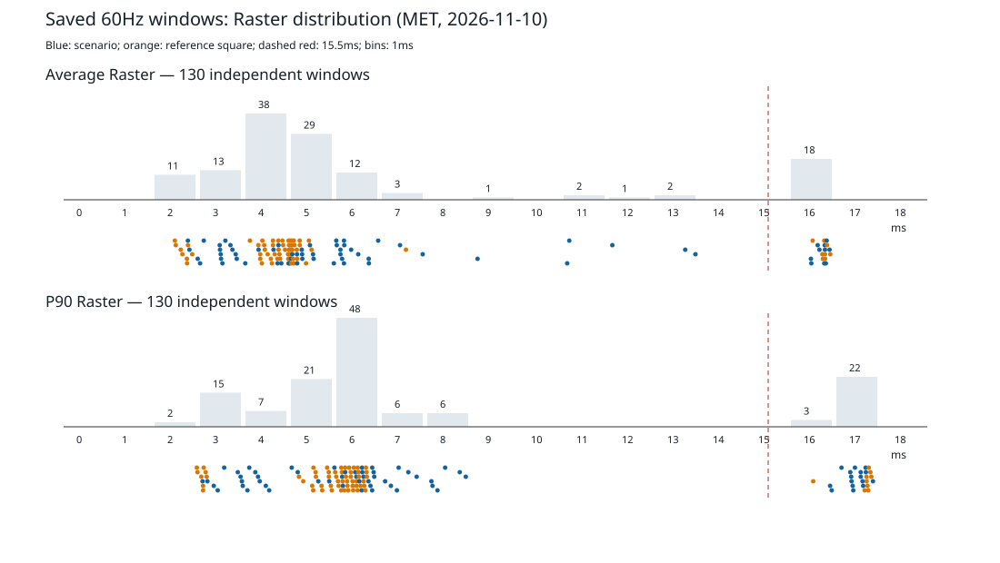

# 真机性能度量修正 MET（2026-11-10）

本批仅用 vivo V2417 / Android16 / 60Hz 已保存数据离线重算，没有连接手机、运行 adb、Gradle 或构建。正式结果沿用 FIN 的样本身份：wheel、number_wheel、capsule、lotto、grid 使用 PERF 的 perf_after，其余使用 DEV 的 bench_20261110_180650。它们不是同一 APK 的全量重测。历史 DEVICE/PERF/AB 等报告保留原文，当前口径以本文为准。

## 问题与证据

原 `dropped_frame_ratio` 统计线程耗时超过帧预算的帧比例，不能直接解释为未呈现帧。Raster 耗时包含提交和等待缓冲区的时间；高档窗口平均值接近一个帧周期，不能继续当作纯绘制成本。下表从两个原始汇总读取，路径为 `tool/bench/results/perf_after/wheel_default_{2,3}/wheel_steady_*.timeline_summary.json`。

| 指标 | 第二轮（未污染） | 第三轮（污染） |
| --- | --- | --- |
| fps | 60.030055 | 59.974747 |
| frame_count | 301 | 301 |
| elapsed_micros | 5014155 | 5018779 |
| 60hz_frame_percentage | 100 | 100 |
| average_frame_request_pending_latency（ms） | 16.319340 | 16.305697 |
| average_vsync_transitions_missed | 1 | 1 |
| average_vsync_frame_lag | 0 | 0 |
| UI build 平均（ms） | 0.916681 | 0.976777 |
| Raster 平均（ms） | 5.251907 | 16.744056 |
| Raster P90（ms） | 6.707 | 17.409 |

`average_vsync_transitions_missed` 是 SDK 原字段，两轮均为1；不能仅凭这个名称将它解释为本次窗口真实丢帧数。两轮帧率、帧数、请求延迟和 build 几乎一致，主要区别为 Raster 高档。

每轮先测几乎不画内容的旋转方块。它也会独立进入高档，且不与主场景同步：

| 来源 / 轮次 | 参照 Raster 平均 ms | 主场景 Raster 平均 ms | 观察 |
| --- | --- | --- | --- |
| DEV slot_3 / slot_steady | 16.6923 | 9.1064 | 主场景混合窗口，P90 16.862ms |
| DEV slot_4 / slot_steady | 16.4784 | 3.4556 | 参照高档、主场景低档 |
| PERF perf_ablation / wheel_raster_1 | 16.8667 | 5.4863 | 参照高档、主场景低档 |
| PERF perf_ablation / wheel_raster_3 | 16.7500 | 5.2381 | 参照高档、主场景低档 |
| PERF perf_ablation / wheel_picture_2 | 16.7341 | 13.6754 | 两者高档 |
| PERF perf_ablation / wheel_picture_3 | 16.7520 | 12.0714 | 两者高档 |

完整65个参照窗口的逐轮对照见[离线报告](../tool/bench/results/met/REPORT.md)。以上数值均可由[原始来源与哈希](../tool/bench/results/met/provenance.json)及[全部窗口数据](../tool/bench/results/met/all_windows.json)复核；旧辅助脚本 ref_rounds.py/cmp_rounds.py 的两表已用保存数据独立复现，未执行任何设备命令。

## 规则、阈值与分布

分布覆盖 DEV、PERF perf_after/perf_ablation、AB A/B/C 和其内 skia_compare，排除 comparison 副本，按 report_key/run_id/actual_scene 去重。共 **130个稳态窗口（主场景65、参照65）**，fps **59.829927–60.176516**；全部满足 fps≥59 且 frame_count≥0.98×elapsed_micros/1e6×60，按该口径没有真实卡顿窗口。另有冷首帧3个和RSS3个样本；它们不属于持续动画窗口。

P90 低档最大8.848ms、高档最小16.490ms，**15.5ms 在两者间隙内**，且接近60Hz帧周期16.667ms；平均值也有13.899220–16.440377ms的间隙。平均值12–14ms的混合窗口仍因P90接近帧周期被识别。保留批准阈值，无需调整。

1. `backpressure_contaminated` 同时要求 fps≥59、交付帧数≥期望98%、Raster P90≥15.5ms；参照使用同一纯函数，仅供报告。130个窗口中 **25个污染：主场景16、参照9**。
2. 所有稳态主窗口都检查交付，任何一轮不达标则场景失败，不能因污染被跳过。
3. 成本类指标仅取未污染窗口中位数，偶数样本取中间两值平均，至少两个窗口，否则不确定。稳定性为未污染窗口极差/中位数≤30%；全零稳定，零中位数但非全零失败。补足未污染样本最多到同配置五次启动，仍不足不得判通过。
4. 稳定指标≤目标通过；超目标但≤15%按实测中位数×1.1向上取整标「首版标定」；超15%或不稳定保持原目标并失败。耗时精度0.001ms、比例0.000001，沿用历史工具的精度。RSS不重标。
5. 目标保守使用MET开始时预算（包含FIN已批准的UI值和历史更严校准值），不回退到DEV较宽的估算。原目标存于 budgets.status.json 的 met.targets，避免反复运行自动叠加放宽。
6. 冷首帧 `informational:true`，不是通过。Raster P99 首版没有预算，仅记录中位数；比较器支持显式提供P99目标，本批不凭空设阈值。
7. RSS保留 `kRssCycles=5`、稳态1.5MiB、页面峰值5622989B、预热仅信息；RSS取所有轮次而不按帧时污染过滤，也不用相对极差规则。

## 正式重算结果

正式集合33个报告样本，其中27个稳态主窗口、27个配对参照：主窗口污染5个，参照污染3个；其余为3个首帧和3个RSS。所有主稳态窗口交付通过；所有10个带RSS场景的稳态增长中位数通过。

| 场景 | 未污染/总窗口 | UI平均 ms | Raster平均 / P90 ms | 结论与原因 |
| --- | --- | --- | --- | --- |
| wheel_steady | 2/3 | 0.9365 | 5.0996 / 6.7480 | 失败：旧掉帧代理0与1/301，稳定性200% |
| wheel_first_frame | 不适用 | 40.378首帧 | 不适用 | 信息项，待空白页基线，非通过 |
| grid_steady | 3/3 | 1.0243 | 5.4998 / 6.5570 | 失败：UI P90 1.780>1.5ms（18.7%）；Raster平均超37.5%且不稳定，P90/掉帧代理也不稳定 |
| slot_steady | 2/3 | 1.3576 | 3.4481 / 3.9580 | 失败：UI平均超1ms目标35.8% |
| slot_raster | 3/3 | 1.0641 | 2.7681 / 3.1630 | 失败：UI平均/P90、Raster平均/P90及掉帧代理不稳定；UI平均不重标 |
| lever_steady | 3/3 | 1.3999 | 3.7137 / 4.2170 | 失败：UI平均超1ms目标40.0% |
| capsule_mixing | 3/3 | 1.6541 | 3.8083 / 4.3140 | 通过 |
| number_wheel_spin | 2/3 | 1.1357 | 2.9759 / 3.3465 | 通过 |
| lots_shaking | 2/3 | 1.3782 | 3.8951 / 4.8300 | 失败：UI平均超37.8%，Raster平均/P90不稳定 |
| lotto_draw | 2/3 | 2.2188 | 4.8241 / 5.4880 | 通过（UI P90首版标定后） |
| memory_cycles | 不适用 | 不适用 | 不适用 | 通过：稳态增长933888B≤1572864B |

总计 **4通过、6失败、0个样本不足不确定、1信息项**。逐项未污染中位数、原目标、新预算、稳定性、逐窗口污染分类和全部RSS原值见[完整重算报告](../tool/bench/results/met/REPORT.md)及[机器可读结果](../tool/bench/results/met/assessment.json)。

### 首版标定清单

仅以下四个稳定指标符合≤15%政策；标定日期2026-11-10，设备vivo V2417。某指标通过不表示所在场景全部通过。

| 场景 / 指标 | 原目标 ms | 未污染中位数 ms | 新预算 ms |
| --- | --- | --- | --- |
| wheel / Raster平均 | 5 | 5.099638 | 5.610 |
| lever / UI P90 | 2 | 2.096000 | 2.306 |
| lots / UI P90 | 2 | 2.024000 | 2.227 |
| lotto / UI P90 | 3 | 3.322500 | 3.655 |

### 新旧结论与敏感性

FIN旧口径只有capsule及memory场景整体通过；MET增加number_wheel和lotto通过。首帧由超标改为信息待标定，不能计作通过。wheel仍因未污染窗口的掉帧代理稳定性失败；grid、slot、lever、lots的剩余超标或不稳定也未消失。无需再把高档Raster本身解释为绘制成本超标。

合并所有可用窗口后，9个稳态场景均失败，memory仍通过，首帧仍信息项；详见[敏感性结果](../tool/bench/results/met/sensitivity.json)。这是混合旧实现、消融配置、后端和APK的压力检查，不能用它替代正式同配置结果，也没有用它改预算。所有130个稳态窗口的交付结论仍通过。各配置轮次有限，不能据此估计总体污染发生概率。

## 补跑、首帧标定与局限

当前正式集合每个稳态场景至少有两个未污染窗口，无因样本不足必须补跑的场景。wheel、grid、slot_raster、lots需调查未污染窗口间稳定性后重测；slot、lever、lots的UI平均和grid的UI P90/Raster平均需性能修复，不是补一个好窗口即可通过。未来同配置初测三次后，若未污染不足两个，最多补到五次启动；仍不足则不确定。

首帧待标定：下一次真机会话先新增 `blank_first_frame` 场景（空白路由冷push，沿用完整UI FrameTiming计时，独立进程三次），再以相同环境测 `wheel_first_frame` 三次，计算两个中位数之差 `luckdraw首帧−空白页首帧` 后制定预算。需新增的测试目标、SCENARIO路由与具体未来命令见[bench README](../tool/bench/README.md)。本批没有实现或运行设备场景，不把未来命令写成已可运行。

证据支持高档为提交/swap/GL等待vsync释放缓冲区的背压，与绘制内容不相关；这是基于交付完整、耗时接近帧周期和参照不同步的推断，现有数据没有独立的swap阻塞探针。污染窗口下无法观测真实绘制成本；本规则假设「fps完整 + P90≈帧周期」即背压，极端情况下可能将真实重负载误判为污染，因此必须保留至少两个未污染窗口及全部窗口交付检查。这里的「未发现真实丢帧」指保存的timeline交付门禁，没有显示面板逐帧呈现的独立测量。

未污染窗口中的旧掉帧代理仍按批准规则执行相对稳定性；wheel中位数约0.1661%低于0.5%预算，但因0与1/301的极差/中位数200%仍失败。本批不自行新增稀有事件豁免，也不借度量修正保证所有场景通过。

## 本地验证与设计修正建议

本批新增9条MET回归并保留既有测试名，相关bench三文件42通过，工具目录177通过；串行四组139文件共1060通过、0跳过失败，lib覆盖6792/6792=100%。主包及bench独立分析0 issue，格式346文件0变化，imports、验收矩阵静态/运行JSON、parity manifest均通过，发布预演0 warnings。详见[发布检查清单](RELEASE_CHECKLIST.md)及[原始门禁日志](../tool/bench/results/met/validation/)。正式和敏感性性能比较器均如实退出1。

原文没有明确「首版目标」具体预算版本及取整步长；本批保守冻结MET前较严目标并沿用历史0.001ms/0.000001精度，建议后续统一写入预算schema。首版没有P99目标，本批保留信息项，建议后续有可信基线再给目标。T4.6首帧测试名仍称layout/record，实际计完整UI，既有FIN测试名仍称不改Raster目标，现用于核对冻结原目标；保留名称保证矩阵追踪，建议后续协调改名。空白首帧场景及设备补跑上限的自动管理仅写未来准备步骤，未冒充本批实现。

流程偏离：早期一次试跑中测试与主包分析曾短暂重叠；发现后后续均串行，已串行复跑受影响的工具/相关全量组及最终两工程分析，最终门禁日志来自串行执行。没有挂起超时、设备操作或本批dart/flutter_tester孤儿进程。

## 第二轮：预算标定与稳定性规则

第一轮MET内容原样保留为历史证据；当前规则、预算和结论由本节MET2取代。

MET2（2026-11-10）纯离线复算：**帧交付完整（全部130个窗口约60fps，59.829927–60.176516，无真实丢帧，按timeline交付口径）；偶发窗口的Raster时间被vsync背压污染且与绘制内容无关（参照方块同样出现）；按真机实测标定了首版回归预算。** 不是性能全部达标：1项满足有效目标（memory，RSS沿用FIN口径）、5场景已标定但未达最初设计目标、3场景失败、1场景不确定、1首帧信息项。首帧与进程级CPU待下次真机会话标定；性能结论基于单台设备vivo V2417（Android 16）三轮数据，不是跨设备保证。PERF五场景与DEV其余场景沿用MET/FIN身份，并非同一APK全量重测。现有timeline不等于独立面板呈现测量；污染窗口无法测量纯绘制成本。

比例类（`dropped_frame_ratio`及同类0–1比例）稳定性采用绝对极差≤0.01（1个百分点），避免近零中位数放大相对误差；时间类中位数<0.5ms时绝对极差≤0.15ms，其余时间/字节相对极差≤30%。RSS仍只按FIN绝对上限，不做相对稳定性门禁。成本至少2个未污染窗口，偶数取中间两项平均；不足或不稳定均为「不确定，需补跑」。所有稳态窗口必须fps≥59且帧数≥期望98%，否则失败；污染判定仍追加Raster P90≥15.5ms，阈值与窗口规则不变。

显式首版标定仅用于稳定时间指标：`max(实测中位数×1.1向上取整到0.001ms, 有来源且不高于FIN/MET既有批准值的历史标定下限)`；未标定的设计估算不能充当下限，比例/GC/RSS不重标。正常`compare.dart`只比较冻结后的`budgets.json`，不得每次回归自动放宽；`--calibrate`仅输出建议。最初`design_target`来自DEV保存的设计快照，MET前目标（含FIN批准值）另存`target`，`gap_to_design=实测中位数/design_target−1`，零目标差距无定义。历史标定下限及来源在`budgets.status.json.met2`冻结，重复重算不叠加。原设计目标达成与回归门禁通过分开列示。

新增硬门禁独立检查**每一个未污染窗口**：同帧build+raster合计P99≤12.0ms（16.67ms至少预留4.5ms），且UI P99≤4ms。任一超标直接失败，优先于不确定，不能用跨窗口中位数掩盖。保存数据中grid=12.231ms、slot_raster=16.905ms、lotto=12.229ms超合计上限，lotto UI P99还达4.386ms；不调整阈值。lots的Raster均值/P90相对极差41.69%/53.75%，仍不稳定，需下次同配置调查补跑，不能挑好窗口。

### 11场景新结论

| 场景 | 未污染/总窗口 | UI均值 ms | Raster均值/P90 ms | 结论 |
| --- | --- | --- | --- | --- |
| wheel_steady | 2/3 | 0.9365 | 5.0996/6.7480 | 已按实测标定（未达最初设计目标） |
| wheel_first_frame | 不适用 | — | —/— | 信息项，待标定 |
| grid_steady | 3/3 | 1.0243 | 5.4998/6.5570 | 失败 |
| slot_steady | 2/3 | 1.3576 | 3.4481/3.9580 | 已按实测标定（未达最初设计目标） |
| slot_raster | 3/3 | 1.0641 | 2.7681/3.1630 | 失败 |
| lever_steady | 3/3 | 1.3999 | 3.7137/4.2170 | 已按实测标定（未达最初设计目标） |
| capsule_mixing | 3/3 | 1.6541 | 3.8083/4.3140 | 已按实测标定（未达最初设计目标） |
| number_wheel_spin | 2/3 | 1.1357 | 2.9759/3.3465 | 已按实测标定（未达最初设计目标） |
| lots_shaking | 2/3 | 1.3782 | 3.8951/4.8300 | 不确定，需补跑 |
| lotto_draw | 2/3 | 2.2188 | 4.8241/5.4880 | 失败 |
| memory_cycles | 不适用 | — | —/— | 满足设计目标 |

### 未达最初设计目标（完整14项）

| 未达最初设计目标的场景 | 指标与差距（实测中位数/最初目标−1） |
| --- | --- |
| wheel_steady | Raster均值 +1.99% |
| grid_steady | UI均值 +70.72%、UI P90 +18.67%、Raster均值 +37.49% |
| slot_steady | UI均值 +35.76% |
| slot_raster | UI均值 +6.41% |
| lever_steady | UI均值 +39.99%、UI P90 +4.80% |
| capsule_mixing | UI均值 +10.27% |
| number_wheel_spin | UI均值 +13.57% |
| lots_shaking | UI均值 +37.82%、UI P90 +1.20% |
| lotto_draw | UI均值 +47.92%、UI P90 +10.75% |

首帧40.378ms与4ms历史估算不列为设计达成比较；RSS有效目标按FIN口径1.5MiB，不能与历史0.5MiB不同口径直接比。

### 帧预算余量实测

| 场景 | 未污染合计P99最大 ms / 12 | UI P99最大 ms / 4 | 帧预算余量门禁 |
| --- | --- | --- | --- |
| wheel_steady | 10.081 | 1.850 | 通过 |
| grid_steady | 12.231 | 2.434 | 失败 |
| slot_steady | 6.578 | 2.527 | 通过 |
| slot_raster | 16.905 | 2.190 | 失败 |
| lever_steady | 7.340 | 2.963 | 通过 |
| capsule_mixing | 8.508 | 3.241 | 通过 |
| number_wheel_spin | 5.528 | 2.180 | 通过 |
| lots_shaking | 8.864 | 2.780 | 通过 |
| lotto_draw | 12.229 | 4.386 | 失败 |

硬门禁失败表示余量不足，全部窗口仍完整交付，不等于已观察到真实丢帧。

### 首版回归预算

| 场景 | UI均值/P90 ms | Raster均值/P90 ms |
| --- | --- | --- |
| wheel_steady | 1.031/1.660 | 5.610/7.423 |
| grid_steady | 1.200/1.958 | 4.000/7.000 |
| slot_steady | 1.494/2.093 | 3.793/4.354 |
| slot_raster | 1.000/2.000 | 5.000/8.000 |
| lever_steady | 1.540/2.306 | 4.086/4.639 |
| capsule_mixing | 2.000/3.000 | 4.190/7.503 |
| number_wheel_spin | 1.300/1.959 | 3.274/3.682 |
| lots_shaking | 1.517/2.227 | 5.000/8.000 |
| lotto_draw | 2.500/3.655 | 5.307/7.083 |

28个稳定时间指标完成首版标定，其余8个时间指标不稳定且预算保留。比例/GC不重标，RSS保持稳态1572864B、页面峰值5622989B、预热仅信息。回归通过不等于最初设计目标达成。

### CPU占用指示（不是实测进程CPU）

UI线程忙占比≈`avg_build_ms×fps/1000`，取全部主窗口的推算中位数；Raster线程忙占比≈`avg_raster_ms×fps/1000`，仅取未污染窗口的推算中位数。**由帧耗时推算，未做进程级CPU实测（`dumpsys cpuinfo`/`top`），进程级CPU实测待下次真机会话。** 两线程比例不能相加当进程CPU，Raster墙钟耗时也不等于执行CPU指令的时间。

| 场景 | UI忙占比（全部窗口中位数） | Raster忙占比（未污染窗口中位数） |
| --- | --- | --- |
| wheel_steady | 5.74% | 30.62% |
| wheel_first_frame | 不适用（非稳态） | 不适用（非稳态） |
| grid_steady | 6.14% | 32.99% |
| slot_steady | 8.13% | 20.71% |
| slot_raster | 6.40% | 16.61% |
| lever_steady | 8.40% | 22.28% |
| capsule_mixing | 9.92% | 22.85% |
| number_wheel_spin | 6.80% | 17.86% |
| lots_shaking | 7.95% | 23.39% |
| lotto_draw | 13.02% | 28.97% |
| memory_cycles | 不适用（非稳态） | 不适用（非稳态） |

### 复现、验证与保守处理

运行`python tool/bench/recalculate_met2.py`离线重放；正常冻结比较器真实退出1（3硬失败、1不确定）。全部逐指标「实测/最初设计目标/标定预算/差距/状态」、33条原始SHA-256及逐窗口硬门禁见[MET2完整报告](../tool/bench/results/met2/REPORT.md)。

设计版本差异：MET冻结目标已含FIN批准UI值，不能称作「最初设计目标」；本轮保留原始design_budgets快照用于成本差距，同时保留MET冻结目标和全部既有批准下限，不抹去FIN已接受的设计差距。原15%政策、P99仅信息、六失败结论在第一轮保留为历史；按本轮主会话决定由分类型稳定性、实测标定和12/4ms硬门禁替代。旧测试名逐字保留但断言改验当前规则，矩阵仅追加MET2-01～10，状态「已落地」（D6）。D1–D5/D7相关库实现未涉及，D2既有门禁未改，D8按保守做法记录差异；未修改库代码或依赖，未使用设备、子代理或版本提交。

### MET2本地门禁实际输出

| 验证 | 实际输出摘要 / 退出码 |
| --- | --- |
| 主包 / bench `flutter pub get --no-example` | 均0；主包配置未变，bench追加exclude后立即恢复 |
| 主包 / bench `flutter analyze --no-pub` | 均`No issues found! (ran in 3.2s)`，0 issue / 0 |
| `dart format lib test tool`及检查 | `Formatted 347 files (0 changed)` / 0 |
| `flutter test test/tool --no-pub --concurrency=1 --reporter=json` | 187通过，0失败/跳过 / 0 |
| bench四文件 + design invariants最终复核 | 52 + 2 = 54通过；新增MET2测试10条 / 0 |
| 四组全量，独立`coverage/met2-{a,b,c,d}.lcov` | 552/130/365/23，共1070通过、140文件、0失败/跳过；各命令84.137/45.971/73.608/10.646秒 / 均0 |
| `dart run tool/coverage.dart --min=100 --lcov=coverage/met2.lcov` | `TOTAL: 6792/6792 (100.00%)`，`PASS: coverage >= 100.0%` / 0 |
| `dart run tool/check_imports.dart` | `PASS: 145 lib files; IMP-R1…R12` / 0 |
| `dart run tool/check_acceptance.dart` | `PASS: 1493 references resolve; 1094 registered tests all mapped.` / 0 |
| `check_acceptance.dart --from-json .../met2/validation/all.tests.jsonl` | 同为1493引用、1094登记测试全部映射 / 0 |
| `dart run tool/parity/generate.dart --verify-manifest` | `PASS: parity manifest 16 cases, 96 artifacts; hashes and frames verified` / 0 |
| `dart pub publish --dry-run` | `Total compressed archive size: 245 KB.`；`Package has 0 warnings.` / 0 |
| 正常冻结性能比较器 | 3硬失败、1不确定、首帧INFO，6场景回归通过但仅memory满足有效目标 / **1（真实未全达标）** |
| 幂等重算 | 连续重算预算及assessment的SHA-256一致，不叠加放宽 / 0 |

[原始日志与退出码](../tool/bench/results/met2/validation/)、[测试汇总](../tool/bench/results/met2/validation/test_summary.json)、[自检](../tool/bench/results/met2/validation/selfcheck.json)。原始33份来源SHA-256保持一致，第一轮正文保留已核验；无依赖或库改动。本轮未做设备采样、真实发布或子代理转派。ARCHITECTURE旧ADR-35、T4.8历史汇总与MET-04旧矩阵说明仍待T4.8统一文档对齐，当前以第二轮新规及MET2新增验收行为为准。

## 第三轮：根因分析与待复测

PEND（2026-11-11）只读原始时间线，不碰手机、adb、Gradle、build或drive。`analyze_frames.py`解析四场景全部16个未污染窗口，按引擎帧号关联UI/Raster并逐项核对SDK时长；MET2正式与旧DEV分列。全部trace尖峰为slot5、grid10、lotto171、lots0；正式样本为5/8/24/0。窗口边界未配对帧逐项记录，不补零、不相加两个独立P99。完整方法、尖峰帧号/时间位置、UI与Raster事件累计及普通帧对照见[PERF_ROOTCAUSE_REPORT](PERF_ROOTCAUSE_REPORT.md)。

已定位的是事件层长墙钟区间：slot/grid多数尖峰在SurfaceFrame::Encode/Submit与GLES编码，部分UI在PAINT/COMPOSITING；slot不是只在窗口开头发生。图集准备在源代码的布局准备阶段同步发起，但原采集从图片ready、稳定与cruising后开始，没有图集构建那一帧，实际帧号、耗时、执行线程无法判定。lots两窗口普通帧Raster均值不同，没有证据证明非确定性库成本。

代码根因均「无法判定」：没有函数级采样或独立等待探针证明可避免的luckdraw工作，不能直接断言库缺陷或设备故障；本批不做无证据优化，不改lib、公共API、strictUpstream/picture、parity/MANIFEST、golden或预算。本批没有「已修复，待真机复测确认」的产品改动；准备好的测量工具仍待真机确认，不写成「已达标」。三项硬失败、lots不确定、14项原设计差距继续有效。

新增统一冷push的blank/wheel/grid/slot首帧、进程与UI/Raster线程CPU采样、`run_pending_device_checks.ps1`一条命令收尾，以及纯函数/夹具/CLI测试。CPU窗口用TCP握手明确划分前后，窗口内每秒一次共五次，无额外adb轮询；解析失败或越窗显式失败。结果按冻结MET2规则评估四项复测；首帧/CPU只建立基线，不擅自批准预算。运行命令、APK前提与剩余清单见[发布检查清单](RELEASE_CHECKLIST.md)。本批只运行离线PlanOnly/语法检查，不执行采集分支。新增场景需要新入口APK；当前禁止构建，因此不声称已有历史APK可直接跑新场景。

PEND本地验证：新增15条Flutter测试、登记1条未执行设备测试；工具202通过，四组全量1085通过/141文件/零失败跳过，覆盖6792/6792=100%。主包与bench分别analyze均0 issue；format353文件0变化；imports、静态/JSON acceptance、parity manifest与publish dry-run零警告均通过。真实日志及分组原值见[发布检查清单的PEND记录](RELEASE_CHECKLIST.md#pend-本地门禁实际输出)。这些是本地功能门禁，不是性能达标证据。

## 第四轮：真机收尾复测

仅一台 vivo V2417 / Android 16，APK 与首次会话身份见 session.json、validation/apk.json。原始脚本未通过：转盘冷帧五次仅两次 driver 成功即提前退出；续跑只执行未启动项目，不清零计数、不覆盖 runs.json，不超过每项五次。CPU 五项目均缺少有效轮。首帧数值可从原始 driver 响应恢复，但不把 driver 失败改写为通过。所有正式成本预算、RSS 与 12ms/4ms 硬门禁均未放宽。

## APK 与测量身份

APK SHA-256：`E92CFEB2366540F4FCFEE28BEB67F7899976A254BDE3048FB83C04408D17F14C`。构建指定 integration_test/pending_bench_test.dart 与 LUCKDRAW_TIMELINE=true；arm64 libapp.so 检出 pending 测试名和新增路由。首轮因 Maven JVM 证书链失败（56.372s），使用 Windows 证书库重试成功（33.427s），Gradle workers=2。没有升级依赖或关闭证书校验；临时 Gradle 属性已恢复。

## 冷 push 首帧 UI（ms）

固定取启动顺序前3份完整设备 FrameTiming；全部额外轮仍在 audit.json。计时为 FrameTiming.buildDuration，不是启动时间或纯 layout/record。wheel/grid 的 driver 汇总失败来自冷窗口缺少完整 Raster timeline 事件，恢复值来自原始 Flutter driver JSON 响应，原 valid=false 保留。

| 场景 | 前三次原值 | 中位数 | 极差 | 玩法−空白 | 增量预算 | 与原4ms差距 | driver成功/启动 |
| --- | --- | --- | --- | --- | --- | --- | --- |
| blank_first_frame | 2.883 / 2.835 / 3.469 | 2.883 | 0.634 | — | — | — | 3/3 |
| wheel_first_frame | 47.238 / 40.970 / 37.118 | 40.970 | 10.120 | 38.087 | 41.896 | +852.175% | 2/5 |
| grid_first_frame | 10.024 / 13.403 / 31.592 | 13.403 | 21.568 | 10.520 | 11.572 | +163.000% | 1/5 |
| slot_first_frame | 3.128 / 2.577 / 7.338 | 3.128 | 4.761 | 0.245 | 0.270 | -93.875% | 3/3 |

有效增量预算为实测中位数差×1.1向上取整到0.001ms，冻结在 `budgets.status.json.devfin.first_frame_increment_budgets_ms`。wheel 比4ms多34.087ms，grid多6.520ms；不能写成达到设计目标。九宫格、老虎机三轮极差明显，标定不是稳定性或跨设备保证。既有 MET2 schema 只支持 wheel 的绝对 first_frame_ui_millis，无法表达空白基线及 grid/slot 有符号增量；因此 budgets.json 保留旧绝对信息字段并写明兼容原因，本轮有效增量预算由 DEVFIN 审计测试检查。不得将增量阈值套到旧绝对40.378ms；建议维护者另行扩展比较器 schema。

## 原生进程/线程 CPU（%）

协议为 before/start/end TCP 握手，计划五秒窗口第0/1/2/3/4秒各一次 cpuinfo+top，窗口前后各一次。每轮应取五次样本的角色/进程中位数，再取三轮中位数；单核100%，多核进程可超过100%。本次全部在 before 阶段失败，没有任何有效五秒 CPU 窗口。cpuinfo 是系统原生历史统计，不覆盖本次五秒；部分返回区间结束于采样前数分钟，匹配不到当前PID或命中旧PID。top 随后返回0线程/不被当前解析器识别的列头。不能用旧PID、框架墙钟或零值填空。

| 场景 | UI三轮 / 中位数 | Raster三轮 / 中位数 | 总进程三轮 / 中位数 | 有效/启动 | 结论 |
| --- | --- | --- | --- | --- | --- |
| cpu_wheel_steady | 缺测 / 缺测 | 缺测 / 缺测 | 缺测 / 缺测 | 0/5 | 不确定（采样链路失败） |
| cpu_grid_steady | 缺测 / 缺测 | 缺测 / 缺测 | 缺测 / 缺测 | 0/5 | 不确定（采样链路失败） |
| cpu_slot_steady | 缺测 / 缺测 | 缺测 / 缺测 | 缺测 / 缺测 | 0/5 | 不确定（采样链路失败） |
| cpu_capsule_mixing | 缺测 / 缺测 | 缺测 / 缺测 | 缺测 / 缺测 | 0/5 | 不确定（采样链路失败） |
| cpu_lotto_draw | 缺测 / 缺测 | 缺测 / 缺测 | 缺测 / 缺测 | 0/5 | 不确定（采样链路失败） |

全部25次失败原文与错误保留在各 cpu_*/cpu/；错误分类与完整轮次见 audit.json。没有统计区间足够新且进程身份正确的完整样本，不宣称完成CPU标定。

## 四场景：MET2 与本次并排

| 场景 | MET2结论；合计/UI P99最大ms | 本次未污染/总窗口 | 每轮合计P99 ms | 每轮UI P99 ms | 稳定性 | 本次结论 |
| --- | --- | --- | --- | --- | --- | --- |
| slot_raster | 失败；16.905/2.190 | 3/3 | 5.352 / 5.114 / 5.397 | 2.093 / 1.985 / 2.068 | 稳定 | 失败 |
| grid_steady | 失败；12.231/2.434 | 2/3 | 14.039 / 9.348 / 20.420（污染） | 2.222 / 2.119 / 2.193 | 稳定 | 失败 |
| lotto_draw | 失败；12.229/4.386 | 3/3 | 9.593 / 11.224 / 12.331 | 4.570 / 3.814 / 4.445 | 稳定 | 失败 |
| lots_shaking | 不确定；8.864/2.780 | 3/3 | 6.321 / 10.919 / 6.271 | 2.611 / 2.152 / 2.682 | 不稳定：average_frame_rasterizer_time_millis, 90th_percentile_frame_rasterizer_time_millis | 不确定 |

所有未污染窗口独立检查 build+raster 同帧P99≤12ms且UI P99≤4ms，至少两个未污染窗口才评估成本；失败优先于不确定。冻结时间预算不因本次更慢而重标；比例、GC、RSS继续原门槛。各指标原值、中位数、原设计差距、硬门禁与RSS见 frame_assessment.json。

补充：冻结成本与波动（不能只看硬余量）

| 场景 | UI均值中位数ms | Raster均值/P90中位数ms | 未通过指标 |
| --- | --- | --- | --- |
| grid_steady | 1.062244 | 5.752400/7.333000 | average_frame_rasterizer_time_millis: 5.752400332225915 / 上限4.0, 状态FAIL, 极差比0.07572340883265483；90th_percentile_frame_rasterizer_time_millis: 7.333 / 上限7.0, 状态FAIL, 极差比0.0684576571662348 |
| slot_raster | 1.090628 | 2.896249/3.295000 | average_frame_build_time_millis: 1.0906279069767444 / 上限1.0, 状态FAIL, 极差比0.03513779437612421 |
| lots_shaking | 1.232439 | 3.059010/3.478000 | average_frame_rasterizer_time_millis: 3.0590099667774124 / 上限5.0, 状态UNCERTAIN, 极差比0.5805018017685337；90th_percentile_frame_rasterizer_time_millis: 3.478 / 上限8.0, 状态UNCERTAIN, 极差比0.6403105232892466 |
| lotto_draw | 2.208983 | 5.225883/5.945000 | 成本指标通过，硬余量另验 |

slot_raster旧硬余量失败本轮未重现，但UI均值1.090627907ms>冻结1.0ms，仍失败。grid的Raster均值5.752400332ms>4ms、P90 7.333ms>7ms；lotto硬余量最大12.331ms/UI4.570ms；lots均值/P90相对极差58.050%/64.031%，保持不确定。

## 全部持续动画窗口交付

| 场景/轮 | 主/参照 | fps | 帧数/期望 | 交付比例 | fps≥59且≥98% |
| --- | --- | --- | --- | --- | --- |
| grid_steady_1 | 主场景 | 60.004362 | 301/300.978 | 100.007270% | 通过 |
| grid_steady_1 | 参照 | 60.072682 | 301/300.636 | 100.121137% | 通过 |
| grid_steady_2 | 主场景 | 60.050726 | 301/300.746 | 100.084543% | 通过 |
| grid_steady_2 | 参照 | 60.044928 | 301/300.775 | 100.074880% | 通过 |
| grid_steady_3 | 主场景 | 59.962560 | 301/301.188 | 99.937600% | 通过 |
| grid_steady_3 | 参照 | 60.089339 | 301/300.552 | 100.148899% | 通过 |
| slot_raster_1 | 主场景 | 60.093526 | 301/300.532 | 100.155877% | 通过 |
| slot_raster_1 | 参照 | 60.101242 | 301/300.493 | 100.168736% | 通过 |
| slot_raster_2 | 主场景 | 59.995834 | 301/301.021 | 99.993057% | 通过 |
| slot_raster_2 | 参照 | 60.026547 | 301/300.867 | 100.044245% | 通过 |
| slot_raster_3 | 主场景 | 60.002986 | 301/300.985 | 100.004977% | 通过 |
| slot_raster_3 | 参照 | 60.159200 | 301/300.203 | 100.265333% | 通过 |
| lots_shaking_1 | 主场景 | 60.024919 | 301/300.875 | 100.041532% | 通过 |
| lots_shaking_1 | 参照 | 60.053709 | 301/300.731 | 100.089515% | 通过 |
| lots_shaking_2 | 主场景 | 60.010391 | 301/300.948 | 100.017319% | 通过 |
| lots_shaking_2 | 参照 | 60.117087 | 301/300.414 | 100.195144% | 通过 |
| lots_shaking_3 | 主场景 | 60.033012 | 301/300.834 | 100.055020% | 通过 |
| lots_shaking_3 | 参照 | 60.089843 | 301/300.550 | 100.149739% | 通过 |
| lotto_draw_1 | 主场景 | 60.061381 | 579/578.408 | 100.102301% | 通过 |
| lotto_draw_1 | 参照 | 60.008226 | 301/300.959 | 100.013710% | 通过 |
| lotto_draw_2 | 主场景 | 59.991906 | 579/579.078 | 99.986510% | 通过 |
| lotto_draw_2 | 参照 | 60.107951 | 301/300.459 | 100.179918% | 通过 |
| lotto_draw_3 | 主场景 | 60.036009 | 579/578.653 | 100.060015% | 通过 |
| lotto_draw_3 | 参照 | 60.008405 | 301/300.958 | 100.014009% | 通过 |

24/24个持续动画窗口交付通过；fps=59.962560–60.159200；fps=0轮数=0。冷push事件窗不按持续60fps验收；CPU项目没有有效窗口。这是timeline交付检查，不是独立面板呈现测量。

## 异常、根因与边界

1. 原脚本在首个项目有效轮不足时全局退出；本次续跑脚本位于 validation/resume_pending.ps1，只执行未启动项目，保留首次session和所有启动次数。原始脚本与产品lib未改。
2. 冷窗口的 SDK TimelineSummary 因 Raster 事件未闭合而失败；设备测试与FrameTiming仍有原始响应，恢复数据单独保存为 device_response.original.json，并保留driver失败。wheel/grid设备用例验收仍不确定。
3. CPU五项目0/5有效；统计区间/PID/线程列不符合协议。CPU未完成，不提供伪造百分比。
4. 本轮首帧仅增量预算标定，原4ms设计目标差距及波动不抹去；历史40.378ms外壳不同。
5. 本轮亮度按用户要求保持最低1、手动0、USB常亮2；主会话每120秒有锁屏看护。本脚本没有额外窗口内adb轮询；不能独立排除系统抢占、DIM或外部看护影响。
6. 若本次仍有硬失败，库代码根因为「无法判定」；没有可靠线程CPU或luckdraw函数采样栈，不将引擎GLES等待解释成可避免的库内工作，不改lib。

本报告由validation/summarize.py及finalize.py对本次原始响应、runs.json与冻结compare输出生成；所有失败保留。完整采集链路未通过不影响离线工具回归可以通过，两者分别报告。

### DEVFIN 本地门禁、收尾与建议

| 命令/核验 | 本次实际输出摘要 |
| --- | --- |
| 主包/bench `flutter pub get --no-example` | 均0；主包analysis_options未变，bench自动追加后立即恢复；pubspec依赖未改 |
| 主包/bench `flutter analyze --no-pub` | 均No issues found，0 issue；输出耗时6.0s/4.3s |
| `dart format lib test tool`及只读检查 | 均Formatted 354 files (0 changed) |
| `flutter test test/tool --no-pub --concurrency=1 --reporter=json` | 206通过，0失败/跳过；包含DEVFIN新增4条 |
| 四组全量、独立coverage/devfin-{a,b,c,d}.lcov | 552/130/384/23，共1089通过、142文件，0失败/跳过；68.782/36.948/73.651/9.632秒 |
| `dart run tool/coverage.dart --min=100 --lcov=coverage/devfin.lcov` | TOTAL: 6792/6792 (100.00%)；PASS |
| `dart run tool/check_imports.dart` | PASS: 145 lib files; IMP-R1…R12 |
| `check_acceptance.dart`静态 / `--from-json .../all.tests.jsonl` | 均PASS: 1528 references resolve; 1114 registered tests all mapped |
| `dart run tool/parity/generate.dart --verify-manifest` | PASS: parity manifest 16 cases, 96 artifacts; hashes and frames verified |
| `dart pub publish --dry-run` | 246 KB；Package has 0 warnings；退出0，没有真实publish |
| 冻结compare（仅四复测场景） | 退出1；grid/lotto硬失败，slot_raster成本失败，lots不确定；不作为本地工具门禁通过 |
| 原始/续跑采集脚本与assess_pending | 退出1；冷帧driver轮次不足，CPU各0/5；独立审计报告不冒充该CLI通过 |
| 数据自检 | 53次启动，每项3–5；33份新汇总、28个原始设备响应、341文件哈希；型号V2417，零fps=0轮，lib145文件哈希未变 |
| 持续窗口交付 | 24/24通过，fps59.962560–60.159200，最低交付比例99.937600%；未独立测量面板呈现 |
| 手机与进程收尾 | 亮屏未锁，stay_on=2、亮度模式0/亮度1；当前用户0无bench包（pm path及包列表为空）；仅结束本轮38476/30904两个Gradle daemon，其它进程保留 |

卸载首次返回DELETE_FAILED_INTERNAL_ERROR，再以当前用户卸载返回not installed for 0；最终包列表/pm path均空，因此记录为当前用户已无安装，不冒充卸载命令退出0。日志汇总脚本一次文本替换将append误改，Flutter工具测试本身已退出0；修正后由原JSON确认206条通过，无需重跑已通过测试。原始采集、比较器失败和上述异常均保留。

建议修正文档/工具：在bench README补完整pending目标与LUCKDRAW_TIMELINE构建命令；冷窗口先无损保存设备response，再容忍SDK无完整Raster事件；CPU采样从当前进程身份出发并验证原生统计区间，支持本机toybox列头，绝不使用陈旧PID替代；run_pending逐项保留失败并继续独立项目、恢复时不重置计数；经维护者批准扩展schema，分别表达空白基线、wheel/grid/slot有符号首帧增量及冻结预算。当前保守做法是在budgets.status.json.devfin冻结有效增量，旧绝对字段保持信息兼容，不把它与增量比较。

D6：矩阵仅追加DEVFIN-01～19，真实通过条目标已落地，失败/不确定如实标原因；D8：不改架构或lib，对采样工具和预算schema缺口保守留证。D1–D5/D7相关库实现及D2门禁未改；没有core_patch.diff、add/commit/push。前三轮METRIC正文及原验收矩阵字节前缀保留。

### DEVFIN 回拷后真实仓库复验

已将本批12个路径回拷到E:/workspaces/dart-labs/luckdraw；共享文档和矩阵逐次重读后定点追加，budgets仅更新reason/devfin/status字段，没有覆盖其它并行改动。新增Dart文件Formatted 1 file (0 changed)；真实仓库flutter test test/tool为206/206通过（38.621s）；check_imports为PASS:145 lib files；check_acceptance为PASS:1528 references resolve、1114 registered tests all mapped，全部退出0。原始日志见results/pending/validation/real_*；完整路径及文件哈希见copy_manifest.json。源lib、依赖、parity/golden未修改，无core_patch.diff。

2026-11-11 01:15:35（北京时间）最终交接实测：V2417内置屏幕state ON/committedState ON、mWakefulness=Awake、isKeyguardShowing=false；USB常亮2、手动亮度模式0、亮度1，设置未修改；当前用户0无bench安装。仅本轮Gradle PID38476/30904已结束，无自有dart/flutter_tester孤儿；两条其它工作区dart-sass进程保留。最近两条git提交仍443589a3/f0b64ae1，没有add/commit/push或真实publish。

## 第五轮：INSTR 冷首帧与线程CPU

INSTR（2026-11-11，副本候选实现）：wheel/grid带打点冷首帧中位数38.412→27.075ms、24.214→12.993ms，精确文字宽度缓存将首帧TextPainter.layout次数276→63、128→22；随机/多语言/emoji/lineClamp等价。减DEVFIN历史空白2.883ms后的增量24.192/10.110ms，新预算26.612/11.121ms，仍未达到原4ms目标，三轮波动大。CPU采用/proc累计节拍差，UI与平台合并标为UI+platform；wheel完整链路仅2/5，不能给三轮中位数；其余场景逐轮数值和有效性见本轮报告，lotto仅搅拌阶段。库改动以补丁交付，未覆盖并行共享lib，待主会话合并。

[完整报告](../tool/bench/results/pending2/REPORT.md)。首帧阶段占比使用包含首次layout的Dart Frame，结果指标保持FrameTiming.buildDuration；相同边界去重后才求占比。CPU取stat的utime+stime增量/真实主机读取开始间隔/100Hz，实际窗口长度与两次读取耗时逐轮保留；UI/platform合并不当纯UI报。转盘两个GC汇总失败原值不冒充driver通过，第五次启动超时后没有第六次；grid CRLF解析错误造成的历史假权限降级已识别，原文保留、该轮剔除。默认打点包装编译期关闭，新增精确豁免仅COV-02第14行；共享库补丁待合并。

## INSTR 真实仓库回拷复验

共享路径重读后定点追加；真实lib未覆盖。23个库候选文件（核心8、玩法15）和核心等价测试以两份diff交付，两补丁在快照上git apply --check --ignore-space-change均exit0；核心矩阵2行/COV-02见core_acceptance_append.md。真实仓库格式检查7个自有Dart路径exit0；flutter test test/tool为223/223、0失败/跳过（45.310s）；check_imports为145 lib PASS；check_acceptance为1552 references/1131 registered tests PASS。副本四组全量1108/1108（144文件，554/130/401/23），行覆盖6878/6878=100%，主包/bench分析均0 issue，format360文件0改动；矩阵静态与from-json均1554/1133，parity16例/96产物未变，publish --dry-run压缩包248KB、Package has 0 warnings。登记与主包执行计数差25是独立example/bench注册，不冒充全部设备运行。

最终实测 2026-11-10T18:20:04.5409880Z：屏幕ON=True、Awake=True、未锁=True，stay_on=0（要求2，未通过）、亮度模式=0、亮度=1；当前用户bench包列表及pm path为空。卸载命令exit1/DELETE_FAILED_INTERNAL_ERROR，未冒充退出0。常亮变化来源未定位，本批没有执行任何设置写入命令。

进程末检没有自有dart/flutter_tester；两次single-use Gradle已退出，接手前Kotlin PID7968保留，没有按java.exe批杀。首尾git log仍443589a3/f0b64ae1，未add/commit/push。完整路径和共享文件变更见tool/bench/results/pending2/validation/copy_manifest.json，真实复验日志见validation/real_*。CPU完整链路wheel仅2/5，其余四项各三轮；lotto仅搅拌阶段，任务完成状态为PARTIAL。

## 第六轮：STEADY 带打点稳态与 wheel CPU

STEADY（2026-11-11）仅单台 vivo V2417 / Android16：四场景带luckdraw打点，slot/grid/lots各3/3，lotto4/5（2个污染、1个安装后VM连接超时，未污染2）。轮前后核对未锁，窗口内无额外adb轮询。按引擎帧号配对并校验SDK数组，trace尖峰与FrameTiming P99独立，12ms/4ms和MET2规则均未放宽。

slot/grid尖峰主要在框架编码/提交；lotto结算重复准备已定位，但复用painter候选三轮没有稳定净收益，已回滚。lots本轮三轮稳定且通过，不能解释历史不稳定。wheel /proc CPU已补齐3/3；仅标定，不外推跨设备。

### STEADY 审核原值

| 场景 | 有效/启动/未污染 | trace尖峰各轮 | 合计/UI P99最大ms | 冻结门禁 |
| --- | --- | --- | --- | --- |
| slot_raster | 3/3/3 | [0, 2, 2] | 10.858/2.438 | FAIL |
| grid_steady | 3/3/3 | [0, 2, 2] | 11.2/2.641 | FAIL |
| lotto_draw | 4/5/2 | [10, 9] | 9.62/4.725 | FAIL |
| lots_shaking | 3/3/3 | [0, 1, 1] | 6.3/2.567 | PASS |

| wheel轮 | 进程% | UI+platform% | Raster% | 实际秒数 | 首/尾读取ms | 同轮帧数/fps |
| --- | --- | --- | --- | --- | --- | --- |
| 1 | 40.039608 | 15.014853 | 18.299352 | 6.393669 | 1381.079/1536.642 | 477.0/59.992 |
| 2 | 35.523078 | 12.675636 | 18.152762 | 6.390212 | 1375.282/1530.990 | 477.0/60.088 |
| 3 | 39.291465 | 14.930757 | 18.545571 | 6.362705 | 1336.095/1515.638 | 475.0/60.076 |

CPU 中位数：{"process": 39.29146487225166, "ui_platform": 14.930756651455631, "raster": 18.29935206217275}

| 场景 | 成功/启动/未污染 | 尖峰各轮（仅未污染） | 位置 | 事件累计ms / %同帧合计 | 结论三选一 |
| --- | --- | --- | --- | --- | --- |
| slot_raster | 3/3/3 | 0/2/2 | 2.566–2.583s、4.534–4.550s，成对；首5帧0 | paint 0.377/0.67%；Encode 43.418/77.47%；Submit 50.742/90.54% | 框架或设备（有证据：长区间在编码/提交，具体GPU/驱动/调度原因无法判定） |
| grid_steady | 3/3/3 | 0/2/2 | 2.867–2.884s、4.700–4.718s，成对；首5帧0 | paint 0.902/1.36%；Encode 52.004/78.58%；Submit 59.596/90.05%；CreateGlyphAtlas 0.119/0.18% | 框架或设备（有证据：编码/提交；不是已证明的设备缺陷） |
| lotto_draw | 4/5/2 | 10/9 | 0.134–4.434s，搅拌/开奖散布；含结算最后帧，首5帧0 | paint 38.181/19.90%；record 5.956/3.10%；Encode 55.164/28.75%；COMPOSITING 15.508/8.08% | 库内成本（已定位：结算重复准备；其它UI尖峰仍无法判定可避免性） |
| lots_shaking | 3/3/3 | 0/1/1 | 2.367s与3.583s的孤立UI尖峰，首5帧0 | paint 1.123/7.05%；COMPOSITING 4.597/28.86%；Encode 2.149/13.49% | 无法判定（历史Raster不稳定未重现；本轮UI长区间多在框架） |

结算record5.956ms已定位；候选复用painter三轮仍FAIL，且UI均值与尖峰比例没有稳定净收益，已回滚，不标已修复。

| 指标（未污染） | 原始实现2窗口 | 候选3窗口 | 结论 |
| --- | --- | --- | --- |
| trace尖峰/帧数/比例 | 19/534/3.56% | 47/808/5.82% | 没有下降；轮数不同不只比较总数 |
| 合计P99各轮ms / 最大 | 9.620/9.169 / 9.620 | 9.098/9.788/10.593 / 10.593 | 均≤12，但候选最大更高 |
| UI P99各轮ms / 最大 | 4.725/4.226 / 4.725 | 4.120/4.565/3.376 / 4.565 | 仍有窗口>4，失败 |
| UI均值中位数ms / 极差比 | 2.233893 / 8.22% | 2.391984 / 36.05% | 候选均值更高且不稳定 |
| Raster均值中位数ms / 极差比 | 4.731389 / 1.49% | 4.839185 / 9.43% | 未观测净改善 |
| Raster P90中位数ms | 5.141 | 5.283 | 候选更高 |
| record次数 | 1/1 | 0/0/0 | 结构性工作消除不等于场景收益 |
| MET2最终状态 | FAIL | FAIL | 两者UI硬门禁失败；未放宽预算 |

[完整事件、CPU原文与门禁](../tool/bench/results/steady/REPORT.md)，[逐帧清单](../tool/bench/results/steady/ATTRIBUTION.md)。历史INSTR待合并文字以其当时身份保留，本批已同步真实库打点；没有应用旧补丁，没有新核心补丁。

## STEADY 真实仓库回拷复验

真实仓库实际输出：format本批3个Dart文件0改动；flutter test test/tool --no-pub --concurrency=1 为227/227，39.389s，零失败/跳过；check_imports为145 lib文件PASS；check_acceptance为1564 references / 1137 registered tests全部映射PASS。源/共享14个路径及全部结果文件见tool/bench/results/steady/validation/copy_manifest.json；没有回拷lib，库哈希在副本已核对恢复同步基线。共享文档与矩阵均即时重读定点追加，无整文件覆盖他人增量。

最终实测2026-11-10T19:15:22.1344383Z：stay_on=2，brightness_mode=0，brightness=1，Display State=ON、Awake且未锁，reverse为空，包列表与pm path均空；卸载原退出1/DELETE_FAILED_INTERNAL_ERROR保留。进程末检仅剩接手前的两个其它工作区Sass Dart PID25880/22908；没有自有dart/flutter_tester/Gradle/Kotlin残留，无需结束进程。首尾git log均443589a3 / f0b64ae1，未add/commit/push。

最终库候选已回滚，无待合并core_patch.diff；steady_lotto_rejected.diff仅拒绝实验历史，不应应用。grid/slot/lotto性能仍失败、lots仅本轮三轮通过；CPU仅单台设备标定。
