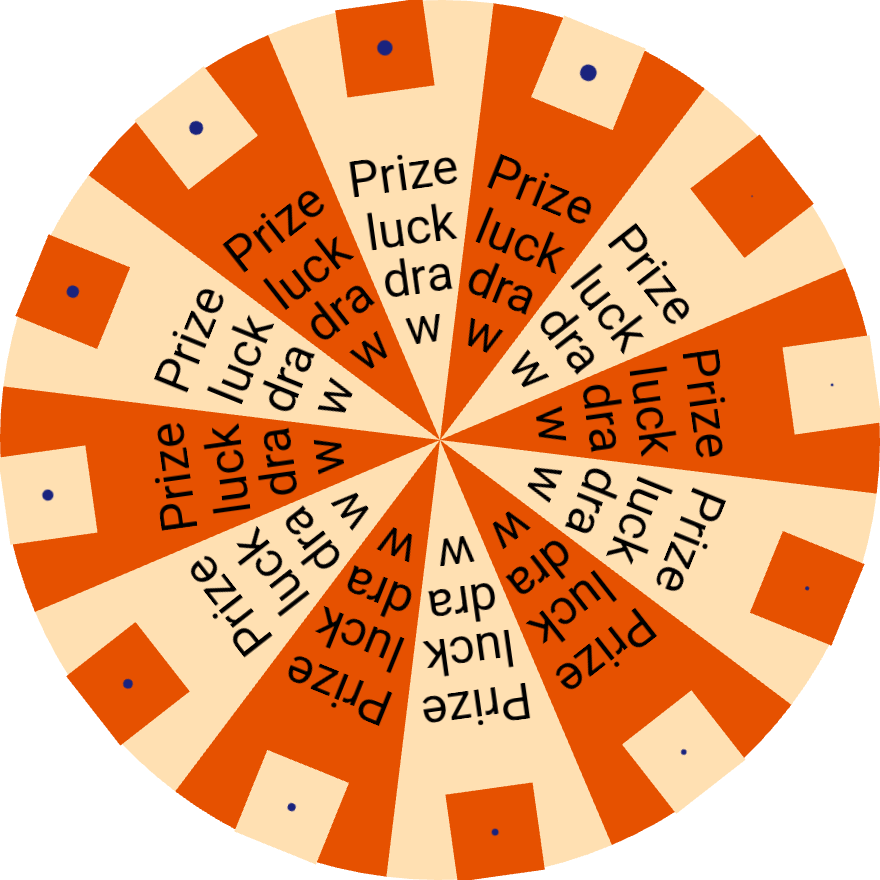
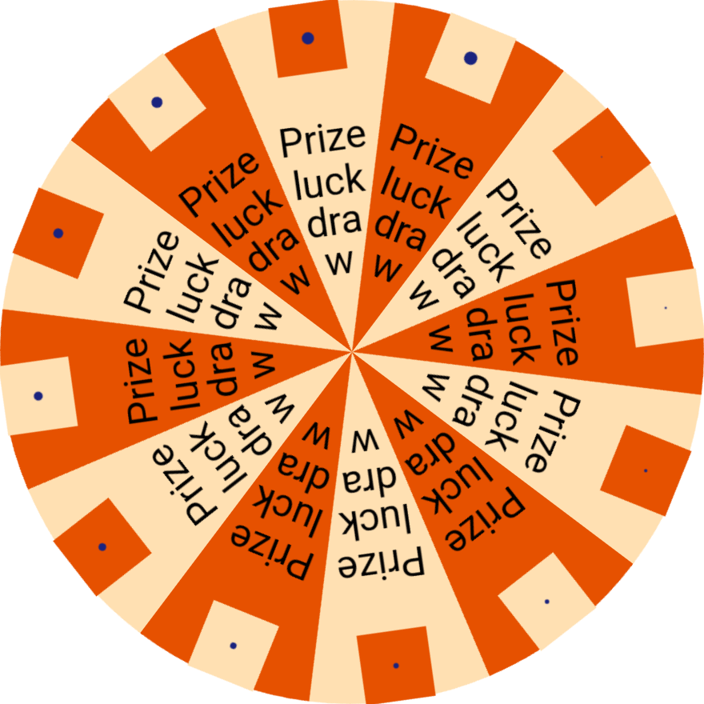

# PERF 真机性能修复与验证

执行环境：副本 `C:\ldp\luckdraw`，vivo V2417，序列号
`10AE9K17UE0011S`，Android 16，Flutter 3.47.0，profile，实际屏幕刷新率约
60Hz。本报告保留未达标与不稳定结果；预算不变，不以追加轮次筛选好结果。

## 任务与证据目录

- 根因消融：`tool/bench/results/perf_ablation/runs.json`。同一份修复前 APK，
  显式 Picture 三轮、显式 raster 三轮、去文字与去图片各一轮，共八次启动。
- 修复后采集：`tool/bench/results/perf_after/runs.json`。五场景各三轮；
  另一次启动只截取 37° 图像，不计入帧时统计。
- DEV 对照：`tool/bench/results/bench_20261110_180650/`，按每份
  `report_key`、`run_id` 读取原值，不将 p50 当平均值。
- 汇总脚本：`tool/bench/analyze_perf.py`。输出三轮原值、中位数、极差、
  极差/中位数与逐轮配对 timeline。不同事件含子事件，不能相加。
- 单条 `flutter drive` 超时为五分钟；每轮核对解锁、温度和设备身份。
  构建前可用内存至少 4GiB，Gradle workers=2；后续轮次复用 APK。

## 根因消融

**首先纠正背景假设：转盘基准没有 `LuckyShadow`。** 真实仓库、副本以及
DEV 采集副本 `C:\ldd\luckdraw\tool\bench\lib\main.dart` 均如此。
`LuckyShadow(blur: 6, ...)` 位于九宫格分支，不属于转盘。转盘
`WheelStyle` 本身也没有阴影字段。因此“去掉阴影”与 Picture 对照是同一个
无阴影场景，其三次有效轮不重复启动；不能把转盘超标归因于模糊阴影重算。

消融仅调整基准配置，未改变盘面尺寸、奖品数量、采样窗口或指标。
Picture/raster 保留十二张源图及两行文字；去文字只删文字，去图片只删图片。
各轮仍运行原有参照及五次 RSS 页面循环。消融的 RSS 循环沿用原场景默认
Picture，因此其 `rss_steady_delta_bytes` 可比较显式 raster 的窗口内增量，
不能将该组循环 RSS 冒充位图循环测量；修复后默认 auto 的循环包含位图。

| 消融 | 有效轮 | Raster 平均 ms | p90 ms | 掉帧率 |
| --- | --- | --- | --- | --- |
| Picture／原场景已无阴影 | 3 | 5.003 / 13.675 / 12.071 | 5.603 / 17.326 / 17.306 | 0 / 25.667% / 20.266% |
| 显式 raster，原版 medium 采样 | 3 | 5.486 / 4.969 / 5.238 | 6.787 / 6.571 / 6.506 | 0.332% / 0 / 0.332% |
| Picture 去文字 | 1 | 3.464 | 3.941 | 0 |
| Picture 去图片 | 1 | 4.789 | 5.150 | 0.332% |

DEV 首轮 `Rasterizer::DoDraw` 16.541ms，`SurfaceFrame::Encode` 14.476ms，
`RenderPassGLES::EncodeCommandsInReactor` 13.473ms，UI PAINT 0.362ms，
且每帧有 `CreateGlyphAtlas`。消融说明图文命令回放确有成本；Picture 对照
本身的强烈波动也说明不能用单轮消融建立精确可加的因果模型。

修复后，转盘前两轮 GLES 编码平均降到 2.819 / 2.856ms；没有
`CreateGlyphAtlas`，UI PAINT 0.264 / 0.241ms。但第三轮即使没有字形图集事件，
编码仍升到 14.432ms，PAINT 仅 0.255ms。数字盘也出现约 16.77ms 与 3.00ms
的轮间差异。证据支持两项并存：图文 Picture 回放的可消除成本，以及在
单纹理回放下仍存在的 GLES 编码长延迟。应用 timeline 未包含 GPU 计数器、
驱动调用栈或 CPU 调度证据，暂不能进一步断言是 DVFS、驱动等待或呈现节流。
不将缺少证据的推测写成已证实的驱动缺陷，也不宣称当前达成稳定性能验收。

## 库内设计

- `LuckyPerformanceOptions.cacheMode` 默认新增 `auto`：支持位图的运动段用
  raster，idle/settled 回放原 Picture。显式 picture/raster 继续可选；
  低层 `LuckyPictureCache` 自身仍默认 picture，避免未接入玩法意外光栅化。
- 转盘只对原有随盘旋转段预栅格化，z 序、静态按钮和动态层契约保持原样。
  采样遵守 `performance.filterQuality`，默认 low；原来硬编码的 medium 已移除。
- 数字盘只缓存盘面；小球和外轨保持原方式。
- 扭蛋按配色复用球体纹理；大乐透按号码缓存小纹理。机身、按钮、卡片与
  其它静态层保留原方式。没有改 slot、lever 或 lots。
- 九宫格仅将有阴影且有背景的格子背景缓存为纹理，内容仍是独立 Picture。
  背景纹理按阴影 sigma、偏移和抗锯齿边缘扩边，文字、图片和用户回调
  不受纹理边界裁剪；停下后回放完整矢量段。
- 栅格化在低频准备阶段执行，尺寸为逻辑尺寸×DPR 向上取整；单边超过
  `maxRasterSide=4096` 或为空时回退矢量。不新增逐帧 Paint/Rect/Path 分配，
  不新增 `saveLayer`。单张 RGBA 纹理上限为 64MiB；多段内存为各段之和，
  沿用既有逐纹理边长限制，没有新增隐含的全局纹理池。
- 缓存键补充精确 DPR 和逻辑原点：即使向上取整后的像素尺寸相同，DPR 或
  原点变化也重建。原图在新图成功创建后释放，临时 Picture 始终释放；
  尺寸、配置、图片版本和性能选项变更按 surface 失效，dispose 全量释放。
- strictUpstream 返回的是配置，无法携带 Widget 的 performance 参数。
  因此 auto 对上游 frame 时间基准保守保留 Picture；显式 raster 仍表示调用方
  主动选择位图。没有改 parity 测试、PNG、frames.json 或 MANIFEST。

## UI 时间与 RSS

DEV 旧时间线里 layout 约 0.005–0.007ms；匀速窗口基本没有 Widget BUILD。
PAINT 平均：wheel 0.362ms、number 0.429ms、capsule 1.037ms、lotto 1.691ms、
grid 0.236ms。FrameTiming 的 buildDuration 包含 UI 整帧工作，不能将它直接称为
Widget build 或 Ticker 回调耗时。COMPOSITING 另有约 0.30–0.48ms；剩余区间
没有足够细的应用打点，不虚构 notify/Ticker 的拆分值。

这次仅做有证据的缓存回放优化，不因 0.1ms 超标引入逐帧 Widget 重建、时钟
语义变化或无依据的运动学重写。预算建议以最终三轮和稳定性为条件提出，
不修改 `budgets.json`。

独立 memory_cycles 的旧原始 RSS（MiB，保留负步长）为：

| 轮 | 首次返回增长 | 后四次净增长 | 后四次各步增长 |
| --- | --- | --- | --- |
| 1 | 3.984375 | 0.890625 | 0.378906 / 0.253906 / 0 / 0.257813 |
| 2 | 4.191406 | 0.101563 | 0.382813 / -0.664063 / 0.140625 / 0.242188 |
| 3 | 3.714844 | 1.167969 | 0.671875 / 0.250000 / 0 / 0.246094 |

热身增长中位数 3.984375MiB，后四次净增长中位数 0.890625MiB、范围
0.101563–1.167969MiB。十二个后续步长中位数 0.248047MiB，包含负增长和平台段。
这些现象与热身及分配器驻留相容，但单凭 RSS 不足以证明无泄漏。原五次增长
4.875MiB 中位数仍超 0.5MiB 上限，未扣除热身、强制 GC 或修改预算。

**建议口径，待主会话决定：**同时保留现有总增长指标，另报告首次循环开销；
对第 2–5 次返回的净增长以 1.5MiB 为首轮观察上限，要求长期无单调上升趋势，
且确定性的原生资源和监听释放测试通过。该建议来自本机三轮最大 1.168MiB
加约 28% 余量，仅是诊断建议，不能代替现行 0.5MiB 验收。

## 文档冲突与待同步

1. 背景引用的转盘阴影实际属于九宫格；无阴影转盘用三次 Picture 对照验证。
2. ARCHITECTURE §8.1 默认 picture 与本批授权 auto 冲突；按本批授权实现，
   §8.1/§8.3/公开默认值清单由主会话统一同步。
3. strictUpstream 配置转换器没有 Widget performance 通道；采用 frame+auto
   保守矢量回退，覆盖严格预设测试，parity 输入与基线不改。
4. TEST_STRATEGY §7 仍有 20 次 RSS 和不稳定后整组重跑描述；本批按用户要求
   使用既有唯一来源五次循环，三轮结束后不因波动追加。
5. 通用路径授权与副本协议对 core 相冲突；core 仅在副本修改并交付
   `C:\ldp\core_patch.diff`，不直接覆盖真实仓库的 core。
6. 既有 `performance options keep vector defaults and accept raster overrides`
   测试名按要求保留，默认值断言更新为 auto；建议主会话最终文档对齐时记录
   历史名称。转盘显式 raster 测试改为断言配置的 low 采样，测试名保持原样。

## 采集与本机门禁结果

真机原始数据已采齐。消融八次启动全部有效；修复后十七次启动，
十五次有效性能测量、一次有效截图、一次启动采集挂起（扭蛋第3次；安装后
无 Flutter 服务日志，310664ms 包含轮询与清理延迟）。扭蛋第4次仅补第三份有效
数据，其余场景不补跑有效组。未发生锁屏；没有重建 APK 来重跑同场景。

### 三轮并排比较

下面每个耗时场景均是同设备的三份有效原始值。掉帧仍按任一线程超过实际
帧周期计数；即使 FPS 接近60也不改指标定义。极差过30%的项仍标为不稳定，
不挑选去除长延迟轮。

场景 | 指标 | DEV 三轮原值 | PERF 三轮原值 | DEV 中位数 | PERF 中位数 | PERF 极差 | 极差/中位数
--- | --- | --- | --- | --- | --- | --- | ---
wheel_steady | Raster平均 ms | 16.449 / 16.787 / 11.079 | 4.947 / 5.252 / 16.744 | 16.449 | 5.252 | 11.797 | 224.6%
wheel_steady | Raster p90 ms | 17.576 / 17.536 / 16.897 | 6.789 / 6.707 / 17.409 | 17.536 | 6.789 | 10.702 | 157.6%
wheel_steady | Raster p99 ms | 19.181 / 20.283 / 18.871 | 8.853 / 9.116 / 19.479 | 19.181 | 9.116 | 10.626 | 116.6%
wheel_steady | 掉帧率 % | 37.542 / 35.548 / 16.667 | 0.000 / 0.332 / 34.884 | 35.548 | 0.332 | 34.884 | 10500.0%
wheel_steady | UI平均 ms | 1.136 / 1.045 / 1.019 | 0.956 / 0.917 / 0.977 | 1.045 | 0.956 | 0.060 | 6.3%
wheel_steady | UI p90 ms | 1.635 / 1.509 / 1.476 | 1.340 / 1.323 / 1.432 | 1.509 | 1.340 | 0.109 | 8.1%
wheel_steady | UI p99 ms | 2.312 / 1.930 / 1.784 | 1.850 / 1.769 / 1.737 | 1.930 | 1.769 | 0.113 | 6.4%
wheel_steady | RSS页面峰值 MiB | 3.062 / 2.520 / 1.496 | 2.527 / 1.742 / 1.789 | 2.520 | 1.789 | 0.785 | 43.9%
wheel_steady | RSS五次增长 MiB | 2.480 / 2.074 / 1.434 | 0.000 / 1.520 / 0.000 | 2.074 | 0.000 | 1.520 | 未定义
wheel_steady | RSS稳态窗口增量 MiB | 47.227 / 46.883 / 46.445 | 43.016 / 48.137 / 47.660 | 46.883 | 47.660 | 5.121 | 10.7%
number_wheel_spin | Raster平均 ms | 7.401 / 7.899 / 16.589 | 16.769 / 3.002 / 2.950 | 7.899 | 3.002 | 13.819 | 460.3%
number_wheel_spin | Raster p90 ms | 8.715 / 8.848 / 17.359 | 17.644 / 3.390 / 3.303 | 8.848 | 3.390 | 14.341 | 423.0%
number_wheel_spin | Raster p99 ms | 12.814 / 16.524 / 20.655 | 20.163 / 3.660 / 3.605 | 16.524 | 3.660 | 16.558 | 452.4%
number_wheel_spin | 掉帧率 % | 0.332 / 1.000 / 35.880 | 40.532 / 0.000 / 0.000 | 1.000 | 0.000 | 40.532 | 未定义
number_wheel_spin | UI平均 ms | 1.186 / 1.242 / 1.274 | 1.131 / 1.162 / 1.110 | 1.242 | 1.131 | 0.052 | 4.6%
number_wheel_spin | UI p90 ms | 1.780 / 1.808 / 1.746 | 1.613 / 1.731 / 1.639 | 1.780 | 1.639 | 0.118 | 7.2%
number_wheel_spin | UI p99 ms | 2.353 / 2.302 / 2.105 | 1.926 / 2.180 / 2.092 | 2.302 | 2.092 | 0.254 | 12.1%
number_wheel_spin | RSS页面峰值 MiB | 2.035 / 1.113 / 0.559 | 0.000 / 0.422 / 0.000 | 1.113 | 0.000 | 0.422 | 未定义
number_wheel_spin | RSS五次增长 MiB | 1.797 / 1.152 / 0.000 | 0.000 / 0.000 / 0.000 | 1.152 | 0.000 | 0.000 | 0.0%
number_wheel_spin | RSS稳态窗口增量 MiB | 47.227 / 47.414 / 46.395 | 46.867 / 47.449 / 45.844 | 47.227 | 46.867 | 1.605 | 3.4%
capsule_mixing | Raster平均 ms | 6.167 / 5.998 / 6.009 | 3.996 / 3.808 / 3.670 | 6.009 | 3.808 | 0.326 | 8.6%
capsule_mixing | Raster p90 ms | 7.332 / 6.820 / 6.751 | 4.314 / 4.522 / 4.277 | 6.820 | 4.314 | 0.245 | 5.7%
capsule_mixing | Raster p99 ms | 8.933 / 10.270 / 7.696 | 4.789 / 4.950 / 5.981 | 8.933 | 4.950 | 1.192 | 24.1%
capsule_mixing | 掉帧率 % | 0.000 / 0.331 / 0.332 | 0.000 / 0.000 / 0.000 | 0.331 | 0.000 | 0.000 | 0.0%
capsule_mixing | UI平均 ms | 1.890 / 1.687 / 2.013 | 1.763 / 1.654 / 1.459 | 1.890 | 1.654 | 0.304 | 18.4%
capsule_mixing | UI p90 ms | 2.865 / 2.793 / 3.042 | 2.472 / 2.513 / 2.387 | 2.865 | 2.472 | 0.126 | 5.1%
capsule_mixing | UI p99 ms | 3.622 / 3.392 / 3.611 | 3.241 / 3.073 / 3.155 | 3.611 | 3.155 | 0.168 | 5.3%
capsule_mixing | RSS页面峰值 MiB | 0.812 / 1.785 / 1.852 | 0.609 / 0.242 / 1.148 | 1.785 | 0.609 | 0.906 | 148.7%
capsule_mixing | RSS五次增长 MiB | 0.914 / 1.785 / 1.664 | 0.746 / 0.000 / 1.023 | 1.664 | 0.746 | 1.023 | 137.2%
capsule_mixing | RSS稳态窗口增量 MiB | 45.117 / 44.281 / 45.812 | 45.738 / 45.203 / 50.004 | 45.117 | 45.738 | 4.801 | 10.5%
lotto_draw | Raster平均 ms | 6.090 / 5.944 / 6.126 | 5.031 / 16.440 / 4.618 | 6.090 | 5.031 | 11.823 | 235.0%
lotto_draw | Raster p90 ms | 6.439 / 6.415 / 6.833 | 5.958 / 17.805 / 5.018 | 6.439 | 5.958 | 12.787 | 214.6%
lotto_draw | Raster p99 ms | 13.253 / 10.463 / 12.156 | 10.805 / 20.267 / 5.450 | 12.156 | 10.805 | 14.817 | 137.1%
lotto_draw | 掉帧率 % | 0.345 / 0.173 / 0.173 | 0.000 / 37.024 / 0.000 | 0.173 | 0.000 | 37.024 | 未定义
lotto_draw | UI平均 ms | 2.504 / 2.552 / 2.415 | 2.285 / 2.172 / 2.153 | 2.504 | 2.172 | 0.132 | 6.1%
lotto_draw | UI p90 ms | 3.729 / 3.845 / 3.816 | 3.354 / 3.227 / 3.291 | 3.816 | 3.291 | 0.127 | 3.9%
lotto_draw | UI p99 ms | 4.779 / 5.202 / 5.026 | 4.386 / 3.513 / 4.016 | 5.026 | 4.016 | 0.873 | 21.7%
lotto_draw | RSS页面峰值 MiB | 1.176 / 2.137 / 0.699 | 2.324 / 2.902 / 5.176 | 1.176 | 2.902 | 2.852 | 98.3%
lotto_draw | RSS五次增长 MiB | 1.176 / 1.688 / 0.645 | 1.988 / 0.000 / 4.918 | 1.176 | 1.988 | 4.918 | 247.3%
lotto_draw | RSS稳态窗口增量 MiB | 52.750 / 52.078 / 57.574 | 54.816 / 57.398 / 45.066 | 52.750 | 54.816 | 12.332 | 22.5%
grid_steady | Raster平均 ms | 6.174 / 5.419 / 3.558 | 5.500 / 3.434 / 6.090 | 5.419 | 5.500 | 2.656 | 48.3%
grid_steady | Raster p90 ms | 7.370 / 7.200 / 4.044 | 6.557 / 3.893 / 7.583 | 7.200 | 6.557 | 3.690 | 56.3%
grid_steady | Raster p99 ms | 9.856 / 8.177 / 4.668 | 11.617 / 4.426 / 9.817 | 8.177 | 9.817 | 7.191 | 73.3%
grid_steady | 掉帧率 % | 0.332 / 0.000 / 0.000 | 0.000 / 0.000 / 0.332 | 0.000 | 0.000 | 0.332 | 未定义
grid_steady | UI平均 ms | 1.091 / 0.858 / 0.960 | 1.024 / 1.111 / 1.022 | 0.960 | 1.024 | 0.089 | 8.7%
grid_steady | UI p90 ms | 1.736 / 1.466 / 1.611 | 1.694 / 1.831 / 1.780 | 1.611 | 1.780 | 0.137 | 7.7%
grid_steady | UI p99 ms | 2.185 / 1.923 / 2.120 | 2.145 / 2.434 / 2.234 | 2.120 | 2.234 | 0.289 | 12.9%
grid_steady | RSS页面峰值 MiB | 0.090 / 1.262 / 0.281 | 1.453 / 0.059 / 1.594 | 0.281 | 1.453 | 1.535 | 105.6%
grid_steady | RSS五次增长 MiB | 0.000 / 1.262 / 0.281 | 0.363 / 0.000 / 1.539 | 0.281 | 0.363 | 1.539 | 423.7%
grid_steady | RSS稳态窗口增量 MiB | 47.465 / 46.031 / 43.336 | 45.484 / 47.836 / 44.879 | 46.031 | 45.484 | 2.957 | 6.5%

### 验收结论与剩余原因

| 场景 | Raster 中位数变化 ms | UI 中位数变化 ms | 实际结论 |
| --- | --- | --- | --- |
| wheel_steady | 16.449 → 5.252 | 1.045 → 0.956 | Raster均值仍超过5ms；一轮16.744ms/34.884%掉帧，未通过；UI均值三轮均达1ms |
| number_wheel_spin | 7.899 → 3.002 | 1.242 → 1.131 | 两轮约3ms/零掉帧，但一轮16.769ms/40.532%掉帧；组不稳定；UI仍超过1ms |
| capsule_mixing | 6.009 → 3.808 | 1.890 → 1.654 | Raster三轮均≤5ms且零掉帧；UI中位数仍超过1.5ms |
| lotto_draw | 6.090 → 5.031 | 2.504 → 2.172 | 两轮Raster达标，但一轮16.440ms/37.024%掉帧；组不稳定；UI仍超过1.5ms |
| grid_steady | 5.419 → 5.500 | 0.960 → 1.024 | Raster中位数略增1.49%，极差48.3%，未证明不劣化；UI约增6.7%，仍超0.6ms；三轮零掉帧 |

本批**未达成完整性能验收**。位图消除图文盘面的字形图集回放，也让胶囊
稳定达到 Raster 目标；转盘、数字盘和大乐透在单纹理回放下仍可能出现长
GLES 编码段，应用 timeline 不足以确定驱动内的等待来源。九宫格背景位图
增加一条内容 Picture 回放，不能将其不稳定结果解释为已验证的性能收益。
未为已达标的 slot/lever/lots 增加改动或重测。

UI 预算建议仅供主会话决定：wheel保持现行1ms；number可评估1.3ms，capsule
可评估2.0ms，lotto可评估2.5ms，grid可评估1.2ms。这些是本机UI三轮范围及
固定 Canvas/COMPOSITING 成本下的首版观察预算建议，尚未跨设备验证，不等于
已批准放宽；Raster和掉帧目标不提出放宽。

### 37° 采样与位图占用

两张图均在 accelerating 阶段暂停时钟，将角度精确固定为37°后，由真实
surface在DPR2.75下绘制。暂停仅为对齐姿态，仍走运动段的缓存选择。图像为
880×880原始PNG，未缩放或重画；合计529515字节，低于2MiB。

| 原始 Picture | auto（low采样） |
| --- | --- |
|  |  |

目视：文字位置、换行、奖品图案和扇区边界一致，没有明显模糊或锯齿；auto
存在轻微旋转重采样边缘差异。通道阈值32的差异像素为19464/774400（2.5134%），
RGBA均绝对误差1.295934。此为画质诊断，不套用或放宽严格parity容差；停下后
恢复Picture。原始姿态与差异指标见 `docs/device/perf/capture_*.json`。

以同场景320逻辑像素、DPR2.75核对缓存RGBA占用的Widget测试实际输出：

| 场景 | 缓存RGBA字节 | MiB | 说明 |
| --- | --- | --- | --- |
| wheel | 3097600 | 2.954102 | 一个880×880旋转盘面 |
| number_wheel | 3097600 | 2.954102 | 一个880×880数字盘 |
| capsule | 25600 | 0.024414 | 30个球共享一份80×80配色纹理 |
| lotto | 363968 | 0.347107 | 47张号码球小纹理之和 |
| grid | 4624000 | 4.409790 | 带阴影背景的normal/active纹理；内容保持矢量 |

这些是明确持有的RGBA像素总和，不含GPU分配器对齐、驱动驻留和其它引擎缓存。
转盘显式raster消融的稳态窗口RSS增量中位48.195MiB，对照Picture为46.980MiB，
差约1.215MiB；最终auto的对应增量47.660MiB，DEV为46.883MiB，差约0.777MiB。
不能从RSS反推恰好等于2.954MiB纹理，也不能把阴影贴图字节从RSS中直接扣除。

五玩法各十次实际页面挂载/销毁测试，逐次断言原生Picture/ui.Image已创建与
已释放集合相等、ImageStream添加与移除次数相等、监听剩余为0、Ticker调度
回调归零；另有十次转盘原生对象累计数校验。现有时钟/宿主测试继续随全包
运行。缓存失效、DPR/原点、尺寸、图片与性能选项覆盖在单测内，无新增豁免。

### 采集后正确性修正范围

新增长号码/系统文字缩放用例实际复现号码球纹理边界裁剪，随后仅在低频
准备阶段补测量这两类文字的完整范围。superLotto的两位号码、不缩放分支
仍返回与采集APK完全相同的圆形+抗锯齿边界；同尺寸DPR的RGBA字节测试
验证363968字节不变，每帧回放路径未变。该特殊配置修正由Widget测试验证，
未额外运行真机以突破规定次数；原始真机文件不冒充该分支的测量。

基准的builder-only WidgetsApp移除不适用的initialRoute参数，修复debug断言；
运行路由仍来自PlatformDispatcher，不改变已采集profile画面和窗口。

既有capsule/lotto几何和真实运动学golden显式固定picture，保留原PNG不变；
旧的“每帧回放缓存Picture”测试名按要求保留，断言改为Picture与Image缓存回放
总数，并继续校验没有重新录制或saveLayer。auto的阶段选择和资源释放由新增
PERF用例验证。所有parity测试和基线均未修改。

基准场景复用测试对独立应用的`lib/main.dart`使用相对导入；增加带中文原因的
局部`avoid_relative_lib_imports`忽略，避免为测试增加依赖或复制场景配置。
这不是覆盖率豁免，新增lib代码仍要求100%行覆盖。

## 副本门禁实际结果与交付

| 命令/组 | 实际输出摘要 |
| --- | --- |
| flutter analyze | No issues found!，0 issue |
| dart format --output=none --set-exit-if-changed lib test tool | 343 files (0 changed) |
| flutter test test/core test/testing --no-pub --concurrency=1 --coverage | 418 passed，0 skipped，80.881s |
| flutter test test/wheel test/grid test/slot test/capsule test/number_wheel test/lots test/lotto test/perf --no-pub --concurrency=1 --coverage | 377 passed，0 skipped；含本批新增18项 |
| flutter test test/parity --no-pub --concurrency=1 --coverage | 36 passed，0 skipped；所有基线未变 |
| flutter test test/tool test/compat test/example_pages_test.dart --no-pub --concurrency=1 --coverage | 214 passed，0 skipped，62.846s |
| 串行全包合计 | 1045 passed，0 skipped，0 failed；各命令均小于五分钟 |
| dart run tool/coverage.dart --min=100 --lcov=coverage/PERF.lcov | TOTAL: 6792/6792 (100.00%)；PASS，无新增豁免 |
| dart run tool/check_imports.dart | PASS: 145 lib files；IMP-R1…R12通过 |
| dart run tool/check_acceptance.dart | PASS: 1468 references resolve；1069 registered tests all mapped |
| dart run tool/check_acceptance.dart --from-json coverage/perf_logs/merged.jsonl | 同上PASS，使用四组真实JSON重编号合并产物 |
| bench flutter analyze --no-pub | No issues found!，0 issue |
| python analyze_perf.py | PASS: 5 scenes x 3 valid rounds; 38 timeline files; budgets unchanged |

原始分组JSON、合并JSON、LCOV及门禁输出保存在
`tool/bench/results/perf_validation/`。开发期失败日志单独保留，未混入最终成功
四组；JSON合并只调整ID与时间，不更名、不改结果或断言。pubspec.yaml与
budgets.json哈希和真实仓库一致；parity97个文件哈希一致。

本批源文件（core仅补丁交付）：

- `lib/src/wheel/render/wheel_painter.dart`
- `lib/src/number_wheel/render/number_wheel_canvas_renderer.dart`
- `lib/src/number_wheel/render/number_wheel_painter.dart`
- `lib/src/capsule/render/capsule_canvas_renderer.dart`
- `lib/src/capsule/render/capsule_painter.dart`
- `lib/src/lotto/render/lotto_canvas_renderer.dart`
- `lib/src/lotto/render/lotto_painter.dart`
- `lib/src/grid/render/grid_painter.dart`
- `test/core/foundation/models_test.dart`
- `test/core/render/perf_cache_test.dart`
- `test/wheel/wheel_painter_test.dart`
- `test/wheel/perf_wheel_test.dart`
- `test/capsule/capsule_golden_test.dart`
- `test/capsule/capsule_painter_test.dart`
- `test/capsule/f2_capsule_kinematics_test.dart`
- `test/capsule/capsule_perf_support.dart`
- `test/lotto/lotto_render_support.dart`
- `test/lotto/lotto_painter_test.dart`
- `test/perf/perf_resources_test.dart`
- `test/perf/perf_renderers_test.dart`
- `test/perf/perf_memory_sizes_test.dart`
- `tool/bench/lib/main.dart`
- `tool/bench/integration_test/bench_support.dart`
- `tool/bench/integration_test/perf_bench_test.dart`
- `tool/bench/integration_test/perf_capture.dart`
- `tool/bench/test_driver/perf_driver.dart`
- `tool/bench/run_perf.ps1`
- `tool/bench/analyze_perf.py`
- `tool/bench/merge_perf_validation.py`
- `tool/bench/README.md`

core补丁仅包含以下三项，保存为 `C:\ldp\core_patch.diff`，并附在验证产物目录；`git apply --check` 已通过：

- `lib/src/core/foundation/options.dart`
- `lib/src/core/render/picture_cache.dart`
- `lib/src/core/render/cached_picture.dart`

共享文件仅追加：test/ACCEPTANCE.md追加PERF-01–26，共26行；CHANGELOG.md
追加PERF说明。完整拷回路径清单见 `tool/bench/results/perf_validation/delivery_manifest.json`，
包含原始结果和docs/device/perf四个图像/元数据文件。没有改共享fixtures，
没有回拷analysis_options或本机Gradle参数。

已按专属HeapDumpPath确认并结束本次Gradle PID35852；未发现其Kotlin子守护
进程。真机基准应用已force-stop，没有kill adb server，没有按进程名清理用户
IDE或其它应用进程。

## 真实仓库回拷后实际验证

已核对目标文件自任务开始以来没有冲突，一次回拷245个文件；core的三个文件
按副本协议没有回拷。共享ACCEPTANCE和CHANGELOG均在同一条命令中重新读取
当前内容后仅追加。245条完整路径及回拷后生成的日志，见delivery_manifest.json。

| 真实仓库命令 | 实际结果 |
| --- | --- |
| 对相关lib/test目录format检查 | PASS: Formatted 67 files (0 changed) |
| flutter test test/perf test/wheel/perf_wheel_test.dart test/core/render/perf_cache_test.dart --no-pub --concurrency=1 --reporter=json | **编译失败**：cached_picture.dart尚未合并，auto及cache新增成员也待core补丁；未执行行为断言 |
| dart run tool/check_imports.dart | PASS: 144 lib files；IMP-R1…R12 |
| dart run tool/check_acceptance.dart | PASS: 1468 references；1069注册测试全部映射 |

真实测试失败的来源是**副本协议保留的core补丁待主会话合并**，不能将副本
1045通过/100%覆盖率当作真实仓库已通过。主会话先在monorepo根合并
`C:\ldp\core_patch.diff`，再重跑相关真实测试；补丁`git apply --check`已通过。
没有擅自应用core补丁，也没有将此失败归因于其它并行路径。

当前未完成事项：转盘稳定的5ms/0.5%真机验收、number/lotto的GLES长延迟、
grid不劣化证明、剩余UI/RSS目标，以及core补丁合并后的真实测试。已有数据
和次数上限均保留，未通过追加有效轮、放宽预算或改PNG基线掩盖这些问题。

最终核对：parity97个文件仍与拷回前哈希一致；自有项目dart/flutter_tester/Gradle进程剩余0。
`git -C E:\workspaces\dart-labs log --oneline -2`仍为443589a3、f0b64ae1，未新增提交。
