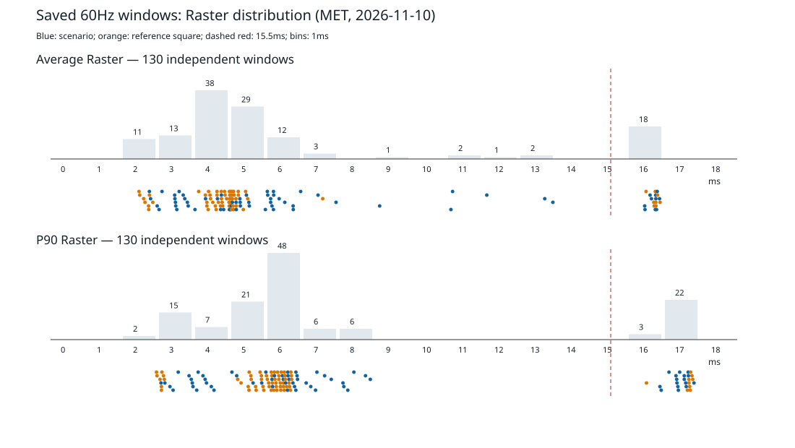

# MET 离线度量修正重算（2026-11-10）

设备 vivo V2417 / Android16 / 60Hz；仅重读保存数据，未连接手机、adb、Gradle或构建。
沿用 FIN 的 33 个样本身份，重新定位原始汇总并记录 SHA-256；PERF 五个修复场景，其余 DEV。参照与主窗口独立分类。

全量分布：130 个稳态窗口，其中 25 个污染；参照 65 个，其中 9 个污染。fps 59.829927–60.176516；真实卡顿 0 个。P90 间隙 8.848–16.490ms，15.5ms 位于其中。

逐点身份与原值见 [all_windows.json](all_windows.json)；冷首帧3个及RSS3个样本不属于持续动画窗口，不能用其fps套稳态交付规则。

## 正式结果集（FIN 选择）

| 场景 | 未污染/总窗口 | UI avg ms | Raster avg / P90 ms | RSS 稳态 B | 结论 |
| --- | --- | --- | --- | --- | --- |
| wheel_steady | 2/3 | 0.9365 | 5.0996 / 6.7480 | 0.0000 | 失败 |
| wheel_first_frame | 不适用 | — | — / — | — | 信息项（待标定） |
| grid_steady | 3/3 | 1.0243 | 5.4998 / 6.5570 | 925696.0000 | 失败 |
| slot_steady | 2/3 | 1.3576 | 3.4481 / 3.9580 | 331776.0000 | 失败 |
| slot_raster | 3/3 | 1.0641 | 2.7681 / 3.1630 | 0.0000 | 失败 |
| lever_steady | 3/3 | 1.3999 | 3.7137 / 4.2170 | 753664.0000 | 失败 |
| capsule_mixing | 3/3 | 1.6541 | 3.8083 / 4.3140 | 585728.0000 | 通过 |
| number_wheel_spin | 2/3 | 1.1357 | 2.9759 / 3.3465 | 1110016.0000 | 通过 |
| lots_shaking | 2/3 | 1.3782 | 3.8951 / 4.8300 | 802816.0000 | 失败 |
| lotto_draw | 2/3 | 2.2188 | 4.8241 / 5.4880 | 1163264.0000 | 通过 |
| memory_cycles | 不适用 | — | — / — | 933888.0000 | 通过 |

首帧中位数40.378ms，仅信息，非通过；待 blank_first_frame 基线。RSS使用所有原始五次循环，不随窗口污染过滤。

## 每场景每窗口与每指标

### wheel_steady：失败

| run_id | 来源 | fps | 帧数 | 完整比例 | Raster avg / P90 ms | 分类 |
| --- | --- | --- | --- | --- | --- | --- |
| 1794313406972146 | tool/bench/results/perf_after/wheel_default_1/wheel_steady_1794313406972146.timeline_summary.json | 60.0496476921085 | 301.0 | 1.0008274615351416 | 4.94736877076412 / 6.789 | CLEAN |
| 1794313485209525 | tool/bench/results/perf_after/wheel_default_2/wheel_steady_1794313485209525.timeline_summary.json | 60.03005491453695 | 301.0 | 1.0005009152422826 | 5.251906976744186 / 6.707 | CLEAN |
| 1794313560628439 | tool/bench/results/perf_after/wheel_default_3/wheel_steady_1794313560628439.timeline_summary.json | 59.97474684579656 | 301.0 | 0.9995791140966092 | 16.74405647840532 / 17.409 | BACKPRESSURE |

| 指标 | 未污染中位数（RSS全部） | 首版目标 | 新预算 | 稳定 | 结论 |
| --- | --- | --- | --- | --- | --- |
| average_frame_build_time_millis | 0.9365415282392029 | 1.0 | 1.0 | True | 通过 |
| 90th_percentile_frame_build_time_millis | 1.3315000000000001 | 1.66 | 1.66 | True | 通过 |
| average_frame_rasterizer_time_millis | 5.099637873754153 | 5.0 | 5.61 | True | 通过；首版标定 |
| 90th_percentile_frame_rasterizer_time_millis | 6.747999999999999 | 8.0 | 8.0 | True | 通过 |
| dropped_frame_ratio | 0.0016611295681063123 | 0.005 | 0.005 | False | 失败 |
| new_gen_gc_over_reference | 0.0 | 0.0 | 0.0 | True | 通过 |
| rss_delta_bytes | 1875968.0 | 5622989.0 | 5622989.0 | True | 通过 |
| rss_steady_growth_bytes | 0.0 | 1572864.0 | 1572864.0 | True | 通过 |
| 99th_percentile_frame_rasterizer_time_millis | 8.9845 | 无目标 | — | — | 信息项（待标定） |

### wheel_first_frame：信息项（待标定）

| run_id | 来源 | fps | 帧数 | 完整比例 | Raster avg / P90 ms | 分类 |
| --- | --- | --- | --- | --- | --- | --- |
| 1794305396820500 | tool/bench/results/bench_20261110_180650/wheel_1/wheel_first_frame_1794305396820500.timeline_summary.json | 21.591743317355444 | 2.0 | None | 2.935 / 3.031 | INFO |
| 1794305572288023 | tool/bench/results/bench_20261110_180650/wheel_3/wheel_first_frame_1794305572288023.timeline_summary.json | 24.274790629930816 | 2.0 | None | 2.9855 / 3.15 | INFO |
| 1794305667616945 | tool/bench/results/bench_20261110_180650/wheel_4/wheel_first_frame_1794305667616945.timeline_summary.json | 26.997475736018682 | 2.0 | None | 3.41 / 4.049 | INFO |

| 指标 | 未污染中位数（RSS全部） | 首版目标 | 新预算 | 稳定 | 结论 |
| --- | --- | --- | --- | --- | --- |
| first_frame_ui_millis | 40.378 | 4.0 | 4.0 | True | 信息项（待标定） |

### grid_steady：失败

| run_id | 来源 | fps | 帧数 | 完整比例 | Raster avg / P90 ms | 分类 |
| --- | --- | --- | --- | --- | --- | --- |
| 1794314642091899 | tool/bench/results/perf_after/grid_steady_1/grid_steady_1794314642091899.timeline_summary.json | 59.97894161279189 | 301.0 | 0.9996490268798649 | 5.499757475083054 / 6.557 | CLEAN |
| 1794314716054046 | tool/bench/results/perf_after/grid_steady_2/grid_steady_1794314716054046.timeline_summary.json | 60.06353564700999 | 301.0 | 1.0010589274501664 | 3.433727574750829 / 3.893 | CLEAN |
| 1794314791537683 | tool/bench/results/perf_after/grid_steady_3/grid_steady_1794314791537683.timeline_summary.json | 60.012544815015815 | 301.0 | 1.0002090802502637 | 6.0896644518272405 / 7.583 | CLEAN |

| 指标 | 未污染中位数（RSS全部） | 首版目标 | 新预算 | 稳定 | 结论 |
| --- | --- | --- | --- | --- | --- |
| average_frame_build_time_millis | 1.024325581395349 | 1.2 | 1.2 | True | 通过 |
| 90th_percentile_frame_build_time_millis | 1.78 | 1.5 | 1.5 | True | 失败 |
| average_frame_rasterizer_time_millis | 5.499757475083054 | 4.0 | 4.0 | False | 失败 |
| 90th_percentile_frame_rasterizer_time_millis | 6.557 | 7.0 | 7.0 | False | 失败 |
| dropped_frame_ratio | 0.0 | 0.005 | 0.005 | False | 失败 |
| new_gen_gc_over_reference | 0.0 | 0.0 | 0.0 | True | 通过 |
| rss_delta_bytes | 1523712.0 | 5622989.0 | 5622989.0 | True | 通过 |
| rss_steady_growth_bytes | 925696.0 | 1572864.0 | 1572864.0 | True | 通过 |
| 99th_percentile_frame_rasterizer_time_millis | 9.817 | 无目标 | — | — | 信息项（待标定） |

### slot_steady：失败

| run_id | 来源 | fps | 帧数 | 完整比例 | Raster avg / P90 ms | 分类 |
| --- | --- | --- | --- | --- | --- | --- |
| 1794306159431550 | tool/bench/results/bench_20261110_180650/slot_1/slot_steady_1794306159431550.timeline_summary.json | 60.0674791275488 | 301.0 | 1.0011246521258135 | 3.440528239202658 / 4.084 | CLEAN |
| 1794306659957714 | tool/bench/results/bench_20261110_180650/slot_3/slot_steady_1794306659957714.timeline_summary.json | 59.861110251993324 | 300.0 | 0.9976851708665555 | 9.10642666666667 / 16.862 | BACKPRESSURE |
| 1794306825736505 | tool/bench/results/bench_20261110_180650/slot_4/slot_steady_1794306825736505.timeline_summary.json | 60.07912080893243 | 301.0 | 1.0013186801488736 | 3.455634551495018 / 3.832 | CLEAN |

| 指标 | 未污染中位数（RSS全部） | 首版目标 | 新预算 | 稳定 | 结论 |
| --- | --- | --- | --- | --- | --- |
| average_frame_build_time_millis | 1.3576395348837205 | 1.0 | 1.0 | True | 失败 |
| 90th_percentile_frame_build_time_millis | 1.9024999999999999 | 2.0 | 2.0 | True | 通过 |
| average_frame_rasterizer_time_millis | 3.4480813953488383 | 5.0 | 5.0 | True | 通过 |
| 90th_percentile_frame_rasterizer_time_millis | 3.9579999999999997 | 8.0 | 8.0 | True | 通过 |
| dropped_frame_ratio | 0.0 | 0.005 | 0.005 | True | 通过 |
| new_gen_gc_over_reference | 0.0 | 0.0 | 0.0 | True | 通过 |
| rss_delta_bytes | 1470464.0 | 5622989.0 | 5622989.0 | True | 通过 |
| rss_steady_growth_bytes | 331776.0 | 1572864.0 | 1572864.0 | True | 通过 |
| 99th_percentile_frame_rasterizer_time_millis | 4.458 | 无目标 | — | — | 信息项（待标定） |

### slot_raster：失败

| run_id | 来源 | fps | 帧数 | 完整比例 | Raster avg / P90 ms | 分类 |
| --- | --- | --- | --- | --- | --- | --- |
| 1794306159431550 | tool/bench/results/bench_20261110_180650/slot_1/slot_raster_1794306159431550.timeline_summary.json | 60.01329862796839 | 301.0 | 1.0002216437994733 | 2.768136212624582 / 3.163 | CLEAN |
| 1794306659957714 | tool/bench/results/bench_20261110_180650/slot_3/slot_raster_1794306659957714.timeline_summary.json | 60.06177383369913 | 301.0 | 1.0010295638949853 | 2.7336511627906988 / 3.056 | CLEAN |
| 1794306825736505 | tool/bench/results/bench_20261110_180650/slot_4/slot_raster_1794306825736505.timeline_summary.json | 60.135498664132854 | 301.0 | 1.002258311068881 | 6.167504983388707 / 7.073 | CLEAN |

| 指标 | 未污染中位数（RSS全部） | 首版目标 | 新预算 | 稳定 | 结论 |
| --- | --- | --- | --- | --- | --- |
| average_frame_build_time_millis | 1.0640664451827238 | 1.0 | 1.0 | False | 失败 |
| 90th_percentile_frame_build_time_millis | 1.405 | 2.0 | 2.0 | False | 失败 |
| average_frame_rasterizer_time_millis | 2.768136212624582 | 5.0 | 5.0 | False | 失败 |
| 90th_percentile_frame_rasterizer_time_millis | 3.163 | 8.0 | 8.0 | False | 失败 |
| dropped_frame_ratio | 0.0 | 0.005 | 0.005 | False | 失败 |
| new_gen_gc_over_reference | 0.0 | 0.0 | 0.0 | True | 通过 |
| rss_delta_bytes | 495616.0 | 5622989.0 | 5622989.0 | True | 通过 |
| rss_steady_growth_bytes | 0.0 | 1572864.0 | 1572864.0 | True | 通过 |
| 99th_percentile_frame_rasterizer_time_millis | 3.455 | 无目标 | — | — | 信息项（待标定） |

### lever_steady：失败

| run_id | 来源 | fps | 帧数 | 完整比例 | Raster avg / P90 ms | 分类 |
| --- | --- | --- | --- | --- | --- | --- |
| 1794306971906081 | tool/bench/results/bench_20261110_180650/lever_1/lever_steady_1794306971906081.timeline_summary.json | 60.00647910488674 | 301.0 | 1.0001079850814458 | 3.713657807308969 / 4.217 | CLEAN |
| 1794307088000701 | tool/bench/results/bench_20261110_180650/lever_2/lever_steady_1794307088000701.timeline_summary.json | 59.97994557567198 | 301.0 | 0.999665759594533 | 3.492933554817276 / 3.921 | CLEAN |
| 1794307182571397 | tool/bench/results/bench_20261110_180650/lever_3/lever_steady_1794307182571397.timeline_summary.json | 60.05322990610947 | 301.0 | 1.0008871651018245 | 3.78479069767442 / 4.448 | CLEAN |

| 指标 | 未污染中位数（RSS全部） | 首版目标 | 新预算 | 稳定 | 结论 |
| --- | --- | --- | --- | --- | --- |
| average_frame_build_time_millis | 1.3999368770764127 | 1.0 | 1.0 | True | 失败 |
| 90th_percentile_frame_build_time_millis | 2.096 | 2.0 | 2.306 | True | 通过；首版标定 |
| average_frame_rasterizer_time_millis | 3.713657807308969 | 4.086 | 4.086 | True | 通过 |
| 90th_percentile_frame_rasterizer_time_millis | 4.217 | 4.639 | 4.639 | True | 通过 |
| dropped_frame_ratio | 0.0 | 0.0 | 0.0 | True | 通过 |
| new_gen_gc_over_reference | 0.0 | 0.0 | 0.0 | True | 通过 |
| rss_delta_bytes | 1880064.0 | 5622989.0 | 5622989.0 | True | 通过 |
| rss_steady_growth_bytes | 753664.0 | 1572864.0 | 1572864.0 | True | 通过 |
| 99th_percentile_frame_rasterizer_time_millis | 4.779 | 无目标 | — | — | 信息项（待标定） |

### capsule_mixing：通过

| run_id | 来源 | fps | 帧数 | 完整比例 | Raster avg / P90 ms | 分类 |
| --- | --- | --- | --- | --- | --- | --- |
| 1794313856923256 | tool/bench/results/perf_after/capsule_mixing_1/capsule_mixing_1794313856923256.timeline_summary.json | 60.081938989884875 | 301.0 | 1.0013656498314147 | 3.9960531561461776 / 4.314 | CLEAN |
| 1794313932872435 | tool/bench/results/perf_after/capsule_mixing_2/capsule_mixing_1794313932872435.timeline_summary.json | 59.990501171807814 | 301.0 | 0.9998416861967968 | 3.8082956810631217 / 4.522 | CLEAN |
| 1794314342104240 | tool/bench/results/perf_after/capsule_mixing_4/capsule_mixing_1794314342104240.timeline_summary.json | 60.03006688665725 | 301.0 | 1.0005011147776208 | 3.6701594684385377 / 4.277 | CLEAN |

| 指标 | 未污染中位数（RSS全部） | 首版目标 | 新预算 | 稳定 | 结论 |
| --- | --- | --- | --- | --- | --- |
| average_frame_build_time_millis | 1.654102990033223 | 2.0 | 2.0 | True | 通过 |
| 90th_percentile_frame_build_time_millis | 2.472 | 3.0 | 3.0 | True | 通过 |
| average_frame_rasterizer_time_millis | 3.8082956810631217 | 5.0 | 5.0 | True | 通过 |
| 90th_percentile_frame_rasterizer_time_millis | 4.314 | 7.503 | 7.503 | True | 通过 |
| dropped_frame_ratio | 0.0 | 0.005 | 0.005 | True | 通过 |
| new_gen_gc_over_reference | 0.0 | 0.0 | 0.0 | True | 通过 |
| rss_delta_bytes | 638976.0 | 5622989.0 | 5622989.0 | True | 通过 |
| rss_steady_growth_bytes | 585728.0 | 1572864.0 | 1572864.0 | True | 通过 |
| 99th_percentile_frame_rasterizer_time_millis | 4.95 | 无目标 | — | — | 信息项（待标定） |

### number_wheel_spin：通过

| run_id | 来源 | fps | 帧数 | 完整比例 | Raster avg / P90 ms | 分类 |
| --- | --- | --- | --- | --- | --- | --- |
| 1794313634381578 | tool/bench/results/perf_after/number_wheel_spin_1/number_wheel_spin_1794313634381578.timeline_summary.json | 60.14040086274502 | 301.0 | 1.0023400143790837 | 16.768671096345525 / 17.644 | BACKPRESSURE |
| 1794313710151659 | tool/bench/results/perf_after/number_wheel_spin_2/number_wheel_spin_1794313710151659.timeline_summary.json | 59.99401654359921 | 301.0 | 0.9999002757266535 | 3.00199003322259 / 3.39 | CLEAN |
| 1794313785579170 | tool/bench/results/perf_after/number_wheel_spin_3/number_wheel_spin_1794313785579170.timeline_summary.json | 60.011743161701744 | 301.0 | 1.0001957193616957 | 2.949710963455148 / 3.303 | CLEAN |

| 指标 | 未污染中位数（RSS全部） | 首版目标 | 新预算 | 稳定 | 结论 |
| --- | --- | --- | --- | --- | --- |
| average_frame_build_time_millis | 1.1356727574750831 | 1.3 | 1.3 | True | 通过 |
| 90th_percentile_frame_build_time_millis | 1.685 | 1.959 | 1.959 | True | 通过 |
| average_frame_rasterizer_time_millis | 2.975850498338869 | 5.0 | 5.0 | True | 通过 |
| 90th_percentile_frame_rasterizer_time_millis | 3.3465 | 8.0 | 8.0 | True | 通过 |
| dropped_frame_ratio | 0.0 | 0.005 | 0.005 | True | 通过 |
| new_gen_gc_over_reference | 0.0 | 0.0 | 0.0 | True | 通过 |
| rss_delta_bytes | 0.0 | 5622989.0 | 5622989.0 | True | 通过 |
| rss_steady_growth_bytes | 1110016.0 | 1572864.0 | 1572864.0 | True | 通过 |
| 99th_percentile_frame_rasterizer_time_millis | 3.6325000000000003 | 无目标 | — | — | 信息项（待标定） |

### lots_shaking：失败

| run_id | 来源 | fps | 帧数 | 完整比例 | Raster avg / P90 ms | 分类 |
| --- | --- | --- | --- | --- | --- | --- |
| 1794308933597372 | tool/bench/results/bench_20261110_180650/lots_2/lots_shaking_1794308933597372.timeline_summary.json | 60.01964097885853 | 301.0 | 1.0003273496476421 | 4.707026578073092 / 6.128 | CLEAN |
| 1794309094772711 | tool/bench/results/bench_20261110_180650/lots_3/lots_shaking_1794309094772711.timeline_summary.json | 60.073940842536025 | 301.0 | 1.0012323473756004 | 3.0831129568106337 / 3.532 | CLEAN |
| 1794309197830176 | tool/bench/results/bench_20261110_180650/lots_4/lots_shaking_1794309197830176.timeline_summary.json | 59.98888710848781 | 301.0 | 0.9998147851414634 | 16.749292358803995 / 17.59 | BACKPRESSURE |

| 指标 | 未污染中位数（RSS全部） | 首版目标 | 新预算 | 稳定 | 结论 |
| --- | --- | --- | --- | --- | --- |
| average_frame_build_time_millis | 1.378229235880398 | 1.0 | 1.0 | True | 失败 |
| 90th_percentile_frame_build_time_millis | 2.024 | 2.0 | 2.227 | True | 通过；首版标定 |
| average_frame_rasterizer_time_millis | 3.8950697674418633 | 5.0 | 5.0 | False | 失败 |
| 90th_percentile_frame_rasterizer_time_millis | 4.83 | 8.0 | 8.0 | False | 失败 |
| dropped_frame_ratio | 0.0 | 0.005 | 0.005 | True | 通过 |
| new_gen_gc_over_reference | 0.0 | 0.0 | 0.0 | True | 通过 |
| rss_delta_bytes | 1191936.0 | 5622989.0 | 5622989.0 | True | 通过 |
| rss_steady_growth_bytes | 802816.0 | 1572864.0 | 1572864.0 | True | 通过 |
| 99th_percentile_frame_rasterizer_time_millis | 5.599 | 无目标 | — | — | 信息项（待标定） |

### lotto_draw：通过

| run_id | 来源 | fps | 帧数 | 完整比例 | Raster avg / P90 ms | 分类 |
| --- | --- | --- | --- | --- | --- | --- |
| 1794314421829493 | tool/bench/results/perf_after/lotto_draw_1/lotto_draw_1794314421829493.timeline_summary.json | 60.047571366123734 | 579.0 | 1.0007928561020623 | 5.030516407599308 / 5.958 | CLEAN |
| 1794314496989620 | tool/bench/results/perf_after/lotto_draw_2/lotto_draw_1794314496989620.timeline_summary.json | 59.94597602264672 | 578.0 | 0.9990996003774454 | 16.440377162629762 / 17.805 | BACKPRESSURE |
| 1794314571366953 | tool/bench/results/perf_after/lotto_draw_3/lotto_draw_1794314571366953.timeline_summary.json | 60.04806956864433 | 579.0 | 1.0008011594774056 | 4.6177409326424845 / 5.018 | CLEAN |

| 指标 | 未污染中位数（RSS全部） | 首版目标 | 新预算 | 稳定 | 结论 |
| --- | --- | --- | --- | --- | --- |
| average_frame_build_time_millis | 2.218784974093264 | 2.5 | 2.5 | True | 通过 |
| 90th_percentile_frame_build_time_millis | 3.3225 | 3.0 | 3.655 | True | 通过；首版标定 |
| average_frame_rasterizer_time_millis | 4.824128670120896 | 6.0 | 6.0 | True | 通过 |
| 90th_percentile_frame_rasterizer_time_millis | 5.4879999999999995 | 7.083 | 7.083 | True | 通过 |
| dropped_frame_ratio | 0.0 | 0.005 | 0.005 | True | 通过 |
| new_gen_gc_over_reference | 0.0 | 0.0 | 0.0 | True | 通过 |
| rss_delta_bytes | 3043328.0 | 5622989.0 | 5622989.0 | True | 通过 |
| rss_steady_growth_bytes | 1163264.0 | 1572864.0 | 1572864.0 | True | 通过 |
| 99th_percentile_frame_rasterizer_time_millis | 8.1275 | 无目标 | — | — | 信息项（待标定） |

### memory_cycles：通过

| run_id | 来源 | fps | 帧数 | 完整比例 | Raster avg / P90 ms | 分类 |
| --- | --- | --- | --- | --- | --- | --- |
| 1794310311094766 | tool/bench/results/bench_20261110_180650/memory_1/memory_cycles_1794310311094766.timeline_summary.json | — | 269 | None | 6.107349442379186 / 7.679 | INFO |
| 1794310371442895 | tool/bench/results/bench_20261110_180650/memory_2/memory_cycles_1794310371442895.timeline_summary.json | — | 269 | None | 3.6528134328358233 / 5.541 | INFO |
| 1794310535504668 | tool/bench/results/bench_20261110_180650/memory_3/memory_cycles_1794310535504668.timeline_summary.json | — | 268 | None | 5.004628252788101 / 5.992 | INFO |

| 指标 | 未污染中位数（RSS全部） | 首版目标 | 新预算 | 稳定 | 结论 |
| --- | --- | --- | --- | --- | --- |
| rss_delta_bytes | 5111808.0 | 5622989.0 | 5622989.0 | True | 通过 |
| rss_steady_growth_bytes | 933888.0 | 1572864.0 | 1572864.0 | True | 通过 |

## 参照窗口独立证据

| 来源 | 参照 avg / P90 ms | 参照 fps | 主场景 avg ms | 主场景 fps | 参照分类 |
| --- | --- | --- | --- | --- | --- |
| tool/bench/results/bench_20261110_180650/capsule_1/capsule_mixing_reference_1794307338918934.timeline_summary.json | 5.0026 / 6.6390 | 60.0280 | 6.167073089701 | 60.01108510409232 | CLEAN |
| tool/bench/results/bench_20261110_180650/capsule_2/capsule_mixing_reference_1794307482879570.timeline_summary.json | 4.5593 / 5.6880 | 60.1115 | 5.998109271523183 | 60.16657774498057 | CLEAN |
| tool/bench/results/bench_20261110_180650/capsule_3/capsule_mixing_reference_1794307751074775.timeline_summary.json | 5.0303 / 6.6510 | 60.0099 | 6.009023255813957 | 60.152347310460655 | CLEAN |
| tool/bench/results/bench_20261110_180650/grid_1/grid_steady_reference_1794305776155025.timeline_summary.json | 4.3260 / 6.0500 | 60.0100 | 6.173956810631226 | 60.02280068780945 | CLEAN |
| tool/bench/results/bench_20261110_180650/grid_2/grid_steady_reference_1794305881436541.timeline_summary.json | 7.5310 / 16.4900 | 59.9949 | 5.419003322259136 | 59.98524084074197 | BACKPRESSURE |
| tool/bench/results/bench_20261110_180650/grid_3/grid_steady_reference_1794305983682447.timeline_summary.json | 4.9478 / 6.6710 | 60.0181 | 3.5583521594684364 | 60.005773312940676 | CLEAN |
| tool/bench/results/bench_20261110_180650/lever_1/lever_steady_reference_1794306971906081.timeline_summary.json | 4.3724 / 5.5430 | 60.0177 | 3.713657807308969 | 60.00647910488674 | CLEAN |
| tool/bench/results/bench_20261110_180650/lever_2/lever_steady_reference_1794307088000701.timeline_summary.json | 5.0775 / 6.5310 | 60.0201 | 3.492933554817276 | 59.97994557567198 | CLEAN |
| tool/bench/results/bench_20261110_180650/lever_3/lever_steady_reference_1794307182571397.timeline_summary.json | 4.9570 / 6.6120 | 60.0905 | 3.78479069767442 | 60.05322990610947 | CLEAN |
| tool/bench/results/bench_20261110_180650/lots_2/lots_shaking_reference_1794308933597372.timeline_summary.json | 2.4475 / 2.9440 | 60.0615 | 4.707026578073092 | 60.01964097885853 | CLEAN |
| tool/bench/results/bench_20261110_180650/lots_3/lots_shaking_reference_1794309094772711.timeline_summary.json | 4.6059 / 5.8330 | 60.0860 | 3.0831129568106337 | 60.073940842536025 | CLEAN |
| tool/bench/results/bench_20261110_180650/lots_4/lots_shaking_reference_1794309197830176.timeline_summary.json | 16.7978 / 17.6650 | 60.0967 | 16.749292358803995 | 59.98888710848781 | BACKPRESSURE |
| tool/bench/results/bench_20261110_180650/lotto_1/lotto_draw_reference_1794309329997426.timeline_summary.json | 4.4894 / 6.1060 | 60.0840 | 6.090131260794471 | 60.04522369801421 | CLEAN |
| tool/bench/results/bench_20261110_180650/lotto_2/lotto_draw_reference_1794309404767165.timeline_summary.json | 4.6444 / 6.2450 | 60.0721 | 5.944338514680482 | 60.05590489053178 | CLEAN |
| tool/bench/results/bench_20261110_180650/lotto_3/lotto_draw_reference_1794309488538708.timeline_summary.json | 16.7034 / 17.7700 | 60.0696 | 6.126352331606217 | 60.063038181419834 | BACKPRESSURE |
| tool/bench/results/bench_20261110_180650/number_wheel_1/number_wheel_spin_reference_1794307935246425.timeline_summary.json | 5.0001 / 6.3170 | 60.0447 | 7.4009468438538155 | 59.97644380336733 | CLEAN |
| tool/bench/results/bench_20261110_180650/number_wheel_2/number_wheel_spin_reference_1794308053039094.timeline_summary.json | 5.4552 / 6.5990 | 60.1055 | 7.899330000000003 | 59.90788563504755 | CLEAN |
| tool/bench/results/bench_20261110_180650/number_wheel_4/number_wheel_spin_reference_1794308364525262.timeline_summary.json | 4.3612 / 5.5510 | 59.9996 | 16.589342192691028 | 60.080991571894394 | CLEAN |
| tool/bench/results/bench_20261110_180650/slot_1/slot_raster_reference_1794306159431550.timeline_summary.json | 4.9438 / 5.9740 | 60.1337 | 2.768136212624582 | 60.01329862796839 | CLEAN |
| tool/bench/results/bench_20261110_180650/slot_1/slot_steady_reference_1794306159431550.timeline_summary.json | 4.2848 / 5.1770 | 60.0529 | 3.440528239202658 | 60.0674791275488 | CLEAN |
| tool/bench/results/bench_20261110_180650/slot_3/slot_raster_reference_1794306659957714.timeline_summary.json | 2.7156 / 3.0670 | 60.1523 | 2.7336511627906988 | 60.06177383369913 | CLEAN |
| tool/bench/results/bench_20261110_180650/slot_3/slot_steady_reference_1794306659957714.timeline_summary.json | 16.6923 / 17.7130 | 60.1068 | 9.10642666666667 | 59.861110251993324 | BACKPRESSURE |
| tool/bench/results/bench_20261110_180650/slot_4/slot_raster_reference_1794306825736505.timeline_summary.json | 2.8289 / 3.1470 | 60.0365 | 6.167504983388707 | 60.135498664132854 | CLEAN |
| tool/bench/results/bench_20261110_180650/slot_4/slot_steady_reference_1794306825736505.timeline_summary.json | 16.4784 / 17.6860 | 60.1167 | 3.455634551495018 | 60.07912080893243 | BACKPRESSURE |
| tool/bench/results/bench_20261110_180650/wheel_1/wheel_steady_reference_1794305396820500.timeline_summary.json | 4.9679 / 6.4970 | 60.0074 | 16.44903986710963 | 60.11197202816196 | CLEAN |
| tool/bench/results/bench_20261110_180650/wheel_3/wheel_steady_reference_1794305572288023.timeline_summary.json | 4.8152 / 6.0360 | 60.0410 | 16.787325581395343 | 59.98830128476606 | CLEAN |
| tool/bench/results/bench_20261110_180650/wheel_4/wheel_steady_reference_1794305667616945.timeline_summary.json | 2.4663 / 3.0670 | 60.0992 | 11.078690000000005 | 59.94093420343594 | CLEAN |
| tool/bench/results/perf_after/capsule_mixing_1/capsule_mixing_reference_1794313856923256.timeline_summary.json | 4.7471 / 5.9000 | 60.0874 | 3.9960531561461776 | 60.081938989884875 | CLEAN |
| tool/bench/results/perf_after/capsule_mixing_2/capsule_mixing_reference_1794313932872435.timeline_summary.json | 5.0629 / 6.3570 | 60.0867 | 3.8082956810631217 | 59.990501171807814 | CLEAN |
| tool/bench/results/perf_after/capsule_mixing_4/capsule_mixing_reference_1794314342104240.timeline_summary.json | 5.3329 / 6.4690 | 60.1231 | 3.6701594684385377 | 60.03006688665725 | CLEAN |
| tool/bench/results/perf_after/grid_steady_1/grid_steady_reference_1794314642091899.timeline_summary.json | 4.9612 / 6.1070 | 60.0158 | 5.499757475083054 | 59.97894161279189 | CLEAN |
| tool/bench/results/perf_after/grid_steady_2/grid_steady_reference_1794314716054046.timeline_summary.json | 4.4273 / 5.4970 | 60.0355 | 3.433727574750829 | 60.06353564700999 | CLEAN |
| tool/bench/results/perf_after/grid_steady_3/grid_steady_reference_1794314791537683.timeline_summary.json | 4.9377 / 6.2810 | 60.0245 | 6.0896644518272405 | 60.012544815015815 | CLEAN |
| tool/bench/results/perf_after/lotto_draw_1/lotto_draw_reference_1794314421829493.timeline_summary.json | 4.4124 / 5.2710 | 59.9872 | 5.030516407599308 | 60.047571366123734 | CLEAN |
| tool/bench/results/perf_after/lotto_draw_2/lotto_draw_reference_1794314496989620.timeline_summary.json | 4.9668 / 6.1210 | 60.0204 | 16.440377162629762 | 59.94597602264672 | CLEAN |
| tool/bench/results/perf_after/lotto_draw_3/lotto_draw_reference_1794314571366953.timeline_summary.json | 5.0206 / 6.4440 | 60.0763 | 4.6177409326424845 | 60.04806956864433 | CLEAN |
| tool/bench/results/perf_after/number_wheel_spin_1/number_wheel_spin_reference_1794313634381578.timeline_summary.json | 5.0085 / 6.3580 | 60.1295 | 16.768671096345525 | 60.14040086274502 | CLEAN |
| tool/bench/results/perf_after/number_wheel_spin_2/number_wheel_spin_reference_1794313710151659.timeline_summary.json | 5.0488 / 5.9990 | 60.1246 | 3.00199003322259 | 59.99401654359921 | CLEAN |
| tool/bench/results/perf_after/number_wheel_spin_3/number_wheel_spin_reference_1794313785579170.timeline_summary.json | 5.1363 / 6.1770 | 60.1736 | 2.949710963455148 | 60.011743161701744 | CLEAN |
| tool/bench/results/perf_after/wheel_default_1/wheel_steady_reference_1794313406972146.timeline_summary.json | 2.7363 / 3.1240 | 59.9954 | 4.94736877076412 | 60.0496476921085 | CLEAN |
| tool/bench/results/perf_after/wheel_default_2/wheel_steady_reference_1794313485209525.timeline_summary.json | 4.9862 / 6.1910 | 59.9807 | 5.251906976744186 | 60.03005491453695 | CLEAN |
| tool/bench/results/perf_after/wheel_default_3/wheel_steady_reference_1794313560628439.timeline_summary.json | 5.0253 / 6.3180 | 59.9976 | 16.74405647840532 | 59.97474684579656 | CLEAN |
| tool/bench/results/perf_ablation/wheel_no_images_1/wheel_steady_reference_1794313161872611.timeline_summary.json | 4.7288 / 6.2370 | 60.0655 | 4.789285714285713 | 60.10281375016598 | CLEAN |
| tool/bench/results/perf_ablation/wheel_no_text_1/wheel_steady_reference_1794313086663358.timeline_summary.json | 2.5758 / 3.0820 | 59.9799 | 3.463760797342193 | 60.14001634769481 | CLEAN |
| tool/bench/results/perf_ablation/wheel_picture_1/wheel_steady_reference_1794312864115392.timeline_summary.json | 4.8297 / 6.2610 | 60.0203 | 5.002705298013245 | 60.17651645319612 | CLEAN |
| tool/bench/results/perf_ablation/wheel_picture_2/wheel_steady_reference_1794312938177742.timeline_summary.json | 16.7341 / 17.6630 | 60.1147 | 13.675403333333321 | 59.871312600696065 | BACKPRESSURE |
| tool/bench/results/perf_ablation/wheel_picture_3/wheel_steady_reference_1794313011385089.timeline_summary.json | 16.7520 / 17.6220 | 60.0478 | 12.071225913621264 | 60.05181613849665 | BACKPRESSURE |
| tool/bench/results/perf_ablation/wheel_raster_1/wheel_steady_reference_1794312634478011.timeline_summary.json | 16.8667 / 17.7490 | 59.8405 | 5.486318936877079 | 60.100089611030626 | BACKPRESSURE |
| tool/bench/results/perf_ablation/wheel_raster_2/wheel_steady_reference_1794312714447022.timeline_summary.json | 2.6124 / 2.9310 | 60.0456 | 4.968890365448506 | 60.031156369594875 | CLEAN |
| tool/bench/results/perf_ablation/wheel_raster_3/wheel_steady_reference_1794312788194243.timeline_summary.json | 16.7500 / 17.7020 | 60.0938 | 5.238102990033222 | 60.11443311590283 | BACKPRESSURE |
| tool/bench/results/ab_experiment/A1/wheel_steady_reference_1794317307523105.timeline_summary.json | 5.1957 / 6.4680 | 60.0221 | 6.920096345514952 | 60.08036797129556 | CLEAN |
| tool/bench/results/ab_experiment/A2/wheel_steady_reference_1794317714016543.timeline_summary.json | 5.1298 / 6.6650 | 60.0861 | 11.124503311258271 | 60.15816417999641 | CLEAN |
| tool/bench/results/ab_experiment/A3/wheel_steady_reference_1794318510944013.timeline_summary.json | 4.8721 / 6.2100 | 60.0229 | 6.715428571428573 | 60.00244794040103 | CLEAN |
| tool/bench/results/ab_experiment/B1/wheel_steady_reference_1794317443730982.timeline_summary.json | 5.0615 / 6.4440 | 60.0059 | 16.850332225913633 | 60.107506568891786 | CLEAN |
| tool/bench/results/ab_experiment/B2_retry1/wheel_steady_reference_1794318240377721.timeline_summary.json | 5.1937 / 6.1370 | 60.0114 | 6.325189368770768 | 59.99911097662805 | CLEAN |
| tool/bench/results/ab_experiment/B3/wheel_steady_reference_1794318645468846.timeline_summary.json | 2.7120 / 3.0290 | 60.1603 | 6.712046511627909 | 60.015392652201825 | CLEAN |
| tool/bench/results/ab_experiment/C1/wheel_steady_reference_1794317579433547.timeline_summary.json | 4.9816 / 6.3700 | 60.1505 | 6.481176079734219 | 59.98763178595137 | CLEAN |
| tool/bench/results/ab_experiment/C2/wheel_steady_reference_1794318375940604.timeline_summary.json | 4.7254 / 5.8360 | 60.1466 | 16.73332890365448 | 60.10947513045354 | CLEAN |
| tool/bench/results/ab_experiment/C3/wheel_steady_reference_1794318836384152.timeline_summary.json | 4.6051 / 5.7970 | 60.0119 | 13.899220000000005 | 59.829927448235644 | CLEAN |
| tool/bench/results/ab_experiment/skia_compare/I1/wheel_steady_reference_1794319612227772.timeline_summary.json | 4.7626 / 6.4840 | 60.1088 | 5.246524916943516 | 60.01569181045011 | CLEAN |
| tool/bench/results/ab_experiment/skia_compare/I2/wheel_steady_reference_1794319872704160.timeline_summary.json | 5.3968 / 6.3840 | 60.0782 | 5.13828239202658 | 60.053397645667395 | CLEAN |
| tool/bench/results/ab_experiment/skia_compare/I3/wheel_steady_reference_1794320135284961.timeline_summary.json | 4.7027 / 5.8790 | 60.1608 | 5.134146179401998 | 60.007759142810094 | CLEAN |
| tool/bench/results/ab_experiment/skia_compare/S1/wheel_steady_reference_1794319481306794.timeline_summary.json | 4.3263 / 5.4910 | 60.0850 | 4.726588039867111 | 60.00684995137651 | CLEAN |
| tool/bench/results/ab_experiment/skia_compare/S2/wheel_steady_reference_1794319742323060.timeline_summary.json | 4.5812 / 5.6740 | 60.0773 | 4.288504983388709 | 60.16000562825833 | CLEAN |
| tool/bench/results/ab_experiment/skia_compare/S3/wheel_steady_reference_1794320002742381.timeline_summary.json | 4.0980 / 5.4690 | 60.0091 | 16.627806666666668 | 59.89370066006851 | CLEAN |

## 合并所有可用窗口：敏感性分析

| 场景 | 未污染/总窗口 | UI avg ms | Raster avg / P90 ms | RSS 稳态 B | 结论 |
| --- | --- | --- | --- | --- | --- |
| wheel_steady | 18/29 | 1.0321 | 5.1882 / 6.5845 | 143360.0000 | 失败 |
| wheel_first_frame | 不适用 | — | — / — | — | 信息项（待标定） |
| grid_steady | 6/6 | 1.0231 | 5.4594 / 6.8785 | 649216.0000 | 失败 |
| slot_steady | 2/3 | 1.3576 | 3.4481 / 3.9580 | 331776.0000 | 失败 |
| slot_raster | 3/3 | 1.0641 | 2.7681 / 3.1630 | 0.0000 | 失败 |
| lever_steady | 3/3 | 1.3999 | 3.7137 / 4.2170 | 753664.0000 | 失败 |
| capsule_mixing | 6/6 | 1.7255 | 4.9971 / 5.6365 | 1009664.0000 | 失败 |
| number_wheel_spin | 4/6 | 1.1736 | 5.2015 / 6.0525 | 980992.0000 | 失败 |
| lots_shaking | 2/3 | 1.3782 | 3.8951 / 4.8300 | 802816.0000 | 失败 |
| lotto_draw | 5/6 | 2.4153 | 5.9443 / 6.4150 | 874496.0000 | 失败 |
| memory_cycles | 不适用 | — | — / — | 933888.0000 | 通过 |

合并DEV/PERF/消融/AB A,B,C/Skia、Impeller，以report_key/run_id/actual_scene去重。配置、后端、APK不同，不能替代正式结果集或用于改预算。
合并轮数可超过五次，只是离线敏感性分析；五次上限约束同配置后续独立启动，不能把跨版本历史轮数当作补跑。

## 失败、不确定与补跑

正式结果集没有少于两个未污染窗口的场景，因此没有“样本不足”不确定项；不把不稳定改叫通过。
需复查稳定性：wheel_steady（旧掉帧代理0与1/301，极差/中位数200%）、grid_steady、slot_raster、lots_shaking（具体失败指标见上表）。
它们已有至少两轮未污染数据，当前判失败；修正或调查后需新一组同配置数据。确需补足未污染窗口时仅补到同配置总启动5次，仍不足即不确定。
明确预算超标：grid UI P90和Raster平均；slot_steady、lever_steady、lots_shaking的UI平均均超15%，保持原目标，不自动放宽。
首帧待标定：下一真机会话先增加blank_first_frame（空白页冷push）三次，记录完整UI；再测wheel_first_frame三次，以中位数差定预算。命令与实现准备见工具README。

## 政策与保守边界

成本中位数只取未污染窗口，偶数取中间两项平均；稳定性对未污染窗口取极差/中位数≤30%，全零稳定、零中位数但非全零失败。
目标采用MET开始时budgets.json（包含FIN批准UI、既有更严校准值），不回退到DEV较宽原估算。稳定指标≤目标通过；超出≤15%按中位数×1.1向上取整，耗时0.001ms、比例0.000001；>15%或不稳定不改预算。RSS绝对门禁不重标。
首版无Raster P99预算：报告所有未污染P99中位数，标INFO，不凭空新增阈值。first_frame_ui_millis保留历史4ms但informational:true，不能算通过。
背压分类是“fps/帧数完整且P90接近帧周期”的操作性推断，未直接测量swap/GL等待；污染窗口无法观测真实绘制成本，极端重负载可能误判，所以至少两轮未污染且所有稳态窗口检查交付。
历史dropped_frame_ratio是线程耗时预算代理，不是实际未呈现帧计数；按批准规则在未污染窗口继续门禁，稀有一次超时仍可能触发相对稳定性失败，不自行豁免。

## 本批本地验证

四组串行测试1060通过、0跳过、0失败，139文件；相关bench三文件42通过，新增9条MET回归。

| 检查 | 退出码 | 实际输出摘要 |
| --- | --- | --- |
| analyze | 0 | No issues found! (ran in 3.3s) |
| bench_analyze | 0 | No issues found! (ran in 3.3s) |
| format_check | 0 | Formatted 346 files (0 changed) in 0.75 seconds. |
| tools | 0 | 177通过、0跳过、0失败；原始成功JSON结束事件已核验 |
| coverage | 0 | PASS: coverage >= 100.0% |
| imports | 0 | PASS: 145 lib files; IMP-R1…R12 / 依赖图与静态规则通过 |
| acceptance | 0 | PASS: 1483 references resolve; 1084 registered tests all mapped. / 全部测试引用有效且无遗漏 |
| acceptance_json | 0 | PASS: 1483 references resolve; 1084 registered tests all mapped. / 全部测试引用有效且无遗漏 |
| parity | 0 | PASS: parity manifest 16 cases, 96 artifacts; hashes and frames verified |
| publish | 0 | Package has 0 warnings. |

[逐命令日志与退出码](validation/)、[测试汇总](validation/test_summary.json)、[合并JSON](validation/all.tests.jsonl)、[来源/链接/分类一致性自检](validation/selfcheck.json)。覆盖率6792/6792=100%；主包与bench安装后均立即恢复/核对分析配置。无设备操作、依赖声明变更或版本提交。
